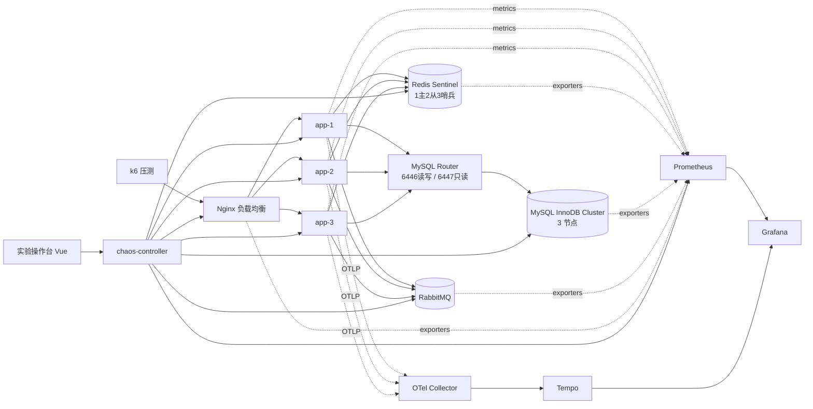

# 本地高可用 / 高并发演示实验室 · 整体设计

- 版本：v1.0
- 日期：2026-10-26
- 状态：待评审
- 环境：Windows 10 + Docker Desktop（WSL2），16 核 / 16GB 可用
- 关联文档：[数据库高可用方案对比](数据库高可用方案对比.md)
- 工程规约：[工程规约](../工程规约.md)
- 阶段交接：[阶段交接-2026-10-26](../../process/STAGE-01阶段交接-2026-10-26.md)

---

## 1. 项目定性

**这是一个"演示实验室"，不是一套要写好的秒杀系统。** 秒杀业务只是产生指标的道具，真正的主角是下面这条演示链：

> **① 制造缺陷/故障 → ② 观察症状 → ③ 执行处理 → ④ 对比处理效果**

所有取舍以此为准。三个判断标准：

1. 一个主题能否在 2 分钟内演完？演不完就砍业务，不砍演示。
2. 能否在同一次运行中看到"裸奔态"与"保护态"的对比？
3. 能否随时暂停、查日志、恢复，然后重演？

### 1.1 交付物形态

- 可执行的代码与一键脚本
- Grafana 面板、Tempo 调用链、实时动画操作台
- 页面内的简短文字说明（现象 / 根因 / 处方 / 预期曲线）
- Mermaid 架构图、时序图、状态机图
- 过程文档与避坑记录

**不包含**：录屏、旁白、视频制作、历史回放。

### 1.2 明确减掉的工作

- 生产级鉴权、审计、多租户、复杂领域建模
- 业务代码的全量单元测试覆盖率
- 为追求极限 TPS 做的深度优化
- 安全加固（仅保留本地实验所需的最小边界）
- CI 流水线
- 消息队列、Nginx、MySQL Router 的自身高可用

---

## 2. 目标与非目标

### 2.1 目标

1. 在本机模拟负载均衡、故障转移、限流熔断、缓存问题、分布式锁、消息削峰、Redis/MySQL 故障切换等场景。
2. 用 Prometheus + Grafana 实时观测 Spring 程序的线程、内存、网络、接口调用次数与耗时。
3. 用 k6 实现可重复的自动化压测，自动判定、归档、对比，并能在压测中注入故障。
4. 提供线程实验室、双 JDK 对比、JVM 参数调优台，用于讲解 JVM 与排查方法。
5. 所有实验都能从实验操作台驱动，支持暂停、查日志、可配置还原。

### 2.2 非目标

- 不是生产可用的秒杀架构，不承诺安全性、数据一致性等级或 SLA。
- 不做视频录制与自动播放讲解。
- 不实现 CI、集群自身的 HA（Nginx/RabbitMQ/Router 均为单点，见 8.6）。
- 不实现服务拆分；只保留可拆分边界。

---

## 3. 总体架构



### 3.1 组件与资源预算

| 组件 | 数量 | 说明 | 内存上限 |
|---|---|---|---|
| Spring 应用实例 | 3 | 同一镜像，Nginx 后负载均衡 | 3 × 768MB |
| Nginx | 1 | 负载均衡、被动健康检查、静态资源、反向代理 | 64MB |
| Redis Sentinel | 6 | 1 主 + 2 从 + 3 哨兵，每节点 1 个 exporter | ≈ 800MB |
| MySQL InnoDB Cluster | 3 + 1 | 3 个 MySQL 节点 + MySQL Router；每节点 exporter | ≈ 2.1GB（实测 1.87GB，2026-10-27 首跑验收） |
| RabbitMQ | 1 | 单节点 + 管理插件 + Prometheus 插件 | 384MB |
| 观测栈组件 | 各 1 | Prometheus / Grafana / Tempo / OTel Collector / cAdvisor；另有 nginx、rabbitmq、mysqld、redis 各节点 exporter | ≈ 1.4GB |
| Toxiproxy | 1（`chaos-proxy` profile） | 置于应用与 Redis/MySQL 之间，注入延迟/断网 | 64MB |
| chaos-controller | 1 | 故障注入、实验向导、日志查看、集群状态探针 | 256MB |
| k6 | 1（按需启动） | 压测生成器 | 512MB |
| 实验操作台 | 静态站点 | 由 Nginx 托管，无独立容器 | — |

总计约 8–9GB，Docker 16GB 限额内。日常开发使用单机数据库 profile，可降到 4GB 左右。

Toxiproxy 默认不启用；启用 `chaos-proxy` profile 时，应用通过代理访问 Redis/MySQL，用于注入延迟和断网。代理开关需要重启应用，因此放在演示准备阶段完成，不影响故障切换类场景（那类场景直接操作目标节点）。

### 3.2 对宿主暴露的端口

| 端口 | 用途 |
|---|---|
| 8080 | Nginx 入口：业务 API + 实验操作台静态页 |
| 3000 | Grafana |
| 15672 | RabbitMQ 管理界面（教学用） |
| 9090（可选） | Prometheus（调试用，默认不暴露） |

其余组件仅在 Docker 内部网络可达，且宿主机端口绑定 `127.0.0.1`。

### 3.3 Compose profiles

| profile | 内容 | 用途 |
|---|---|---|
| `dev` | 单机 MySQL、单机 Redis、应用、观测栈 | 日常开发，启动快 |
| `ha` | Redis Sentinel + MySQL InnoDB Cluster | 高可用场景 |
| `chaos-proxy` | 叠加 Toxiproxy，应用经代理访问 Redis/MySQL | 网络延迟/断网实验 |
| 默认 | 全量（不含 Toxiproxy） | 演示与验收 |

应用通过环境变量切换数据源与 Redis 连接方式，镜像不变。

---

## 4. 目录结构

```
JAVA-LEARN/
├── code/
│   ├── pom.xml                            # parent，统一版本
│   ├── platform/
│   │   ├── platform-common/               # Result、异常、通用工具
│   │   └── platform-observability/        # 指标公共标签、traceId 日志、Actuator 配置
│   ├── services/
│   │   ├── seckill-core/                  # 领域与用例，编译锁定 --release 8
│   │   ├── seckill-lab/                   # 实验室能力库（缓存策略、故障线程、生命周期）
│   │   ├── seckill-app-jdk21/             # Boot 3.5.x + JDK 21 应用外壳
│   │   ├── seckill-app-jdk8/              # Boot 2.7.18 + JDK 8 应用外壳（仅实验）
│   │   └── chaos-controller/              # 故障编排、向导状态、日志代理、集群探针
│   └── lab/
│       ├── docker/
│       │   ├── compose.base.yml
│       │   ├── compose.dev.yml
│       │   ├── compose.ha.yml
│       │   ├── nginx/
│       │   ├── redis/
│       │   ├── mysql-cluster/
│       │   ├── prometheus/
│       │   ├── grafana/
│       │   ├── tempo/
│       │   └── otel-collector/
│       ├── scenarios/                     # 场景步骤 JSON（向导与 k6 共用）
│       ├── k6/
│       │   ├── lib/
│       │   ├── scenarios/
│       │   ├── chaos/
│       │   └── reports/
│       ├── scripts/                       # up / down / bench / compare / verify / reset
│       └── dashboard/                     # Vue 3 实验操作台
└── doc/
    ├── readme.md                          # 部署与使用教学
    ├── design/
    │   ├── 2026-10-26-ha-concurrency-lab-design.md
    │   ├── 数据库高可用方案对比.md
    │   └── diagrams/                      # Mermaid 源文件 + 导出 SVG
    ├── process/
    │   ├── benchmark/                     # 压测归档与对比结论
    │   ├── snapshots/                     # 线程/堆快照
    │   ├── demos/                         # 场景操作手册与实验记录（非录屏）
    │   └── milestones.md
    └── 避坑/
        ├── index.md
        └── <典型错误>.md
```

---

## 5. 业务与模块设计

### 5.1 最小业务面

只做三个接口 + 一个 mock 登录，够产生指标即可：

| 接口 | 说明 |
|---|---|
| `POST /api/login` | 发一个 token 存 Redis（带 TTL），不建用户域、不做权限 |
| `GET /api/products/{id}` | 商品详情：L1 → L2 → 布隆 → DB |
| `POST /api/seckill/orders` | 秒杀下单：校验 → 锁 → 扣库存 → 发 MQ → 立即返回受理 |
| `GET /api/orders/{id}` | 查询订单状态（轮询用） |

管理/实验接口统一挂在 `/lab/**`，见附录 A。

### 5.2 领域边界

- `catalog`：商品与详情缓存
- `inventory`：库存与预扣
- `order`：订单创建、幂等、状态机
- 每个域采用 `api / app / domain / infra` 四层；跨域只能依赖 `api` 接口
- 每域独立表前缀：`catalog_`、`inventory_`、`order_`；跨域只存 ID，不做 JPA 关联
- 跨域状态变更通过领域事件（RabbitMQ）：`OrderCreated`、`StockReserved`
- 共享层 `seckill-core` 锁定 Java 8 语法（`--release 8`），保证 JDK 8 外壳可复用

### 5.3 拆分预留点

| 预留点 | 落地方式 |
|---|---|
| 模块边界 | 只暴露 `api` 包；域内实现禁止被其他域引用 |
| 数据边界 | 独立表前缀与 Repository；无跨域 JOIN |
| 同步契约 | 接口粒度设计为"一次调用一个语义动作"，可替换为 HTTP 客户端 |
| 异步契约 | 领域事件走 MQ，拆分后天然跨进程 |
| 配置外置 | 所有依赖地址走环境变量；`dev` / `ha` / `lab` 配置分离 |
| 观测统一 | `service.name`、`app`、`env`、`instance` 公共标签由 starter 注入 |

---

## 6. 缺陷展品：裸奔态与保护态

故意写坏的实现是展品，必须隔离在明确的 naive 路径，代码注释与页面说明都要标明"演示用途"。

| 场景 | 裸奔态 | 保护态 | 切换方式 |
|---|---|---|---|
| 负载均衡 | Nginx 不重试、无被动健康检查 | `max_fails` + `proxy_next_upstream` | 改配置并 reload |
| 限流/熔断 | 全放行 | Resilience4j 限流 + 熔断 + 降级 | 运行时可切 |
| 秒杀一致性 | 无锁、无幂等 | Redisson 锁 + 幂等键 | 运行时可切 |
| MQ 削峰 | 同步写库 | 异步受理 + 消费者限速 | 运行时可切 |
| 缓存穿透 | 无防护 | 空值缓存 / 布隆过滤器 | 运行时可切 |
| 缓存击穿 | 无防护 | 互斥重建 / 逻辑过期 | 运行时可切 |
| 缓存雪崩 | 固定 TTL | TTL 抖动 / L1 兜底 / 熔断降级 | 运行时可切 |
| Caffeine 预热 | 冷启动 | 热点预热 + 异步刷新 | 重启参数 |
| Redis 高可用 | 单点直连（dev） | Sentinel | Compose profile |
| MySQL 高可用 | 单机（dev） | InnoDB Cluster + Router | Compose profile |
| 线程 | 正常线程 | 故障线程 + 排查演示 | 运行时可切 |
| JVM | 基线参数 | 调优参数 | 重建容器 |

安全约定：

- 每项故障带 TTL（默认 120s），也支持 `manual hold` 一直保持
- 暂停时 TTL 倒计时冻结；全局"全部停止"始终可用
- `oom` 只允许打到指定的小堆实例（`-Xmx128m`），且恢复策略已知
- 所有实验动作只允许作用于带 `lab=java-learn` 标签的容器

---

## 7. 观测体系

### 7.1 数据链路

- **指标**：Actuator + Micrometer，Prometheus 每 5s 抓取，保留 7 天
- **链路**：两个 JDK 外壳统一挂 **OTel Java Agent**（均支持 Java 8+），经 OTel Collector 送 Tempo，保留 3 天
- **日志**：JSON 输出，带 traceId/spanId；不引入 Loki，用操作台日志面板 + `docker logs`
- **容器资源**：cAdvisor；WSL2 下网络指标可能不可靠，作为可降级项
- **业务与实验室指标**：自定义 Micrometer 计数器/仪表

### 7.2 指标约束

- `http.server.requests` 必须按 URI 模板打标签（`/api/orders/{id}`），禁止原始路径
- 禁止把 userId、traceId、订单号放进指标标签
- 开启直方图：`management.metrics.distribution.percentiles-histogram.http.server.requests=true`，桶边界 50ms–2s
- 公共标签：`app`、`env`、`instance`、`jvm.version`

### 7.3 关键指标

| 类别 | 指标 |
|---|---|
| 接口 | `http_server_requests_seconds_{count,sum,bucket}`、按状态码错误率、P95/P99 |
| 线程 | `jvm_threads_live_threads`、`jvm_threads_states_threads`、`tomcat_threads_busy_threads`、自定义线程池 active/queue |
| 内存 | `jvm_memory_used_bytes`、`jvm_gc_pause_seconds_{count,sum}`、`jvm_buffer_memory_used_bytes`、容器 RSS |
| 网络 | `tomcat_connections_current`、Nginx 连接/上游耗时、cAdvisor 收发字节、`http.client.requests` |
| 连接池 | `hikaricp_connections_{active,idle,pending,max}` |
| 熔断限流 | `resilience4j_circuitbreaker_state`、`resilience4j_ratelimiter_available_permissions`、`resilience4j_bulkhead_available_concurrent_calls` |
| 业务 | `orders_created_total`、`seckill_attempts_total{result}`、`stock_oversold_total`、`idempotent_reject_total`、`order_accept_seconds` |
| 缓存 | Spring `cache_gets_total{cache,result}`；自定义 `cache_db_fallbacks_total{reason}`、`bloom_rejected_total`、`rebuild_lock_seconds`、`cache_l1_hit_ratio`、`cache_warmup_keys_total`、`cache_warmup_duration_seconds`、`hotkey_topn_size` |
| MQ | `rabbitmq_queue_messages_ready`、`rabbitmq_queue_messages_unacked`、发布/消费速率 |
| Redis | `redis_up`、连接数、内存、命令速率、角色与复制状态（chaos-controller 探针） |
| MySQL | `mysql_up`、QPS、连接数；自定义 `mysql_cluster_member_state{node}`、`mysql_cluster_primary_info{node}` |
| k6 | `k6_http_reqs_total`、`k6_http_req_duration`（P95/P99）、`k6_vus`、自定义指标，统一带 `run_id` |
| 实验室 | `chaos_actions_total{action,target}`、`chaos_active{action}`、`lab_paused`、`thread_lab_fault_active{mode}`、`thread_lab_lifecycle_state_code`、`thread_lab_snapshot_total` |

### 7.4 面板清单

| 面板 | 内容 |
|---|---|
| D1 应用总览 | 三实例 RED 指标、`up` 状态、故障/恢复标注 |
| D2 JVM 与线程 | 线程状态趋势、线程生命周期时间轴、Tomcat 池、Hikari、GC、堆分区、JVM 版本与启动参数 |
| D3 资源与网络 | 容器 CPU/内存/网络、Nginx 连接与上游耗时、Redis 主从角色、连接数 |
| D4 业务与高可用 | 下单量、失败原因、超卖校验、锁等待、MQ 堆积与消费、熔断器状态、限流拒绝 |
| D5 链路 | Tempo service graph、慢 trace 查询；指标 exemplar 若可用则配置，不作验收项 |
| D6 线程实验室 | 七种故障的指标指纹、生命周期状态、快照事件标注 |
| D7 JDK 对比 | JDK 8 vs 21：吞吐、P99、GC、堆、线程、启动耗时 |
| D8 调优实验 | 调优前后指标对比与参数历史 |
| D9 压测 | k6 VUs/RPS/错误率/P95/P99 与应用指标叠加、`run_id` 切换、故障标注、运行 manifest |
| D10 缓存实验室 | L1/L2 命中率、DB QPS、布隆拦截、锁等待、预热、当前策略与切换标注 |
| D11 数据库高可用 | 集群成员状态、主节点、读写分流、Router 状态、切换标注 |

---

## 8. 高可用设计

### 8.1 应用层与负载均衡

- 三个应用实例同镜像、同配置，Nginx upstream 轮询
- 被动健康检查：`max_fails=2 fail_timeout=5s`
- `proxy_next_upstream error timeout http_502 http_503`，重试其他实例
- 容器 `restart: unless-stopped`；应用就绪探针接 Actuator health
- 假死演示：`SIGSTOP` 冻结进程，不报错但健康检查失败，Nginx 切流；恢复用 `SIGCONT`

### 8.2 Redis Sentinel

- 1 主 + 2 从 + 3 哨兵（quorum=2），哨兵名 `mymaster`
- 应用通过 Sentinel 发现主节点，不在配置中写死地址；Redisson 使用 `sentinelServersConfig`
- 每个节点独立 `redis_exporter`
- 切换演示：杀主 → 哨兵判定下线 → 晋升从节点 → 客户端重连
- 教学点：复制是异步的，切换可能丢最近写入；演示数据可接受，真实业务需评估
- dev profile 使用单机 Redis，配置通过环境变量切换

### 8.3 MySQL InnoDB Cluster

- 3 节点 Group Replication（单主模式）+ MySQL Router
- 应用连接 Router：6446 读写、6447 只读
- 读写分离：`ReadWriteRoutingDataSource` + `LazyConnectionDataSourceProxy`，按 `@Transactional(readOnly=true)` 路由；必须用 Lazy 代理，否则连接先于事务标记获取，这是常见坑
- 集群状态：chaos-controller 每 10s 通过 mysql-shell 查询，暴露 `mysql_cluster_member_state`、`mysql_cluster_primary_info`
- 切换演示：杀主 → 组复制选新主 → Router 重定向 → 应用重试恢复
- 初始化风险高，保留"主从 + ProxySQL"备选方案，见[数据库高可用方案对比](数据库高可用方案对比.md)
- dev profile 使用单机 MySQL

### 8.4 缓存防护与 Caffeine 预热

**读路径**：L1 Caffeine → L2 Redis → 布隆过滤器 → DB。

| 问题 | 策略（运行时可切） | 代价 / 注意 |
|---|---|---|
| 穿透 | `null-cache`（空值 + 短 TTL + 抖动）；`bloom`（Redisson 布隆过滤器） | 布隆有假阳性；空值缓存污染需短 TTL |
| 击穿 | `mutex`（Redisson 锁 + 双重检查）；`logical-expire`（旧值兜底 + 异步刷新） | mutex 增加 P99；逻辑过期短暂不新鲜 |
| 雪崩 | `ttl-jitter`（±20%）；`l1-cache`；熔断降级到 DB + 限流 | 多实例 L1 不一致窗口 ≈ 刷新间隔（10s），最长不超过 L1 TTL（60s） |

**Caffeine 预热**（Caffeine 无内置智能预热，以下为自建机制）：

- 热点探测：每实例本地计数器（用 Caffeine 限容 10 万条），30s 衰减，Top-200 写入 Redis ZSet `hot:products`，跨实例共享
- 启动预热：读取 Top-N（默认 200，可配置）批量加载 L1，限速执行
- 周期再预热：每 5 分钟增量预热
- 运行时：`refreshAfterWrite(10s)` 异步从 Redis 刷新；`expireAfterWrite(60s)` 兜底
- 淘汰：W-TinyLFU 自适应准入，`maximumSize` 默认 1 万
- 指标：命中率、预热条数/耗时、热点榜大小
- 教学边界："智能"= 数据驱动 + 自适应淘汰 + 自动刷新，不做预测模型

实验数据由 `/lab/cache/seed` 生成：1000 个商品、200 个同 TTL 雪崩 Key、1 个热点 Key。

### 8.5 MQ 削峰

- 下单受理后发送 `OrderCreated`，立即返回 `202`；消费者按固定速率落库
- 裸奔态：同步写库，直接暴露 DB 瓶颈
- 教学点：队列堆积不是故障，是缓冲；关注受理延迟、堆积深度、排空时间
- RabbitMQ 为单节点，范围外见 8.6

### 8.6 失败域与明确的范围外

| 组件 | 单点？ | 说明 |
|---|---|---|
| Nginx | 是 | 本地实验接受；生产中需 Keepalived/VIP 或云端 LB |
| MySQL Router | 是 | 生产中可多实例 + 前置 LB |
| RabbitMQ | 是 | 生产中需 3 节点 + quorum queue |
| Grafana/Prometheus | 是 | 观测栈不参与业务链路 |

这些单点是有意为之，写入教学文档，避免"实验室看起来像生产"。

---

## 9. 线程实验室

### 9.1 故障线程

| 模式 | 机制 | 预期指标指纹 | 排查教学 |
|---|---|---|---|
| `deadlock` | 两线程反序抢锁 | `blocked` 陡增、Tomcat busy 上涨、P99 飙升 | thread dump 输出 `Found one Java-level deadlock` |
| `stuck` | 等待永不释放的 latch | `waiting` 陡增、请求超时 | 区分 waiting 与 blocked |
| `cpu-burn` | 自旋 60s | `process_cpu_usage` 拉满、`runnable` 上升 | `top -H` → 十六进制 nid → dump 定位 |
| `heap-leak` | 受控速率灌对象，封顶 80% 堆 | 堆阶梯上升、GC 次数与暂停上涨 | 堆直方图、GC 日志 |
| `oom` | 小堆 + 泄漏，`ExitOnOutOfMemoryError` | 堆断崖、进程退出、`up` 恢复、实例重启 | heap dump、容器重启与流量转移 |
| `thread-leak` | 无限建平台线程；21 可切虚拟线程对照 | 线程数持续上升；VT 版表现为堆增长 | 线程数与内存异常的区分 |
| `starvation` | 小线程池 + 阻塞任务 | active=max、队列涨、接口超时 | 线程池参数与排队论 |

### 9.2 单线程生命周期

- 受控线程依次经历 `NEW → RUNNABLE → BLOCKED → WAITING → TIMED_WAITING → TERMINATED`
- 接口支持 `start / step / freeze / resume / reset`
- `freeze` = 暂停状态推进 + 立即抓取快照，不冻结 JVM
- 暴露 `thread_lab_lifecycle_state_code`（0–5），Grafana 用 state timeline 展示
- 页面同步显示状态机动画和该线程栈
- 教学提示：JVM 的 RUNNABLE 包含运行中与就绪，OS 级 running 不可直接观测

### 9.3 快照与调试

- 快照内容：`jcmd Thread.print -l`、`GC.heap_info`、类直方图；JDK 8 用 `jstack` + `jmap`
- 存储：`doc/process/Stage1/snapshots/<时间戳>/`，附一份分析模板
- Grafana 打 annotation 标记快照时刻
- 故障清理：默认 TTL 120s；`manual hold` 保持；暂停时 TTL 冻结；全局 stop-all
- 虚拟线程相关实验仅存在于 JDK 21 外壳，不进入共享库

---

## 10. 双 JDK 与 JVM 调优台

### 10.1 模块与版本

| 模块 | 运行时 | 框架 | 说明 |
|---|---|---|---|
| `seckill-core` | 编译 `--release 8` | 无 Web 依赖 | 领域与用例，两外壳共用 |
| `seckill-lab` | 编译 `--release 8` | Spring 注解兼容 | 缓存策略、故障线程、生命周期 |
| `seckill-app-jdk21` | Temurin 21 | Spring Boot 3.5.x（实施时确认最新稳定版） | 全部场景，虚拟线程可开关 |
| `seckill-app-jdk8` | Temurin 8 | Spring Boot 2.7.18 | 除虚拟线程外的全部场景，仅实验用途 |
| `chaos-controller` | Temurin 21 | Spring Boot 3.5.x | 编排与探针 |

- 共享代码只能使用 Java 8 语法；JDK 21 特性只在外壳或运行时参数中体现
- 链路统一用 OTel Java Agent，避免框架版本差异污染调用图
- JDK 8 外壳标注 EOL，仅用于本机对比；不得用于真实项目

### 10.2 对比方法

- 相同 CPU/内存限额、相同 `-Xmx512m`、同一套依赖服务
- 同一 k6 场景分别运行，记录吞吐、P99、GC 暂停、堆、线程数、启动耗时、镜像大小
- 结果写入 `doc/process/Stage1/benchmark/jvm-comparison/` 与 D7 面板

### 10.3 JVM 调优台

- 页面：`/tuning`，由 chaos-controller 执行
- 预设：均衡默认、小堆 128m、大堆 1g、G1、ZGC（仅 21）、Parallel、CMS（仅 8，历史演示）、虚拟线程开/关（仅 21）、Tomcat 线程数、Hikari 池大小
- 自定义参数：白名单校验（`-Xms/-Xmx/-XX:Use*GC/-Xss/-XX:MaxMetaspaceSize` 等），拒绝任意命令；白名单按 JVM 版本区分，ZGC 与虚拟线程仅允许在 JDK 21 实例上使用
- 生效方式：JVM 参数只在启动时生效，调优台**重建目标容器**；Nginx 将流量转给其他实例，顺带演示一次故障转移
- 记录：参数、生效时间、2 分钟后指标快照、Grafana annotation；写入 `doc/process/Stage1/benchmark/jvm-tuning/`
- 还原：一键恢复基线，避免环境被调坏
- 安全：仅内部网络可达，`X-Lab-Token` 鉴权，白名单参数，单次只重建一个实例

---

## 11. 压测与故障注入

### 11.1 k6 场景

| 脚本 | 内容 | 判定 |
|---|---|---|
| `smoke.js` | 1 VU × 30s | 错误率 < 1%，checks 全通过 |
| `load.js` | 50→200 VU，稳态 10min | 错误率 < 1%，P95 < 300ms，P99 < 800ms |
| `stress.js` | 阶梯 50→500 VU | 记录拐点（P95 > 1s 或错误 > 5%） |
| `spike.js` | 50→800 VU 突刺 60s | 回落后 30s 内 P95 恢复；429 视为预期拒绝 |
| `soak.js` | 100 VU × 30min | 错误率 < 1%，堆与线程无持续上升趋势 |
| `cache-penetration.js` | 70% 无效 SKU，中途切换防护 | 保护态 DB 回落占比 < 5% |
| `cache-breakdown.js` | 热点 Key TTL 5s，依次切三种模式 | 单次过期重建 ≤ 2 次 |
| `cache-avalanche.js` | 200 Key 同 TTL，中途开抖动/L1 | 峰值 DB QPS 比裸奔降 > 80% |
| `redis-failover.js` | 基线流量，杀 Redis 主 | 错误窗口 < 15s，错误率 < 1% |
| `db-failover.js` | 基线 200 VU，杀 MySQL 主 | 错误窗口 < 15s，错误率 < 1% |
| `caffeine-warmup.js` | 压测中重启实例 | 预热实例 10s 内 L1 命中率 ≥ 80% |

soak 的堆与线程趋势由压测后脚本查询 Prometheus 判定，不依赖 k6 自身。

k6 通过 remote-write 写入 Prometheus：
`-o experimental-prometheus-rw`，`K6_PROMETHEUS_RW_SERVER_URL=http://prometheus:9090/api/v1/write`，Prometheus 开启 `--web.enable-remote-write-receiver`，趋势指标输出 `p(95),p(99),max`。所有指标带 `run_id`。

429 处理：使用 `http.expectedStatuses(200, 429)`，另设自定义 Rate 指标断言 429 比例落在预期区间。

### 11.2 场景步骤与时间线

同一份场景步骤 JSON 被两个驱动共用：

- **批量压测**：k6 内部专用 scenario 按时间点调用 chaos-controller
- **交互演示**：实验操作台按步骤执行，支持暂停/继续

```json
{
  "id": "ha-app-failover",
  "events": [
    {"at": "120s", "action": "kill", "target": "app-1"},
    {"at": "180s", "action": "freeze", "target": "app-2"},
    {"at": "240s", "action": "resume", "target": "app-2"}
  ]
}
```

每个动作自动写 Grafana annotation；批量模式在 `teardown()` 清理，交互模式按配置清理。

### 11.3 chaos-controller 能力

| 能力 | 说明 |
|---|---|
| 容器 | kill / start / restart / SIGSTOP / SIGCONT |
| Toxiproxy | 延迟、带宽、断网、恢复（作用于 Redis/MySQL 链路） |
| Nginx | 切换 naive/guarded 配置并 reload |
| 应用实验室 | 代理到目标实例：故障线程、生命周期、缓存策略、快照、toggles |
| 数据重置 | 库存、订单、队列、Redis Key、策略状态 |
| 日志 | 只读 `docker logs --tail N`，容器白名单 |
| 背景流量 | 启动/停止固定速率 k6，用于交互演示 |
| 全局急停 | 停止全部故障线程、恢复 Toxiproxy、继续被冻结的进程 |
| 探针 | MySQL 集群状态、Redis 主从角色，10s 周期 |
| 向导状态 | 当前步骤、运行/暂停、TTL 冻结、环境脏状态 |

所有动作仅限 `lab=java-learn` 标签的容器，需 `X-Lab-Token`。

### 11.4 压测报告与对比

- 每次运行归档到 `code/lab/k6/reports/<run_id>/`：`report.html`、`summary.json`、`manifest.json`、`chaos.log`
- 结论文档写入 `doc/process/Stage1/benchmark/<日期>-<场景>-<run_id>.md`，含 Grafana 时间范围深链
- `manifest.json`：镜像标签、JVM 参数、场景步骤、预热时长、开始/结束时间
- `compare.sh A B`：RPS、P95、P99、错误率、429 率、峰值堆、GC 暂停、线程峰值、判定结果及涨跌幅
- 压测前自动复位数据（批量模式）；压测后按 `LAB_RESET_MODE` 决定是否自动还原

### 11.5 图表清单

| 图 | 类型 | 用途 |
|---|---|---|
| 总体架构 | 拓扑图 | 组件与数据流 |
| 请求全链路 | 流程图 | 一次秒杀请求经过的每一层 |
| 部署拓扑 | 拓扑图 | 容器、网络、端口 |
| 负载均衡与故障转移 | 时序图 | kill / SIGSTOP / 恢复 |
| 限流与熔断 | 状态机图 | CLOSED / OPEN / HALF_OPEN |
| 缓存读路径 | 流程图 | L1 → L2 → 布隆 → DB |
| 击穿互斥重建 | 时序图 | 锁、双重检查、单次重建 |
| 雪崩 TTL 抖动 | 时间线图 | 固定 TTL 与抖动后的过期分布 |
| Redis Sentinel 选主 | 时序图 | 下线判定、晋升、客户端重连 |
| MySQL 组复制选主 | 时序图 | 成员状态与 Router 切换 |
| 读写分离路由 | 流程图 | readOnly 事务 → 6447，其余 → 6446 |
| MQ 削峰 | 时间线图 | 突刺流量、队列深度、消费速率 |
| 线程状态机 | 状态机图 | 单线程生命周期演示 |
| Caffeine 预热 | 流程图 | 热点统计、预热、刷新、淘汰 |
| JVM 调优流程 | 流程图 | 选预设、重建容器、记录对比 |

源文件放 `doc/design/diagrams/*.mmd`，导出 SVG 到 `doc/design/diagrams/export/`，在对应实验文档中引用；Tempo 的服务拓扑图由数据自动生成，不在此清单内。

---

## 12. 实验操作台

Vue 3 + Vite + SVG，构建产物由 Nginx 托管；通过 Nginx 反向代理访问 `/api/`（chaos-controller）与 `/prom/`（Prometheus），避免 CORS。

### 12.1 页面

| 路由 | 内容 |
|---|---|
| `/` | 拓扑视图：请求粒子按真实 RPS 流动，失败变红，节点健康状态着色 |
| `/scenario/:id` | 实验向导：分步执行、暂停/继续、跳过；同屏显示文字说明与目标指标 |
| `/thread` | 线程生命周期：状态机动画、单步、冻结、快照、栈展示 |
| `/cache` | 缓存视图：三层缓存粒子流向、DB QPS、策略切换 |
| `/tuning` | JVM 调优台 |
| `/jdk` | JDK 8/21 对比 |
| `/bench` | 压测历史、结果对比表、可复制的运行命令；不提供全量压测编排 |

### 12.2 交互约定

- **页面内文字说明**：每步展示"现象 / 根因 / 处方 / 预期指标"，不依赖旁白
- **背景流量**：页面可启动/停止固定速率（默认 50 VU）的 k6 流量，用于交互演示；正式压测与判定仍走 `bench.sh`，两者共用同一套接口与场景数据
- **暂停语义**：暂停后时间线停住、故障 TTL 冻结、故障保持；可查日志、看 trace；继续后从当前步恢复
- **日志面板**：容器白名单、可调行数、手动/自动刷新；另给 Grafana Explore 与 Tempo 深链
- **环境状态栏**：常驻显示"干净 / 有故障 / 数据已修改 / 已暂停"，一键重置与"全部停止"
- **还原模式**：`LAB_RESET_MODE=manual`（默认）/ `auto`；批量压测由脚本传 `auto`
- **故障清理**：`LAB_FAULT_CLEANUP=ttl`（默认）/ `manual`；暂停时冻结 TTL
- 提供全屏布局，便于投屏讲解；不做录屏与回放

### 12.3 实时性

- 每 2 秒轮询 Prometheus；前端插值让粒子动画顺滑
- 拓扑与实例卡片的数据来源都是真实指标，不造数据
- 策略切换、故障注入均通过 chaos-controller，不直接操作容器

---

## 13. 运行方式与配置

### 13.1 脚本

| 脚本 | 用途 |
|---|---|
| `up.sh [--profile dev\|ha\|full]` | 启动基础设施、等待健康、启动应用、打印入口 |
| `down.sh [--keep-data]` | 停止并清理（默认保留命名卷） |
| `bench.sh <scenario> [--chaos <timeline>] [--jvm jdk8\|jdk21] [--tuning <preset>] [--reset auto\|manual]` | 一键压测、判定、归档 |
| `compare.sh <runA> <runB>` | 对比两次运行 |
| `verify.sh [scenario]` | 基础设施与指标自检 |
| `reset.sh` | 手动还原数据与故障 |

### 13.2 关键环境变量

| 变量 | 默认 | 说明 |
|---|---|---|
| `LAB_RESET_MODE` | `manual` | 实验结束是否自动还原 |
| `LAB_FAULT_CLEANUP` | `ttl` | 故障清理方式 |
| `LAB_FAULT_TTL` | `120s` | 故障存活时间 |
| `LAB_TOKEN` | 启动时生成 | 实验接口鉴权 |
| `LAB_PROFILE` | `ha` | `dev` / `ha` |
| `APP_INSTANCES` | `3` | 实例数 |

### 13.3 启动顺序

1. 基础设施（Redis、MySQL、RabbitMQ、观测栈）
2. 等待 Redis Sentinel / MySQL Cluster 就绪
3. 启动应用实例并等待健康
4. 启动 Nginx
5. 启动 chaos-controller 与实验操作台

### 13.4 Windows 注意事项

- 数据卷使用命名卷，避免 Windows 绑定挂载的权限与性能问题
- Git Bash 下脚本统一 LF；涉及 Docker 路径转换时加 `MSYS_NO_PATHCONV=1`
- Docker Desktop 需分配至少 12GB 内存
- cAdvisor 在 WSL2 下网络指标可能不完整，面板降级为应用层指标

---

## 14. 测试策略

| 层级 | 内容 | 工具 |
|---|---|---|
| 单元测试 | 库存扣减、幂等、读写路由判断、热点 Top-N、参数白名单、故障 TTL | JUnit 5 + Mockito |
| 集成测试 | Repository、缓存、MQ、分布式锁 | Testcontainers |
| 场景验收 | k6 thresholds + 压测后 Prometheus 断言 | k6 + 校验脚本 |
| 元测试 | 故意触发阈值失败，确认 `bench.sh` 返回非 0 且报告完整 | 负向用例 |
| UI 冒烟 | 操作台页面加载、指标绑定、暂停/冻结/日志/重置 | Playwright |
| 基础设施自检 | 容器健康、集群成员、数据源可用 | compose healthcheck + `verify.sh` |

Sentinel 与 InnoDB Cluster 不做 Testcontainers 集成测试（启动成本高、稳定性差），由场景验收覆盖；Testcontainers 只覆盖单机 Redis/MySQL/RabbitMQ 的业务集成。

防抖动约定：镜像版本固定、资源限额固定、运行前复位数据、随机故障固定种子、阈值留余量、manifest 记录全部变量。无 CI，验收在本机执行。

---

## 15. 验收矩阵

| # | 场景 | 触发 | 通过标准 | 证据 |
|---|---|---|---|---|
| 1 | 负载均衡 + 故障转移 | kill / SIGSTOP / 重启 | 错误率 < 1%，恢复 < 15s | D1、D3、trace |
| 2 | 限流 / 熔断 / 降级 | spike | 429 比例符合预期，熔断状态可见，放行请求 P95 稳定 | D4 |
| 3 | 分布式锁防超卖 | 800 VU 秒杀 | 超卖 = 0，重复下单 = 0 | D4 + DB 校验 |
| 4 | MQ 削峰 | 50→800 VU 突刺 | 受理 P95 < 100ms，2 分钟内排空 | D4 |
| 5 | 缓存穿透 | 70% 无效 SKU | 保护态 DB 回落 < 5% | D10 |
| 6 | 缓存击穿 | 热点 Key TTL 5s | 单次过期重建 ≤ 2 | D10 |
| 7 | 缓存雪崩 | 200 Key 同 TTL | 峰值 DB QPS 降 > 80% | D10 |
| 8 | Redis 切换 | 杀主 | 错误窗口 < 15s，错误率 < 1% | D3、D10 |
| 9 | MySQL 切换 | 杀主 | 错误窗口 < 15s，错误率 < 1% | D11 |
| 10 | Caffeine 预热 | 压测中重启实例 | 10s 内 L1 命中率 ≥ 80% | D10 |
| 11 | 线程实验室 | 七种故障 + 生命周期 | 指标指纹符合预期，快照落盘，单步/冻结可用 | D6 + 快照 |
| 12 | JDK 对比 / 调优台 | 同一场景分别运行 | 产出对比表，变量唯一 | D7、D8 |
| 13 | 实验向导控制 | 页面操作 | 可暂停查日志、继续、手动/自动还原均可用 | 操作台 |

性能数字只作为"处理前后"的证据，不作为追求目标。

---

## 16. 里程碑

| 阶段 | 内容 | 完成标志 |
|---|---|---|
| **M0 地基** | 仓库骨架、parent pom、compose（dev）、Nginx、观测栈、启停脚本 | `up.sh` 一键起，D1–D3 有数据，`down.sh` 干净退出 |
| **M1 业务主线** | 三域、L1/L2 缓存、锁、MQ、限流熔断、toggles；共享层锁 Java 8；单测 + Testcontainers + smoke | smoke 全绿，D1–D4 有业务数据 |
| **M2 压测与向导** | k6 场景、bench/compare、报告归档、chaos-controller、场景 JSON、操作台 MVP（向导/暂停/日志/重置）、D9 | 一条命令出报告与判定；页面可暂停查日志；负向用例按预期失败 |
| **M3 高可用** | 应用故障转移、Redis Sentinel、MySQL 集群、D11、切换场景 | 场景 1、8、9 通过 |
| **M4 缓存实验室** | 三问题策略、Caffeine 预热、D10、缓存场景 | 场景 5、6、7、10 通过 |
| **M5 实验室进阶** | 线程实验室、生命周期页、快照、JDK 8 外壳、调优台、D6–D8 | 场景 11、12 通过 |
| **M6 可视化收尾** | 拓扑动画、全部 Mermaid 图、readme、避坑目录、最终验收 | 场景 1–13 可从操作台走通，暂停/日志/还原均验证 |

M0–M2 为主线；M3、M4 可并行；M5、M6 依赖前序完成。

---

## 17. 风险与对策

| 风险 | 对策 |
|---|---|
| InnoDB Cluster 在 Docker Desktop 初始化不稳 | 初始化脚本 + 重试 + 健康检查；保留主从 + ProxySQL 备选方案与迁移说明 |
| 16GB 内存吃紧 | profile 裁剪、容器限额；日常用 dev |
| cAdvisor 在 WSL2 网络指标不完整 | 降级为 Nginx + 应用层指标，面板注明 |
| 切换窗口受宿主负载影响 | 阈值留余量，报告记录实际值 |
| 端口冲突 | 仅暴露 8080/3000/15672，均绑定本机 |
| 实验动作误伤非实验容器 | 标签白名单 + 容器名校验 + token |
| 范围膨胀 | 以"2 分钟能演完"为准；按里程碑验收 |
| Windows 路径与换行问题 | 命名卷、LF、`MSYS_NO_PATHCONV`、readme 说明 |

---

## 18. 范围外与后续扩展

- 服务拆分（订单域独立部署、API 网关、注册中心）
- RabbitMQ 3 节点 + quorum queue；Nginx Keepalived/VIP；Router 多实例
- L2 缓存多实例一致性（失效广播、Canal 订阅）
- Redis Cluster 分片（在 Sentinel 版本稳定后可作为进阶 profile）
- 更细的 JVM 实验（JFR 全量录制、async-profiler 火焰图）
- CI 与自动化回归（用户明确不要）

---

## 附录 A：实验接口

应用侧（仅 `lab` profile、内部网络、`X-Lab-Token`）：

| 方法 | 路径 | 说明 |
|---|---|---|
| GET/POST | `/lab/cache/{mode,seed,reset,state}` | 缓存策略与数据 |
| POST | `/lab/thread/fault` | 注入故障线程 |
| POST | `/lab/thread/stop-all` | 停止全部故障线程 |
| POST/GET | `/lab/thread/lifecycle/{start,step,freeze,resume,reset,state}` | 生命周期演示 |
| POST | `/lab/snapshot` | 抓取线程/堆快照 |
| GET/POST | `/lab/toggles` | 运行时开关（锁、幂等、MQ、限流、熔断） |
| GET | `/lab/config` | 当前实验配置与 JVM 信息 |

chaos-controller：

| 方法 | 路径 | 说明 |
|---|---|---|
| POST | `/chaos/instances/{name}/{kill,start,restart,stop-signal,resume-signal}` | 容器动作 |
| POST | `/chaos/toxiproxy/{latency,bandwidth,down,reset}` | 网络故障 |
| POST | `/chaos/nginx/{naive,guarded}` | 切换 Nginx 配置 |
| POST | `/chaos/{mysql,redis}/{kill-primary,status}` | 集群动作与状态 |
| POST | `/lab/guide/{start,step,pause,resume,reset}` | 向导状态 |
| POST | `/lab/traffic/{start,stop}` | 交互演示用的背景流量 |
| POST | `/lab/stop-all` | 全局急停 |
| POST | `/lab/reset` | 全量还原 |
| GET | `/logs/{container}?tail=200` | 只读日志 |
| GET | `/metrics` | 集群角色与实验室指标 |

## 附录 B：实验清单

| ID | 主题 |
|---|---|
| `ha-app-failover` | 负载均衡与实例故障转移 |
| `ha-process-freeze` | SIGSTOP 进程假死 |
| `rate-limit-circuit` | 限流、熔断、降级 |
| `seckill-oversell` | 无锁超卖 → 分布式锁 + 幂等 |
| `mq-peak-shaving` | 同步写库 → MQ 削峰 |
| `cache-penetration` | 缓存穿透 |
| `cache-breakdown` | 缓存击穿 |
| `cache-avalanche` | 缓存雪崩 |
| `redis-failover` | Redis Sentinel 切换 |
| `db-failover` | MySQL InnoDB Cluster 切换 |
| `caffeine-warmup` | 本地缓存预热 |
| `thread-faults` | 七种故障线程与排查 |
| `thread-lifecycle` | 单线程生命周期 |
| `jdk-compare` | JDK 8 vs 21 |
| `jvm-tuning` | 参数调优前后对比 |

## 附录 C：术语

| 术语 | 含义 |
|---|---|
| 裸奔态 | 故意不设防，用于暴露缺陷 |
| 保护态 | 启用对应治理手段的状态 |
| 实验向导 | 操作台上的分步执行器，可暂停 |
| 故障 TTL | 故障自动解除时间；可冻结或改为手动 |
| manifest | 一次压测的全部变量快照，用于可比性 |

---

## 评审记录

- 2026-10-26 初版：四段设计已逐段确认；确认"演示优先"定性；确认不录屏、不配旁白；确认还原可配置且默认手动。
