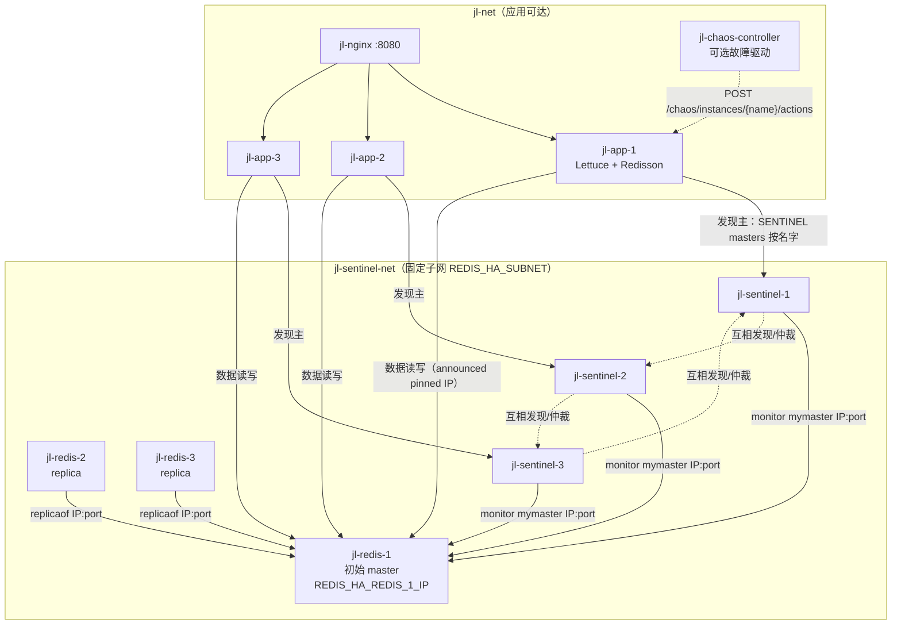
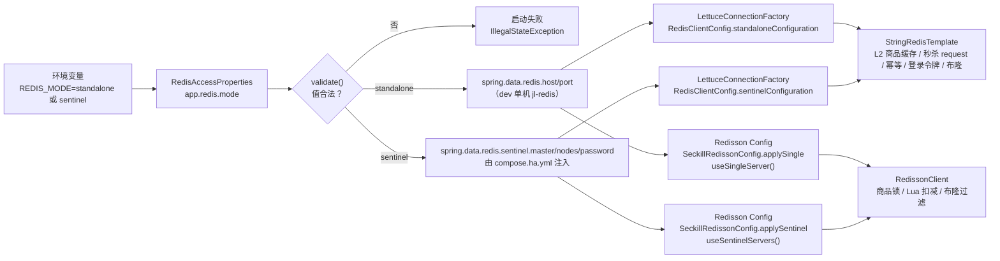
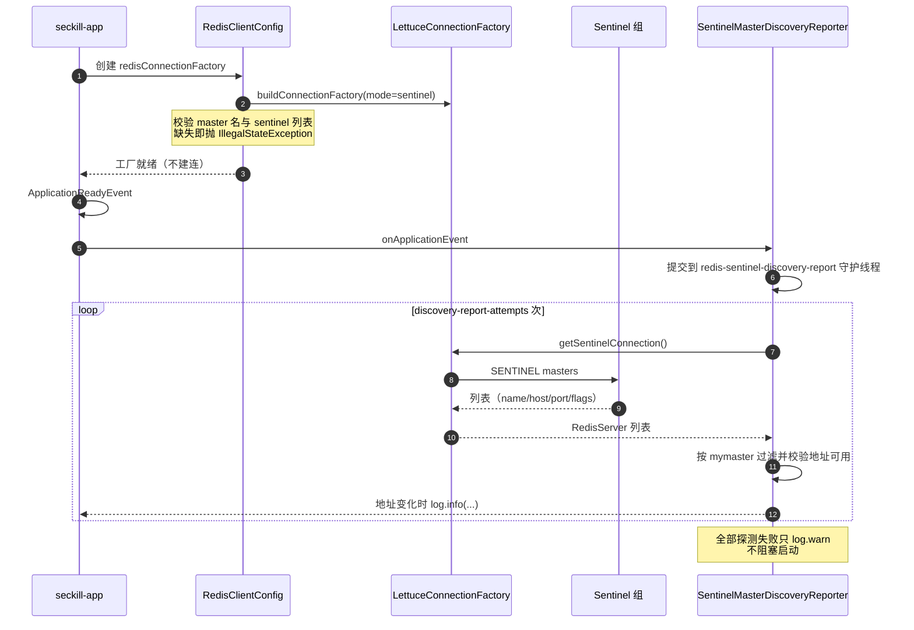
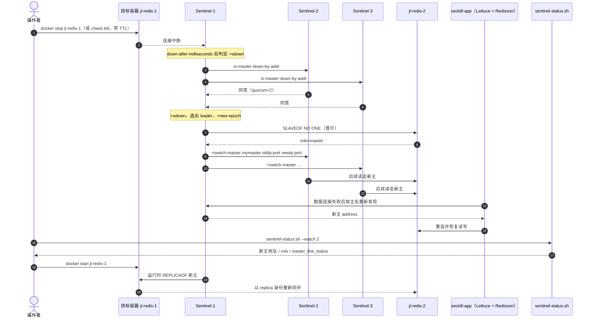

# 04 · Redis 高可用（Sentinel：1 主 + 2 从 + 3 哨兵）

> 一句话职责：让三个应用实例在 Redis 主节点被停掉后，不重启、不改地址地跟到哨兵新选出的主上，并把这条链路做成可观察、可回滚的 5 分钟演练。
>
> 代码基线：`294798a`

本文只描述已经合并进 `feature/ha-lab` 的实现。凡是尚未合并或尚未实测的内容，都集中在“已知缺陷/边界”，不写成既有能力。

---

## 1. 角色与组件

| 角色 | 实例/文件 | 职责 | 关键事实 |
|---|---|---|---|
| 数据节点 | `jl-redis-1` / `jl-redis-2` / `jl-redis-3` | 1 主 + 2 从，异步复制 | 每个节点在 `jl-sentinel-net` 上钉死 IP；初始主是 `redis-1`，从节点用 `--replicaof <master-ip>` 启动 |
| 哨兵 | `jl-sentinel-1` / `-2` / `-3` | 主观下线、仲裁、选主、发布 `+switch-master` | `quorum=2`，监控主名 `mymaster`；监控地址是数据节点的**固定 IP**，不是服务名 |
| 指标边车 | `jl-redis-1-exporter` … | 每个数据节点一个 `redis_exporter` | 只 `expose`，不发布宿主端口 |
| 应用客户端 | `seckill-app` × 3 | Lettuce（L2/令牌/秒杀存储）+ Redisson（锁/Lua/布隆） | 两条栈都由 `REDIS_MODE` 一个变量切换，主节点按**名字**发现 |
| 运维只读工具 | `code/lab/scripts/sentinel-status.sh` | 打印哨兵眼中的主地址、flags、副本/Sentinel 发现情况 | 严格只读：只跑 `INFO` 与只读 `SENTINEL` 子命令 |
| 编排入口 | `code/lab/docker/compose.ha.yml` + `up.sh --profile ha` | `ha` profile 叠加，不改 dev 的 16 个服务 | 所有服务都声明 `profiles: ["ha"]` |
| 故障驱动 | chaos-controller（可选） | 把“停主/恢复”做成带 TTL 的动作 | 数据存储目标默认全拒，必须显式配置 allow-list |

### 1.1 双网络与固定 IP

- 数据节点与哨兵同时加入 `jl-net` 和 `jl-sentinel-net`；`jl-sentinel-net` 的子网由 `REDIS_HA_SUBNET` 钉死，三主三哨各有一个固定 IP（`REDIS_HA_REDIS_*_IP` / `REDIS_HA_SENTINEL_*_IP`）。
- 哨兵监控与复制关系都指 IP：`docker stop` 会让容器名从 Docker 内嵌 DNS 消失，若哨兵开启了 `resolve-hostnames`，它会反复解析失败并进入 `#tilt`，拒绝晋升任何人。仓库里的注释把这条实测教训写死在模板与 entrypoint 里。
- 反之，哨兵把“主地址”回给客户端时返回的是数据节点通告的 pinned IP（`172.28.190.0/24`）。只挂 `jl-net` 的应用路由不到这个网段，所以 `ha` 渲染下 `app-1/2/3` 额外接入 `jl-sentinel-net`。这是唯一不重建整个 dev 栈的做法。



图注：实线是启动/运行期真实连接；点线是控制面。应用与数据节点之间走的是哨兵通告的 pinned IP，因此应用必须同时位于 `jl-sentinel-net`。

---

## 2. 应用侧模式开关（Lettuce 与 Redisson 必须同时切换）

`REDIS_MODE` 落到 `app.redis.mode`，由 `RedisAccessProperties#validate` 在启动期只接受 `standalone` / `sentinel` 两个值；其他值直接让上下文启动失败，避免出现“一半客户端连单机、一半连哨兵”的混淆状态。



两个客户端在 sentinel 模式下的失败策略一致：缺主名或缺哨兵列表就启动失败，绝不回退到 `spring.data.redis.host`。`application.yml` 刻意不声明带空默认值的 `sentinel.*` 键，因为 Boot 的 `RedisConnectionConfiguration` 只要看到这类键就会提前构造 `RedisSentinelConfiguration`，空主名会让**包括 dev 在内**的每次启动失败。

### 2.1 启动期主节点发现报告

`SentinelMasterDiscoveryReporter` 只在 sentinel 模式注册。它在 `ApplicationReadyEvent` 之后用一条守护线程发起 `SENTINEL masters` 探测，按配置的主名过滤，把解析到的 `host:port` 写进日志；探测窗口由 `app.redis.sentinel.discovery-report-attempts` 与 `...-interval-ms` 控制。启动不被阻塞，哨兵不可达时应用仍能起来并按 Task 14 契约降级。



日志证据行是 `Sentinel discovered master '<name>' at <host:port>`；另有一行启动日志 `Redis access mode: sentinel`，用来证明容器确实以哪个模式启动。

---

## 3. 故障切换时序

### 3.1 停主 → 仲裁 → 晋升 → 客户端重连



已记录的时间基线（来自步骤交接，不是本文新测）：

- 拓扑层：停主到新主地址发布 **5.78s**；旧主 `start` 后约 **15s** 复挂为从（step-24a）。
- 应用层：停主后首次失败到读恢复 200 约 **7.2s**，整体重挂约 **9.5s**；Redisson 重挂 +7.8s、Lettuce 重连 +11.6s（step-24b）。
- 同一演练窗口内有两个 L1-miss 请求在 3s 客户端上限内未返回（HTTP 000），说明默认 Lettuce 命令超时远大于请求预算，失败表现为“个别请求挂起后成功/降级”，不是快速失败。

### 3.2 旧主回归

`docker start` 只是让进程回来；Redis 不会自动重建复制链。哨兵发现被监控地址重新可用后，会对它下发运行时 `REPLICAOF`，旧主因此以 `role=slave`、`master_link_status=up` 回归。`sentinel-status.sh` 的数据节点段正是用这两个 `INFO` 字段证明回归。

### 3.3 与应用日志的对应

应用侧可读的证据是：

- 启动：`Redis access mode: sentinel`；
- 发现：`Sentinel discovered master 'mymaster' at <ip:port>`；
- 切换后：Lettuce/Redisson 打出的 master 变更日志（步骤交接建议以 `master … has been changed to …` 作为判据）。

---

## 4. 代码对照表

| 概念/行为 | 类/方法（或脚本函数、配置键） | 位置 | 说明 |
|---|---|---|---|
| 单一模式开关 | `REDIS_MODE` | `code/services/seckill-app-jdk21/src/main/resources/application.yml:67` | 映射到 `app.redis.mode`，默认 `standalone` |
| 模式合法性 | `RedisAccessProperties#validate` | `code/services/seckill-app-jdk21/src/main/java/com/javalearn/lab/seckill/redis/RedisAccessProperties.java:35` | 只接受两个枚举值，其他启动失败 |
| Sentinel 常量 | `MODE_SENTINEL` | `code/services/seckill-app-jdk21/src/main/java/com/javalearn/lab/seckill/redis/RedisAccessProperties.java:27` | 值为 `sentinel` |
| 启动日志证据 | `Redis access mode` | `code/services/seckill-app-jdk21/src/main/java/com/javalearn/lab/seckill/redis/RedisClientConfig.java:62` | 每实例一行，演练据此判断模式 |
| Lettuce 工厂 | `buildConnectionFactory` | `code/services/seckill-app-jdk21/src/main/java/com/javalearn/lab/seckill/redis/RedisClientConfig.java:95` | 按模式选择类型化构造器 |
| Lettuce 客户端参数 | `clientConfiguration` | `code/services/seckill-app-jdk21/src/main/java/com/javalearn/lab/seckill/redis/RedisClientConfig.java:122` | 只接管 `timeout` 与 `shutdown-timeout` |
| Sentinel 配置 | `sentinelConfiguration` | `code/services/seckill-app-jdk21/src/main/java/com/javalearn/lab/seckill/redis/RedisClientConfig.java:148` | 主名/节点/密码，缺失即抛错 |
| 命令超时接管 | `commandTimeout` | `code/services/seckill-app-jdk21/src/main/java/com/javalearn/lab/seckill/redis/RedisClientConfig.java:126` | 仅配置时生效，否则保持框架默认 |
| 连接超时未接管 | `connect-timeout` | `code/services/seckill-app-jdk21/src/main/java/com/javalearn/lab/seckill/redis/RedisClientConfig.java:118` | 已知边界：Boot 在共享 ClientResources 注入 |
| L1 缓存 TTL | `L1_EXPIRE_AFTER_WRITE` | `code/services/seckill-app-jdk21/src/main/java/com/javalearn/lab/seckill/catalog/cache/TwoLevelCache.java:40` | 60s Java 常量，会掩盖切换 |
| L2 缓存 TTL | `L2_TTL` | `code/services/seckill-app-jdk21/src/main/java/com/javalearn/lab/seckill/catalog/cache/TwoLevelCache.java:41` | 5min Java 常量 |
| 哨兵发现报告注册 | `app.redis.mode` | `code/services/seckill-app-jdk21/src/main/java/com/javalearn/lab/seckill/redis/RedisClientConfig.java:73` | `@ConditionalOnProperty` 只在 sentinel 生效 |
| 发现线程 | `onApplicationEvent` | `code/services/seckill-app-jdk21/src/main/java/com/javalearn/lab/seckill/redis/SentinelMasterDiscoveryReporter.java:75` | 守护线程执行，不阻塞启动 |
| 发现主循环 | `reportDiscovery` | `code/services/seckill-app-jdk21/src/main/java/com/javalearn/lab/seckill/redis/SentinelMasterDiscoveryReporter.java:84` | 地址变化才打日志 |
| 按名字探测 | `probe` | `code/services/seckill-app-jdk21/src/main/java/com/javalearn/lab/seckill/redis/SentinelMasterDiscoveryReporter.java:131` | 严格按 master name 过滤 |
| Redisson 配置构建 | `buildConfig` | `code/services/seckill-app-jdk21/src/main/java/com/javalearn/lab/seckill/admission/config/SeckillRedissonConfig.java:61` | 与 Lettuce 共用同一个 mode |
| Redisson 单机分支 | `applySingle` | `code/services/seckill-app-jdk21/src/main/java/com/javalearn/lab/seckill/admission/config/SeckillRedissonConfig.java:75` | `useSingleServer()` |
| Redisson 哨兵分支 | `applySentinel` | `code/services/seckill-app-jdk21/src/main/java/com/javalearn/lab/seckill/admission/config/SeckillRedissonConfig.java:91` | 缺主名/节点即抛错 |
| Redisson 哨兵服务 | `useSentinelServers` | `code/services/seckill-app-jdk21/src/main/java/com/javalearn/lab/seckill/admission/config/SeckillRedissonConfig.java:110` | 设置 masterName 与哨兵地址 |
| 应用接 Sentinel 环境 | `REDIS_MODE: sentinel` | `code/lab/docker/compose.ha.yml:152` | 三个 app 服务共用同一 env 锚点 |
| 哨兵节点列表注入 | `SPRING_DATA_REDIS_SENTINEL_NODES` | `code/lab/docker/compose.ha.yml:161` | 默认由 `sentinel-1:${REDIS_HA_SENTINEL_PORT}` 拼出 |
| 应用加入哨兵网络 | `jl-sentinel-net` | `code/lab/docker/compose.ha.yml:196` | 否则路由不到通告的 pinned IP |
| 主节点服务定义 | `redis-1:` | `code/lab/docker/compose.ha.yml:212` | 无 `REDIS_HA_REPLICAOF_HOST`，即初始主 |
| 从节点启动 | `REDIS_HA_REPLICAOF_HOST` | `code/lab/docker/redis/redis-node-entrypoint.sh:39` | 非空才追加 `--replicaof` |
| 固定通告地址 | `REDIS_HA_ANNOUNCE_IP` | `code/lab/docker/redis/redis-node-entrypoint.sh:33` | 让身份跨 stop/start 稳定 |
| 复制鉴权 | `--requirepass` | `code/lab/docker/redis/redis-node-entrypoint.sh:52` | 同时设置 `masterauth`，旧主才能跟随新主 |
| 哨兵监控行 | `sentinel monitor` | `code/lab/docker/redis/sentinel.conf.tpl:35` | 监控主名 + 固定 IP + quorum |
| 禁用主机名解析 | `resolve-hostnames` | `code/lab/docker/redis/sentinel.conf.tpl:47` | 避免 stop 后进入 #tilt |
| 模板渲染去 CRLF | `tr -d` | `code/lab/docker/redis/sentinel-entrypoint.sh:36` | Windows 克隆下的行尾归一化 |
| 只读状态报告 | `print_report` | `code/lab/scripts/sentinel-status.sh:235` | 哨兵段 + 数据节点段 |
| 主地址查询 | `sentinel get-master-addr-by-name` | `code/lab/scripts/sentinel-status.sh:192` | 演练中最直接的证据 |
| 数据节点角色 | `data_section` | `code/lab/scripts/sentinel-status.sh:210` | 读 `role` 与 `master_link_status` |
| 观察间隔 | `WATCH_INTERVAL` | `code/lab/scripts/sentinel-status.sh:109` | 参数 > 环境 > 默认 2s |
| chaos 停主 | `gateway.stop` | `code/services/chaos-controller/src/main/java/com/javalearn/lab/chaos/action/ChaosActionService.java:461` | KILL 用 Docker stop，走正常关闭 |
| chaos 冻结 | `SIGSTOP` | `code/services/chaos-controller/src/main/java/com/javalearn/lab/chaos/action/ChaosActionService.java:463` | FREEZE 只发信号，不停止容器 |
| 数据存储允许名单 | `rejectionReason` | `code/services/chaos-controller/src/main/java/com/javalearn/lab/chaos/config/DatastoreTargetPolicy.java:89` | 空名单拒绝一切数据存储目标 |

---

## 5. 配置项表

| 键 | 环境变量 | 默认值（.env.example / application.yml） | 读取位置 |
|---|---|---|---|
| 客户端模式 | `REDIS_MODE` | `standalone` | `application.yml`（`app.redis.mode`） |
| 哨兵主名 | `SPRING_DATA_REDIS_SENTINEL_MASTER` | 无默认；ha 渲染取 `REDIS_HA_MASTER_NAME`，回退 `mymaster` | `RedisClientConfig` / `SeckillRedissonConfig` |
| 哨兵端点 | `SPRING_DATA_REDIS_SENTINEL_NODES` | ha 渲染拼出 `sentinel-1..3:26379` | 同上 |
| 哨兵端口密码 | `SPRING_DATA_REDIS_SENTINEL_PASSWORD` | 空（本拓扑哨兵端口不鉴权） | 同上 |
| 数据节点密码 | `REDIS_HA_PASSWORD` | `labredis` | 数据节点 entrypoint / 哨兵模板 / 应用 `REDIS_PASSWORD` |
| 拓扑主名 | `REDIS_HA_MASTER_NAME` | `mymaster` | `sentinel.conf.tpl` 渲染 + compose 映射 |
| 仲裁数 | `REDIS_HA_QUORUM` | `2` | `sentinel.conf.tpl` |
| 主观下线阈值 | `REDIS_HA_DOWN_AFTER_MS` | `5000` | `sentinel.conf.tpl` |
| 切换超时 | `REDIS_HA_FAILOVER_TIMEOUT_MS` | `15000` | `sentinel.conf.tpl` |
| 并行同步数 | `REDIS_HA_PARALLEL_SYNC` | `1` | `sentinel.conf.tpl` |
| 固定子网 | `REDIS_HA_SUBNET` | `172.28.190.0/24` | `compose.ha.yml` 网络 |
| 数据节点 IP | `REDIS_HA_REDIS_1_IP` … `_3_IP` | `172.28.190.11/12/13` | compose 服务 `ipv4_address` |
| 哨兵 IP | `REDIS_HA_SENTINEL_1_IP` … `_3_IP` | `172.28.190.21/22/23` | 同上 |
| 节点端口 | `REDIS_HA_NODE_PORT` | `6379` | entrypoint / 哨兵 / 状态脚本 |
| 哨兵端口 | `REDIS_HA_SENTINEL_PORT` | `26379` | 哨兵 entrypoint / 应用默认列表 |
| 鉴权开关 | `REDIS_HA_REQUIRE_AUTH` | `true` | 数据节点 entrypoint |
| 最大内存/策略 | `REDIS_HA_MAXMEMORY` / `REDIS_HA_MAXMEMORY_POLICY` | `96mb` / `allkeys-lru` | 数据节点 entrypoint |
| 持久化 | `REDIS_HA_APPENDONLY` | `no` | 数据节点 entrypoint |
| 节点内存上限 | `REDIS_HA_NODE_MEM_LIMIT` | `128m` | `compose.ha.yml` `mem_limit` |
| 哨兵内存上限 | `REDIS_HA_SENTINEL_MEM_LIMIT` | `64m` | 同上 |
| tmpfs 大小 | `REDIS_HA_TMPFS_SIZE` | `32m` | 同上 |
| 发现探测次数 | `REDIS_DISCOVERY_REPORT_ATTEMPTS` | `12` | `application.yml` |
| 发现探测间隔 | `REDIS_DISCOVERY_REPORT_INTERVAL_MS` | `5000` | `application.yml` |
| Redisson 读模式 | `SECKILL_REDISSON_READ_MODE` | `MASTER` | `application.yml`（`app.seckill.redisson.read-mode`） |
| 状态脚本刷新 | `SENTINEL_STATUS_WATCH_INTERVAL_SECONDS` | `2` | `sentinel-status.sh` |
| 状态脚本容器 | `SENTINEL_STATUS_DATA_CONTAINERS` / `..._SENTINEL_CONTAINERS` | `jl-redis-1..3` / `jl-sentinel-1..3` | `sentinel-status.sh` |
| 状态脚本超时 | `SENTINEL_STATUS_EXEC_TIMEOUT_SECONDS` | `5` | `sentinel-status.sh` |

说明：`.env` 是本地未提交文件；上表只列 `.env.example` 的公开默认值，不记录任何真实值。

---

## 6. 5 分钟演示步骤

### 6.1 起拓扑

```bash
bash code/lab/scripts/up.sh --profile ha
bash code/lab/scripts/sentinel-status.sh
```

预期：三数据节点 `role` 为 1 master + 2 slave，`master_link_status=up`；三哨兵 `get-master-addr-by-name` 一致，`known slaves / sentinels` 为 2 / 2。

### 6.2 停主并观察（手工路径）

```bash
bash code/lab/scripts/sentinel-status.sh --watch 2 -n 30
# 另一个终端：
docker stop jl-redis-1
```

观察点（5–10s 内）：

1. 哨兵段的主地址从 `jl-redis-1` 的 IP 切到 `-2` 或 `-3`；
2. `failover-state`、`master flags` 出现切换过程；
3. 数据节点段中 `jl-redis-1` 变 `exited`，剩余节点一主一从、`master_link_status=up`；
4. 应用日志出现主地址变化（步骤交接口径：`master … has been changed to …`），三实例均未被重建。

### 6.3 回归

```bash
docker start jl-redis-1
bash code/lab/scripts/sentinel-status.sh
```

预期：`jl-redis-1` 以 `role=slave` 回归，`master_host:port` 指向新主，`master_link_status=up`；不再出现第二个 master。

### 6.4 用 chaos API 驱动（需显式允许名单）

数据存储目标默认全拒。若要用控制器停主/回滚，必须先把 allow-list 配到 chaos-controller 的运行环境（例如只放行 `jl-redis-1..3`），再：

```bash
curl -sS -X POST http://127.0.0.1:8080/lab-api/chaos/instances/jl-redis-1/actions \
  -H "X-Lab-Token: $LAB_TOKEN" -H 'Content-Type: application/json' \
  -d '{"action":"kill","ttlSeconds":45}'
curl -sS http://127.0.0.1:8080/lab-api/chaos/actions -H "X-Lab-Token: $LAB_TOKEN"
```

注意：当前 `compose.base.yml` 并没有把 `CHAOS_DATASTORE_ALLOWED_TARGET_PATTERN` 接进 chaos-controller 容器环境，而本仓库规则禁止在本次文档任务里改代码/Compose。因此“控制台驱动停主”在现有渲染下会被 403 拒绝，必须先由代码属主完成接线（见 step-24c 的待定事项与“已知缺陷”）。手工 `docker stop` 路径不受此限制。

---

## 7. 已知缺陷/边界

1. **自定义 Lettuce 工厂 vs Boot 调参（部分修复）**
   自建 `LettuceConnectionFactory` 会顶掉 Boot 的 `RedisLettuceConnectionConfiguration`。当前用类型化 `LettuceClientConfiguration` 把 `spring.data.redis.timeout` 与 `lettuce.shutdown-timeout` 接回来了（未设置时保持框架默认）；`spring.data.redis.connect-timeout` 与 `spring.data.redis.lettuce.pool.*` 仍不生效。影响：演练里若要“快速失败/错误率毛刺”，必须显式设命令超时；连接超时与池参数不能靠这两个键调。
2. **L1 60s TTL 会掩盖切换**
   商品读先命中 Caffeine L1（`expireAfterWrite=60s`）。停主后，L1 仍能返回旧值，Redis 故障在用户侧被延后甚至看不见；只有 L1 miss 的请求才会走到 Redis 并暴露切换窗口。教学时要么先等待/清空 L1，要么明确说明“看起来无感”有一部分来自 L1。该 TTL 目前是 Java 常量，不在配置外置范围内，属于既有硬编码。
3. **异步复制丢写不能用 `docker stop` 稳定复现**
   `stop` 走正常关闭，复制链有机会追平；要演示“切换丢最近写入”，应使用 `docker kill`（强制终止）而不是把 `stop` 包装成“丢写”。场景 JSON 使用 `kill` 动作（Docker stop 语义）是为了回归干净，不代表丢写已复现。
4. **控制台驱动的活体演练**：拓扑级手工演练（step-24a）与应用级演练（step-24b/24d）已有实测时间线；`redis-sentinel-failover` 已通过校验并能逐步执行，allow-list 也已由 `58b1e75` 接进 compose（默认 `^jl-(redis|mysql)-[1-3]$`）。控制台路径可直接演示；剩余边界是全组哨兵宕机的降级未演练。
5. **哨兵全组宕机的活体降级未演练**
   只有 mock 级断言与 Redisson lazy-init；`REDIS_MODE=sentinel` 且所有哨兵不可达时的真实启动/降级证据留给后续任务。
6. **exporter 未被 Prometheus 抓取**
   Redis HA 的每节点 exporter 已起，但抓取配置未接入；D 面板看不到节点级指标。属待接线项。
7. **哨兵端口不鉴权**
   只有哨兵到数据节点方向带 `auth-pass`；哨兵端口本身无认证。仅限本地实验，且不发布宿主端口。
8. **场景 JSON 把初始主写死为 `jl-redis-1`**
   真实主会在每次切换后漂移。`redis-sentinel-failover.json` 在描述里明确要求先跑 `sentinel-status.sh` 核对，否则第二步可能停掉一个从节点。这是教学简化，不是自动发现。

---

## 8. 关联文档

- 总设计：`doc/design/Stage1/2026-10-26-ha-concurrency-lab-design.md` §3.1 / §3.3 / §8.2
- 步骤交接：`doc/process/Stage1/step-24a-sentinel-compose.md`（拓扑与手工演练）、`doc/process/Stage1/step-24b-sentinel-client.md`（双客户端与应用级演练）、`doc/process/Stage1/step-24c-sentinel-targets.md`（数据存储允许名单与未做的活体验收）
- 同目录：`05-MySQL高可用与读写路由.md`（数据层另一条 HA 链路）、`06-故障注入与实验向导.md`（TTL/看门狗/场景驱动）、`11-配置与安全边界.md`（键清单与安全边界）
- 场景与压测：`code/lab/scenarios/README.md`、`code/lab/k6/README.md`
- 汇总交接：`doc/process/STAGE-01阶段交接-2026-10-26.md`（缺陷/TODO 总表与历史硬编码清单）
