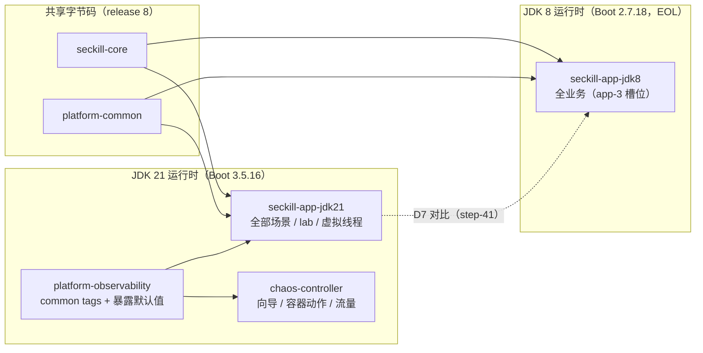
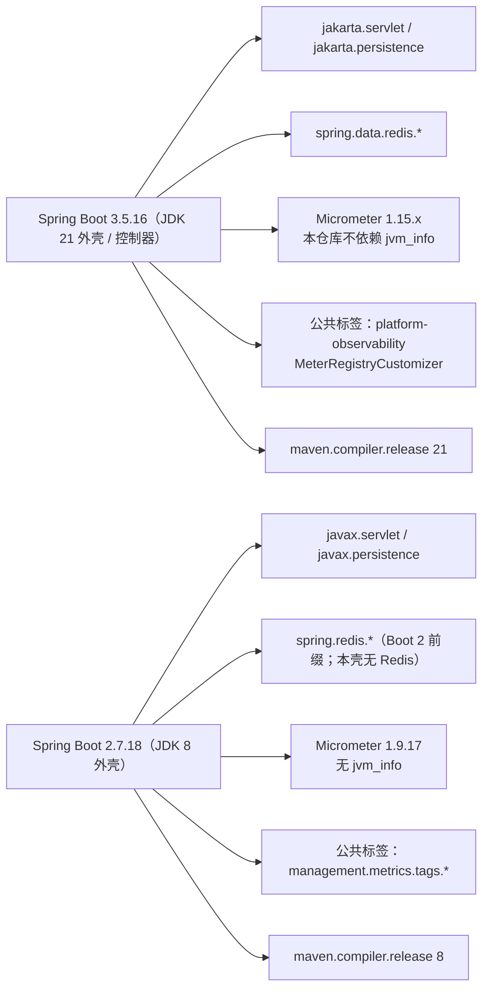
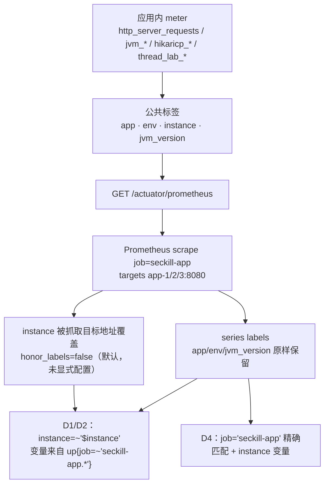
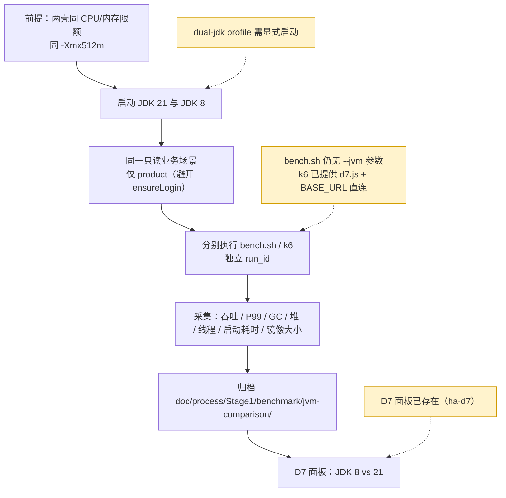

# 08 · 双 JDK 与 JVM 调优（JDK 21 / JDK 8 对比侧）

> 一句话职责：在同一个 `seckill-core` 之上提供 JDK 21（Boot 3.5）与 JDK 8（Boot 2.7，EOL 教学壳）两个可观测运行时，为 D7 对比提供**同标签、同指标名**的数据面；调优台由 `tune.sh` + D8 面板承担（step-51）。
> 代码基线：`294798a`

D7 面板与 compose/Prometheus/k6 接线已落地（step-41）；D8 与 `tune.sh` 调优运行器已落地（step-51）。仍缺：D7 正式归档目录、`bench.sh --jvm/--tuning`、自动参数扫描。

---

## 1. 角色与组件

| 组件 | 运行时/框架 | 现状 |
|---|---|---|
| `seckill-core` | 编译 `release 8`，无 Web 依赖 | 两外壳共用的领域与用例 |
| `platform-common` | 编译 `release 8` | `Result` 信封、`BizException`、错误码 |
| `platform-observability` | Boot 3 / jakarta | 只服务 JDK 21 外壳：公共标签、Actuator 暴露、直方图默认值 |
| `seckill-app-jdk21` | Temurin 21 / Boot 3.5.16 | 全部业务场景 + 线程实验室 + `/lab/**` |
| `seckill-app-jdk8` | JRE 8 / Boot 2.7.18 | **与 JDK 21 同业务契约**（login / products 两级缓存 / orders / 异步 seckill / cache lab）；app-3 默认即此槽位，独立壳只作 D7 对照；线程实验室未移植 |
| `chaos-controller` | Temurin 21 / Boot 3.5.16 | 容器编排、向导、背景流量；不代理 `/lab/thread/**` |
| `seckill-lab` | 编译 `release 8` | 共享实验抽象（当前线程实验室实现仍在 jdk21 外壳内） |

### 1.1 模块 / 运行时矩阵



矩阵中的关键事实：`seckill-app-jdk8` 是**独立 jar**（`spring-boot-maven-plugin` repackage），不是同一镜像的第二 profile；仓库已有 `dual-jdk` profile 的 compose 服务与 Dockerfile（step-41）。

---

## 2. JDK 8 外壳的现实

### 2.1 构建与依赖

- `maven.compiler.release=8` 覆盖 reactor 根的 21；Boot 版本来自根 POM 的 `spring-boot-jdk8.version=2.7.18`，本地属性只是别名。
- 依赖：`seckill-core`、`platform-common`、`spring-boot-starter-web`、`spring-boot-starter-actuator`、`micrometer-registry-prometheus`（Boot 2.7 BOM → 1.9.17）、`spring-boot-starter-data-jpa`、`mysql:mysql-connector-java:8.0.33`、`h2`（runtime）。
- **没有** Flyway/Redis/Redisson/RabbitMQ/Resilience4j/Caffeine，也**不依赖** `platform-observability`（那是 Boot 3/jakarta）。
- 主类只有 7 个：`SeckillJdk8Application`、`catalog/{ProductController,ProductReadService,ProductResponse}`、`catalog/config/CatalogConfig`、`catalog/infra/{ProductJpaEntity,ProductJpaRepository,JpaProductRepositoryAdapter}`、`web/{HelloController,GlobalExceptionHandler}`。
- HTTP 面：`GET /api/products/{id}`、`GET /api/hello`、Actuator。**没有** `/api/login`、`/api/orders`、`/api/seckill/orders`、`/lab/**`。

### 2.2 两个 profile 与种子对齐

- `demo`（默认）：H2 内存库，`schema.sql` + `data.sql` 由 `spring.sql.init` 执行；不依赖任何外部服务，启动耗时可比较。
- `mysql`：复用 JDK 21 侧 Flyway 建好的表；本壳 `ddl-auto=validate`，`spring.sql.init.mode=never`，**不重复建表**。
- 种子逐行同值：20 个商品 id 1–20，`id=1` 极客机械键盘 299.00、`id=20` 智能插座 79.00，库存统一 100。因此 k6 默认 `PRODUCT_ID=1`、`SECKILL_PRODUCT_ID=20` 与 `verify.sh`/`smoke.sh` 的断言在两壳上读同一份数据。
- `demo` 的 DDL 去掉 MySQL 的 `AUTO_INCREMENT`/ENGINE/CHARSET，保留列类型与 `available >= 0` 检查。

### 2.3 Actuator / Prometheus 面

- 暴露：`health,info,metrics,prometheus`（可被 `MANAGEMENT_ENDPOINTS_INCLUDE` 覆盖）。
- `/actuator/health/app` 是容器门 group，`include=db,ping`（本壳无 Redis contributor；JDK 21 侧用 `exclude: redis`，语义等价但写法不同）。
- `/actuator/info` 需要 `management.info.env.enabled=true`：Boot 2.7 默认关闭 env contributor，不打开时返回 `{}`。
- `/actuator/prometheus` 文本包含 `jvm_memory_used_bytes`、`http_server_requests_seconds_*`（含 `_bucket`）、`tomcat_threads_busy_threads`、`hikaricp_connections_*`。
- 与 JDK 21 对齐的两件事在 yml 里**声明式复刻**：公共标签、`http.server.requests` 的直方图/SLO 桶。

### 2.4 公共标签实现与 `jvm_info` 缺失

JDK 21 侧的四个公共标签由 `platform-observability` 的 `MeterRegistryCustomizer#commonTags` 注入：`app` 取 `spring.application.name`，`env`/`instance` 取 `observability.*`，`jvm.version` 取 `System.getProperty("java.version")`。Prometheus 渲染为 `jvm_version`。

JDK 8 侧不引这个模块，改用 Boot 2.7 官方键 `management.metrics.tags.*` 复刻同样四个标签，取值来源一致（`jvm_version` 来自 `${java.version}`）。

`jvm_info` **不存在**：Boot 2.7.18 + Micrometer 1.9.17 不导出该指标；交接文档记录的 JRE 8 实测抓取清单只有 buffer/classes/gc/memory/threads 五族。运行时代际必须用每条序列上的 `jvm_version` 标签表达（JRE 8 实测 `1.8.0_503`），或 `count(...) by (jvm_version)`。JDK 21 侧也**不要依赖** `jvm_info`：本仓库没有它的实证，现有 D 面板从未使用。

### 2.5 本机工具链实况（2026-10-27 实测）

| 事实 | 证据 |
|---|---|
| PATH 上的 `java` 是 21.0.12.1 | `java -version` |
| `mvn` 运行在 JDK 25.0.3 上 | `mvn -v` |
| 只有 JRE 8（`C:\Program Files\Java\jre1.8.0_503`），没有 javac 8 | 目录清单；交接文档同样记录 |
| 因此 `--release 8` 由 JDK 25/21 的 javac 编译，jar 用 JRE 8 运行 | `pom.xml` 的 release 8 + 本机 JRE |
| 测试建议统一 `JAVA_HOME=jdk-21.0.12.1` | 交接记录：JDK 21 上无运行时告警；JDK 25 能用但非受支持 |

这意味着“编译运行时”和“目标运行时”是分开的：`--release 8` 只保证字节码/API 兼容 Java 8，不保证在 JRE 8 上跑过测试；JRE 8 只负责**启动 jar** 的实证。

---

## 3. Boot 3.5 与 Boot 2.7 的关键差异



| 差异 | JDK 21 侧 | JDK 8 侧 | 影响 |
|---|---|---|---|
| Servlet/JPA 命名空间 | `jakarta.*` | `javax.*` | 共享代码只能用 Java 8 语法且不能 import 任一命名空间；实体/配置必须各写一份 |
| Redis 配置前缀 | `spring.data.redis.*` | Boot 2 为 `spring.redis.*`，但本壳无 Redis | 将来给 8 侧加缓存时不能照抄 21 侧 yml |
| Micrometer | Boot 3.5 管理的 1.15.x | 1.9.17 | `jvm_info` 两侧都不要用；指标名/标签需逐项对齐 |
| 公共标签 | 代码注入 | yml 声明 | 标签名与取值来源必须完全一致，否则 D7 查询对不上 |
| 健康分组 | `app: exclude: [redis]` | `app: include: [db,ping]` | 语义等价但新增 contributor 时 8 侧需同步调整 include |
| info contributor | Boot 3 默认开 | Boot 2.7 默认关 | 8 侧必须 `management.info.env.enabled=true` |
| 编译 release | 21 | 8 | 共享模块（core/common）必须保持 release 8 |

---

## 4. 指标标签契约（`app / env / instance / jvm_version`）



契约要点：

- **区分两壳看 `app`，不要看 `instance`**：Prometheus 默认 `honor_labels=false`，抓取时目标地址会覆盖应用打的 `instance` 标签；`app` 原样保留。JDK 8 外壳的 `HelloController` 注释也明确写了这一点。
- **D1/D2 的 `$instance` 变量**来自 `label_values(up{job=~"seckill-app.*"}, instance)`；所以将来新增 JDK 8 的 job 名**必须匹配 `seckill-app.*`**（例如 `seckill-app-jdk8`），否则实例不会出现在下拉里。
- **D4 使用精确 `job="seckill-app"`**；JDK 8 的 job 不会进入 D4 的 `$instance` 下拉，除非改面板查询。
- 应用侧公共标签是**四条**：`app`、`env`、`instance`、`jvm_version`；`job` 是 Prometheus 抓取作业名，不是应用标签。
- `orders_total` 在抓取时被 `metric_relabel_configs` 改名回 `orders_created_total`（Micrometer 不接受 `_created` 后缀），这是 D4 查询能工作的前提。

---

## 5. D7 对比流程（已接线；正式归档待补）



计划中的判定口径（直接引用设计 §10.2）：

- 同限额、同 `-Xmx512m`、同一套依赖服务；
- 同一 k6 场景分别跑两壳，记录吞吐、P99、GC 暂停、堆、线程数、启动耗时、镜像大小；
- 结果写入 `doc/process/Stage1/benchmark/jvm-comparison/` 与 D7 面板。

当前**只完成了 JDK 8 数据源**：`/actuator/prometheus` 上同名的 JVM/HTTP/Tomcat/Hikari 指标已经可抓。缺的是 compose 服务、Prometheus job、k6 目标、归档脚本与面板。

---

## 6. 两个已确认的 D7 约束

### 6.1 k6 `ensureLogin()` 缺口

`load/stress/soak/traffic/ha-failover` 每次迭代都先 `ensureLogin()`；`login()` 打的是 `config.paths.login`（默认 `POST /api/login`）。JDK 8 外壳按“不新增 JDK 21 没有的端点”的裁决**没有登录端点**，于是 token 永远为空：

- 每个 VU 每轮都会记一次失败的登录请求（`flow_errors`/`server_errors` 被推高）；
- 依赖 token 的 order/seckill 流程更不可能成功；
- 只有纯 `product()` 读路径能直接换壳（`BASE_URL` + 可选 `PRODUCTS_PATH`）。

交接文档给了三个处置选项：① 只用不依赖登录的读场景（或新写 product-only 场景，推荐）；② 给 k6 加“禁用登录”开关；③ 给 jdk8 壳补 mock login（会破坏 HTTP 面裁决，需另行评审）。**已由 step-41 的 `d7.js` 按选项①接线。**

### 6.2 D1/D2/D4 的 job 正则与 `honor_labels`

- D1/D2 完全不用 `app` 标签，按 `instance=~"$instance"` 过滤；`$instance` 取自 `up{job=~"seckill-app.*"}`。
- D4 用精确 `job="seckill-app"` 加 `instance` 变量。
- Prometheus 未显式配置 `honor_labels`，即默认 false：抓取目标的 `instance`（地址）覆盖应用侧 `instance`；`app` 保留。
- 结论：D7 新 job 名必须匹配 `seckill-app.*` 才能进入 D1/D2 下拉；若要让 D4 也看到 JDK 8，必须改 D4 的 job 条件或新增面板查询。区分两壳的唯一可靠标签是 `app`。

---

## 7. 代码对照表

| 概念/行为 | 类/方法（或脚本函数、配置键） | path:line | 说明 |
|---|---|---|---|
| 根 POM 的 JDK 21 版本 | `spring-boot-jdk21.version` | `code/pom.xml:15` | `3.5.16` |
| 根 POM 的 JDK 8 版本 | `spring-boot-jdk8.version` | `code/pom.xml:16` | `2.7.18` |
| 共享代码 release | `shared.java.release` | `code/pom.xml:14` | `8` |
| 模块清单 | `<module>` | `code/pom.xml:22` | platform-common 起，含 jdk21/jdk8/chaos-controller |
| JDK 8 覆盖 release | `maven.compiler.release` | `code/services/seckill-app-jdk8/pom.xml:22` | `8` |
| JDK 8 Boot 别名 | `spring-boot.version` | `code/services/seckill-app-jdk8/pom.xml:25` | 指向根属性 |
| JDK 8 BOM | `spring-boot-dependencies` | `code/services/seckill-app-jdk8/pom.xml:37` | 2.7.18 |
| JDK 8 驱动钉版 | `mysql-connector-java.version` | `code/services/seckill-app-jdk8/pom.xml:30` | 8.0.33（旧坐标） |
| Micrometer registry | `micrometer-registry-prometheus` | `code/services/seckill-app-jdk8/pom.xml:71` | Boot 2.7 BOM → 1.9.17 |
| H2 依赖 | `h2` | `code/services/seckill-app-jdk8/pom.xml:91` | demo profile |
| 入口类 | `SeckillJdk8Application` | `code/services/seckill-app-jdk8/src/main/java/com/javalearn/lab/seckill/jdk8/SeckillJdk8Application.java:12` | `@SpringBootApplication` |
| 读路径端点 | `ProductController` | `code/services/seckill-app-jdk8/src/main/java/com/javalearn/lab/seckill/jdk8/catalog/ProductController.java:14` | `/api/products` |
| 直读 DB 服务 | `ProductReadService` | `code/services/seckill-app-jdk8/src/main/java/com/javalearn/lab/seckill/jdk8/catalog/ProductReadService.java:17` | 无缓存，`readOnly` 事务 |
| hello 端点 | `HelloController` | `code/services/seckill-app-jdk8/src/main/java/com/javalearn/lab/seckill/jdk8/web/HelloController.java:15` | `/api/hello`，同 JDK 21 形状 |
| javax 命名空间 | `javax.persistence.Column` | `code/services/seckill-app-jdk8/src/main/java/com/javalearn/lab/seckill/jdk8/catalog/infra/ProductJpaEntity.java:3` | Boot 2.7 |
| jakarta 命名空间 | `jakarta.persistence.Column` | `code/services/seckill-app-jdk21/src/main/java/com/javalearn/lab/seckill/catalog/infra/ProductJpaEntity.java:3` | Boot 3.5 |
| JDK 21 Redis 前缀 | `redis` | `code/services/seckill-app-jdk21/src/main/resources/application.yml:32` | 位于 `spring.data` 下 |
| JDK 8 默认 profile | `active` | `code/services/seckill-app-jdk8/src/main/resources/application.yml:12` | `${APP_PROFILE:demo}` |
| JDK 8 SQL 初始化 | `init` | `code/services/seckill-app-jdk8/src/main/resources/application.yml:25` | `schema.sql` + `data.sql` |
| JDK 8 种子 DDL | `catalog_product` | `code/services/seckill-app-jdk8/src/main/resources/schema.sql:5` | H2 版表 |
| JDK 8 库存 DDL | `inventory_stock` | `code/services/seckill-app-jdk8/src/main/resources/schema.sql:16` | `available >= 0` |
| JDK 8 商品种子 | `INSERT INTO catalog_product` | `code/services/seckill-app-jdk8/src/main/resources/data.sql:7` | id 1–20 与 Flyway 同值 |
| JDK 8 库存种子 | `INSERT INTO inventory_stock` | `code/services/seckill-app-jdk8/src/main/resources/data.sql:30` | 全部 100 |
| JDK 8 环境标签 | `env` | `code/services/seckill-app-jdk8/src/main/resources/application.yml:58` | `OBSERVABILITY_ENV` |
| JDK 8 实例标签 | `instance` | `code/services/seckill-app-jdk8/src/main/resources/application.yml:59` | `INSTANCE_ID` |
| JDK 8 info | `runtime` | `code/services/seckill-app-jdk8/src/main/resources/application.yml:64` | `jre8` |
| JDK 8 暴露端点 | `include` | `code/services/seckill-app-jdk8/src/main/resources/application.yml:78` | health/info/metrics/prometheus |
| JDK 8 env contributor | `enabled` | `code/services/seckill-app-jdk8/src/main/resources/application.yml:74` | Boot 2.7 默认关 |
| JDK 8 健康组 | `app` | `code/services/seckill-app-jdk8/src/main/resources/application.yml:89` | group 起点 |
| JDK 8 健康 include | `include` | `code/services/seckill-app-jdk8/src/main/resources/application.yml:90` | `db,ping` |
| JDK 8 公共标签块 | `tags` | `code/services/seckill-app-jdk8/src/main/resources/application.yml:92` | app/env/instance/jvm.version |
| JDK 8 app 标签 | `app` | `code/services/seckill-app-jdk8/src/main/resources/application.yml:96` | 取 `spring.application.name` |
| JDK 8 jvm 标签 | `[jvm.version]` | `code/services/seckill-app-jdk8/src/main/resources/application.yml:99` | 渲染为 `jvm_version` |
| JDK 8 P99 直方图 | `percentiles-histogram` | `code/services/seckill-app-jdk8/src/main/resources/application.yml:103` | `http.server.requests` |
| JDK 8 demo 数据源 | `url` | `code/services/seckill-app-jdk8/src/main/resources/application.yml:119` | H2 内存 |
| JDK 8 mysql profile | `validate` | `code/services/seckill-app-jdk8/src/main/resources/application.yml:144` | 不重复建表 |
| JDK 21 公共标签 | `commonTagsCustomizer` | `code/platform/platform-observability/src/main/java/com/javalearn/lab/observability/ObservabilityAutoConfiguration.java:17` | `MeterRegistryCustomizer` |
| JDK 21 四标签 | `jvm.version` | `code/platform/platform-observability/src/main/java/com/javalearn/lab/observability/ObservabilityAutoConfiguration.java:23` | Prometheus 渲染 `jvm_version` |
| 直方图默认值 | `percentiles-histogram.http.server.requests` | `code/platform/platform-observability/src/main/java/com/javalearn/lab/observability/ObservabilityEnvironmentPostProcessor.java:24` | JDK 21 侧注入 |
| 抓取作业 | `job_name: seckill-app` | `code/lab/docker/prometheus/prometheus.yml:15` | 三实例 |
| 抓取路径 | `metrics_path` | `code/lab/docker/prometheus/prometheus.yml:16` | `/actuator/prometheus` |
| 订单指标改名 | `orders_total` | `code/lab/docker/prometheus/prometheus.yml:26` | 抓取时改回 `orders_created_total` |
| D1 实例变量 | `label_values` | `code/lab/docker/grafana/dashboards/ha-d1.json:291` | `up{job=~"seckill-app.*"}` |
| D2 实例变量 | `label_values` | `code/lab/docker/grafana/dashboards/ha-d2.json:420` | 同上 |
| D4 实例变量 | `label_values` | `code/lab/docker/grafana/dashboards/ha-d4.json:629` | 精确 `job="seckill-app"` |
| k6 登录路径 | `login` | `code/lab/k6/lib/config.js:236` | 默认 `/api/login` |
| k6 登录函数 | `login` | `code/lab/k6/lib/flow.js:31` | POST `config.paths.login` |
| k6 确保登录 | `ensureLogin` | `code/lab/k6/lib/flow.js:51` | token 为空即登录，JDK 8 上必失败 |
| D7 未实现（step-33 交接时） | `compose` | `doc/process/Stage1/step-33-jdk8-shell.md:61` | 当时缺 compose/D7/k6 接线；step-41 已补齐 |
| jvm_info 缺失（交接） | `jvm_info` | `doc/process/Stage1/step-33-jdk8-shell.md:62` | 必须改用 `jvm_version` 标签 |
| 本机只有 JRE 8（交接） | `jre1.8.0_503` | `doc/process/Stage1/step-33-jdk8-shell.md:64` | 无 javac 8 |
| 测试在 JDK 25 的非受支持路径（交接） | `JDK 25` | `doc/process/Stage1/step-33-jdk8-shell.md:65` | 建议统一 JDK 21 |
| 启动样本不可直接入表（交接） | `Xmx512m` | `doc/process/Stage1/step-33-jdk8-shell.md:66` | 需同限额 + 多次中位 |
| k6 登录缺口（交接） | `ensureLogin` | `doc/process/Stage1/step-33-jdk8-shell.md:73` | 三个处置选项 |
| 各阶段未实现清单（历史） | `M5` | `doc/process/STAGE-01阶段交接-2026-10-26.md:439` | 当时 D6–D8 待办；D6/D7/D8 均已落地（2026-10-30 复核） |

---

## 8. 配置项表（JDK 8 外壳）

| 配置键 | 环境变量 | 默认 | 读取位置 |
|---|---|---|---|
| `spring.application.name` | `APP_NAME` | `seckill-app-jdk8` | `code/services/seckill-app-jdk8/src/main/resources/application.yml:10` |
| `spring.profiles.active` | `APP_PROFILE` | `demo` | `code/services/seckill-app-jdk8/src/main/resources/application.yml:12` |
| `spring.sql.init.schema-locations` | `SQL_SCHEMA_LOCATIONS` | `classpath:schema.sql` | `code/services/seckill-app-jdk8/src/main/resources/application.yml:29` |
| `spring.sql.init.data-locations` | `SQL_DATA_LOCATIONS` | `classpath:data.sql` | `code/services/seckill-app-jdk8/src/main/resources/application.yml:30` |
| `spring.datasource.hikari.maximum-pool-size` | `DB_POOL_MAX_SIZE` | `10` | `code/services/seckill-app-jdk8/src/main/resources/application.yml:35` |
| `spring.datasource.hikari.connection-timeout` | `DB_CONNECTION_TIMEOUT_MS` | `30000` | `code/services/seckill-app-jdk8/src/main/resources/application.yml:37` |
| `server.port` | `SERVER_PORT` | `8080` | `code/services/seckill-app-jdk8/src/main/resources/application.yml:43` |
| `server.shutdown` | `SERVER_SHUTDOWN` | `graceful` | `code/services/seckill-app-jdk8/src/main/resources/application.yml:44` |
| `server.tomcat.mbeanregistry.enabled` | `TOMCAT_MBEAN_REGISTRY_ENABLED` | `true` | `code/services/seckill-app-jdk8/src/main/resources/application.yml:49` |
| `server.tomcat.threads.max` | `TOMCAT_THREADS_MAX` | `200` | `code/services/seckill-app-jdk8/src/main/resources/application.yml:51` |
| `observability.env` | `OBSERVABILITY_ENV` | `dev` | `code/services/seckill-app-jdk8/src/main/resources/application.yml:58` |
| `observability.instance` | `INSTANCE_ID` | `app-jdk8-local` | `code/services/seckill-app-jdk8/src/main/resources/application.yml:59` |
| `management.info.env.enabled` | `INFO_ENV_CONTRIBUTOR_ENABLED` | `true` | `code/services/seckill-app-jdk8/src/main/resources/application.yml:74` |
| `management.endpoints.web.exposure.include` | `MANAGEMENT_ENDPOINTS_INCLUDE` | `health,info,metrics,prometheus` | `code/services/seckill-app-jdk8/src/main/resources/application.yml:78` |
| `management.endpoint.health.group.app.include` | `HEALTH_GROUP_APP_INCLUDE` | `db,ping` | `code/services/seckill-app-jdk8/src/main/resources/application.yml:90` |
| `management.metrics.tags.[jvm.version]` | （`java.version` 系统属性） | 运行期 | `code/services/seckill-app-jdk8/src/main/resources/application.yml:99` |
| `management.metrics.distribution.percentiles-histogram.http.server.requests` | `HTTP_METRIC_PERCENTILES_HISTOGRAM` | `true` | `code/services/seckill-app-jdk8/src/main/resources/application.yml:104` |
| `management.metrics.distribution.slo.http.server.requests` | `HTTP_METRIC_SLO_BUCKETS` | `50ms,...,2s` | `code/services/seckill-app-jdk8/src/main/resources/application.yml:106` |
| `spring.datasource.url`（demo） | `DEMO_DB_URL` | `jdbc:h2:mem:seckill-jdk8;...` | `code/services/seckill-app-jdk8/src/main/resources/application.yml:119` |
| `spring.datasource.url`（mysql） | `DB_URL` | `jdbc:mysql://...` | `code/services/seckill-app-jdk8/src/main/resources/application.yml:137` |
| `spring.jpa.hibernate.ddl-auto`（mysql） | `JPA_DDL_AUTO` | `validate` | `code/services/seckill-app-jdk8/src/main/resources/application.yml:144` |

配置项全部由 `${ENV:default}` 占位；JDK 8 侧没有任何 Java 运行时常量（唯一数字是 JPA 列长度/精度这类表结构契约）。

---

## 9. 5 分钟演示步骤

### 9.1 运行已构建的 JDK 8 jar（不重建镜像）

```bash
# 0. 工具链确认（本机：PATH=21，mvn=25，只有 JRE 8）
java -version
mvn -v
ls "C:/Program Files/Java/jre1.8.0_503/bin/java"

# 1. 若还没有 jar：用 JDK 21 编译（--release 8），不要用 JRE 8 编译
cd code
JAVA_HOME="C:/Program Files/Java/jdk-21.0.12.1" \
  mvn -q -pl services/seckill-app-jdk8 -am -DskipTests package
cd ..

# 2. 用 JRE 8 启动 demo profile（H2，零外部依赖）
SERVER_PORT=18081 APP_PROFILE=demo \
  "C:/Program Files/Java/jre1.8.0_503/bin/java" \
  -Xmx512m -jar code/services/seckill-app-jdk8/target/seckill-app-jdk8-0.1.0-SNAPSHOT.jar

# 3. 另开一个终端：读路径 + 健康 + 观测
curl -s http://127.0.0.1:18081/api/products/1
curl -s http://127.0.0.1:18081/api/products/20
curl -s http://127.0.0.1:18081/api/hello
curl -s http://127.0.0.1:18081/actuator/health
curl -s http://127.0.0.1:18081/actuator/health/app
curl -s http://127.0.0.1:18081/actuator/info

# 4. 标签契约：应有 app/env/instance/jvm_version；不应有 jvm_info
curl -s http://127.0.0.1:18081/actuator/prometheus \
  | grep -m1 'jvm_memory_used_bytes{'
curl -s http://127.0.0.1:18081/actuator/prometheus \
  | grep -c '^jvm_info' || true

# 5. 收尾（Windows Git Bash）
taskkill //F //PID "$(netstat -ano | grep ':18081' | awk '{print $5}' | head -n1)" 2>/dev/null || true
```

### 9.2 在现有栈里对照 JDK 21

```bash
curl -s http://127.0.0.1:8080/api/products/1        # 经 Nginx → 三个 JDK 21 实例
curl -sG http://127.0.0.1:8080/prom/api/v1/query \
  --data-urlencode 'query=count by (app, jvm_version) (jvm_memory_used_bytes{area="heap"})'
```

D7 面板已存在（`ha-d7`，step-41），第二步可直接看两侧同图对比；JDK 8 的序列需要 `up.sh --profile dual-jdk` 且 `seckill-app-jdk8` target UP——未启动时该 target 为 down，属预期态。

---

## 10. 已知缺陷 / 边界

1. **D7 面板已实现（step-41）**：`ha-d7.json` 提供 Targets up、Runtime identity、Startup、吞吐/P95/P99、GC、堆、线程、CPU 与指标缺口说明。
2. **compose 已有 JDK 8 服务（step-41）**：`seckill-app-jdk8`（`profiles: ["dual-jdk"]`）与 Dockerfile 均已入库，`up.sh --profile dual-jdk` 渲染 17 个服务。
3. **k6 已接线第二运行时**：`run.sh` 白名单含 `d7`，`scenarios/d7.js` 为无登录读场景，`BASE_URL=http://seckill-app-jdk8:8080` 直连 JDK 8；`bench.sh` 仍只认 `smoke|load|stress|spike|soak`，没有 `--jvm` 参数。
4. **`ensureLogin()` 缺口已绕过**：JDK 8 没有 `/api/login`；step-41 的 `d7.js` 只做 product 读，不带登录。其他带登录的 k6 场景仍不适用于 JDK 8（见 §6.1）。
5. **`jvm_info` 不存在**：两侧都不要按 `jvm_info` 写查询；用 `jvm_version` 标签。
6. **D1/D2/D4 的标签事实**：D1/D2 按 `instance` 过滤且实例变量来自 `job=~"seckill-app.*"`；D4 精确 `job="seckill-app"`；`honor_labels=false` 会覆盖应用 `instance`。新 job 名必须匹配正则，区分两壳靠 `app`。
7. **`mysql` profile 已真机验证**：step-41 以 `APP_PROFILE=mysql` 连共享 MySQL 启动 JDK 8，`ddl-auto=validate` 通过。
8. **测试不在 JRE 8 上跑**：surefire 跟随 Maven 的 JDK（25 或 21）；JRE 8 只用于启动 jar 的冒烟。
9. **启动耗时样本仍偏少**：step-41 两侧各 3 次（JDK 8 中位 9.332s、JDK 21 30.517s），但 JDK 21 是并发重建、有 CPU 争用；严格基准应逐实例串行、多轮取中位后再写入 `doc/process/Stage1/benchmark/jvm-comparison/`。
10. **JDK 8 侧功能不对等**：没有缓存 L1/L2、穿透防护、线程实验室、toggles、异步秒杀、登录、订单、Flyway；D7 只能比“裸读路径 + JVM/GC/堆/线程/启动”。
11. **健康组写法不同**：8 侧 `include=db,ping`，21 侧 `exclude=redis`；将来给 8 侧加 contributor 时必须同步 include。
12. **调优台**：`code/lab/scripts/tune.sh`（切 JVM 参数、重建 app 层、打 Grafana annotation、可选短压测、前后对比记录）+ D8 面板已落地（step-51）。仍缺：设计 §10.3 的 `/tuning` 控制台页面与 chaos-controller 调优端点、GC/堆预设白名单、自动参数扫描与 `doc/process/Stage1/benchmark/jvm-tuning/` 归档对比。
13. **JDK 8 仅 JRE**：本机没有 javac 8，若要在容器里构建需要 JDK 8 基础镜像；当前未定镜像。

---

## 11. 关联文档

- `doc/design/Stage1/details/07-线程实验室.md`：线程实验室只在 JDK 21 外壳，JDK 8 无对等实现。
- `doc/design/Stage1/details/09-压测与观测.md`：k6 场景、Prometheus job、D1–D9 清单与 `run_id` 约定。
- `doc/design/Stage1/details/10-操作台与API.md`：`/lab-api/**` 只到 chaos-controller，JDK 8 不暴露 `/lab/**`。
- `doc/process/Stage1/step-33-jdk8-shell.md`：JDK 8 外壳交接（含本文件引用的四条 D7 约束）。
- `doc/design/Stage1/2026-10-26-ha-concurrency-lab-design.md` §10：双 JDK 与调优台原始设计。
- `doc/process/STAGE-01阶段交接-2026-10-26.md`：M5/D6–D8 未实现清单（历史记录；D6/D7/D8 均已落地）。

---

### 验证说明

- 代码对照表的 `path:line` 由脚本机械校验（文件存在、行号有效、该行含表中符号）；结果见提交报告。
- Mermaid 代码块成对闭合且仅用 `flowchart`；**未做可视化渲染验证**。
