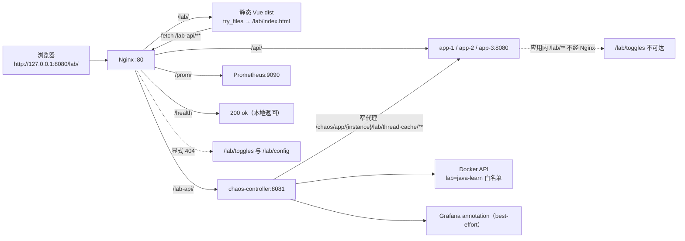
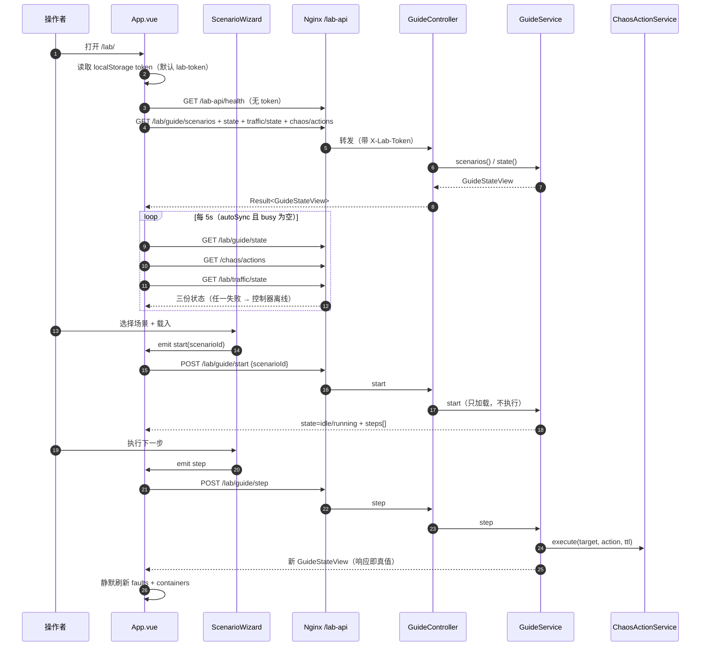
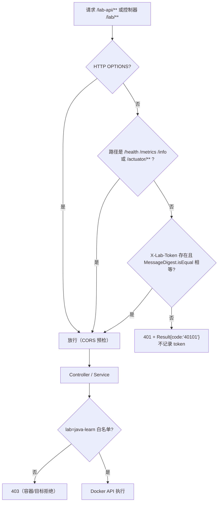
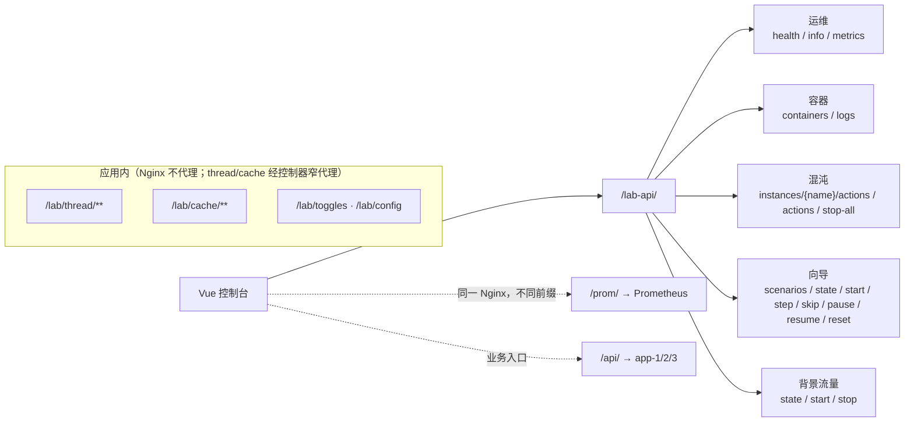

# 10 · 操作台与 API（Vue 控制台 / Nginx / chaos-controller）

> 一句话职责：用一块静态 Vue 页面（`/lab/`）驱动场景向导、环境状态、背景流量与只读日志；所有写操作经 Nginx `/lab-api/` 代理到 chaos-controller，并由 `X-Lab-Token` 统一鉴权。
> 代码基线：`294798a`

控制台是**单页 MVP**：没有 Vue Router，没有设计 §12.1 里的 `/scenario/:id`、`/thread`、`/cache`、`/tuning`、`/jdk`、`/bench` 路由。应用内部的 `/lab/**`（线程实验室、缓存实验室、toggles）**不经过 Nginx**；线程与缓存实验室经 chaos-controller 的两份显式白名单窄代理进入，`/lab/toggles` 仍然不可达。

---

## 1. 角色与组件

| 角色 | 位置 | 职责 |
|---|---|---|
| Vue 应用 | `code/lab/dashboard/src/App.vue` | 状态栏、令牌、容器清单、日志面板、向导挂载、5s 轮询 |
| 向导组件 | `code/lab/dashboard/src/components/ScenarioWizard.vue` | 场景下拉、进度、步骤列表、explain 四条、五个动作按钮 |
| 线程页 | `code/lab/dashboard/src/components/ThreadLab.vue` | 实例选择、七种线程故障、生命周期、快照 |
| 缓存页 | `code/lab/dashboard/src/components/CacheLab.vue` | 实例选择、8 种防御模式、策略参数、播种、预热、D10 深链 |
| API 客户端 | `code/lab/dashboard/src/api.js` | 统一 `/lab-api` 前缀、`X-Lab-Token`、`Result.data` 解包、`ApiError` |
| 构建 | `vite.config.js` + `package.json` | `base=/lab/`，`dist` 输出；dev 代理 `/lab-api` |
| 静态托管 | Nginx `location /lab/` | 从 `dist` 挂载，SPA 回退 `index.html` |
| 控制器代理 | Nginx `location /lab-api/` | `proxy_pass http://chaos-controller:8081/`（剥前缀） |
| Prometheus 代理 | Nginx `location /prom/` | `proxy_pass http://prometheus:9090/` |
| 业务代理 | Nginx `location /api/` | 轮询 `app-1/2/3:8080` |
| 控制器 API | `chaos/web`, `chaos/guide`, `chaos/traffic` | 容器/日志、向导、背景流量、app 窄代理 |
| 鉴权 | `chaos/auth/TokenFilter` | `X-Lab-Token` 常量时间比较；公开 `/health`、`/metrics`、`/info`、`/actuator*` |
| 冒烟 | `code/lab/scripts/console-smoke.sh` + `.mjs` | Playwright 真浏览器驱动；42 项断言（含线程页 4 条、缓存页 5 条、动画页 7 条） |

---

## 2. 控制台架构



路由细节：

- `/lab` → 301 `/lab/`；`/lab/` 静态目录，未知路径回退 `/lab/index.html`。
- `/lab-api/` 的 `proxy_pass` 带尾斜杠，因此浏览器 `/lab-api/lab/guide/state` → 控制器 `/lab/guide/state`；`/lab-api/health` → 控制器 `/health`。
- `/lab-api/` 的读超时 30s（向导 step 可能触发 Docker stop/start）；`/api/` 连接 2s、读 10s。
- `/lab/(toggles|config)` 被 Nginx 显式 404；应用内 `/lab/thread/**`、`/lab/cache/**` 由控制器的显式白名单窄代理访问，Nginx 本身仍不代理这些路径（直接请求会落到静态 location）。
- `/prom/` 只代理查询/UI；Prometheus 自身 `--web.route-prefix=/`，外部 URL 指向 `/prom/`。
- 控制台与 API 同源，避免 CORS；Vite dev server 只代理 `/lab-api`（`VITE_LAB_API_TARGET`，默认 `http://127.0.0.1:8080`）。

### 2.1 实验页窄代理（`AppProxyService`）

浏览器只访问 `/lab-api/chaos/app/{instance}/...`，控制器再以 `X-Lab-Token` 转发到 `jl-net` 内的 app。安全边界是**实例白名单 + 方法/路径白名单 + GET/POST + 请求体上限**：

| 分组 | 方法 | 精确路径 |
|---|---|---|
| 线程 | GET | `/lab/thread/state`、`/lab/thread/lifecycle` |
| 线程 | POST | `/lab/thread/fault`、`/lab/thread/stop-all`、`/lab/thread/lifecycle/{start,step,freeze,resume,reset}`、`/lab/thread/snapshot`、`/lab/thread/fault/{deadlock,stuck,cpu-burn,heap-leak,oom,thread-leak,starvation}/{stop,pause,resume}` |
| 缓存 | GET | `/lab/cache/state`、`/lab/cache/preheat` |
| 缓存 | POST | `/lab/cache/mode`（JSON body）、`/lab/cache/seed`、`/lab/cache/preheat` |

- 实例只允许 `CHAOS_APP_PROXY_INSTANCES`（默认 `app-1,app-2,app-3`）；未知实例 404/40401。
- 白名单外路径 404/40401（包括 `GET /lab/cache/mode`、`POST /lab/cache/preheat/run`、尾斜杠、`..`、查询串）；其他方法 405/40501；上游不可达 503/50301；非 JSON 502/50201。
- 只有 `POST /lab/thread/fault` 与 `POST /lab/cache/mode` 转发请求体，上限 `CHAOS_APP_PROXY_MAX_REQUEST_BYTES`（默认 8192）；其余 POST 即使带 body 也被丢弃。
- 超时外置：`CHAOS_APP_PROXY_CONNECT_TIMEOUT_SECONDS`（2s）、`CHAOS_APP_PROXY_REQUEST_TIMEOUT_SECONDS`（10s）。播种是同步调用，1000 行通常数秒内完成；极慢主机需调大请求超时。

---

## 3. 向导页面与 `/lab/guide/state` 轮询



语义：

- **响应即真值**：每次向导迁移都用响应体覆盖 `guide`，再静默刷新故障/容器；静默失败不会掩盖动作结果。
- 自动同步间隔 `VITE_LAB_SYNC_INTERVAL_MS`（默认 5000），`busy` 期间跳过；`localStorage` 键 `ha-lab-auto-sync` 可关闭。
- 状态栏展示：向导状态、活动故障数、容器 rollup（排除 `jl-traffic`）、还原模式（`manual`/`auto`）、背景流量状态。
- 向导按钮可用性完全由 `status` 决定：`step/skip/pause` 仅 RUNNING，`resume` 仅 PAUSED，`reset` 任意状态；`explain` 只在“当前步 + RUNNING”渲染。
- `skip` 推进游标但**不执行**事件；`reset` 调 `stop-all` 并解冻（若处于 PAUSED），再清空向导。
- 暂停期间 TTL 冻结（`ChaosActionService.pause()` 取消所有 active 动作的定时器并记录剩余），`resume` 只按剩余毫秒重排。

### 3.1 状态栏 / 日志面板

- 容器清单只显示 `lab=java-learn` 的容器；`jl-traffic` 是 profile-gated 的 created-but-stopped，rollup 不把它算作常驻失败。
- 日志面板只读：容器选择 + `tail`（1–1000，默认 200）+ 手动刷新；内容来自 `docker logs --tail N`，`text/plain; charset=UTF-8`。
- 错误横幅按 HTTP 状态翻译（401 token、403 白名单/策略、404 未找到、409 状态冲突、503 不可用）。

---

## 4. `X-Lab-Token` 过滤流程



两套过滤器语义相同但注册方式不同：

- **控制器**：`TokenFilter` 是 `@Component`，`@Order(HIGHEST_PRECEDENCE)`，公开路径集合固定。
- **应用内**：`LabTokenFilter` 不在组件扫描里，由 `LabConfig` 的 `FilterRegistrationBean` 只注册到 `/lab/*`；因此 `/api/**` 与 MVC slice 测试不会加载它。
- 两边都用常量时间比较，且**从不记录期望值或收到的 token**。
- 应用内 `/lab/**` 的 token 来自 `app.lab.token`（默认 `lab-token`）；控制器来自 `lab.token`（默认 `lab-token`）；compose 注入同一个 `LAB_TOKEN`。

---

## 5. 端点矩阵

### 5.1 经 Nginx `/lab-api/` 到 chaos-controller

| 方法 | 路径（浏览器） | 控制器路径 | 参数 / Body | 响应 |
|---|---|---|---|---|
| GET | `/lab-api/health` | `/health` | 无 | Spring Health JSON（**非** `Result` 信封；无需 token） |
| GET | `/lab-api/info` | `/info` | 无 | Actuator info |
| GET | `/lab-api/metrics` | `/metrics` | 无 | Prometheus 文本（控制器自身指标） |
| GET | `/lab-api/containers` | `/containers` | 无 | `Result<List<ContainerView{name,state,health}>>` |
| GET | `/lab-api/logs/{container}` | `/logs/{container}` | `tail`（1–1000，默认 200） | `text/plain` 日志；未知容器 404 |
| POST | `/lab-api/chaos/instances/{name}/actions` | `/chaos/instances/{name}/actions` | `{action, ttlSeconds?}` | **202** `Result<ChaosActionView>` |
| GET | `/lab-api/chaos/actions` | `/chaos/actions` | 无 | `Result<List<ChaosActionView>>` |
| POST | `/lab-api/chaos/stop-all` | `/chaos/stop-all` | 无 | `Result<StopAllResult{reverted,failed,pending}>` |
| GET | `/lab-api/lab/guide/scenarios` | `/lab/guide/scenarios` | 无 | `Result<List<GuideScenarioSummary{id,name,description,stepCount,durationHintSeconds}>>` |
| GET | `/lab-api/lab/guide/state` | `/lab/guide/state` | 无 | `Result<GuideStateView>` |
| POST | `/lab-api/lab/guide/start` | `/lab/guide/start` | `{scenarioId}` | `Result<GuideStateView>` |
| POST | `/lab-api/lab/guide/step` | `/lab/guide/step` | 无 | `Result<GuideStateView>` |
| POST | `/lab-api/lab/guide/skip` | `/lab/guide/skip` | 无 | `Result<GuideStateView>` |
| POST | `/lab-api/lab/guide/pause` | `/lab/guide/pause` | 无 | `Result<GuideStateView>` |
| POST | `/lab-api/lab/guide/resume` | `/lab/guide/resume` | 无 | `Result<GuideStateView>` |
| POST | `/lab-api/lab/guide/reset` | `/lab/guide/reset` | 无 | `Result<GuideStateView>` |
| GET | `/lab-api/lab/traffic/state` | `/lab/traffic/state` | 无 | `Result<TrafficStateView{container,state,health,running}>` |
| POST | `/lab-api/lab/traffic/start` | `/lab/traffic/start` | 无 | `Result<TrafficStateView>`；容器未创建 → 404 |
| POST | `/lab-api/lab/traffic/stop` | `/lab/traffic/stop` | 无 | `Result<TrafficStateView>` |

`GuideStateView` 字段：`scenarioId, scenarioName, status, currentStep, totalSteps, steps[], activeActions, lastError, resetMode`；`steps[]` 为 `GuideStepView{atSeconds, action, target, ttlSeconds, title, text, explain}`，`explain` 为 `{symptom, rootCause, fix, expectation}`。

`ChaosActionView` 字段：`id, target, action, ttlSeconds, expiresAt, revertAction, status, lastError`。`status` 取值 `applying/active/reverting/reverted/failed/completed`。

### 5.2 应用内 `/lab/**`（Nginx 不代理；线程/缓存经控制器窄代理）

| 方法 | 路径 | 参数 / Body | 响应 |
|---|---|---|---|
| GET | `/lab/thread/state` | 无 | `Result<List<ThreadActionView>>` |
| POST | `/lab/thread/fault` | `{mode, hold?, ttlSeconds?, virtual?}` | `Result<ThreadActionView>` |
| POST | `/lab/thread/fault/{mode}/stop` | 无 | `Result<ThreadActionView>` |
| POST | `/lab/thread/fault/{mode}/pause` | 无 | `Result<ThreadActionView>` |
| POST | `/lab/thread/fault/{mode}/resume` | 无 | `Result<ThreadActionView>` |
| POST | `/lab/thread/stop-all` | 无 | `Result<List<ThreadActionView>>` |
| GET | `/lab/thread/lifecycle` | 无 | `Result<LifecycleDemoView>` |
| POST | `/lab/thread/lifecycle/{start\|step\|freeze\|resume\|reset}` | 无 | `Result<LifecycleDemoView>` |
| GET | `/lab/cache/mode` | 无 | `Result<CacheModeResponse{mode}>`（不在代理白名单） |
| POST | `/lab/cache/mode` | `{mode}` | `Result<CacheModeResponse>` |
| POST | `/lab/cache/seed` | 无 | `Result<CacheSeedResponse>`（预留 id 段 90000..90999） |
| GET | `/lab/cache/state` | 无 | `Result<CacheStateResponse>` |
| GET | `/lab/cache/preheat` | 无 | `Result<CachePreheatStateResponse>`（热榜、tracker、最后一次运行） |
| POST | `/lab/cache/preheat` | 无 | `Result<CachePreheatStateResponse>`（同步跑一次 manual 预热） |
| GET | `/lab/toggles` | 无 | `Result<Map<String,Boolean>>`（不在代理白名单） |
| POST | `/lab/toggles` | `{key, value}` | `Result<Map<String,Boolean>>`（不在代理白名单） |
| GET | `/lab/config` | 无 | `Result<LabConfigResponse>`（不含密钥；不在代理白名单） |

控制台只能访问 §2.1 列出的子集；其余行仍需在 `jl-net` 内直连应用容器。

### 5.3 端点分组示意



错误契约：所有控制器端点返回 `Result{code,message,data,success}`；业务错误码 `40001`（参数）、`40101`（token）、`40301/403`（白名单/策略）、`40401`（不存在）、`40901`（状态冲突）、`42901`（限流）、`50001`、`50301`。`/health`、`/info`、`/metrics` 与日志端点不套 `Result`。

---

## 6. 健康检查与探针

| 端点 | 归属 | 语义 |
|---|---|---|
| `/health`（Nginx） | Nginx | 本地返回 `ok`，不走上游 |
| `/health`（控制器，基础路径 `/`） | chaos-controller | Spring Health JSON，公开 |
| `/actuator/health` | 应用 | 根健康（Redis DOWN 时 503，诚实暴露） |
| `/actuator/health/app` | 应用 | 容器门 group：JDK 21 用 `exclude: [redis]`，JDK 8 用 `include: [db,ping]` |
| `/actuator/health/readiness`、`/liveness` | 应用 | probes 开启 |
| `/actuator/prometheus` | 应用 | 指标抓取 |
| `/metrics`（控制器） | chaos-controller | `management.endpoints.web.path-mapping.prometheus=metrics` |

`/lab-api/health` 是控制台判断“控制器在线”的依据；容器/日志/向导 API 都要求 token。

---

## 7. 代码对照表

| 概念/行为 | 类/方法（或脚本函数、配置键） | path:line | 说明 |
|---|---|---|---|
| 控制台入口 | `createApp` | `code/lab/dashboard/src/main.js:5` | 挂载 `#app` |
| 状态栏/轮询 | `SYNC_INTERVAL_MS` | `code/lab/dashboard/src/App.vue:24` | 默认 5000，`VITE_LAB_SYNC_INTERVAL_MS` 可覆盖 |
| 环境同步 | `syncEnvironment` | `code/lab/dashboard/src/App.vue:152` | 并发拉 guide/faults/traffic |
| 自动轮询 | `startPolling` | `code/lab/dashboard/src/App.vue:257` | `setInterval`，busy 时跳过 |
| 全量刷新 | `reloadAll` | `code/lab/dashboard/src/App.vue:287` | 健康 + 场景 + 环境 + 容器 |
| 令牌输入 | `token` | `code/lab/dashboard/src/App.vue:426` | `localStorage` 键 `ha-lab-token`，默认 `lab-token` |
| 日志视图 | `log-view` | `code/lab/dashboard/src/App.vue:504` | 只读 `<pre>` |
| 向导按钮 | `action-step` | `code/lab/dashboard/src/components/ScenarioWizard.vue:142` | `step/skip/pause` 仅 running |
| 向导 reset | `action-reset` | `code/lab/dashboard/src/components/ScenarioWizard.vue:160` | 任意状态可用 |
| 按钮可用性 | `canRun` | `code/lab/dashboard/src/components/ScenarioWizard.vue:23` | `status === 'running'` |
| API 前缀 | `API_BASE` | `code/lab/dashboard/src/api.js:1` | `/lab-api` |
| token 头 | `TOKEN_HEADER` | `code/lab/dashboard/src/api.js:2` | `X-Lab-Token` |
| 统一解包 | `readJson` | `code/lab/dashboard/src/api.js:27` | 返回 `payload.data ?? null`，非 2xx 抛 `ApiError` |
| 拉场景 | `fetchGuideScenarios` | `code/lab/dashboard/src/api.js:78` | GET `/lab/guide/scenarios` |
| 拉向导状态 | `fetchGuideState` | `code/lab/dashboard/src/api.js:82` | 轮询目标 |
| 载入场景 | `startGuide` | `code/lab/dashboard/src/api.js:87` | POST `/lab/guide/start` |
| 向导动作 | `runGuideAction` | `code/lab/dashboard/src/api.js:95` | POST `/lab/guide/{step,skip,pause,resume,reset}` |
| 拉流量 | `fetchTrafficState` | `code/lab/dashboard/src/api.js:99` | GET `/lab/traffic/state` |
| 流量动作 | `runTrafficAction` | `code/lab/dashboard/src/api.js:103` | POST `/lab/traffic/{start,stop}` |
| 活动故障 | `fetchActiveFaults` | `code/lab/dashboard/src/api.js:122` | GET `/chaos/actions` |
| 全停 | `stopAllFaults` | `code/lab/dashboard/src/api.js:127` | POST `/chaos/stop-all` |
| 缓存页实例 | `instance` | `code/lab/dashboard/src/components/CacheLab.vue:45` | 默认 `app-1` |
| 缓存模式列表 | `MODES` | `code/lab/dashboard/src/components/CacheLab.vue:33` | 8 个 `CacheDefenseMode` key |
| 缓存页轮询 | `startPolling` | `code/lab/dashboard/src/components/CacheLab.vue:163` | 5s；seed 不占 busy，轮询不中断 |
| 缓存模式切换 | `applyMode` | `code/lab/dashboard/src/components/CacheLab.vue:202` | POST，等待响应后刷新 |
| 缓存播种 | `runSeed` | `code/lab/dashboard/src/components/CacheLab.vue:229` | 单独 `seeding` 标志 |
| 缓存状态 | `fetchCacheState` | `code/lab/dashboard/src/api.js:211` | GET `/lab/cache/state` |
| 缓存模式写入 | `updateCacheMode` | `code/lab/dashboard/src/api.js:216` | POST `/lab/cache/mode` |
| 缓存播种 | `seedCache` | `code/lab/dashboard/src/api.js:221` | POST `/lab/cache/seed` |
| 预热读 | `fetchCachePreheat` | `code/lab/dashboard/src/api.js:226` | GET `/lab/cache/preheat` |
| 预热触发 | `runCachePreheat` | `code/lab/dashboard/src/api.js:231` | POST `/lab/cache/preheat` |
| 构建 base | `base` | `code/lab/dashboard/vite.config.js:9` | `/lab/` |
| dev 代理 | `labApiTarget` | `code/lab/dashboard/vite.config.js:6` | `/lab-api` → 8080 |
| 容器列表 | `containers` | `code/services/chaos-controller/src/main/java/com/javalearn/lab/chaos/web/LabController.java:29` | `lab=java-learn` |
| 日志端点 | `logs` | `code/services/chaos-controller/src/main/java/com/javalearn/lab/chaos/web/LabController.java:34` | `text/plain`，tail 归一 |
| tail 上限 | `MAX_TAIL` | `code/services/chaos-controller/src/main/java/com/javalearn/lab/chaos/web/LabController.java:21` | 1000 |
| 混沌动作 | `apply` | `code/services/chaos-controller/src/main/java/com/javalearn/lab/chaos/web/ChaosController.java:34` | 容器名 + action，202 |
| 活动动作 | `actions` | `code/services/chaos-controller/src/main/java/com/javalearn/lab/chaos/web/ChaosController.java:40` | 列表 |
| 全停 | `stopAll` | `code/services/chaos-controller/src/main/java/com/javalearn/lab/chaos/web/ChaosController.java:46` | `StopAllResult` |
| 向导场景列表 | `scenarios` | `code/services/chaos-controller/src/main/java/com/javalearn/lab/chaos/guide/GuideController.java:27` | 读目录、校验 |
| 向导状态 | `state` | `code/services/chaos-controller/src/main/java/com/javalearn/lab/chaos/guide/GuideController.java:32` | 轮询端点 |
| 向导 start | `start` | `code/services/chaos-controller/src/main/java/com/javalearn/lab/chaos/guide/GuideController.java:37` | 只加载不执行 |
| 向导 step | `step` | `code/services/chaos-controller/src/main/java/com/javalearn/lab/chaos/guide/GuideController.java:42` | 执行当前事件 |
| 向导 skip | `skip` | `code/services/chaos-controller/src/main/java/com/javalearn/lab/chaos/guide/GuideController.java:48` | 不执行只推进 |
| 向导 pause | `pause` | `code/services/chaos-controller/src/main/java/com/javalearn/lab/chaos/guide/GuideController.java:53` | 冻结 TTL |
| 向导 resume | `resume` | `code/services/chaos-controller/src/main/java/com/javalearn/lab/chaos/guide/GuideController.java:58` | 只补剩余 |
| 向导 reset | `reset` | `code/services/chaos-controller/src/main/java/com/javalearn/lab/chaos/guide/GuideController.java:63` | stop-all + 解冻 |
| 流量状态 | `state` | `code/services/chaos-controller/src/main/java/com/javalearn/lab/chaos/traffic/TrafficController.java:23` | 缺失容器返回 `missing` |
| 流量启动 | `start` | `code/services/chaos-controller/src/main/java/com/javalearn/lab/chaos/traffic/TrafficController.java:28` | 启 `jl-traffic` |
| 流量停止 | `stop` | `code/services/chaos-controller/src/main/java/com/javalearn/lab/chaos/traffic/TrafficController.java:33` | 宽限 5s |
| 控制器鉴权 | `TOKEN_HEADER` | `code/services/chaos-controller/src/main/java/com/javalearn/lab/chaos/auth/TokenFilter.java:36` | `X-Lab-Token` |
| 公开路径 | `PUBLIC_PATHS` | `code/services/chaos-controller/src/main/java/com/javalearn/lab/chaos/auth/TokenFilter.java:39` | `/health,/metrics,/info,/actuator` |
| token 比较 | `doFilterInternal` | `code/services/chaos-controller/src/main/java/com/javalearn/lab/chaos/auth/TokenFilter.java:59` | 常量时间，失败 401 |
| 应用内过滤注册 | `addUrlPatterns` | `code/services/seckill-app-jdk21/src/main/java/com/javalearn/lab/seckill/lab/config/LabConfig.java:55` | 只 `/lab/*` |
| 应用内 token 头 | `TOKEN_HEADER` | `code/services/seckill-app-jdk21/src/main/java/com/javalearn/lab/seckill/lab/auth/LabTokenFilter.java:37` | 与控制器同名 |
| 应用内路径判定 | `isLabPath` | `code/services/seckill-app-jdk21/src/main/java/com/javalearn/lab/seckill/lab/auth/LabTokenFilter.java:74` | `/lab` 或 `/lab/` |
| 向导状态机 | `pause` | `code/services/chaos-controller/src/main/java/com/javalearn/lab/chaos/guide/GuideService.java:165` | 仅 RUNNING；非法 409 |
| 向导 resume | `resume` | `code/services/chaos-controller/src/main/java/com/javalearn/lab/chaos/guide/GuideService.java:178` | 仅 PAUSED |
| 向导 reset | `reset` | `code/services/chaos-controller/src/main/java/com/javalearn/lab/chaos/guide/GuideService.java:191` | 任意状态 |
| TTL 冻结 | `pause` | `code/services/chaos-controller/src/main/java/com/javalearn/lab/chaos/action/ChaosActionService.java:268` | 取消定时器并记剩余 |
| TTL 解冻 | `resume` | `code/services/chaos-controller/src/main/java/com/javalearn/lab/chaos/action/ChaosActionService.java:294` | 按剩余重排 |
| 容器白名单 | `LAB_LABEL` | `code/services/chaos-controller/src/main/java/com/javalearn/lab/chaos/gateway/DockerContainerGateway.java:40` | `lab=java-learn` |
| 线程代理白名单 | `THREAD_GET_PATHS` / `THREAD_POST_PATHS` | `code/services/chaos-controller/src/main/java/com/javalearn/lab/chaos/appproxy/AppProxyService.java:40` | 线程页原有列表不变 |
| 缓存代理 GET 白名单 | `CACHE_GET_PATHS` | `code/services/chaos-controller/src/main/java/com/javalearn/lab/chaos/appproxy/AppProxyService.java:61` | `state` / `preheat` |
| 缓存代理 POST 白名单 | `CACHE_POST_PATHS` | `code/services/chaos-controller/src/main/java/com/javalearn/lab/chaos/appproxy/AppProxyService.java:66` | `mode` / `seed` / `preheat` |
| 代理请求体白名单 | `BODY_PATHS` | `code/services/chaos-controller/src/main/java/com/javalearn/lab/chaos/appproxy/AppProxyService.java:72` | 仅 fault 与 cache mode |
| 结果信封 | `Result` | `code/platform/platform-common/src/main/java/com/javalearn/lab/common/Result.java:3` | code/message/data |
| 控制器基础路径 | `base-path` | `code/services/chaos-controller/src/main/resources/application.yml:15` | `/`，因此 `/health` |
| prometheus 路径映射 | `prometheus` | `code/services/chaos-controller/src/main/resources/application.yml:17` | `/metrics` |
| 控制器 token 配置 | `token` | `code/services/chaos-controller/src/main/resources/application.yml:23` | `LAB_TOKEN` |
| 向导场景目录 | `scenario-dir` | `code/services/chaos-controller/src/main/resources/application.yml:56` | `/app/scenarios` |
| 向导目标正则 | `target-pattern` | `code/services/chaos-controller/src/main/resources/application.yml:59` | `^jl-app-[0-9]+$` |
| 数据存储目标策略 | `allowed-target-pattern` | `code/services/chaos-controller/src/main/resources/application.yml:69` | 空 = 全拒 |
| 流量容器名 | `container-name` | `code/services/chaos-controller/src/main/resources/application.yml:72` | `jl-traffic` |
| 流量停止宽限 | `stop-grace-seconds` | `code/services/chaos-controller/src/main/resources/application.yml:73` | 5s |
| Nginx 静态控制台 | `location /lab/` | `code/lab/docker/nginx/conf.d/default.conf:49` | `try_files` 回退 |
| Nginx 控制器代理 | `proxy_pass` | `code/lab/docker/nginx/conf.d/default.conf:56` | 剥 `/lab-api/` |
| Nginx Prometheus 代理 | `proxy_pass` | `code/lab/docker/nginx/conf.d/default.conf:68` | 剥 `/prom/` |
| Nginx 业务代理 | `proxy_pass` | `code/lab/docker/nginx/conf.d/default.conf:24` | 三实例 upstream |
| 应用 lab 路径 404 | `location ~ ^/lab/(toggles|config)` | `code/lab/docker/nginx/conf.d/default.conf:44` | 明确不外泄 |
| Nginx 健康 | `location = /health` | `code/lab/docker/nginx/conf.d/default.conf:7` | 本地 `ok` |
| 控制台挂载 | `../dashboard/dist` | `code/lab/docker/compose.base.yml:95` | 只读挂到 `/usr/share/nginx/html/lab` |
| 冒烟入口 | `console` | `code/lab/scripts/console-smoke.sh:2` | Playwright 驱动 |
| 浏览器回退 | `SMOKE_BROWSER_CHANNELS` | `code/lab/scripts/console-smoke.mjs:66` | `chrome,msedge` |
| Playwright 解析 | `PLAYWRIGHT_MODULE` | `code/lab/scripts/console-smoke.sh:53` | env 说明起点 |

所有行均为完整仓库相对路径；`...` 仅出现在被引用的 Java 代码字符串或省略说明中，不作为路径使用。

---

## 8. 配置项表（控制台与控制器）

| 配置键 / 变量 | 默认 | 读取位置 |
|---|---|---|
| `VITE_LAB_API_TARGET` | `http://127.0.0.1:8080` | `code/lab/dashboard/vite.config.js:6` |
| `VITE_LAB_SYNC_INTERVAL_MS` | `5000` | `code/lab/dashboard/src/App.vue:24` |
| `LAB_TOKEN`（控制器） | `lab-token` | `code/services/chaos-controller/src/main/resources/application.yml:23` |
| `LAB_DOCKER_MAX_CONNECTIONS` | `16` | `code/services/chaos-controller/src/main/resources/application.yml:28` |
| `LAB_DOCKER_CONNECTION_TIMEOUT_SECONDS` | `5` | `code/services/chaos-controller/src/main/resources/application.yml:29` |
| `CHAOS_DEFAULT_TTL_SECONDS` | `120` | `code/services/chaos-controller/src/main/resources/application.yml:36` |
| `CHAOS_MAX_TTL_SECONDS` | `600` | `code/services/chaos-controller/src/main/resources/application.yml:38` |
| `CHAOS_ACTION_TIMEOUT_SECONDS` | `30` | `code/services/chaos-controller/src/main/resources/application.yml:40` |
| `CHAOS_WATCHDOG_INTERVAL_SECONDS` | `5` | `code/services/chaos-controller/src/main/resources/application.yml:42` |
| `CHAOS_SCHEDULER_THREADS` | `4` | `code/services/chaos-controller/src/main/resources/application.yml:49` |
| `LAB_RESET_MODE` | `manual` | `code/services/chaos-controller/src/main/resources/application.yml:52` |
| `CHAOS_GUIDE_SCENARIO_DIR` | `/app/scenarios` | `code/services/chaos-controller/src/main/resources/application.yml:56` |
| `CHAOS_GUIDE_TARGET_PATTERN` | `^jl-app-[0-9]+$` | `code/services/chaos-controller/src/main/resources/application.yml:59` |
| `CHAOS_DATASTORE_ALLOWED_TARGET_PATTERN` | 空（全拒） | `code/services/chaos-controller/src/main/resources/application.yml:69` |
| `CHAOS_TRAFFIC_CONTAINER` | `jl-traffic` | `code/services/chaos-controller/src/main/resources/application.yml:72` |
| `CHAOS_TRAFFIC_STOP_GRACE_SECONDS` | `5` | `code/services/chaos-controller/src/main/resources/application.yml:73` |
| `LAB_API_BASE`（冒烟） | `http://127.0.0.1:8080/lab-api` | `code/lab/scripts/console-smoke.sh:73` |
| `CONSOLE_URL`（冒烟） | `http://127.0.0.1:8080/lab/` | `code/lab/scripts/console-smoke.sh:70` |
| `SMOKE_SCENARIO_ID` | `quick-failover` | `code/lab/scripts/console-smoke.sh:49`（帮助文本；实际取值在 mjs） |
| `SMOKE_BROWSER_CHANNELS` | `chrome,msedge` | `code/lab/scripts/console-smoke.mjs:66` |

`code/services/chaos-controller/src/main/resources/application.yml` 的完整路径为 `code/services/chaos-controller/src/main/resources/application.yml`。

---

## 9. 5 分钟演示步骤

```bash
# 0. 栈已启动；打开控制台
#    浏览器：http://127.0.0.1:8080/lab/
#    令牌：code/lab/docker/.env 的 LAB_TOKEN（默认 lab-token）

# 1. 控制器与静态页
curl -s http://127.0.0.1:8080/lab-api/health
curl -s -o /dev/null -w '%{http_code}\n' http://127.0.0.1:8080/lab/

# 2. 无 token 必须 401（不要回显 token）
curl -s -o /dev/null -w '%{http_code}\n' http://127.0.0.1:8080/lab-api/containers
LAB_TOKEN="$(sed -n 's/^LAB_TOKEN=//p' code/lab/docker/.env | head -n1)"
[ -n "$LAB_TOKEN" ] || LAB_TOKEN=lab-token
curl -s -H "X-Lab-Token: $LAB_TOKEN" http://127.0.0.1:8080/lab-api/containers

# 3. 向导：列出场景 → 载入 quick-failover → 跳过唯一事件 → 复位
curl -s -H "X-Lab-Token: $LAB_TOKEN" http://127.0.0.1:8080/lab-api/lab/guide/scenarios
curl -s -X POST -H "X-Lab-Token: $LAB_TOKEN" -H 'Content-Type: application/json' \
  -d '{"scenarioId":"quick-failover"}' http://127.0.0.1:8080/lab-api/lab/guide/start
curl -s -X POST -H "X-Lab-Token: $LAB_TOKEN" http://127.0.0.1:8080/lab-api/lab/guide/skip
curl -s -X POST -H "X-Lab-Token: $LAB_TOKEN" http://127.0.0.1:8080/lab-api/lab/guide/reset

# 4. 背景流量（profile 未创建时 state=missing，start 返回 404）
curl -s -H "X-Lab-Token: $LAB_TOKEN" http://127.0.0.1:8080/lab-api/lab/traffic/state
curl -s -X POST -H "X-Lab-Token: $LAB_TOKEN" http://127.0.0.1:8080/lab-api/lab/traffic/start

# 5. 只读日志
curl -s -H "X-Lab-Token: $LAB_TOKEN" \
  'http://127.0.0.1:8080/lab-api/logs/jl-app-1?tail=50'

# 6. 全停（清空 chaos 动作，不影响背景流量与线程实验室）
curl -s -X POST -H "X-Lab-Token: $LAB_TOKEN" http://127.0.0.1:8080/lab-api/chaos/stop-all

# 6b. 缓存实验室（窄代理；模式按实例，演示后恢复 off）
curl -s -H "X-Lab-Token: $LAB_TOKEN" \
  http://127.0.0.1:8080/lab-api/chaos/app/app-1/lab/cache/state
curl -s -X POST -H "X-Lab-Token: $LAB_TOKEN" -H 'Content-Type: application/json' \
  -d '{"mode":"null-cache"}' http://127.0.0.1:8080/lab-api/chaos/app/app-1/lab/cache/mode
curl -s -X POST -H "X-Lab-Token: $LAB_TOKEN" \
  http://127.0.0.1:8080/lab-api/chaos/app/app-1/lab/cache/seed
curl -s -X POST -H "X-Lab-Token: $LAB_TOKEN" -H 'Content-Type: application/json' \
  -d '{"mode":"off"}' http://127.0.0.1:8080/lab-api/chaos/app/app-1/lab/cache/mode

# 7. 浏览器冒烟（需要 Playwright；源比 dist 新时会 npm run build）
bash code/lab/scripts/console-smoke.sh --no-build
```

演示顺序：先看状态栏“控制器在线”，载入场景后看 explain 四条，`skip` 演示“不注入也能推进”，`reset` 演示逃生舱；最后用日志面板和 `/prom/` 深链过渡到观测文档。

---

## 10. 已知缺陷 / 边界

1. **设计路由未实现**：§12.1 的 `/`（拓扑粒子）、`/scenario/:id`、`/thread`、`/cache`、`/tuning`、`/jdk`、`/bench` 都不存在；实际只有 `/lab/` 一个单页，没有 Vue Router。
2. **实验页已接入但仍是单页内视图**：线程/缓存实验室都经控制器窄代理可达（无 Vue Router，靠 `view` 切换）；缓存页不内嵌 Grafana D10，只提供新标签页深链，也没有“恢复 off / 清空实验数据”的独立 reset 端点。
3. **轮询 5s 而非设计 2s**：没有 WebSocket/SSE，拓扑动画与粒子视图不存在。
4. **没有自动播放**：`atSeconds` 只用于展示与 k6 时间线；向导必须手动 `step`。
5. **向导只覆盖容器动作**：事件动作白名单是 `kill/start/restart/freeze/resume`，不包含线程/缓存实验室动作。
6. **日志面板能力有限**：只读、手动刷新、tail 1–1000；没有自动刷新、Grafana Explore/Tempo 深链。
7. **背景流量依赖 profile**：`jl-traffic` 未创建时 `state=missing`、`start` 404；`bench.sh` 在它运行时拒绝归档。
8. **`/lab-api/` 的 health 不套 `Result`**：前端 `fetchHealth` 直接读 `status`，与其他端点的解包逻辑不同。
9. **token 存在 localStorage**：默认预填 `lab-token`；这是教学默认值，不是生产凭据；页面本身无登录。
10. **Nginx 对 `/lab/toggles|config` 显式 404**：其他应用内 lab 路径会落到 SPA 静态回退，容易被误认为“API 404 而不是未代理”。
11. **Playwright 非仓库依赖**：dashboard 没装 playwright，脚本会回退到 npx 缓存或已安装 Chrome/Edge 通道；`console-smoke.sh` 在源码比 dist 新时会执行 `npm run build`，离线/无 npm 环境需 `--no-build`。
12. **控制器向导是进程内存态**：单实例，重启回到 IDLE；`TRAFFIC` 不是 chaos 动作，不受 `stop-all`/pause 影响。
13. **容器 rollup 排除流量容器**：`steadyContainers` 只承诺常驻服务；`jl-traffic` 的 exited 不算环境异常。

---

## 11. 关联文档

- `doc/design/Stage1/details/07-线程实验室.md`：应用内 `/lab/thread/**` 的完整端点与指标（控制台经窄代理可达）。
- `doc/design/Stage1/details/08-双JDK与JVM调优.md`：JDK 8 不暴露 `/lab/**`。
- `doc/design/Stage1/details/09-压测与观测.md`：`/prom/`、D1–D9、`run_id` 与 bench 归档。
- `doc/process/Stage1/step-21-chaos-actions.md`、`step-22a-scenario-timeline.md`、`step-22b-guide-state.md`、`step-23-console-mvp.md`：控制器/向导/控制台交接。
- `doc/design/Stage1/2026-10-26-ha-concurrency-lab-design.md` §11.3、§12：控制器能力与控制台原始设计。
- `code/lab/k6/README.md`：控制器与 k6 共用的场景 schema/命令。

---

### 验证说明

- 代码对照表与配置表的 `path:line` 由脚本机械校验；结果见提交报告。
- Mermaid 代码块成对闭合且图类型在标准集合内；**未做可视化渲染验证**。
