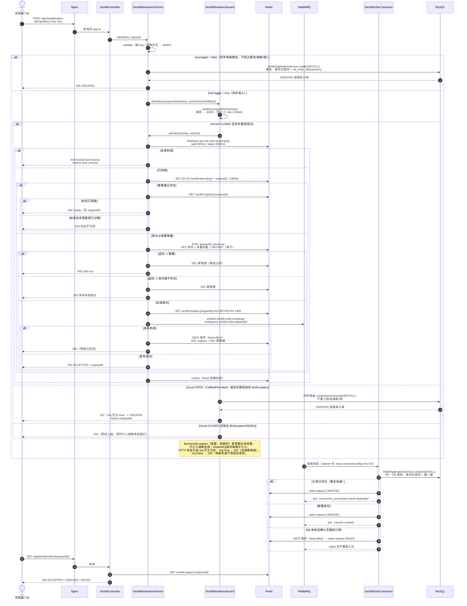

# 图 2 · 秒杀下单全链路

> 代码基线：`504fc74`（本目录所有图统一基线）
> 源文件：[02-seckill-request-chain.mmd](02-seckill-request-chain.mmd) · 类型：`sequenceDiagram`

从浏览器/Nginx 到应用准入、Redis 锁/幂等/Lua、RabbitMQ、消费者与 MySQL 的完整时序，包含发布失败/消费失败补偿、熔断降级到同步 DB 路径，以及 `mq` 开关关闭时的同步替代路径。

读图要点：HTTP 状态只由 `mq` 开关决定——`mq=true` 返回 202（包括熔断降级到同步 DB 的请求），`mq=false` 返回 200；降级本身不改变状态码。

