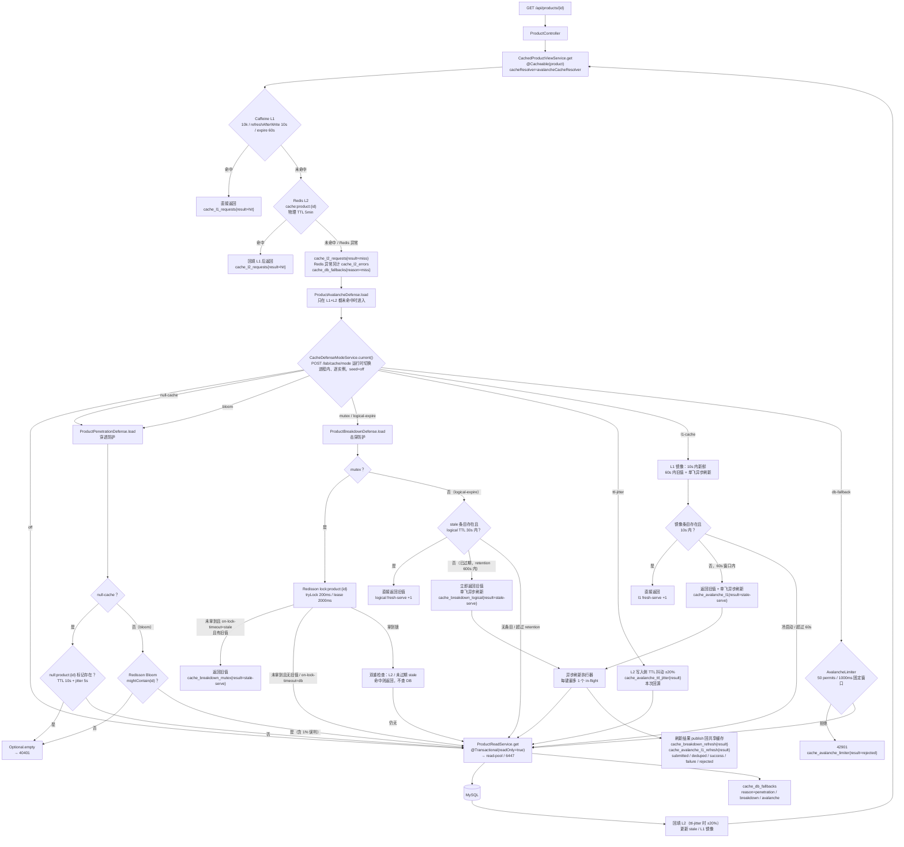

# 图 4 · 缓存读路径与四类防护

> 代码基线：`504fc74`（本目录所有图统一基线）
> 源文件：[04-cache-read-path.mmd](04-cache-read-path.mmd) · 类型：`flowchart TB`

L1 Caffeine → L2 Redis → 穿透/击穿/雪崩防护 → DB 回源，展示 `POST /lab/cache/mode` 的运行时模式分派、各策略参数，以及指标落点。

读图要点：一个进程内模式开关逐实例生效；`off` 保持历史行为；`db-fallback` 超出 50 permits/1000ms 直接 42901；异步刷新每键最多一个 in-flight。

