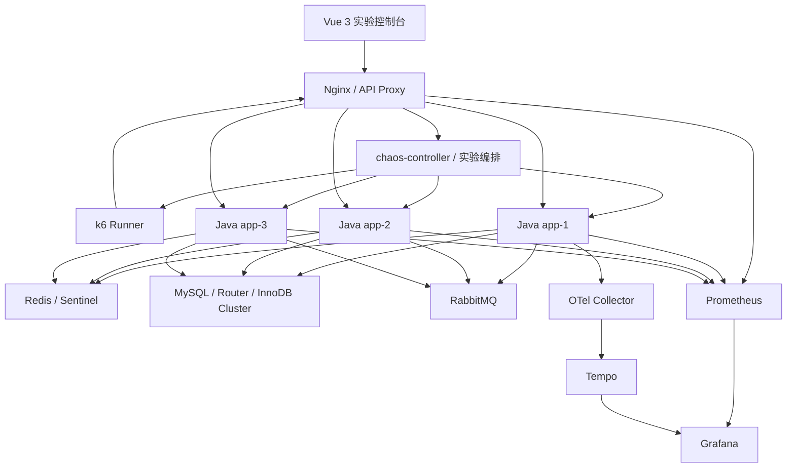

# Stage2 改造方案：Java 并发与高可用演练工作台

- 文档版本：v1.3
- 日期：2026-10-27
- 基线：Stage1 当前实现与设计文档
- 状态：方案评审稿（已纳入 B0 前置门禁、流量归因、崩溃恢复与负向验收；已纳入 2026-10-27 用户确认的 8 项范围结论，见需求 §十一 与本文件 §15）
- 范围：在 Stage1 基础上进行增量改造；本文件不代表代码已经实现

---

## 1. 方案摘要

Stage2 将现有 Java 高并发与高可用教学实验室，改造成一套可从 UI 完成配置、启动、观测、故障注入、压测、对比和复盘的实验工作台。

改造原则：

1. **保留 Stage1 已有架构与实验能力**，优先复用 Docker Compose、Nginx、Java 应用、chaos-controller、k6、Prometheus、Grafana、Tempo、OTel Collector、Redis、MySQL、RabbitMQ 及现有实验脚本。
2. **控制台成为统一入口**：常用控制和关键指标直接呈现在 UI；Grafana 继续承担深度监控与探索，不用自研图表替代全部 Grafana 能力。
3. **相同业务代码，不同运行配置**：多个负载均衡 Java 实例可以配置不同 JDK、JVM/GC 参数、业务线程池参数及缓存策略，以观察不同配置在相同流量下的差异。
4. **从场景向导进入完整实验流程**：向导负责选择目标、配置、预检查、执行、监控和恢复，不只是一个场景下拉框。
5. **拓扑和压测结果按实例可解释**：拓扑图展示流量路径和实例负载热度；Benchmark 展示各 Java 实例实际接收请求数、占比、响应时间和吞吐。
6. **每次实验可复现**：保存配置快照、数据规模、压测参数、故障时间线、监控窗口、阈值结果和业务对账。
7. **区分“目标配置”和“实际状态”**：UI 中的目标 key 数、JVM 参数或故障状态，只有经过后端确认后才能显示为实际生效。
8. **本项目是本地演示实验室**，不是生产级秒杀平台；不引入复杂多租户、生产级权限体系或集群自身 HA。

## 2. Stage1 基线与改造边界

### 2.1 已有基础（按当前文档记录）

- Nginx 作为统一入口，负载均衡到 `jl-app-1/2/3`。
- Java 应用基于相同业务主链路；设计包含 JDK 21 与可选 JDK 8 外壳。
- `chaos-controller` 管理容器故障动作、实验向导、日志与状态探针。
- 有线程实验室、缓存实验、Redis Sentinel、MySQL InnoDB Cluster + Router、RabbitMQ 异步链路等实验基础。
- Prometheus + Grafana 采集和展示应用、JVM、容器、Redis、MySQL、Nginx、RabbitMQ 等指标；Tempo/OTel 提供链路追踪。
- k6 已有 smoke/load/stress/spike/soak 等场景及 cache/HA/DB 故障相关场景；已有 `bench.sh`、`compare.sh`、报告归档与部分 `run_id` 关联能力。
- UI 已有拓扑、场景向导、线程、缓存、JVM 调优、JDK 对比和 benchmark 等页面基础。

### 2.2 已知缺口与限制

- 部分正式压测仍需在终端执行，尚未完全纳入 UI 的完整执行闭环。
- `bench.sh` 当前支持的场景白名单少于 k6 Runner 本身支持的场景；需统一可执行场景目录。
- 现有 compare 以两次 run 为主；业务对账、N 次实验查询和历史检索需要完善。
- k6 指标带 `run_id`，但应用侧常规 Micrometer 指标没有相同的 run 标签；首期应用指标应按实验时间窗口聚合，并明确显示关联口径。
- `TwoLevelCache` 有 Caffeine L1 + Redis L2，但 L2 TTL 当前为硬编码；有整体缓存开关，缺少独立的 Caffeine-only 开关。
- Caffeine 已启用 `recordStats()`，但统计尚未完整绑定到 Micrometer；L1 条目数、命中率和驱逐指标需要补齐。
- 缓存状态接口以计数为主，没有完整的键分页、单键值/TTL 查询接口。
- Redis 没有“最大 key 数”原生配置；应通过实验数据播种控制目标规模，以业务前缀统计实际数量，不能把 Redis 内存限制当作 key 数限制。
- 应用代理存在路径白名单和 query string 转发限制；新增缓存查询 API 时需要同步修复代理路径、请求体和响应大小限制。
- 某些业务指标当前只注册未在真实业务路径递增，例如 `stock_oversold_total`；必须修复或由真实库存/订单对账补足，不能把恒为 0 当成通过。
- 故障动作 TTL、手动保持、单项撤销、超时反馈、恢复后健康确认及状态呈现需要统一。
- Redis Sentinel / MySQL HA 等部分 exporter 或指标接线需要按当前环境复核，不能只依据仪表盘存在就判定采集正常。
- 数据库内置 10,000 条基础商品作为每次重置后的基础环境（已确认口径，需求 §十一.3）：由**固定 seed 确定性生成**，库存随 seed 随机、每次重置结果相同；数量与 seed 外置为配置（默认 10,000 与固定种子），不用「写死」实现——与工程规约 §1 配置外置保持一致。是否替换商品 1/20 演示基线与库存具体区间遗留待确认。

### 2.3 Stage2 非目标

- 不重写业务领域和现有故障实验。
- 不把所有 Grafana 仪表盘迁移到 Vue。
- 不开放任意 Docker 命令、任意 shell 或无限制 JVM 参数输入。
- 不把关闭 Redis 与模拟 Redis 故障混为一谈。
- 不在 Prometheus 中给所有应用指标随意增加高基数 `run_id` 标签。
- 不承诺在同一运行进程内热修改所有 JVM 启动参数。

## 3. 目标架构



### 3.1 新增/强化的逻辑模块

1. **实验配置与台账**：创建 run、保存参数快照、状态转换、历史查询。
2. **实例配置管理**：管理每个 Java 实例的 JDK 镜像、JVM 启动参数和运行时应用配置。
3. **Benchmark 执行器**：通过白名单启动 k6 容器，管理日志、停止、超时和报告生成。
4. **指标查询聚合**：通过 Prometheus HTTP API 获取核心指标，按实例和实验时间窗口归集。
5. **缓存实验服务**：数据播种、预热、实际键数量核验、L1/L2 开关与键查询。
6. **故障剧本**：统一故障启动、暂停、恢复、TTL、单项撤销和全局急停。
7. **业务对账器**：检查库存、订单、幂等和消息队列最终状态。

以上模块优先作为现有 chaos-controller、应用 `/lab/**`、脚本和 Vue 页面上的增量改造，不为每项能力新增独立微服务。

## 4. 多 Java 实例的 JVM 与应用配置

### 4.1 目标

`jl-app-1/2/3` 使用相同源码版本与业务代码，通过每个实例独立的运行配置，支持比较不同 JVM、GC、堆参数和缓存策略。

示例：

| 配置 | app-1（基线） | app-2（实验组 A） | app-3（实验组 B） |
|---|---|---|---|
| 应用源码版本 | 相同 | 相同 | 相同 |
| JDK | 21 | 21 或已验证的 8 外壳 | 21 |
| `-Xms/-Xmx` | 256m/512m | 128m/256m | 512m/512m |
| GC | 默认/已验证配置 | Parallel 或适用配置 | G1 或适用配置 |
| Caffeine L1 | 开 | 关 | 开 |
| L1 最大条目数 | 10,000 | 不适用 | 20,000 |
| L2 TTL | 300s | 300s | 600s |
| 线程池参数 | 基线 | 实验参数 A | 实验参数 B |

以上数值仅为示例，实际可选项必须受当前镜像、JDK 版本和资源预算约束。

### 4.2 配置类型与生效方式

| 配置类别 | 示例 | 生效方式 |
|---|---|---|
| 镜像/运行时 | JDK 8、JDK 21、已验证镜像 tag | 重建或替换容器 |
| JVM 启动参数 | `-Xms`、`-Xmx`、GC 选择、GC 日志 | 重启 JVM |
| 容器资源 | CPU quota、memory limit | 容器重建或受控更新 |
| 运行时应用参数 | Caffeine 开关、缓存 TTL、熔断/限流 | 通过受控应用配置 API 动态生效，或按实现要求重启 |
| 实验参数 | VU、持续时间、阈值、故障时间 | 仅作用于本次 run |

UI 应明确显示配置状态：`草稿`、`校验失败`、`待重启`、`应用中`、`已生效`、`应用失败`。启动参数不能伪装成热更新。

### 4.3 GC 参数配置（按 JDK/GC 类型动态显示）

GC 配置不能只有一个“GC 类型”下拉框。用户选择 GC 后，UI 应展示与当前 JDK 版本兼容的参数表单、参数说明、默认值/当前值、建议范围和是否需要重启。所有参数都以白名单字段生成 JVM 参数，禁止把整段文本直接拼接成 shell 命令。

**G1 参数建议首批支持：**

| UI 参数 | JVM 参数 | 用途与校验 |
|---|---|---|
| 目标最大停顿时间（ms） | `-XX:MaxGCPauseMillis=200` | G1 的目标值，不是硬性上限；需提示“目标停顿时间”，不能承诺每次 GC 都满足 |
| 并发标记启动占用率（%） | `-XX:InitiatingHeapOccupancyPercent=45` | 触发并发标记的堆占用阈值；整数范围与当前 JDK 兼容性校验 |
| G1 Region 大小 | `-XX:G1HeapRegionSize` | 仅在当前 JDK 支持时显示；使用受限枚举，如 `1m/2m/4m/8m/16m/32m`，同时检查堆大小约束 |
| 并行 GC 线程数 | `-XX:ParallelGCThreads` | 允许自动/指定；指定值不能超过配置的安全上限 |
| 并发 GC 线程数 | `-XX:ConcGCThreads` | 允许自动/指定；与 CPU quota 联合校验 |
| 预留堆比例（%） | `-XX:G1ReservePercent` | 校验合法范围，并展示它对可用堆空间的影响 |
| Mixed GC 目标次数 | `-XX:G1MixedGCCountTarget` | 校验为正整数，并仅对支持该参数的版本显示 |
| Mixed GC 堆浪费阈值（%） | `-XX:G1HeapWastePercent` | 校验范围并显示默认值来源 |
| 字符串去重 | `-XX:+UseStringDeduplication` / `-XX:-UseStringDeduplication` | 作为布尔开关；仅在对应 GC/JDK 支持时显示 |
| GC 日志 | JDK 8：`-Xloggc` 等；JDK 9+：`-Xlog:gc*` | 由版本适配器生成，不要求用户手写跨版本日志参数 |

**其他 GC 类型：**
- Parallel：显示当前 JDK 支持的并行 GC 线程、堆大小及日志参数。
- Serial：仅展示适用的参数；不显示 G1 专属字段。
- ZGC / Shenandoah：仅在已验证的 JDK 镜像支持时出现在下拉框中；不支持的镜像隐藏选项或明确禁用。
- “使用 JVM 默认值”应是明确选项；未填写的参数默认不生成 JVM 参数，而不是擅自写入一个推测值。

**交互和验收要求：**
1. 选择实例 JDK 与 GC 后，参数表单随之刷新；不兼容参数不能提交。
2. 每个字段提供“JVM 默认值 / 当前目标值 / 本次生效值”，有条件时通过 `jcmd`、启动参数回读或应用启动信息确认实际值。
3. 提供“恢复该 GC 类型默认值”和配置差异预览；保存后显示“待重启”，重启并健康检查后显示“已生效”。
4. 记录原始参数、规范化后的有效参数、JDK 版本、GC 类型、镜像 digest 和应用结果到 run 快照。
5. `MaxGCPauseMillis` 是目标而非保证值；报告同时比较实际 GC pause 的 P50/P95/P99（采集能力允许时）、最大暂停、吞吐和 CPU，避免只根据目标参数判定效果。

### 4.4 Java 业务线程池配置

实例配置页应显式展示和配置业务线程池，不把业务线程池与 Tomcat Web 线程池、ForkJoinPool 或 Hikari 连接池混为一谈。先确认业务代码实际使用的线程池 bean/执行器，再将其纳入受控配置。

| 参数 | 建议控件 | 生效方式与约束 |
|---|---|---|
| 核心线程数 `corePoolSize` | 整数输入 | 只有对应执行器支持安全动态调整时才可热更新；否则标记重启/重建 |
| 最大线程数 `maxPoolSize` | 整数输入 | 必须 `maxPoolSize >= corePoolSize`；受 CPU/内存安全上限约束 |
| 队列容量 `queueCapacity` | 整数输入 | 有界队列优先；容量变化通常需重建执行器或重启应用，不能假定可热更新 |
| 空闲线程存活时间 `keepAliveSeconds` | 整数输入 | 只对支持该属性的执行器开放 |
| 核心线程超时 `allowCoreThreadTimeOut` | 开关 | 与 keep-alive 组合校验 |
| 拒绝策略 `rejectionPolicy` | 白名单下拉框 | 只允许项目已实现并验证的策略；明确 `AbortPolicy`、`CallerRunsPolicy` 等语义及风险 |
| 预启动核心线程 `prestartAllCoreThreads` | 开关（可选） | 仅在执行器实现支持时开放 |

**线程池配置与观测必须闭环：**
- 每个实例展示目标值与有效值，并提供 Active、Pool size、Core/Max、Queue size、Queue remaining、Completed、Rejected、任务耗时等指标。
- 配置应用后读取执行器实际参数进行确认；若无法回读，显示“配置请求已提交，实际生效未验证”，不可直接显示成功。
- 动态修改只允许对实现明确支持的字段开放；队列容量等不能安全修改的字段必须走重建/重启流程。
- 报告记录每个实例的线程池配置快照，并与 k6 的实例请求数、响应时间、错误率和拒绝数关联分析。

### 4.5 JDK 8 / 21 约束

- 只允许选择已构建、已测试的应用镜像。
- JDK 8 与 JDK 21 应通过对应的应用外壳/构建目标提供；不能仅把容器内 `JAVA_HOME` 指向另一个路径就认为完成切换。
- 公共业务代码应保持兼容的编译目标；依赖、Spring Boot 版本与 Java 版本必须匹配。
- 每个实例暴露 `app`、`instance`、`jvm.version`、`app.version` 等低基数标签。
- 报告记录源码 commit、镜像 tag/imageId（最小闭环，见 §10.4）、Java 版本和有效启动参数。

**JDK 8 外壳的观测边界（已确认，需求 §十一.7）**：JDK 8 外壳纳入 B4 每实例配置，但标记为 `LIMITED-OBSERVABILITY`——支持镜像选择、JVM 启动参数配置、重启生效、容器/进程/GC 日志回读，并作为 jdk-matrix 实验的必过项；**不承诺**运行时热配置回读和完整应用内指标，相关状态显式显示 `READBACK_UNAVAILABLE`，指标用 GC 日志、JMX、外部采集兜底并在报告中标注来源。
原因：8 号壳（Spring Boot 2.7 / Micrometer 1.9）**故意不依赖 platform-observability**（jakarta 命名空间不兼容，见架构现状 §2），也没有 `/lab/**` 配置与回读端点、没有登录端点；Boot 2.7 时代也没有 `jvm_info` 序列。为它补齐应用内热配置回读需要重写一层兼容代码，与"保留 Stage1 能力、增量改造"的原则冲突，收益只服务一个对照页，因此按 `LIMITED-OBSERVABILITY` 边界处理而不是强行拉平。

### 4.6 安全和资源限制

- JVM 参数由后端白名单和类型规则校验，禁止任意 shell 参数或挂载路径。
- 校验 `-Xmx` 与容器内存限制的关系，预留 Metaspace、线程栈、直接内存和 native 开销。
- OOM 故障仅能作用于专用小堆实验实例，且必须有恢复路径。
- 重启前检查是否存在正在执行的 benchmark；默认要求先结束当前 run。
- 每次配置应用保留前后快照、实例名、时间、结果和失败原因。

## 5. 缓存实验改造

### 5.1 必须新增的能力

- 独立控制每个 Java 实例的 Caffeine L1 开关。
- 保留 Redis L2 开关/故障模式，但区分“正常关闭 L2”和“Redis 不可用”。
- 配置 L1 最大容量、刷新/过期参数和 L2 TTL。
- UI 设置目标 Redis 业务缓存键数，执行 seed 后核验实际数量。
- 展示每个 Java 实例 Caffeine 的实际条目数、命中/未命中、命中率和驱逐数。
- 展示 Redis 业务缓存键数、内存、命中/未命中、错误、TTL 与驱逐信息。
- 提供分页键列表；值仅在查询单个键时按需读取，并限制返回字节数。
- 支持预热、清理/重置、实际数量复核和缓存实验报告。

### 5.2 计数口径

- Redis 业务缓存键只按已定义的商品缓存前缀统计，例如 `cache:product:*`；不把锁、Bloom、空值标记、热点 ZSet 等其他命名空间计入商品缓存键数量。
- Redis 使用 `SCAN` 分页，禁止在在线实验接口使用 `KEYS`。
- Caffeine 是每个 JVM 的本地缓存，分别显示 app-1/app-2/app-3 的数据。
- `maximumSize` 是容量上限，不是当前条目数；当前数量应使用实际缓存状态/估算条目数。
- UI 必须分开显示目标数、实际数、差值、播种状态和核验时间。
- Caffeine 关闭时显示“不适用/已关闭”，不能显示为采集失败。

### 5.3 缓存对照实验矩阵

| 实验组 | Caffeine L1 | Redis L2 | 目的 |
|---|---|---|---|
| A：两级缓存 | 开 | 开 | 基准 |
| B：仅 Redis | 关 | 开 | 测量 L1 对延迟、吞吐与回源的影响 |
| C：Redis 故障 | 开 | 故障 | 观察本地缓存兜底和降级行为 |
| D：两级均不可用 | 关 | 故障 | 观察回源、限流、降级与错误 |

A/B 是第一优先级。对照实验需使用相同数据集、请求比例、VU、持续时间、实例数、JVM 参数及预热流程。若测试写业务数据，必须执行可验证的数据复位。

**C/D 组的执行场（已确认，需求 §十一.6）**：chaos-proxy 与 ha/db-ha **维持互斥**。C/D 组（Redis 不可用）默认在 `dev + chaos-proxy` 场执行，用 Toxiproxy 模拟 Redis 故障；Redis/MySQL 的 HA 切换（Sentinel failover、Cluster 杀主）走独立场景，用容器动作完成，**不叠加 Toxiproxy**。「关闭 Redis」（配置态）与「Redis 故障」（故障态）仍按上文口径分开。

### 5.4 建议新增接口（示例契约，需与现有 API 风格统一）

| 方法 | 路径 | 用途 |
|---|---|---|
| `GET` | `/lab/cache/l1/state` | 查询指定实例或当前实例 L1 开关和统计 |
| `POST` | `/lab/cache/l1/config` | 修改 L1 开关/容量等白名单参数 |
| `POST` | `/lab/cache/seed` | 扩展为可设置目标数据规模并返回播种结果 |
| `GET` | `/lab/cache/keys` | 分页列出指定业务前缀的键（cursor/limit） |
| `POST` | `/lab/cache/key` | 查询单个键的 L1/L2 状态、值预览和 TTL |
| `GET` | `/lab/cache/state` | 保留汇总状态并补充目标/实际数量与采集时间 |

如果现有接口命名或 DTO 更合适，可在实现时调整，但需保留上述语义。当前代理会丢弃 query string 的问题要先修复，或对查询参数采用 POST body，并将新路径加入严格白名单。

## 6. 指标与观测

### 6.1 监控原则

- Prometheus 继续作为指标存储和查询入口。
- Grafana 保留完整仪表盘、Explore 和历史查询能力。
- Vue 控制台展示实验最常用的 KPI、按实例指标、状态和对比表，并可嵌入 Grafana 面板或跳转到带时间范围的 Grafana/Tempo 页面。
- 所有面板显示数据时间、实例维度和缺失数据状态；没有序列时显示“无数据”，不显示虚构的 0。
- 应用指标优先用低基数标签；禁止将 userId、订单号、traceId、原始 URL 等作为指标标签。

### 6.2 必须覆盖的指标目录

#### HTTP / k6
- RPS、请求总量、成功率、失败率、状态码分布。
- P50/P90/P95/P99、最大延迟；只有采集端提供真实分位数时才展示。
- k6 VU、迭代数、检查失败、超时、连接错误。
- 阈值 PASS/FAIL 与阈值详情。

#### JVM
- 堆 used/committed/max、非堆/Metaspace、BufferPool/直接内存（采集可用时）。
- Live/Peak/Daemon 线程数与线程状态分布。
- GC 次数、耗时、暂停时间与长暂停；GC 类型。
- 进程/容器 CPU、容器 RSS、重启次数、OOM/堆转储事件。
- Java 版本、JVM 参数、镜像版本和配置变更时间。

#### Web、业务线程池、数据库连接池
- Tomcat 当前/忙碌/最大线程数及连接数（按实际采集能力）。
- 业务线程池 Active、Pool size、Core/Max、Queue、Remaining capacity、Completed、Rejected。
- Hikari active/idle/pending/max/total、连接获取耗时、超时/失败。
- 线程故障注入数、活动故障数、恢复数、快照和故障模式。

#### Caffeine / Redis
- L1 开关、每实例条目数、命中/未命中、命中率、驱逐数、预热加载数/耗时/失败数。
- L2 命中/未命中/错误、业务键数量、内存、驱逐、连接数、命令速率。
- DB fallback 次数和原因；穿透、击穿、雪崩、互斥锁、逻辑过期、TTL 抖动等防护计数。
- 单键 TTL 和缓存状态（通过按需查询接口展示，不将键名/值放入 Prometheus 标签）。

#### MySQL / HA
- QPS/TPS、查询与事务耗时、连接数、慢查询、锁等待、死锁（以可采集指标为准）。
- Hikari 读写池状态、Router 读写路径。
- InnoDB Cluster 成员状态、PRIMARY、ONLINE 状态与故障转移事件。
- 库存基线、剩余库存、扣减量、订单新增量和对账结果。

#### Redis / RabbitMQ / Nginx / 容器
- Redis 角色、复制状态、Sentinel 主节点切换、内存和驱逐。
- RabbitMQ Ready/Unacked、发布/消费速率、失败、积压和排空时间。
- Nginx 请求速率、上游响应时间、状态码和失败数。
- 容器 CPU、内存、重启、健康检查；网络指标在当前 WSL2/cAdvisor 环境实际可用时展示，否则标记为降级项。
- Toxiproxy 的延迟、带宽、断网状态和生效时间。

#### 熔断、限流、业务正确性
- 熔断状态及切换次数、慢调用/失败率、限流通过/拒绝、降级次数。
- `seckill_attempts_total{result}`、`order_consumer_processed_total{result}`、`orders_created_total`、`idempotent_reject_total`、`order_accept_seconds`。
- 修复 `stock_oversold_total` 的真实递增路径，或将其标记为未接线；最终判定以真实业务对账为准。
- 订单新增量、订单数量合计、库存变化、重复订单/幂等键、消息队列排空状态。

### 6.3 UI 指标布局

- 顶部 KPI：RPS、P95/P99、失败率、VU、运行时长、实验状态。
- JVM 行：每个实例一列，堆、GC、CPU、线程数。
- 线程池/连接池：Active、Queue、Rejected、Pending。
- 缓存行：L1/L2 开关、条目数、命中率、DB fallback。
- 业务正确性：订单、库存、超卖、幂等、队列排空。
- 时间线：k6 开始/结束、配置应用、故障注入/恢复、异常事件。
- 深度分析：Grafana 面板、Tempo trace 链接。

## 7. k6 执行、归档与比较

### 7.1 UI 可配置参数

- 场景：`smoke`、`load`、`spike`、缓存对比、DB/Redis HA 故障等经验证的白名单场景；`stress`/`soak` 首期不进入 UI 白名单（已确认，移入 §15 Future，场景本身保留在 CLI 与文档口径中）。
- VU/阶段曲线、持续时间、预热时间、请求比例、数据规模。
- 目标配置组/实例配置、缓存策略、阈值。
- 故障剧本、故障目标、开始时间、持续时间、自动 TTL 或手动保持。
- 数据复位策略、结束后业务对账选项。

UI 只提供后端已实现且通过验收的场景，不直接拼接任意 shell 命令。

### 7.2 执行器设计

- 由 chaos-controller 或现有脚本执行层启动固定版本的 k6 Runner 容器。
- 镜像、命令、参数、挂载路径、运行时长、并发 run 数量均受白名单限制。
- 返回唯一 `run_id`、状态、日志、开始/结束时间和退出结果。
- 支持停止、超时清理、失败恢复与报告归档。
- 执行期间禁止重复启动同一资源冲突场景；对于数据会互相污染的场景，默认只允许一个活动 run。

### 7.3 实验台账

每次 run 至少记录：

- `run_id`、场景、状态、创建/开始/结束时间、退出码。
- 源码 commit、应用镜像、JDK/JVM 参数和每个实例的有效配置快照。
- k6 场景参数、阈值、请求比例、数据集/库存基线。
- L1/L2 开关、目标/实际键数、TTL、预热结果。
- 故障动作、目标、开始/结束时间、恢复状态。
- k6 汇总、Prometheus 时间窗口、业务对账结果、最终判定。
- 报告文件位置和 Grafana/Tempo 深链。

第一期应用指标按 `[run_start, run_end]` 时间窗口查询，并在报告里标注窗口口径；k6 自身指标按 `run_id` 过滤。不要为了 UI 方便就给所有应用指标添加高基数 run 标签。

### 7.4 比较报告

至少支持两次 run 横向对比；建议台账接口设计支持后续 N 次比较。指标包括：

- RPS、总请求数、成功/失败率、P95/P99。
- JVM 堆峰值、GC 暂停、线程峰值、CPU。
- 线程池队列与拒绝数、Hikari pending。
- L1/L2 命中率、DB fallback、键数量。
- MySQL/Redis/MQ 状态、故障恢复时间。
- 订单、库存、幂等和队列排空对账。
- 每项指标差值、百分比变化和实验阈值结果。

### 7.5 公平性规则

比较两组配置时，除要比较的变量外，其余变量尽量一致：源码版本、数据集、VU、持续时间、请求比例、实例数、依赖拓扑、JVM 其他参数、缓存预热策略和资源预算。若实验专门比较不同 JVM/GC，则要把 JVM/GC 作为显式变量，并保存完整配置快照。

## 8. 故障注入闭环

统一现有故障动作与向导能力，支持：

- 选择目标容器/实例及故障类型。
- 自动 TTL 或手动保持（manual hold）。
- 暂停/继续实验时冻结/恢复 TTL 计时。
- 查看实际动作状态、剩余时间、最后错误和容器健康状态。
- 单项撤销、目标恢复、全局“全部停止”与全量重置。
- 将故障事件记录到 run 时间线。
- 对 start/restart/resume 类动作，在 UI 中区分“请求已接受”和“容器健康已恢复”。

首批场景优先覆盖：
1. Java 实例 kill/restart/freeze/resume。
2. 七种线程实验和线程快照。
3. Caffeine 开/关、缓存穿透/击穿/雪崩。
4. Redis 故障和 Sentinel 切换。
5. MySQL 主节点故障与 Router 路由。
6. Toxiproxy 延迟、断网（bandwidth 带宽压制首期隐藏、不进 UI，移入 §15 Future）。
7. 熔断、限流和降级。
8. RabbitMQ 消费积压与恢复。

所有动作限定在 `lab=java-learn` 的实验容器，并继续使用现有 token/白名单机制。

## 9. 简单 UI 设计（Markdown 线框图）

以下线框图是页面布局建议，不是实际运行截图。**信息架构已确认（需求 §十一.2）：控制台一次性重构为侧边导航工作区**（总览 / 场景向导 / 实例与 JVM / Benchmark / 实时监控 / 故障与缓存实验 / 实验报告与对比），现有线程实验室、缓存实验室、向导、动画视图等组件逐步挂接迁移，不为换 UI 重写已可用能力；`console-smoke` 断言基线随重构一次性重写并在后续批次逐批增补。

### 9.1 总览 `/`

```text
┌──────────────────────────────────────────────────────────────────────┐
│ Java 并发与高可用演练台   环境：DEV/HA   状态：干净   [全部停止] [重置] │
├────────────┬─────────────────────────────────────────────────────────┤
│ 总览       │ 当前实验：cache-lab             Run ID：run-20261027-001 │
│ 场景向导   │ 状态：运行中  运行时长：02:31    [暂停] [停止] [查看报告] │
│ 实例/JVM   ├──────────────┬──────────────┬──────────────┬─────────────┤
│ Benchmark  │ RPS          │ P95          │ 错误率       │ VU          │
│ 缓存实验   │ 1,240        │ 86 ms        │ 0.2%         │ 100         │
│ 线程实验   ├──────────────┴──────────────┴──────────────┴─────────────┤
│ 故障时间线 │ 实时曲线：RPS / P95 / P99 / 错误率 / CPU / GC             │
│ 监控面板   ├─────────────────────────────────────────────────────────┤
│ 实验记录   │ app-1 健康 | app-2 健康 | app-3 故障中 | Redis 正常       │
│            │ 最近事件：10:02:01 app-3 freeze；10:02:20 请求失败上升    │
└────────────┴─────────────────────────────────────────────────────────┘
```

### 场景向导 `/wizard`（核心流程，必须明确设计）

场景向导采用分步流程，顶部显示步骤进度，支持返回修改；每一步保存草稿，但只有预检查通过后才允许启动。建议流程如下：

```text
1 选择实验类型
  ├─ 基准压测：smoke / load / stress / spike / soak
  ├─ 缓存对照：Caffeine L1 开/关、Redis L2 对照、预热/冷缓存
  ├─ JVM/GC 对照：不同 JDK、GC、堆与 G1 参数
  ├─ 线程池对照：不同实例 core/max/queue/rejection 配置
  └─ 高可用故障：实例故障、Redis/MySQL/MQ/Toxiproxy、熔断/限流
       ↓
2 选择目标与流量路径
  - 入口：Nginx / 业务 API
  - 被测实例：全部实例或指定实例；显示当前 upstream 权重
  - 依赖：Redis / MySQL / RabbitMQ / Toxiproxy
       ↓
3 配置实验变量
  - 基线组与实验组；明确本次只改变哪些变量
  - VU/阶段曲线/时长/预热、请求比例、数据规模、阈值
  - 各实例 JDK/JVM/GC/业务线程池/缓存配置
       ↓
4 配置故障（可选）
  - 故障类型、目标、触发时刻、持续时间/手动保持、恢复策略
       ↓
5 预检查
  - 容器健康、镜像/JDK/参数兼容性、配置是否已生效
  - 资源预算、数据准备、无冲突 run、故障残留、监控数据可用性
  - 预计请求量和破坏性动作二次确认
       ↓
6 执行与实时观测
  - 显示 run ID、阶段、k6 状态、实例分流、KPI、故障时间线
  - 支持停止；暂停仅在场景/执行器明确支持时提供
       ↓
7 结束检查与报告
  - 停止流量、等待异步队列排空、业务对账、检查故障恢复
  - 汇总实例命中次数、响应时间、RPS、错误率、GC/线程池/缓存指标
  - 保存报告并支持与历史 run 比较
```

**向导每一步的 UI 结构：**
- 左侧/顶部：步骤名、完成状态、可返回步骤。
- 主区域：当前步骤的配置控件与简短说明。
- 右侧摘要：实例数、流量目标、数据规模、故障项、配置差异。
- 底部操作：`上一步`、`保存草稿`、`下一步`；最后一步为 `执行预检查`，预检查通过后才出现/启用 `启动实验`。
- 预检查失败时按“阻断项 / 警告项”分组，提供具体修复建议；阻断项未解决不能强制跳过。
- 配置比较实验时，展示“变量差异清单”，提醒哪些配置不同、哪些配置保持一致。
- 每个向导模板必须关联后端白名单场景 ID；UI 不得只凭显示名称自行拼接脚本参数。

### 9.2 实例/JVM `/instances`

```text
┌──────────────────────────────────────────────────────────────────────┐
│ 实例与 JVM 配置                                      [校验全部] [应用] │
├──────────┬───────────────┬──────────────┬──────────────┬──────────────┤
│ 实例     │ app-1         │ app-2        │ app-3        │              │
│ 源码版本 │ 同一 commit   │ 同一 commit  │ 同一 commit  │              │
│ JDK      │ [21 ▼]        │ [21 ▼]       │ [8 ▼]        │              │
│ 镜像     │ [jdk21 ▼]     │ [jdk21 ▼]    │ [jdk8 ▼]     │              │
│ Xms/Xmx  │ [256/512 MB]  │ [128/256 MB] │ [256/512 MB] │              │
│ GC       │ [G1 ▼]        │ [Parallel ▼] │ [适用选项 ▼] │              │
│ G1 停顿  │ [200ms]       │ [默认值]     │ [150ms]      │              │
│ 业务池   │ core/max/queue│ core/max/queue│ core/max/queue│             │
│ Caffeine │ [开 ▼]        │ [关 ▼]       │ [开 ▼]       │              │
│ L1 上限  │ [10000]       │ [—]          │ [10000]      │              │
│ 状态     │ 已生效        │ 待重启       │ 已生效       │              │
├──────────┴───────────────┴──────────────┴──────────────┴──────────────┤
│ 提示：JDK/GC/堆参数需要重启；应用前显示变更差异、内存校验和影响范围。   │
└──────────────────────────────────────────────────────────────────────┘
```

### 9.3 缓存实验 `/cache`

```text
┌──────────────────────────────────────────────────────────────────────┐
│ 缓存实验：L1/L2 对照                         [生成数据] [预热] [核验] │
├──────────────────────────────┬───────────────────────────────────────┤
│ 配置                         │ 实际状态                              │
│ app-1 Caffeine：[开 ▼]       │ app-1 L1：4,820 / 上限 10,000         │
│ app-2 Caffeine：[关 ▼]       │ app-2 L1：已关闭                      │
│ app-3 Caffeine：[开 ▼]       │ app-3 L1：4,790 / 上限 10,000         │
│ Redis L2：[开 ▼]             │ Redis 业务键：目标 10,000 / 实际 9,980│
│ 目标 Redis 键数：[10000]     │ L1 命中率：app-1 82% / app-3 80%      │
│ L1 最大容量：[10000]         │ L2 命中率：91%   DB fallback：2.1%    │
│ L2 TTL：[300 秒]             │ 最近核验：10:03:15                    │
├──────────────────────────────┴───────────────────────────────────────┤
│ [运行 A：L1 开 + L2 开] [运行 B：L1 关 + L2 开] [比较 A/B]            │
├──────────────────────────────────────────────────────────────────────┤
│ 键查询：前缀 [cache:product:*] [查询]                                 │
│ Key                         L1 状态    Redis 状态   TTL    [查看单键] │
│ cache:product:1001          命中       存在         242s   [查看]     │
│ cache:product:1002          未命中     存在         180s   [查看]     │
└──────────────────────────────────────────────────────────────────────┘
```

### 9.4 Benchmark `/bench`

```text
┌──────────────────────────────────────────────────────────────────────┐
│ Benchmark                                      [新建实验] [停止活动] │
├──────────────────────────────────────────────────────────────────────┤
│ 场景：[load ▼]  VU：[100]  时长：[5m]  预热：[30s]  阈值：[默认 ▼]    │
│ 配置组：[cache-A ▼] 数据规模：[10000] 故障剧本：[无 ▼]                │
│ 数据复位：[压测前复位 ☑]  结束后对账：[☑]          [预检查] [启动]    │
├──────────────────────────────────────────────────────────────────────┤
│ 最近运行                                                               │
│ Run ID           场景       状态      RPS    P95    错误率  业务对账   │
│ run-001          load       PASS      1240   86ms   0.2%   PASS      │
│ run-002          cache-B    FAIL      980    130ms  1.8%   PASS      │
├──────────────────────────────────────────────────────────────────────┤
│ 选择 run-001 与 run-002：[比较]                                        │
│ RPS +26.5% | P95 -33.8% | 错误率 -1.6pp | L1 命中率差值 | 报告/面板   │
├──────────────────────────────────────────────────────────────────────┤
│ 实例分流：实例   命中数   占比   平均响应   P95   实例 RPS   错误率    │
│          app-1  实时值   实时值   实时值    实时值  实时值    实时值    │
│          app-2  实时值   实时值   实时值    实时值  实时值    实时值    │
│          app-3  实时值   实时值   实时值    实时值  实时值    实时值    │
└──────────────────────────────────────────────────────────────────────┘
```

### 9.5 监控面板与被测架构图 `/observe`

监控页面最上方先展示带连线的实时被测架构图，再展示实例列表和曲线。图上的节点对应真实拓扑（Nginx、app-1/2/3、Redis、MySQL Router/Cluster、RabbitMQ、Toxiproxy 等），连线表示请求/依赖路径；应由当前环境拓扑数据生成，不能用固定静态示意图冒充实时状态。

**节点负载热度规则：**
- Java 实例节点按 CPU、内存/RSS、线程池使用率、网络 I/O 和错误率显示热度颜色；支持切换“综合负载 / CPU / 内存 / 线程池 / 网络 I/O”。
- 建议颜色语义：绿色为正常、黄色为接近阈值、红色为超过阈值或异常、灰色为无数据/采集不可用。阈值可配置，颜色必须有图例，不能只凭颜色传达信息。
- 鼠标悬停节点展示 tooltip：实例名、健康状态、JDK、CPU、内存 used/limit、线程数、业务线程池 active/max/queue/rejected、网络接收/发送速率、请求数、平均响应时间、P95、指标更新时间。
- 鼠标悬停连线展示方向、每秒请求量、上游响应时间（可采集时）、错误率和当前连接/依赖状态。Nginx upstream 指标与应用指标口径要分别标注。
- 点击节点可筛选下方实例指标；点击连线可查看路径指标。键盘/点击也应能打开同一详情，避免信息只靠 hover。
- 网络 I/O 指标若当前环境无法可靠采集，应显示“无数据/未接线”，不可用 0 伪装正常。

```text
[ k6 Runner ] ──请求──> [ Nginx / Load Balancer ]
                              │ upstream 请求数 / 响应时间 / 错误率
                ┌─────────────┼─────────────┐
                ▼             ▼             ▼
        [ app-1 🟢 ]   [ app-2 🟡 ]   [ app-3 🔴 ]
          CPU/内存       线程池队列       GC/错误率
             │              │              │
             ├──────┬───────┴──────┬───────┤
             ▼      ▼              ▼       ▼
          [Redis] [MySQL Router/Cluster] [RabbitMQ]
```

下方保留实例列表（用于精确比较和无障碍查看）：

| 实例 | 健康 | CPU | 内存/RSS | JVM 线程 | 业务池 Active/Max | Queue | 网络 RX/TX | 请求数 | 平均响应时间 | P95 |
|---|---|---:|---:|---:|---:|---:|---:|---:|---:|---:|
| app-1 | 实时值 | 实时值 | 实时值 | 实时值 | 实时值 | 实时值 | 实时值 | 实时值 | 实时值 | 实时值 |
| app-2 | 实时值 | 实时值 | 实时值 | 实时值 | 实时值 | 实时值 | 实时值 | 实时值 | 实时值 | 实时值 |
| app-3 | 实时值 | 实时值 | 实时值 | 实时值 | 实时值 | 实时值 | 实时值 | 实时值 | 实时值 | 实时值 |

以上表格是字段线框，不是预填的真实数据；实际无数据时必须显示无数据。

### 9.6 Benchmark `/bench` 增加实例分流统计

Benchmark 主结果区除整体 RPS/P95/P99/错误率外，增加“负载均衡分流”面板，按实例展示：

| 实例 | 收到请求数 | 分流占比 | 成功数/失败数 | 平均响应时间 | P95/P99 | 实例 RPS | 错误率 | 线程池拒绝 | 配置组 |
|---|---:|---:|---:|---:|---:|---:|---:|---:|---|
| app-1 | 真实采集值 | 真实采集值 | 真实采集值 | 真实采集值 | 真实采集值 | 真实采集值 | 真实采集值 | 真实采集值 | baseline |
| app-2 | 真实采集值 | 真实采集值 | 真实采集值 | 真实采集值 | 真实采集值 | 真实采集值 | 真实采集值 | 真实采集值 | experiment-A |
| app-3 | 真实采集值 | 真实采集值 | 真实采集值 | 真实采集值 | 真实采集值 | 真实采集值 | 真实采集值 | 真实采集值 | experiment-B |

**计数口径要求：**
- 优先使用 Nginx upstream 按 upstream peer 的请求计数、响应时间与失败指标；同时在 Java 应用端按实例统计业务请求数，二者用于交叉核对。
- 若使用应用 Micrometer HTTP 指标，需区分业务路由与健康检查/监控端点；不要将 `/actuator/**` 等内部探针算作业务命中。
- “负载均衡击中次数”定义为指定 run 时间窗内各实例实际收到的业务请求数；“分流占比”=该实例业务请求数 / 所有被测实例业务请求数总和。
- “平均响应时间”必须明确是应用端处理时间还是 Nginx upstream 响应时间；UI 可并列展示，不能混为同一口径。P95/P99 应来自 histogram/summary 或 k6 的实例级采样，若无法获得则显示“不可用”，不以平均值推算分位数。
- 首期可按 run 的开始/结束时间窗聚合应用侧指标；若存在背景流量，需在预检查中提示并标记数据可能被污染。Nginx upstream 指标若无法按实例/时间窗准确拆分，应明确显示采集限制。
- 比较不同实例配置时，同时展示 Nginx upstream 权重和实例启停状态；权重不一致时提示分流不均衡，避免误把流量差异当作 JVM 性能差异。

### 9.7 监控与故障时间线 `/observe`（实例表格线框）

```text
┌──────────────────────────────────────────────────────────────────────┐
│ 实时观测      实例：[全部 ▼] 指标组：[线程池 ▼] 时间：[当前 Run ▼]     │
├──────────────────────────────────────────────────────────────────────┤
│ [RPS/P95/P99 曲线]                    [JVM 堆/GC/CPU 曲线]             │
├──────────────────────────────────────────────────────────────────────┤
│ 实例     Busy Threads   Pool Active   Queue   Hikari Pending  状态     │
│ app-1    42             18            0       0               正常     │
│ app-2    80             32            120     6               警告     │
│ app-3    0              0             0       0               已冻结   │
├──────────────────────────────────────────────────────────────────────┤
│ 事件时间线：10:02 开始压测 → 10:03 app-3 freeze → 10:03 延迟上升       │
│              → 10:04 恢复 app-3 → 10:05 错误率回落                   │
│ [打开 Grafana 当前时间范围] [打开 Tempo trace] [下载快照]             │
└──────────────────────────────────────────────────────────────────────┘
```

### 9.8 页面交互规则

- 所有会影响运行环境的按钮显示目标实例、当前值、预期影响和是否需要重启。
- 执行中的操作有超时、进度、结果和失败原因，不让 UI 无限等待。
- “已请求”与“已生效/已恢复”是不同状态。
- 全局“全部停止”始终可用；全量重置前显示将被清理的故障与数据范围。
- 指标无数据时显示“无数据/采集异常”，不显示伪造的 0。
- Grafana iframe 若因登录、Cookie 或代理配置不可用，提供带时间范围的跳转链接作为降级方案。

## 10. 后端 API 与数据模型建议

### 10.1 实验接口（建议）

| 方法 | 路径 | 说明 |
|---|---|---|
| `POST` | `/lab/runs` | 创建实验并保存配置快照 |
| `GET` | `/lab/runs` | 查询历史 run，支持场景/状态筛选 |
| `GET` | `/lab/runs/{runId}` | 运行详情与当前状态 |
| `POST` | `/lab/runs/{runId}/start` | 执行预检查并启动 |
| `POST` | `/lab/runs/{runId}/stop` | 停止压测与相关剧本 |
| `GET` | `/lab/runs/{runId}/report` | 报告与结果摘要 |
| `POST` | `/lab/runs/compare` | 比较两个或多个 run |

### 10.2 实例配置接口（建议）

| 方法 | 路径 | 说明 |
|---|---|---|
| `GET` | `/lab/instances` | 实例状态、版本、健康度和有效配置 |
| `GET` | `/lab/instances/{id}/config` | 获取配置快照 |
| `PUT` | `/lab/instances/{id}/config` | 校验并保存目标配置 |
| `POST` | `/lab/instances/{id}/apply` | 重启/重建并等待健康确认 |
| `GET` | `/lab/instances/{id}/metrics` | 返回 UI 核心指标（或统一查询 Prometheus） |
| `GET` | `/lab/topology` | 返回当前节点、连线、实例状态与拓扑版本 |
| `GET` | `/lab/topology/metrics` | 返回拓扑节点/连线的实时指标摘要和更新时间 |
| `GET` | `/lab/instances/{id}/thread-pool` | 查询业务线程池目标值与实际值 |
| `PUT` | `/lab/instances/{id}/thread-pool` | 校验并保存业务线程池配置 |
| `POST` | `/lab/instances/{id}/thread-pool/apply` | 应用支持动态调整的字段，或触发受控重启/重建 |
| `GET` | `/lab/runs/{runId}/instance-stats` | 返回各实例命中次数、分流占比、响应时间和错误率 |
| `GET` | `/lab/scenarios` | 返回后端白名单场景及向导所需的 schema/能力声明 |
| `POST` | `/lab/scenarios/validate` | 执行场景预检查并返回阻断项/警告项 |

这些是语义建议，不要求机械照搬路径。实现时应优先扩展现有 API、复用 token、路径白名单、容器白名单和 DTO 约定。

### 10.3 实验台账字段

```json
{
  "runId": "run-20261027-001",
  "scenario": "cache-lab",
  "status": "COMPLETED",
  "sourceCommit": "git-sha",
  "startedAt": "ISO-8601",
  "endedAt": "ISO-8601",
  "instances": {
    "app-1": {
      "javaVersion": "21",
      "jvmArgs": ["-Xms256m", "-Xmx512m", "-XX:MaxGCPauseMillis=200"],
      "gc": {"collector": "G1", "maxGCPauseMillis": 200, "effectiveArgs": []},
      "businessThreadPool": {"corePoolSize": 16, "maxPoolSize": 64, "queueCapacity": 500, "rejectionPolicy": "AbortPolicy"},
      "caffeineEnabled": true
    }
  },
  "load": {
    "vus": 100,
    "duration": "5m",
    "thresholds": {}
  },
  "cache": {
    "redisTargetKeys": 10000,
    "redisActualKeys": 9980,
    "l1TargetKeys": 5000,
    "l1ActualKeysByInstance": {}
  },
  "instanceStats": {"app-1": {"businessRequests": 0, "share": 0.0, "avgResponseMs": 0, "p95Ms": null, "rps": 0, "errors": 0}},
  "faultEvents": [],
  "businessVerification": {
    "status": "PASS",
    "details": {}
  },
  "verdict": "PASS"
}
```

以上为字段示例。正式模型应校验数据类型、状态转换和配置版本；不要把敏感数据、缓存完整值或用户标识存进指标标签。

## 10.4 B0 前置门禁：Stage1 缺口修复与指标可用性审计

**B0 是 Stage2 B1 的前置门禁，不是可以与后续功能并行“顺手修”的任务。** B0 未通过时，相关实验只能以 `DEGRADED` 或 `INVALID` 状态运行，不得生成无条件的 PASS 结论。

| 缺口 | B0 要求 | 验收证据 |
|---|---|---|
| `stock_oversold_total` 仅注册、未在真实路径递增 | 修复真实递增，或在指标字典中明确标为未接线；业务对账以只读 SQL/接口核验为准 | 造出可验证样本，证明计数/对账结果变化 |
| `TwoLevelCache` 的 L2 TTL 硬编码 | 将 TTL 外置到受控配置，回读有效值并纳入实验快照 | 配置、应用有效值、键 TTL 三者一致 |
| Caffeine stats 未完整绑定 Micrometer | 导出每实例命中、未命中、驱逐等统计；条目数使用 `estimatedSize()` 并标记为估算 | Prometheus 有真实序列，UI 区分无数据与 0 |
| 代理 query string / body / response 限制不完整 | 窄白名单支持缓存接口的 query string；配置请求体、响应体、超时上限 | `/lab/cache/keys?cursor=` 经代理可分页 |
| router 模式 `reset-lab.sh` 可能清理单机 `jl-mysql` | 复位目标由当前 profile/拓扑解析；router 模式明确指向集群，执行前展示目标 | 复位日志和目标容器/数据库一致 |
| Redis Sentinel / HA Redis exporter 未纳入抓取 | 加入抓取目标与健康检查；无序列时阻断或降级 HA 验收 | Prometheus target 与关键序列可查询 |
| chaos-controller 状态仅内存保存 | 持久化 run/operation/故障台账；最低要求是重启后将未决动作标为 `UNKNOWN` 并列出清理项 | 重启控制器后可看到未决动作和恢复建议 |
| 应用容器可能运行旧镜像 | 最小闭环（已确认，需求 §十一.8）：启动/重建后执行一次 `docker compose images` 或 `docker inspect --format '{{.Image}}'`，把 imageTag + imageId 写入 run manifest/报告；重建时显式 `--force-recreate`。不做来源校验、不归档构建日志、不锁 base digest——这是「本次运行镜像身份记录」，不是「溯源证据」 | 运行容器实际 tag/id 与 manifest 记录一致，杜绝「tag 更新但容器没换」 |
| 故障动作 API 超时与 Docker stop 契约不一致 | 所有耗时操作返回 `operationId`；超时显示“待确认”，后台继续核验 | 延迟响应场景下 UI 不错误显示失败或成功 |
| MySQL 探针可能与杀主目标重合 | 探针和目标分离；故障前动态确认 PRIMARY，禁止对探针容器执行杀主动作 | 演练时探针持续可用且目标为当前 PRIMARY |

B0 还应验证 Stage1 现有指标是否真实接线：每项指标记录来源、标签、PromQL、聚合窗口、空数据语义、状态和验收证据。任何未接线项不得用固定 0 冒充真实结果。

## 10.5 实验状态机、持久化与操作契约

### Run 状态机

```text
DRAFT → VALIDATING → READY → RUNNING → STOPPING → VERIFYING → COMPLETED
   │          │          │        │          │           └→ FAILED / INVALID
   │          └──────────┴────────┴──────────────────────→ FAILED
   └─────────────────────────────────────────────────────→ ABORTED

控制器重启时：未结束的 RUNNING / STOPPING / VERIFYING → UNKNOWN
```

- 台账持久化选型已确认（需求 §十一.1）：**复用栈内 MySQL**——standalone 模式写 `jl-mysql`，db-ha 模式经 Router 6446；账表放独立台账库（与业务 `lab` 数据分离），不引入嵌入式库或新服务，不得只存于 chaos-controller 进程内存。注意：MySQL 主节点故障演练恰会命中台账写入窗口，台账写入必须可重试/可暂存，`UNKNOWN` 恢复逻辑要覆盖"故障事件自身没记上"的情况；standalone/router 的台账目标解析与 B0 复位目标解析走同一口径。
- 启动 run、停止 run、应用配置、故障注入/撤销均返回 `operationId`。UI 状态明确区分：`REQUESTED`（已请求）、`APPLIED`（已生效）、`RESTORED`（已恢复）、`PENDING_CONFIRMATION`（待确认）、`FAILED`（已确认失败）。
- 操作需支持幂等键、防重复点击、超时轮询和浏览器刷新后恢复状态。请求超时不等同于动作失败。
- 默认只允许一个会改变环境的活动 run；配置变更和故障操作使用互斥锁。只读观测可并行。冲突时返回明确的锁持有者、run ID 和解除方式。
- 控制器重启后，扫描并列出残留 k6/traffic 容器、Toxiproxy toxic、暂停态故障和未确认操作；未能自动确认的状态标为 `UNKNOWN`，不得默认为已恢复。
- 审计记录操作者（本地环境可记为 `local`）、时间、目标、变更前后值、operationId、结果和失败原因。日志不得记录凭据或完整缓存值。

## 10.6 流量归因与公平对比规则

每次 run 的 manifest 必须记录流量模式、目标实例、Nginx upstream 权重/路由规则、是否绕过 Nginx、应用镜像 digest、源码 commit、JDK、依赖/应用外壳版本和配置快照。

支持两种明确的流量模式：

- `via-nginx`：经正式 Nginx 入口，由负载均衡分流，用于整体演示和分流观察。
- `target-instance`：通过受控的直连地址或受控路由规则定向到指定实例，用于 JVM/GC/线程池配置对照。不得让前端传任意 URL 或任意网络目标。

公平性要求：

1. 每实例展示 RPS、请求数、错误率、P95/P99、GC、堆、业务线程池、Hikari 和 L1 命中率等可用指标。
2. 报告显式标注 `traffic_mixed=true/false`。混合流量下的实例级 P95 只作为观察，不应直接归因于 JVM/GC 配置。
3. 同一轮对照固定数据集、热点比例、VU、时长、实例数和非目标参数；记录预热、缓存清理、稳定期及流量路由规则。
4. JDK 8 与 JDK 21 若使用不同 Spring Boot/依赖外壳，不得宣称是纯 JVM 因果对照。报告必须列出依赖/外壳差异；纯 GC 对照优先固定同一 JDK 版本。
5. 支持重复 N 次运行并展示中位数、离散程度/方差；单次运行明确标记“演示性结果，未进行重复验证”，不声称统计显著。

## 10.7 配置应用闭环与回滚

- JVM 参数按 JDK 版本和参数类别使用结构化 schema/白名单校验；不能仅靠字符串前缀。拒绝危险诊断/命令执行类选项、任意 GC 日志路径、任意挂载和任意 shell/compose 参数。
- 资源预算必须同时考虑 `-Xmx`、Metaspace、线程栈、直接内存、容器内其他进程和 `mem_limit`。预算超限时阻止应用并给出超限明细。
- 只允许通过后端固定模板或受控 Docker API 重建指定实例，例如等价于 `docker compose up -d --no-deps --force-recreate app-N` 的固定操作；UI 不传入任意 compose 文件或命令。
- 应用容器重建后，核验运行镜像 digest；执行 `nginx -t` 并按项目架构 reload 或确认 resolver 已生效；等待应用健康端点、Nginx 上游、Prometheus `up` 和真实请求探针全部通过。
- 应用失败时回滚到上一个已知可用配置和镜像，并记录失败原因、回滚结果与耗时。回滚失败则标记 `DEGRADED`，不允许进入正式 benchmark。
- JVM/镜像/容器资源启动参数只允许在 run 外应用。run 中仅可修改明确列入白名单的运行时配置，并把变更作为时间线事件记录。
- 重建会清空 L1、重置部分计数器并重建连接池。每个实例重建后设置可配置稳定期，稳定期内不得开始正式对照；报告必须记录稳定期长度和是否满足。

## 10.8 缓存语义与数据质量门禁

- Caffeine L1 的 `off` 定义为绕过 L1 读写并清空已有本地条目；界面显示“已关闭/不适用”，不能继续展示旧条目命中。
- Caffeine 当前条目数使用 `estimatedSize()`，标注“估算值”；`maximumSize` 是容量上限，不等于实际条目数。
- Redis L2 正常关闭属于配置状态，Redis 故障属于故障状态，二者必须使用不同实验标签和报告结论。
- Redis 业务键只统计配置白名单前缀（如 `cache:product:*`），使用 `SCAN` 分页；禁止 `KEYS`。键列表不批量读取值；单键查询才按需读取，返回截断预览、TTL 和响应字节数。
- A/B 缓存对照要明确 A 组预热，B 组清空并确认 L1 关闭；固定数据集、热点比例、VU、时长、实例数和其他 JVM 参数。报告记录预热步骤与实际执行结果。
- `miss` 与 `penetration` 若会对同一次数据库回源双计，指标字典和教学说明必须明确，不能把二者相加后当作唯一回源总量。
- 指标查询统一返回 `OK / NO_DATA / COLLECTING / DEGRADED` 等数据质量状态。无序列、采集未开始、目标未接线都不得显示成 0。
- 启动前查询 Prometheus 关键序列；HA 实验需确认 Sentinel、MySQL exporter 等目标可用。缺失时按场景要求阻断或显式降级。
- 应用指标按 `[run_start - scrape_grace, run_end + drain_grace]` 时间窗口归集，并在报告展示实际窗口；开始正式 run 前停止背景 `jl-traffic` 并确认没有其他活动写 run。
- k6 的 `run_id` 标签仅用于受控的 k6 指标，并配置保留/清理策略；不向全部应用指标增加高基数 `run_id`。
- Grafana iframe 不作为唯一监控入口。优先提供后端聚合查询和带 run 时间范围的 Grafana 深链；iframe 仅作为可选增强。

## 10.9 可执行业务对账流程

1. 停止压测写入并确认 k6/traffic 已结束。
2. 等待 RabbitMQ 队列排空；超过时限时标记 `PENDING` 或 `FAIL`，不能假定消费完成。
3. 读取或生成实验基线快照，包括库存、订单数量、幂等键、队列深度及相关业务计数。
4. 执行只读 SQL/API 对账：订单新增量、库存扣减量、超卖、重复订单、幂等拒绝、消息队列排空情况。
5. 性能阈值与业务对账分别判定；最终 `PASS` 要求两者均通过。任何一项未接线或无数据，结果为 `DEGRADED`，不能自动 PASS。
6. 失败结果必须附带证据：实际值、预期值、差值、样本订单/键（脱敏）、查询或接口结果和时间。
7. 如果存在残留故障、背景流量、未结束 run 或未确认配置，实验标记 `INVALID`，不参与性能比较。
8. router 模式的复位目标必须指向集群，不得默认清理单机 MySQL。

## 10.10 k6 执行器、故障目标与资源安全

- UI 与 CLI 共用同一个 k6 执行层；场景白名单以单一目录/schema 为唯一事实源，修复 `bench.sh` 与 `run.sh` 场景清单不一致的问题。
- 固定 k6 镜像；场景文件只读挂载；输出使用受控命名卷；禁止任意脚本路径、`--out`、环境变量和网络目标。**`stress`/`soak` 首期不进入 UI 白名单**（已确认，移入 §15 Future）；bandwidth 毒性首期隐藏不做。仅已验证场景进入正式 UI 白名单。
- 停止、超时和退出码由统一执行层处理；清理 k6/traffic 容器和故障残留。日志支持分页、字节上限和下载。
- 故障目标在执行时动态解析当前主节点。MySQL failover 前确认当前 PRIMARY；探针容器必须与故障目标分离。
- `stop-all` 覆盖线程生命周期演示机、Toxiproxy toxic、暂停态故障、traffic 和 k6；未真机验证的断网/bandwidth 故障标注未验证，不进入正式向导。
- 故障动作记录 action ID、剩余 TTL、最后错误和容器健康。暂停状态下应正确显示暂停与剩余时间；恢复操作需确认真实状态。
- 16GB 等资源受限环境在启动前按 profile 评估多 JVM、HA、DB-HA、k6 与 exporter 的内存预算；超限拒绝启动或要求用户选择较轻 profile。

## 11. 实施批次

### B0：Stage1 基线修复与指标可用性审计（硬性前置门禁）

- 修复/明确标记 `stock_oversold_total`、Caffeine stats、L2 TTL、代理 query string、router reset、Sentinel exporter、镜像 digest、chaos 状态恢复和 MySQL 探针隔离等已知缺口。
- 建立指标字典：来源 job、指标名、标签、PromQL 模板、聚合窗口、空数据含义、接线状态、验收证据。
- 逐项验证指标真实变化，统一 `NO_DATA / COLLECTING / DEGRADED` 语义。
- B0 未通过时，相关实验不得输出无条件 PASS。

**验收：**关键指标有真实序列或明确标记未接线；缓存 TTL/统计可核验；代理分页正常；router 复位目标正确；控制器重启后未决动作可见。

### B1：持久化台账、状态机、观测底座与环境锁

- 持久化 run、operation、配置快照、故障事件和审计记录。
- 实现 run 状态机、`operationId`、幂等操作、并发写锁、刷新恢复和控制器崩溃恢复。
- 每实例、每时间窗查询关键指标；接入业务对账流程和 Grafana/Tempo 深链。
- 正式 run 前检查背景流量、残留故障、监控可用性和资源预算。

**验收：**浏览器刷新或控制器重启后状态可恢复；冲突 run 被拒绝；无数据不会显示成 0。

### B2：统一 k6 执行、流量归因与故障闭环

- UI 与 CLI 复用同一执行层和场景 schema；固定镜像 digest、参数白名单和资源限制。
- 支持 `via-nginx` 与 `target-instance` 流量模式，记录路由规则并展示是否混流。
- 故障动作采用 operationId，支持待确认、动态目标解析、撤销、TTL 和完整 stop-all。
- 增加 k6 容器、traffic、toxic 等孤儿清理。

**验收：**UI/CLI 场景清单一致；定向流量能到达指定实例；超时动作状态可追踪；清理覆盖所有支持的故障资源。

### B3：缓存实验、代理修复与业务对账

- 独立 Caffeine L1 开关、关闭语义、L2 TTL 外置、stats 导出和目标/实际 key 数核验。
- Redis 业务键 SCAN 分页、单键截断预览、TTL、响应字节限制。
- 修复代理 query string/body/response/timeout 白名单。
- 实现预热/清空确认、A/B 对照和排空后业务对账证据。

**验收：**A/B 变量受控；目标/实际 key 数、缓存指标与业务对账可追踪；正常关闭与 Redis 故障不混淆。

### B4：实例 JVM/GC/线程池配置闭环

- 每实例维护镜像 digest、JDK、JVM/GC 参数、业务线程池配置和有效值快照。
- 参数白名单、JDK 兼容性、容器内存预算、受控重建、Nginx reload/解析确认、健康探针、自动回滚和稳定期。
- run 中禁止修改启动参数；动态参数仅限白名单运行时配置。

**验收：**配置应用后证明实际运行镜像和有效参数正确；失败自动回滚；重建后流量恢复并经过稳定期。

### B5：拓扑、分流指标、重复实验与全量验收

- 拓扑节点/连线负载热度和 hover 指标；每实例请求数、分流占比、响应时间、错误率与 RPS。
- 补齐 HA、RabbitMQ、MySQL Router、Tomcat 线程池、cAdvisor 网络等指标缺口或明确降级状态。
- 支持重复 N 次取中位数/离散程度；报告标记单次实验的证据等级。
- 执行 A01–A26 验收矩阵及场景复现、恢复与业务正确性测试。

**验收：**核心 UI 数据来自真实指标；混流、无数据、环境污染和业务对账失败均能明确反映在报告中。

## 12. 核心验收用例

| ID | 场景 | 操作 | 通过标准 |
|---|---|---|---|
| A01 | k6 UI 执行 | 选 load 场景、VU、时长并启动 | UI 返回 run ID、状态、日志与报告；无需终端启动 |
| A02 | run 对比 | 选择两次完成的 run | 显示 RPS、P95/P99、错误率、JVM/缓存/业务对账差异 |
| A03 | 监控联动 | 运行中打开实时指标和 Grafana | 指标按实例显示；时间范围与 run 匹配 |
| A04 | Caffeine 对照 | L1 开启与关闭分别压测 | 变量可追踪；显示每实例 L1 数量/命中率与性能差异 |
| A05 | Redis 目标键数 | 设置目标 10,000 并播种 | 展示目标、实际、差值、扫描口径和核验时间 |
| A06 | 单键检查 | 查一个业务缓存键 | 显示 L1/L2 状态、TTL、截断值预览；列表不批量读值 |
| A07 | JVM 配置 | app-1 与 app-2 使用不同堆/GC | UI 显示待重启、应用结果和健康状态；配置写入报告 |
| A08 | JDK 对照 | 使用已验证 JDK 8/21 镜像 | 同一源码版本、兼容性通过，版本和参数可审计 |
| A09 | 线程故障 | 注入线程池相关故障 | 指标、故障事件、日志/快照与恢复状态可关联 |
| A10 | HA 故障 | Redis 或 MySQL 切换 | 状态变化、错误窗口、恢复时间和请求表现可观察 |
| A11 | 业务对账 | 压测后检查库存、订单、幂等、MQ | 给出明确 PASS/FAIL 和证据；不能只依赖单个计数器 |
| A12 | 清理恢复 | stop-all / reset | 故障清理结果明确，实例恢复健康，数据复位范围可见 |
| A13 | 场景向导 | 从场景选择到预检查、启动、结束对账完整走一遍 | 每步可返回/保存草稿；阻断项不能绕过；run 快照包含向导配置 |
| A14 | G1 参数 | 为一个 JDK 21 实例设置 `MaxGCPauseMillis` 等参数并应用 | UI 显示目标值、待重启、有效参数和实际 GC 暂停数据；不兼容参数被拒绝 |
| A15 | 业务线程池 | 配置 core/max/queue/rejection 并压测 | 实际执行器参数可核验；Active/Queue/Rejected 与请求表现同步展示 |
| A16 | 拓扑负载热度 | 压测期间悬停 app 节点和依赖连线 | tooltip 显示真实指标和更新时间；无数据明确标识；颜色有阈值图例 |
| A17 | 实例分流统计 | 启动 load 场景并查看 Benchmark 结果 | 各实例请求数、占比、平均响应、P95/P99（可用时）、RPS、错误率可见并标明口径 |
| A18 | 配置失败回滚 | 应用无效镜像或不兼容参数 | 自动恢复上一版配置/镜像；失败原因和回滚结果入台账 |
| A19 | 并发写 run | 同时提交两个写入型 run | 仅一个获得环境锁，另一个明确拒绝并提示冲突 run |
| A20 | k6 超时清理 | 停止或超时中断压测 | k6/traffic 容器和故障资源清理；未确认状态不伪报成功 |
| A21 | 控制器重启恢复 | run 中重启 chaos-controller | 未结束 run 标为 `UNKNOWN`，残留故障与清理项可见 |
| A22 | 无指标数据 | 停止 exporter 或查询未接线指标 | UI 显示 `NO_DATA/DEGRADED`，不得显示为 0 或 PASS |
| A23 | 缓存分页代理 | 调用 `/lab/cache/keys?cursor=` | query string 经代理保留，SCAN 分页游标可继续使用 |
| A24 | 缓存值限制 | 查询大量键或超长单键值 | 列表不批量读值；单键预览截断；响应大小受限 |
| A25 | Router 模式复位 | 在 router/集群 profile 执行 reset | 实际复位目标为集群，日志不指向单机 `jl-mysql` |
| A26 | 背景流量门禁 | 背景 traffic 运行时启动正式 benchmark | 启动被阻断，或明确标记为非正式/无效实验 |
| A27 | 实例重建与 Nginx | 重建 app 实例并检查流量 | 镜像 digest 正确、Nginx reload/解析生效、健康探针和真实请求通过 |
| A28 | JDK/参数安全 | 对 JDK 8/21 提交不兼容或危险参数 | 按版本拒绝并解释原因；不执行任意命令或挂载 |
| A29 | 故障动作超时 | 制造 API 超时但动作实际生效 | UI 显示“待确认”，后台确认实际状态并允许撤销 |
| A30 | 报告可复现性 | 完成一次正式 run | 报告包含源码 commit、镜像 digest、配置版本、路由模式、时间窗口、稳定期和对账证据 |
| A31 | 审计记录 | 应用配置、注入/撤销故障 | 可查询操作者、时间、目标、前后值、operationId 和结果 |
| A32 | 重复实验 | 同一方案执行 N 次 | 报告展示每次结果、中位数与离散程度；单次 run 明确标注 |

## 13. 风险与处理

| 风险 | 处理方式 |
|---|---|
| 多实例使用不同 JDK 后行为差异不全来自 JVM | 报告记录应用外壳、Spring Boot/依赖版本；JDK 对比时固定业务源码和尽量一致的依赖语义 |
| 负载均衡导致请求在不同配置实例间混流 | 增加按实例指标；对比时可用实例隔离/定向流量能力，或用 Nginx upstream 权重进行受控实验并记录权重 |
| 运行时配置并未真正生效 | 每次配置写入后读取有效状态；配置状态与目标状态分离 |
| 缓存实际条目数低于目标数 | 分别记录目标/实际；检查 TTL、预热、淘汰和 L1 容量 |
| Prometheus run 窗口包含其他背景流量 | benchmark 前检查并停止背景 traffic；标记时间窗口口径和环境状态 |
| 高基数标签导致 Prometheus 压力 | 不把 runId/traceId/订单号等无界标签加到所有应用指标 |
| UI 调用故障动作超时但故障已发生 | 返回动作 ID；状态轮询；显示“结果待确认”，支持状态核查和撤销 |
| 16GB 环境同时运行全量 HA、k6 与多 JVM | 根据资源预算设置预检查和并发限制；推荐按 dev/HA 分阶段运行 |
| 缓存浏览接口拖慢 Redis/应用 | SCAN 分页、limit 上限、值按需查询、字节截断、请求速率限制 |
| 故障或实验未清理 | 常驻状态栏、stop-all、reset、启动前检查残留故障 |

## 14. 方案结论

Stage2 应沿着“B0 基线修复与指标审计 → B1 持久化台账/状态机/环境锁 → B2 统一压测与故障闭环/流量归因 → B3 缓存对照与业务对账 → B4 JVM/GC/线程池配置闭环 → B5 拓扑、重复实验与全量验收”的顺序增量改造。

首期重点不是增加更多实验种类，而是先通过 B0 证明指标真实可用，再确保实验可以复现、流量可归因、控制器重启后可恢复、配置失败可回滚、业务结果可核验，并且实验后能够安全恢复。Prometheus + Grafana 继续保留为监控底座；控制台提供统一操作和最常用的可视化。多 Java 实例的不同 JDK/JVM/缓存配置作为正式功能纳入 Stage2，前提是镜像已验证、配置有白名单、重启状态可见且每次实验保存有效配置快照。

## 15. Future 清单（首期不做，2026-10-27 确认）

以下条目**保留在文档口径中、不进入初步开发计划**，待 B0–B5 首期闭环后按价值重新排期：

| 条目 | 现状与原因 | 恢复条件 |
|---|---|---|
| `stress` / `soak` 的 UI 启动与参数配置 | 两场景从未按设计时长真机跑过（soak 30m、stress 14m 阶梯）；先不进 UI 白名单，CLI 保留 | B2 执行层稳定且两场景各完成一次真机满时长验证 |
| Toxiproxy bandwidth 带宽压制毒性 | Stage1 仅代码口径（⚪），未真机验证；UI 隐藏 | 真机验证速率限制效果并可复位后开放 |
| 镜像完整溯源 | 首期只做 tag+imageId 最小记录（§10.4）；构建来源校验、构建日志归档、base digest 锁定不做 | 演示环境出现"镜像不可信"实际问题时再立项 |
| JDK 8 外壳运行时热配置回读与完整应用内指标 | 按 `LIMITED-OBSERVABILITY` 边界处理（§4.5）；补齐需重写兼容层，收益仅一个对照页 | jdk-matrix 实验证明 GC 日志/JMX 兜底不够用时 |
| chaos-proxy 与 ha/db-ha 组合 | 维持互斥（§5.3）；组合改造涉及 app 双数据源指向与探针链路 | C/D 故障演练在互斥口径下出现无法覆盖的教学场景时 |
