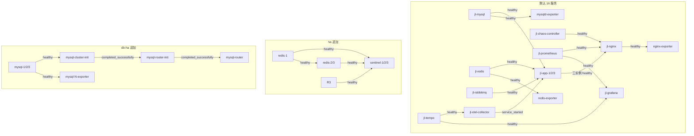

# 01 总体架构与运行拓扑

> 一句话职责：说明本实验室由哪些容器、网络、端口和启动门组成，以及 `dev` / `ha` / `db-ha` 三套 Compose 渲染各自会多出什么。
> 代码基线：`294798a`（本工作树 `git rev-parse --short HEAD`，2026-10-27）。
> 读法：先看 §1 的边界，再看 §2 的拓扑图，最后用 §7 的脚本在 5 分钟内验证「服务数、网络、端口」三件事。

## 1. 角色与组件

### 1.1 运行角色

| 角色 | 是谁 | 在本实验室里的职责 |
|---|---|---|
| 入口与静态站 | `jl-nginx` | 反向代理 `/api/`（三实例轮询、被动健康检查）、托管 Vue 操作台 `/lab/`、代理 `/lab-api/` 到 chaos-controller、代理 `/prom/` 到 Prometheus |
| 业务应用 | `jl-app-1/2/3` | 同一镜像的三实例；catalog 读、同步订单、异步秒杀、`/lab/**` 内部实验 API |
| 开发期数据层 | `jl-mysql`、`jl-redis` | `dev` 默认的单机 MySQL / 单机 Redis；宿主仅回环暴露 3306/6379 |
| Redis HA 层 | `jl-redis-1/2/3`、`jl-sentinel-1/2/3`、三个 exporter | `ha` profile 追加；1 主 2 从 3 哨兵，应用按 `mymaster` 发现主 |
| MySQL HA 层 | `jl-mysql-1/2/3`、两个 init job、`jl-mysql-router`、三个 exporter | `db-ha` profile 追加；3 节点 Group Replication 单主 + Router 6446/6447 |
| 消息 | `jl-rabbitmq` | 单节点、管理插件、Prometheus 插件；秒杀异步削峰 |
| 观测 | Prometheus / Grafana / Tempo / OTel Collector / cAdvisor / 各 exporter | 指标、链路、容器资源；Prometheus 不发布宿主端口，经 Nginx `/prom/` 访问 |
| 故障编排 | `jl-chaos-controller` | 通过只读/读写 Docker socket 做 kill/start/restart/SIGSTOP/SIGCONT、日志、向导、背景流量；**不实现** Toxiproxy 与 Nginx 配置切换 |
| 操作台 | Nginx 托管的静态 Vue 站 | 场景向导、状态栏、日志；自身没有独立容器 |
| 压测 | `bench.sh` / k6 临时容器 | 正式压测走 `code/lab/k6/run.sh`；交互演示的背景流量是 profile `traffic` 的 `jl-traffic` |

### 1.2 四个必须记住的边界

1. **默认 16 服务，不是 25**：`compose.base.yml` + `compose.dev.yml` 渲染 16 个；`ha` 与 `db-ha` 各自是 9 个 profile 门控服务。25 是「16+9」的单一叠加，不是默认。
2. **应用当前只连单机 MySQL**：`DB_WRITE_URL` / `DB_READ_URL` 是 M3 的 Router 接入钩子，默认都指向 `mysql` 容器的 3306 端口；应用侧 `MYSQL_MODE` 与 Router 双数据源尚未合并。拓扑图里到 Router 的边是虚线「未接线」。
3. **`up.sh --profile ha` 只叠加 Redis Sentinel，不含 MySQL 集群**：MySQL 层由独立的 `db-ha-up.sh` 启动；两个脚本没有合并成一个「full」入口。
4. **ha 渲染下应用不再使用 dev Redis**：`REDIS_MODE=sentinel` 让 Lettuce 与 Redisson 都按 `mymaster` 发现主；`jl-redis` 仍在 16 个常驻服务里，但 app 不读它。dev Redis 的 6379 宿主端口也仍然存在，便于宿主工具排查。

### 1.3 `code/lab/` 的落点

| 目录 / 文件 | 内容 | 代表文件 |
|---|---|---|
| `code/lab/docker/compose.base.yml` | 16 个常驻服务、应用模板、网络、卷 | `x-app-common`、`nginx`、`mysql`、`redis`、`rabbitmq`、`app-1/2/3`、观测栈 |
| `code/lab/docker/compose.dev.yml` | 宿主回环端口 | MySQL 3306、Redis 6379 |
| `code/lab/docker/compose.ha.yml` | Redis Sentinel + 应用哨兵客户端叠加 | `redis-1/2/3`、`sentinel-1/2/3`、`jl-sentinel-net` |
| `code/lab/docker/compose.mysql.yml` | MySQL InnoDB Cluster + Router 叠加 | `mysql-1/2/3`、`mysql-cluster-init`、`mysql-router` |
| `code/lab/docker/nginx/conf.d/default.conf` | 入口、轮询、`/lab-api/`、`/prom/` | `upstream seckill_backend` |
| `code/lab/docker/redis/` | Sentinel/数据节点 entrypoint 与模板 | `sentinel-entrypoint.sh`、`sentinel.conf.tpl`、`redis-node-entrypoint.sh` |
| `code/lab/docker/mysql-cluster/` | 节点 cnf 模板、集群/Router 引导脚本 | `node-entrypoint.sh`、`cluster-init-entrypoint.sh`、`router-bootstrap-entrypoint.sh` |
| `code/lab/docker/prometheus/` | 抓取配置 | `prometheus.yml`；`mysql-ha-scrape.yml` 存在但未接线 |
| `code/lab/docker/grafana/` | 数据源、dashboard | `ha-d1..d4`、`ha-d9` |
| `code/lab/docker/tempo/`、`otel-collector/`、`rabbitmq/` | 观测与 MQ 配置 | Tempo/OTel/RabbitMQ 配置 |
| `code/lab/scripts/` | 启停、自检、重置、压测、集群状态 | `up.sh`、`down.sh`、`verify.sh`、`smoke.sh`、`reset-lab.sh`、`bench.sh`、`db-ha-up.sh`、`db-cluster-status.sh`、`sentinel-status.sh` |
| `code/lab/scenarios/` | 向导与 k6 共用的 schema v1 场景 | `ha-app-failover.json`、`quick-failover.json`、`redis-sentinel-failover.json` |
| `code/lab/k6/` | k6 场景、库、dockerized runner | `run.sh`、`lib/`、`scenarios/` |
| `code/lab/dashboard/` | Vue 3 操作台 | `src/App.vue`、`src/components/ScenarioWizard.vue` |

> 没有 `code/lab/docker/toxiproxy/` 目录：Toxiproxy 是设计稿能力，本基线未实现。

## 2. 部署与运行拓扑

```mermaid
flowchart TD
  subgraph HOST["宿主机 Windows 10 + Docker Desktop（WSL2）"]
    H8080["127.0.0.1:8080"]
    H3000["127.0.0.1:3000"]
    H15672["127.0.0.1:15672"]
    H3306["127.0.0.1:3306（dev）"]
    H6379["127.0.0.1:6379（dev）"]
    H6446["127.0.0.1:6446（db-ha）"]
    H6447["127.0.0.1:6447（db-ha）"]
  end

  K6["bench.sh / k6 临时容器"]
  CONSOLE["Vue 操作台 /lab/（静态）"]

  subgraph JLNET["jl-net（Compose 项目 java-learn-lab，bridge）"]
    NG["jl-nginx"]
    A1["jl-app-1"]
    A2["jl-app-2"]
    A3["jl-app-3"]
    MYSQL["jl-mysql（dev 单机）"]
    REDIS["jl-redis（dev 单机）"]
    MQ["jl-rabbitmq"]
    CC["jl-chaos-controller"]
    PROM["jl-prometheus"]
    GRAF["jl-grafana"]
    TEMPO["jl-tempo"]
    OTEL["jl-otel-collector"]
    CADV["jl-cadvisor"]
    EXP["各 exporter（redis/mysqld/nginx）"]
    TRAFFIC["jl-traffic（profile traffic，按需）"]

    subgraph HA["profile ha 追加 9 个服务"]
      R1["jl-redis-1 主"]
      R2["jl-redis-2 从"]
      R3["jl-redis-3 从"]
      S1["jl-sentinel-1"]
      S2["jl-sentinel-2"]
      S3["jl-sentinel-3"]
      RE1["redis-1-exporter"]
      RE2["redis-2-exporter"]
      RE3["redis-3-exporter"]
    end

    subgraph DBHA["profile db-ha 追加 9 个服务"]
      M1["jl-mysql-1"]
      M2["jl-mysql-2"]
      M3["jl-mysql-3"]
      MINIT["mysql-cluster-init（一次性）"]
      RINIT["mysql-router-init（一次性）"]
      ROUTER["jl-mysql-router 6446/6447"]
      ME1["mysql-1-exporter"]
      ME2["mysql-2-exporter"]
      ME3["mysql-3-exporter"]
    end
  end

  NETS["jl-sentinel-net<br/>172.28.190.0/24（仅 ha）"]
  SOCK["/var/run/docker.sock"]

  H8080 --> NG
  H3000 --> GRAF
  H15672 --> MQ
  H3306 --> MYSQL
  H6379 --> REDIS
  H6446 --> ROUTER
  H6447 --> ROUTER

  K6 -->|压测| NG
  TRAFFIC -.->|背景流量| NG
  NG --> CONSOLE
  NG -->|轮询 /api/| A1
  NG -->|轮询 /api/| A2
  NG -->|轮询 /api/| A3
  NG -->|/lab-api/| CC
  NG -.->|/prom/| PROM

  A1 & A2 & A3 --> REDIS
  A1 & A2 & A3 --> MQ
  A1 & A2 & A3 --> MYSQL
  A1 & A2 & A3 -.->|M3 钩子，未接线| ROUTER
  A1 & A2 & A3 -.->|OTLP| OTEL
  A1 -.->|sentinel 模式| S1
  A2 -.->|sentinel 模式| S2
  A3 -.->|sentinel 模式| S3

  R1 -.-> NETS
  R2 -.-> NETS
  R3 -.-> NETS
  S1 -.-> NETS
  S2 -.-> NETS
  S3 -.-> NETS

  R1 --> R2
  R1 --> R3
  R1 --> S1
  R1 --> S2
  R1 --> S3
  S1 -->|quorum 2/3| R1
  S2 -->|quorum 2/3| R1
  S3 -->|quorum 2/3| R1

  M1 --> MINIT
  M2 --> MINIT
  M3 --> MINIT
  MINIT -->|completed| RINIT
  RINIT -->|completed| ROUTER
  M1 --> ME1
  M2 --> ME2
  M3 --> ME3

  OTEL --> TEMPO
  PROM -.->|scrape| A1
  PROM -.->|scrape| A2
  PROM -.->|scrape| A3
  PROM -.->|scrape| EXP
  PROM --> GRAF
  TEMPO --> GRAF
  CC --> SOCK
  SOCK -.->|Docker API| A1
```



> 说明：虚线只表示「设计上存在、当前未接线」或「按 profile 才存在」。`chaos-proxy` / Toxiproxy 没有画进图，因为它在本基线未实现（见 §8）。

## 3. Compose 分层

| 文件 | 何时参与渲染 | 作用 | 关键约束 |
|---|---|---|---|
| `code/lab/docker/compose.base.yml` | 总是 | 16 个常驻服务、命名卷、`jl-net`、应用模板、健康门 | 不发布应用/观测端口；只有 Nginx 8080 是公开入口 |
| `code/lab/docker/compose.dev.yml` | 总是（`up.sh` 固定 base+dev） | 把 MySQL 3306、Redis 6379 绑到 `127.0.0.1` 供宿主机工具使用 | 只允许回环绑定 |
| `code/lab/docker/compose.ha.yml` | `up.sh --profile ha` | 9 个 Redis Sentinel 服务；给 app 叠加 `REDIS_MODE=sentinel`、哨兵端点、`jl-sentinel-net` | 只新增服务，不覆盖 base；数据节点使用固定 IP |
| `code/lab/docker/compose.mysql.yml` | `db-ha-up.sh --profile db-ha`（或 `--profile ha`，但脚本不加载 compose.ha.yml） | 9 个 MySQL 集群 + Router 服务 | 只新增服务；节点不发布宿主端口；Router 只绑回环 |

### 3.1 服务数不变式

| 渲染方式 | 服务数 | 组成 |
|---|---|---|
| `compose.base.yml` + `compose.dev.yml`，无 profile | **16** | nginx、mysql、redis、rabbitmq、app-1/2/3、chaos-controller、redis-exporter、mysqld-exporter、nginx-exporter、prometheus、grafana、tempo、otel-collector、cadvisor |
| 上面的渲染 + `--profile ha`（`up.sh --profile ha` 会加载 `compose.ha.yml`） | **25** | 16 + `redis-1/2/3` + `sentinel-1/2/3` + `redis-1/2/3-exporter` = +9 |
| 上面的渲染 + `-f compose.mysql.yml --profile db-ha`（`db-ha-up.sh`） | **25** | 16 + `mysql-1/2/3` + `mysql-cluster-init` + `mysql-router-init` + `mysql-router` + `mysql-1/2/3-exporter` = +9 |
| 三份文件同时加载并同时选中 `ha` 与 `db-ha` | **34** | 16 + 9 + 9；**当前没有脚本这样做** |
| 再选 `--profile traffic` | +1 | `jl-traffic`，`up.sh` 只创建不启动；默认服务数不变式不受影响 |

两个容易踩的点：

- `compose.ha.yml` 和 `compose.mysql.yml` 都只声明**新增服务**，所以 `docker compose config --services` 在不选 profile 时仍只看到 16 个；`verify.sh`、`bench.sh`、`reset-lab.sh` 的服务枚举都以这个 16 为基线。
- `db-ha-up.sh --profile ha` 虽然 profile 名叫 `ha`，但它的文件列表是 `base + dev + mysql`，**没有 `compose.ha.yml`**；因此它只启动 MySQL 层。Redis Sentinel 仍要由 `up.sh --profile ha` 启动。

## 4. 网络与宿主端口

### 4.1 网络

| 网络 | 谁加入 | 说明 |
|---|---|---|
| `jl-net` | 全部 16 个常驻服务；`ha` 的 9 个服务中的 exporter 也在这里；`db-ha` 的 9 个服务都在这里 | Compose 项目内 bridge；Docker DNS 提供 `app-1`、`mysql-1`、`sentinel-1` 等服务名 |
| `jl-sentinel-net` | 仅 `ha` 渲染下的 `app-1/2/3`、`redis-1/2/3`、`sentinel-1/2/3` | 固定子网 `172.28.190.0/24`；数据节点 announce 固定 IP，Sentinel 才能跨 `docker stop` 保留监控身份 |
| 无额外网络 | `db-ha` 的 MySQL 节点 | Group Replication 走 `jl-net` 的服务名；节点端口不发布到宿主 |

> `jl-sentinel-net` 只在 `compose.ha.yml` 里声明，避免改动 `jl-net` 的 IPAM 导致 16 个 dev 容器被重建。

### 4.2 宿主端口

| 宿主绑定 | 容器/服务 | 何时存在 | 用途 |
|---|---|---|---|
| `127.0.0.1:8080` | `jl-nginx` | 总是 | 业务 API、`/lab/` 操作台、`/lab-api/`、`/prom/`、`/health` |
| `127.0.0.1:3000` | `jl-grafana` | 总是 | Grafana UI |
| `127.0.0.1:15672` | `jl-rabbitmq` | 总是 | RabbitMQ 管理界面 |
| `127.0.0.1:3306` | `jl-mysql` | `dev` overlay | 宿主机 MySQL 客户端 |
| `127.0.0.1:6379` | `jl-redis` | `dev` overlay | 宿主机 Redis 客户端 |
| `127.0.0.1:6446` | `jl-mysql-router` | `db-ha` | 读写路由（跟随 PRIMARY） |
| `127.0.0.1:6447` | `jl-mysql-router` | `db-ha` | 只读路由（ONLINE SECONDARY） |

不发布的端口：应用 8080（容器内）、Prometheus 9090（设计里是「可选、默认不暴露」，实际经 `/prom/` 代理）、Tempo、OTel、cAdvisor、chaos-controller 8081、所有 exporter、MySQL 节点 3306/33061、Redis 数据/哨兵端口。

## 5. 启动顺序与健康门



### 5.1 实际启动脚本做的事

1. `up.sh` 固定用 `compose.base.yml + compose.dev.yml`；`--profile ha` 时追加 `compose.ha.yml` 并传 `--profile ha`。
2. `docker compose up -d --wait --wait-timeout 240`。`--wait` 只等声明了 healthcheck 的服务；OTel Collector 镜像是 distroless，没有 healthcheck，所以脚本随后又用 `docker inspect` 逐个检查渲染模型里的每个容器是否 `running`。
3. `ha` 渲染下再枚举 `--profile ha` 多出来的服务，逐个检查 `running` 且不是 `unhealthy`。
4. 校验并 reload Nginx（先 `nginx -t`，失败不 reload），再 POST Prometheus `/-/reload`。
5. 用 `--profile traffic create traffic` 创建但**不启动** `jl-traffic`；操作台通过 chaos-controller 启停。
6. `db-ha-up.sh` 是独立的 5 步：节点 healthy → `mysql-cluster-init` 退出码 0 → Router 引导/启动 → 三个 exporter → `db-cluster-status.sh` 报告单一 PRIMARY、成员 ONLINE。

### 5.2 健康门的两个关键设计

- **应用容器门是 `/actuator/health/app`，排除 Redis**：Redis 是产品缓存 L2，故障时读路径降级到 MySQL，实例必须保持健康，否则 Docker/Nginx 会在 Redis 演练中把实例踢掉。根 `/actuator/health` 仍诚实报告 Redis DOWN。
- **MySQL 节点的 healthcheck 只证明 mysqld 活着**，不证明它在组里 ONLINE；组状态由 init job 的轮询和 `db-cluster-status.sh` 负责。否则「节点健康」与「组尚未形成」会互相等待死锁。

## 6. 资源预算

### 6.1 设计 §3.1 的预算（基线含 2026-10-27 实测 MySQL）

| 组件 | 数量 | 设计预算 | 本基线实际 `mem_limit` / 备注 |
|---|---|---|---|
| Spring 应用 | 3 | 3 × 768MB | 3 × 768MiB = 2304MiB |
| Nginx | 1 | 64MB | 64MiB |
| Redis Sentinel 层 | 6 + 3 exporter | ≈800MB | 3 × 128 + 3 × 64 = 576MiB（1 主 2 从 3 哨兵），加 3 × 48 exporter = **720MiB**（共 9 服务） |
| MySQL InnoDB Cluster + Router | 3 节点 + Router + 3 exporter（+2 init job） | ≈2.1GB；实测 **1.87GB**（2026-10-27 首跑验收） | 3 × 640 + 64 + 3 × 48 = **2128MiB 稳态**；两个 init job 各 128MiB 为一次性（共 9 服务） |
| RabbitMQ | 1 | 384MB | 384MiB |
| 观测栈（Prom/Grafana/Tempo/OTel/cAdvisor/三 exporter） | 各 1 | ≈1.4GB | 512+256+384+128+128+64+64+64 = **1600MiB** |
| chaos-controller | 1 | 256MB | 256MiB |
| Toxiproxy | 1（`chaos-proxy`） | 64MB | **未实现**，没有服务 |
| k6 / 背景流量 | 按需 | 512MB / — | `jl-traffic` 256MiB（profile `traffic`）；正式 k6 由 `run.sh` 临时启动 |
| 实验操作台 | 静态 | — | 由 Nginx 托管，无独立容器 |

### 6.2 按 profile 汇总（声明上限，不是实测 RSS）

| 渲染 | 稳态 `mem_limit` 之和 | 说明 |
|---|---|---|
| 默认 16（dev） | **5632MiB ≈ 5.5GiB** | 含单机 MySQL 768、单机 Redis 256；不含 `jl-traffic` |
| 默认 + `ha`（25） | **6352MiB ≈ 6.2GiB** | 5632 + 720；Sentinel 层无命名卷，`/data` 是 tmpfs |
| 默认 + `db-ha`（25） | **7760MiB ≈ 7.58GiB** | 5632 + 2128；集群引导时另有 2 × 128MiB 一次性 job |
| 三套全开（34） | **8480MiB ≈ 8.28GiB** | 5632 + 720 + 2128；再加 `jl-traffic` 256 = 8.53GiB；再加 init 峰值 256 ≈ 8.78GiB |

设计稿的总量「约 8–9GB」与三套全开的声明上限一致；但 `db-ha-up.sh` 的内存提示仍写「约 1.8GB」（脚本注释未随设计更新），以本表和设计 §3.1 的 2.1GB/1.87GB 为准。

## 7. 5 分钟演示步骤

> 前提：本机已构建过镜像、`code/lab/docker/.env` 存在。冷启动整套 25 容器可能超过 5 分钟；下面的 5 分钟窗口从「栈已起」开始。不要在演示机上执行 `down.sh --purge`。

```bash
# 1) 看默认 16 个服务（脚本内部就是 compose config --services 的等价枚举）
bash code/lab/scripts/up.sh --profile dev

# 2) 叠加 Redis Sentinel：脚本会打印 16 + 9 的检查结果和拓扑摘要
bash code/lab/scripts/up.sh --profile ha

# 3) 只读看哨兵拓扑：主、两从、三哨兵；--watch 3 可边看边停主
bash code/lab/scripts/sentinel-status.sh
bash code/lab/scripts/sentinel-status.sh --watch 3 -n 5

# 4) 只读看 MySQL 集群与 Router（需要 db-ha 层已启动）
bash code/lab/scripts/db-cluster-status.sh

# 5) 默认 16 服务的全量自检（不改数据；会保留栈运行）
bash code/lab/scripts/verify.sh
```

如果要从零启动 MySQL 层，单独执行（`db-ha-up.sh` 会打印它拥有的 9 个服务和 1.8GB 提示）：

```bash
bash code/lab/scripts/db-ha-up.sh --profile db-ha
```

## 8. 代码对照表

| 概念/行为 | 类或方法 | 路径:行 | 说明 |
|---|---|---|---|
| Compose 项目名 | `name: java-learn-lab` | `code/lab/docker/compose.base.yml:4` | 所有容器/网络/卷的前缀；`container_name` 统一 `jl-*` |
| 应用公共模板 | `x-app-common` | `code/lab/docker/compose.base.yml:8` | 三实例共用镜像、网络、重启策略、健康门 |
| 应用内存上限 | `mem_limit: 768m` | `code/lab/docker/compose.base.yml:16` | 三实例各 768MiB |
| 应用容器健康门 | `actuator/health/app` | `code/lab/docker/compose.base.yml:36` | 排除 Redis 的健康组；根健康仍诚实 |
| 应用依赖门 | `depends_on:` | `code/lab/docker/compose.base.yml:22` | mysql/redis/rabbitmq healthy、otel started |
| Nginx 容器 | `container_name: jl-nginx` | `code/lab/docker/compose.base.yml:85` | 唯一公开入口 |
| Nginx 宿主端口 | `127.0.0.1:8080:80` | `code/lab/docker/compose.base.yml:91` | 只绑回环 |
| Nginx 等三实例 | `app-2:` | `code/lab/docker/compose.base.yml:104` | app-1/2/3 都 healthy 才启动 Nginx（另两行 102/106） |
| MySQL dev 容器 | `container_name: jl-mysql` | `code/lab/docker/compose.base.yml:121` | 单机 MySQL 8.4.4 |
| MySQL dev 端口 | `127.0.0.1:3306:3306` | `code/lab/docker/compose.dev.yml:7` | 仅 dev overlay |
| Redis dev 容器 | `container_name: jl-redis` | `code/lab/docker/compose.base.yml:151` | 单机 Redis 7.4.2 |
| Redis dev 端口 | `127.0.0.1:6379:6379` | `code/lab/docker/compose.dev.yml:11` | 仅 dev overlay |
| RabbitMQ 容器 | `container_name: jl-rabbitmq` | `code/lab/docker/compose.base.yml:173` | 单节点，非 HA |
| RabbitMQ 管理端口 | `127.0.0.1:15672:15672` | `code/lab/docker/compose.base.yml:182` | 教学用管理界面 |
| 应用实例 1 | `container_name: jl-app-1` | `code/lab/docker/compose.base.yml:202` | 三实例同镜像 |
| 应用实例 3 | `container_name: jl-app-3` | `code/lab/docker/compose.base.yml:216` | 与 1/2 仅 `INSTANCE_ID` 不同 |
| chaos-controller | `container_name: jl-chaos-controller` | `code/lab/docker/compose.base.yml:228` | 实验编排与日志 |
| Docker socket | `docker.sock:/var/run/docker.sock` | `code/lab/docker/compose.base.yml:262` | 读写挂载；安全边界见 11 篇 |
| 背景流量 profile | `profiles: ["traffic"]` | `code/lab/docker/compose.base.yml:288` | 默认不启动，不计入 16 |
| exporter | `container_name: jl-mysqld-exporter` | `code/lab/docker/compose.base.yml:330` | 另有 redis/nginx exporter |
| Prometheus 保留 | `retention.time=7d` | `code/lab/docker/compose.base.yml:383` | 7 天 |
| Prometheus 远程写 | `remote-write-receiver` | `code/lab/docker/compose.base.yml:385` | k6 remote write 的前提 |
| Prometheus 外部 URL | `--web.external-url` | `code/lab/docker/compose.base.yml:389` | 生成链接带 `/prom/` 前缀 |
| Grafana 容器 | `container_name: jl-grafana` | `code/lab/docker/compose.base.yml:412` | 观测 UI |
| Grafana 宿主端口 | `127.0.0.1:3000:3000` | `code/lab/docker/compose.base.yml:423` | 只绑回环 |
| Tempo 容器 | `container_name: jl-tempo` | `code/lab/docker/compose.base.yml:448` | 链路存储 |
| OTel Collector | `container_name: jl-otel-collector` | `code/lab/docker/compose.base.yml:475` | distroless，无容器内 healthcheck |
| cAdvisor | `container_name: jl-cadvisor` | `code/lab/docker/compose.base.yml:500` | WSL2 下网络指标可能不完整 |
| 命名卷 | `jl-mysql-data:` | `code/lab/docker/compose.base.yml:533` | 默认保留，`--purge` 才删 |
| `jl-net` | `name: jl-net` | `code/lab/docker/compose.base.yml:548` | 默认 bridge |
| HA 服务门控 | `profiles: ["ha"]` | `code/lab/docker/compose.ha.yml:30` | 每个 HA 服务都声明，默认渲染不出现 |
| HA 应用模式 | `REDIS_MODE: sentinel` | `code/lab/docker/compose.ha.yml:152` | 同时切换 Lettuce 与 Redisson |
| HA 哨兵端点 | `SPRING_DATA_REDIS_SENTINEL_NODES` | `code/lab/docker/compose.ha.yml:161` | 由 `REDIS_SENTINEL_NODES` 映射 |
| HA 数据节点 | `container_name: jl-redis-1` | `code/lab/docker/compose.ha.yml:214` | 固定 IP 172.28.190.11，主 |
| HA 哨兵 | `container_name: jl-sentinel-1` | `code/lab/docker/compose.ha.yml:266` | quorum 2/3，监控 `mymaster` |
| HA exporter | `container_name: jl-redis-1-exporter` | `code/lab/docker/compose.ha.yml:315` | 每数据节点一个 |
| 哨兵专用网络 | `name: jl-sentinel-net` | `code/lab/docker/compose.ha.yml:356` | 子网 `REDIS_HA_SUBNET` |
| DB-HA 节点 | `container_name: jl-mysql-1` | `code/lab/docker/compose.mysql.yml:149` | 3 节点单主组复制 |
| 集群引导 job | `container_name: jl-mysql-cluster-init` | `code/lab/docker/compose.mysql.yml:194` | 一次性，退出 0 才继续 |
| Router 引导 job | `container_name: jl-mysql-router-init` | `code/lab/docker/compose.mysql.yml:245` | 写 mysqlrouter.conf 并 chown |
| MySQL Router | `container_name: jl-mysql-router` | `code/lab/docker/compose.mysql.yml:297` | 应用未来唯一入口 |
| Router 宿主端口 | `MYSQL_HA_ROUTER_RW_HOST_PORT` | `code/lab/docker/compose.mysql.yml:319` | 6446 读写；下一行 320 是 6447 只读 |
| DB-HA exporter | `container_name: jl-mysql-1-exporter` | `code/lab/docker/compose.mysql.yml:351` | 每节点一个 |
| DB-HA 卷 | `jl-mysql-1-data:` | `code/lab/docker/compose.mysql.yml:386` | 不复用 dev 的 `jl-mysql-data` |
| `up.sh` 文件列表 | `COMPOSE_FILES=` | `code/lab/scripts/up.sh:58` | 固定 base+dev |
| `up.sh` 叠加 ha | `compose.ha.yml` | `code/lab/scripts/up.sh:68` | 仅 `--profile ha` |
| `up.sh` 等待 | `--wait-timeout 240` | `code/lab/scripts/up.sh:173` | 只等有 healthcheck 的服务 |
| `up.sh` 显式检查 | `not_running=""` | `code/lab/scripts/up.sh:196` | 补齐 OTel 等无 healthcheck 的服务 |
| `up.sh` Nginx reload | `nginx -s reload` | `code/lab/scripts/up.sh:272` | 先 `nginx -t` |
| `up.sh` Prometheus reload | `/-/reload` | `code/lab/scripts/up.sh:278` | 读挂载配置 |
| `up.sh` 创建流量容器 | `--profile traffic create traffic` | `code/lab/scripts/up.sh:289` | 只创建不启动 |
| `down.sh` ha 门 | `HA_PROFILES=()` | `code/lab/scripts/down.sh:67` | env key 不齐时降级为 dev-only teardown |
| `down.sh` 删卷 | `down -v` | `code/lab/scripts/down.sh:99` | 仅 `--purge` |
| DB-HA 第一步 | `[1/5]` | `code/lab/scripts/db-ha-up.sh:296` | 节点 healthy |
| DB-HA 跳过 Router | `SKIP_ROUTER=false` | `code/lab/scripts/db-ha-up.sh:107` | `--skip-router` 可跳过 6446/6447 |
| DB-HA 内存提示 | `1.8GB` | `code/lab/scripts/db-ha-up.sh:241` | 脚本旧口径；设计/实测已改 2.1GB/1.87GB |
| DB-HA 状态脚本 | `STATUS_SCRIPT` | `code/lab/scripts/db-ha-up.sh:33` | 第 5 步用它判定组健康 |
| 哨兵只读查看 | `--watch [SECONDS]` | `code/lab/scripts/sentinel-status.sh:31` | 只读，不触发 failover |
| Nginx upstream | `upstream seckill_backend` | `code/lab/docker/nginx/conf.d/default.conf:89` | 三实例轮询 |
| Nginx 被动健康 | `max_fails=2` | `code/lab/docker/nginx/conf.d/default.conf:93` | `fail_timeout=5s` |
| Nginx 重试 | `proxy_next_upstream` | `code/lab/docker/nginx/conf.d/default.conf:26` | error/timeout/502/503 |
| Nginx lab-api | `location /lab-api/` | `code/lab/docker/nginx/conf.d/default.conf:55` | 代理到 chaos-controller:8081 |
| 设计 MySQL 预算 | `≈ 2.1GB` | `doc/design/2026-10-26-ha-concurrency-lab-design.md:95` | 同一行记录实测 1.87GB |
| 设计总量 | `8–9GB` | `doc/design/2026-10-26-ha-concurrency-lab-design.md:103` | 三套全开的量级 |
| 设计端口 | `9090` | `doc/design/2026-10-26-ha-concurrency-lab-design.md:114` | 可选、默认不暴露；实际经 `/prom/` |
| 设计 profile | `chaos-proxy` | `doc/design/2026-10-26-ha-concurrency-lab-design.md:124` | **未实现**，仅设计 |
| 设计启动顺序 | `启动顺序` | `doc/design/2026-10-26-ha-concurrency-lab-design.md:594` | §13.3 的 5 步 |
| chaos 动作白名单 | `ALLOWED` | `code/services/chaos-controller/src/main/java/com/javalearn/lab/chaos/action/ChaosActionType.java:16` | 只有 kill/start/restart/freeze/resume，无 Toxiproxy/nginx 切换 |
| Prometheus 应用抓取 | `job_name: seckill-app` | `code/lab/docker/prometheus/prometheus.yml:15` | 三实例 `/actuator/prometheus` |
| Prometheus exporter 抓取 | `job_name: redis-exporter` | `code/lab/docker/prometheus/prometheus.yml:34` | 另有 mysqld/nginx/rabbitmq/cadvisor |

## 9. 配置项表

> 下表 `compose.base.yml` / `compose.dev.yml` / `compose.ha.yml` / `compose.mysql.yml` 均指 `code/lab/docker/` 下的同名文件；`.env.example` 指 `code/lab/docker/.env.example`；`application.yml` 指 `code/services/seckill-app-jdk21/src/main/resources/application.yml`。

| 配置键 | 环境变量 | 默认值 | 在哪里读 |
|---|---|---|---|
| Compose 项目名 | —（硬编码） | `java-learn-lab` | `compose.base.yml:4`；`.env.example` 里的 `COMPOSE_PROJECT_NAME` 不参与当前渲染 |
| 应用镜像 | —（构建） | `java-learn-lab/seckill-app:jdk21` | `compose.base.yml:9` |
| Nginx 镜像 | `NGINX_IMAGE` | `nginx:1.27-alpine` | `.env.example:7` → `compose.base.yml:84` |
| MySQL 镜像 | `MYSQL_IMAGE` | `mysql:8.4.4` | `.env.example:8` → `compose.base.yml:120` |
| Redis 镜像 | `REDIS_IMAGE` | `redis:7.4.2-alpine` | `.env.example:9` → `compose.base.yml:150` |
| RabbitMQ 镜像 | `RABBITMQ_IMAGE` | `rabbitmq:4.1.0-management` | `.env.example:10` → `compose.base.yml:172` |
| 应用数据源主机 | `MYSQL_HOST` | `mysql` | `compose.base.yml:45` → `application.yml:79`/`:86` |
| 应用 Redis 主机 | `REDIS_HOST` | `redis` | `compose.base.yml:51` → `application.yml:33` |
| 应用 Redis 模式 | `REDIS_MODE` | `standalone` | `application.yml:67`；ha 渲染由 `compose.ha.yml:152` 覆盖为 `sentinel` |
| 应用写库 URL | `DB_WRITE_URL` | `mysql`/`seckill`/UTC（完整串见「在哪里读」） | `application.yml:79`；M3 Router 钩子 |
| 应用读库 URL | `DB_READ_URL` | 同上（同一单机） | `application.yml:86`；M3 Router 钩子 |
| 实验 token | `LAB_TOKEN` | `lab-token` | `compose.base.yml:61` → `application.yml:103` |
| 故障 TTL | `CHAOS_DEFAULT_TTL_SECONDS` | `120` | `compose.base.yml:240` |
| 故障 TTL 上限 | `CHAOS_MAX_TTL_SECONDS` | `600` | `compose.base.yml:241` |
| 向导结束还原 | `LAB_RESET_MODE` | `manual` | `compose.base.yml:256` |
| Sentinel 主名 | `REDIS_HA_MASTER_NAME` | `mymaster` | `.env.example:82` → `compose.ha.yml:153` |
| Sentinel quorum | `REDIS_HA_QUORUM` | `2` | `.env.example:99` → `compose.ha.yml:103` |
| HA 数据节点内存 | `REDIS_HA_NODE_MEM_LIMIT` | `128m` | `.env.example:155` → `compose.ha.yml:31` |
| MySQL 节点内存 | `MYSQL_HA_NODE_MEM_LIMIT` | `640m` | `compose.mysql.yml:46` |
| Router 读写宿主端口 | `MYSQL_HA_ROUTER_RW_HOST_PORT` | `6446` | `compose.mysql.yml:319` |
| Router 只读宿主端口 | `MYSQL_HA_ROUTER_RO_HOST_PORT` | `6447` | `compose.mysql.yml:320` |

## 10. 已知缺陷 / 边界

- **未合并能力（不要当作已存在）**：雪崩策略（`ttl-jitter` / `l1-cache` / 熔断降级）、Caffeine 预热、线程快照（`jcmd`/`jstack` 落盘）、应用侧 Router 双数据源（`MYSQL_MODE`）、Toxiproxy/`chaos-proxy`、D6/D7/D10/D11 面板。当前 Grafana 只有 `ha-d1`–`ha-d4` 与 `ha-d9` 五个 dashboard 文件。
- **`up.sh` 没有 `full` profile**：帮助文本只接受 `dev|ha`；MySQL 层必须另跑 `db-ha-up.sh`。设计稿里的 `--profile dev|ha|full` 与 `chaos-proxy` 尚未落地。
- **应用未接 Router**：`DB_WRITE_URL`/`DB_READ_URL` 默认都指 `mysql`；Router 的 6446/6447 只被 `db-cluster-status.sh` 和后续 M3-2b 使用。详见 `doc/process/step-25b-mysql-live-bootstrap.md` 的「未验证：应用经 Router 访问」。
- **MySQL 集群已做过 live bootstrap，但故障转移演练未做**：Router 8.0 误判 8.4 成员为 RO 的问题已用 8.4 Router 修复；`db-failover`、节点重加入、Prometheus 抓取仍未验收。详见 `doc/process/step-25a-mysql-cluster-compose.md`、`step-25b-mysql-live-bootstrap.md`。
- **`prometheus/mysql-ha-scrape.yml` 未接线**：文件存在，但 `prometheus.yml` 只有应用/redis/mysqld/nginx/rabbitmq/cadvisor 等 job；MySQL 集群成员指标目前不可查。
- **`db-ha-up.sh` 内存提示仍是 1.8GB**：设计 §3.1 已改记 2.1GB（实测 1.87GB），脚本注释未同步；以文档 §6 为准。
- **Redis Sentinel 演练会掩盖症状**：L1 Caffeine 60s TTL 会在读路径挡住 failover 错误；要看到错误毛刺需显式设 Lettuce 命令超时。详见 `doc/process/step-24b-sentinel-client.md`。
- **单点**：Nginx、RabbitMQ、MySQL Router、Prometheus/Grafana 都是单点；设计 §8.6 已声明为范围外。
- **cAdvisor 在 WSL2 下无 per-container 序列**：D3 容器网络/CPU 面板可能为空，`verify.sh` 的 1 个 WARN 即此。
- **chaos-controller 只做容器动作/日志/向导/背景流量**，没有 Toxiproxy、没有 Nginx naive/guarded 切换、没有应用 `/lab/cache/**` 代理；操作台不能直接切缓存模式（需在容器网络内调用应用端口）。
- **背景流量容器常驻但停止**：`jl-traffic` 带 `lab=java-learn` 标签，会出现在 `/lab-api/containers` 的 17 项里；常驻汇总按 16 计。

## 11. 关联文档

- [README（索引与代码对照约定）](README.md)
- [02-业务主链路](02-业务主链路.md) — 三域、同步/异步链路、读写路由
- [03-缓存体系](03-缓存体系.md) — 两级缓存、降级、穿透/击穿实验
- 设计：[总体设计](../2026-10-26-ha-concurrency-lab-design.md) §3（架构/预算/端口/profile）、§8.2/§8.3（Redis/MySQL HA）、§13（运行方式）
- 过程：`doc/process/step-24a-sentinel-compose.md`、`step-24b-sentinel-client.md`、`step-25a-mysql-cluster-compose.md`、`step-25b-mysql-live-bootstrap.md`、`阶段交接-2026-10-26.md`
