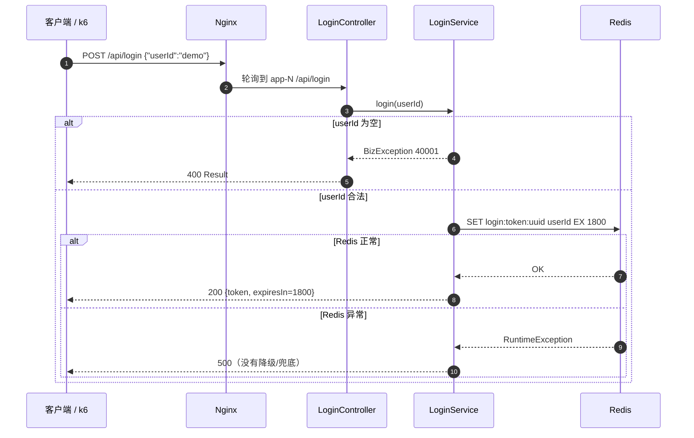
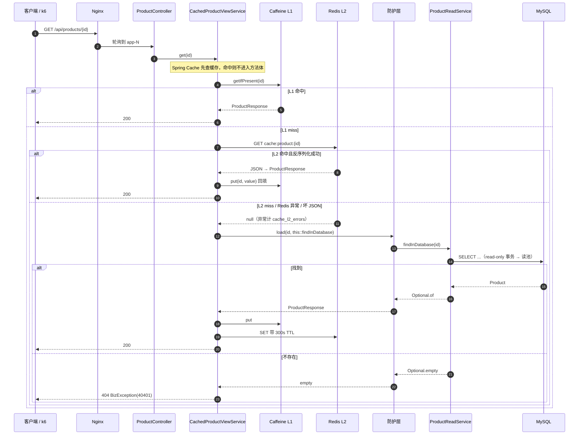
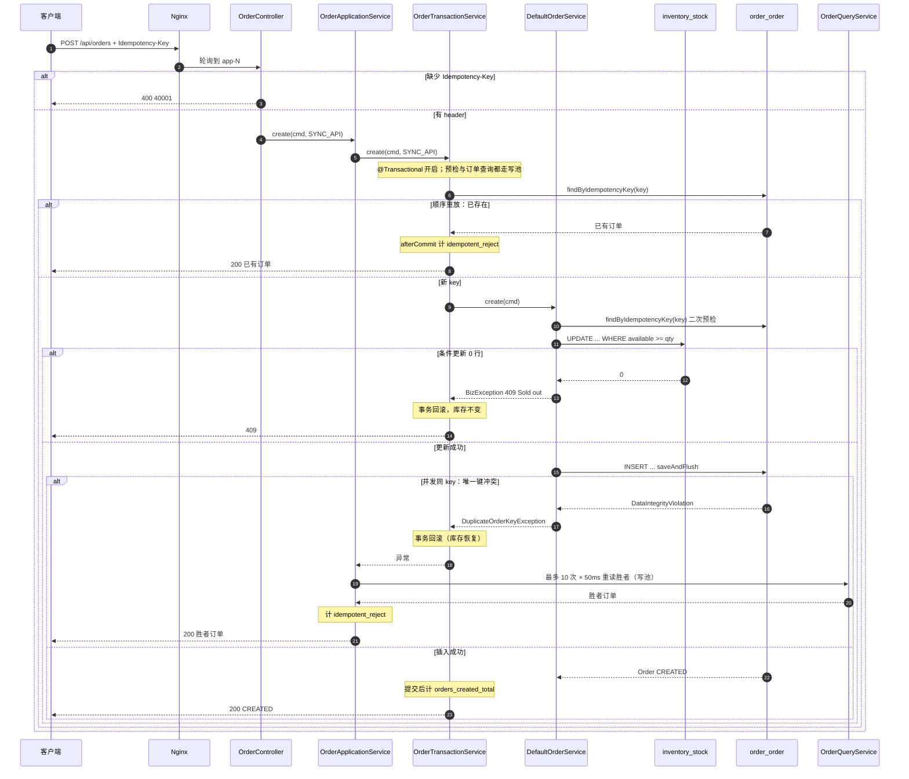
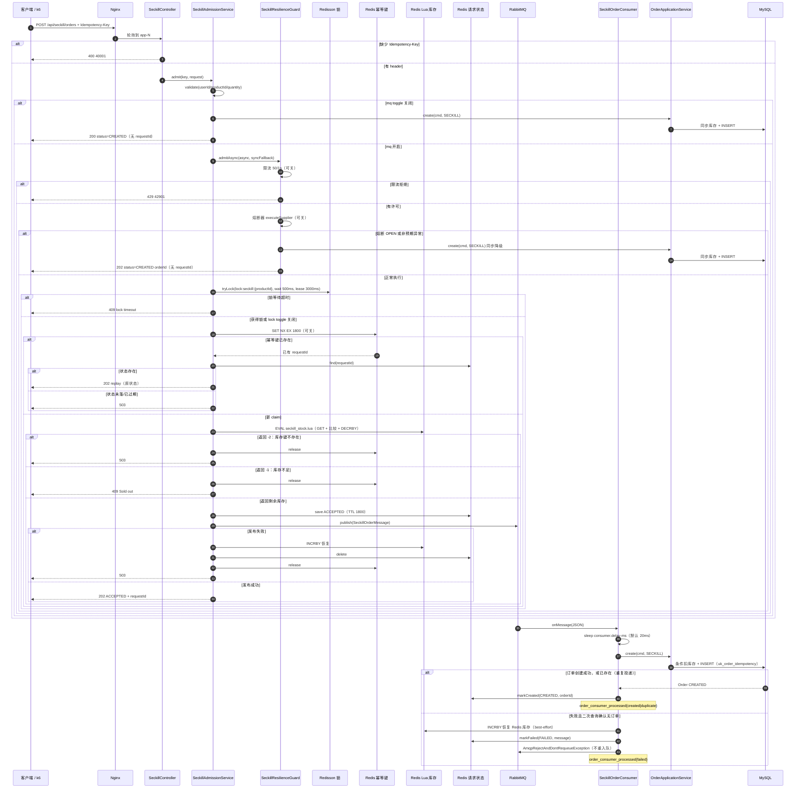
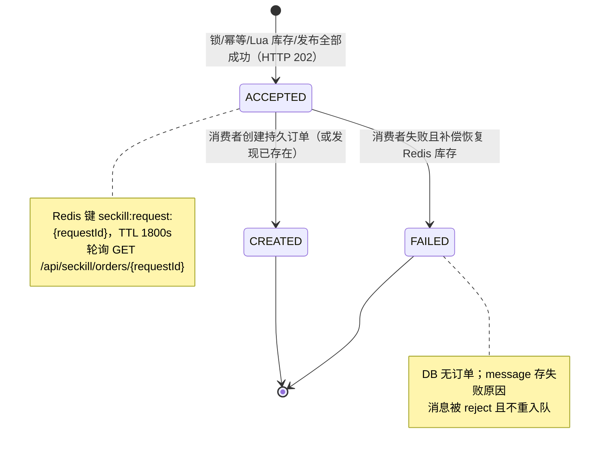
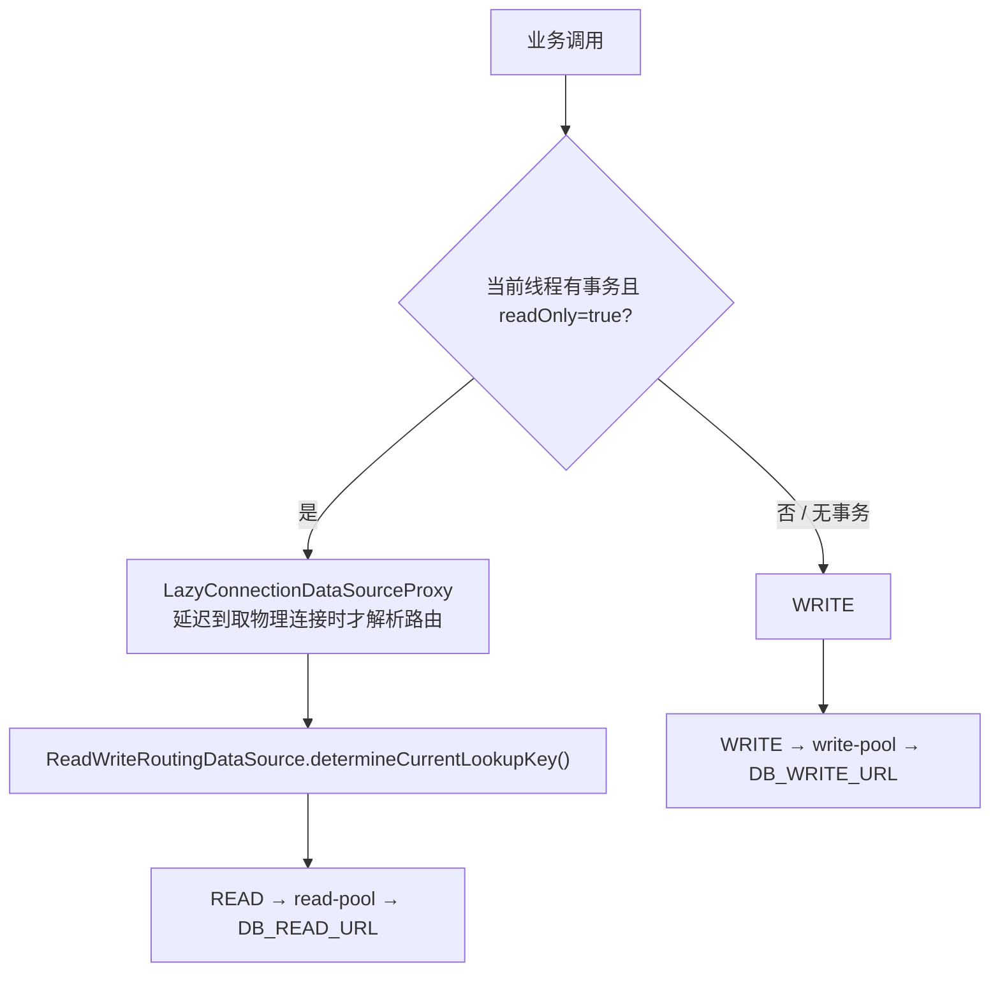

# 02 业务主链路

> 一句话职责：把登录、商品读、同步下单 + 幂等重放、异步秒杀 + 补偿这四条链路，按真实类与真实分支讲清楚。
> 代码基线：`294798a`（本工作树 `git rev-parse --short HEAD`，2026-10-27）。
> 注意：本文只描述已合并代码。设计稿里的支付/取消状态、Router 双数据源、MQ 重试/DLQ 都不在本文按「已实现」描述。

## 1. 角色与组件

| 角色 | 组件 | 职责 |
|---|---|---|
| 入口 | Nginx `jl-nginx` | `/api/` 轮询到 `app-1/2/3`；`proxy_next_upstream` 重试；不代理应用 `/lab/**` |
| 外壳 | `seckill-app-jdk21` | Spring Boot 3.5 外壳：Controller、JPA、Redis/Rabbit 适配、事务与数据源 |
| 共享领域 | `seckill-core` | Java 8、框架中立的领域与用例：`catalog` / `inventory` / `order` 的 api/domain/app |
| 实验壳 | `seckill-app-jdk8` | Boot 2.7 / Java 8 教学外壳；当前只有 catalog 读，不承载订单/秒杀 |
| 空模块 | `seckill-lab` | 仅有 POM，`maven.compiler.release=8`；设计中的缓存/线程实验库没有实际代码 |
| 存储 | MySQL、Redis、RabbitMQ | Flyway 建表；Redis 幂等/库存/请求状态/锁；RabbitMQ 削峰 |
| 观测 | Micrometer / Prometheus | `seckill_attempts`、`order_consumer_processed`、`order_accept_seconds`、`orders_created_total`、`idempotent_reject` |

### 1.1 领域边界

| 域 | 包 | 表前缀 | 读/写 |
|---|---|---|---|
| `catalog` | `com.javalearn.lab.seckill.catalog` | `catalog_` | 商品详情读；无写 API |
| `inventory` | `com.javalearn.lab.seckill.inventory` | `inventory_` | 条件扣减 `inventory_stock.available` |
| `order` | `com.javalearn.lab.seckill.order` | `order_` | 幂等下单、订单查询、订单事件（当前只有 CREATED） |

约定：跨域只存 ID，不做 JPA 关联；`seckill-core` 只含领域与用例，Spring/JPA/Flyway/Controller 在 `seckill-app-jdk21`；共享层锁 Java 8 语法，JDK 21 特性只允许出现在外壳。

### 1.2 Flyway 迁移

| 版本 | 内容 | 关键点 |
|---|---|---|
| `V1__catalog_product.sql` | `catalog_product` | 自增主键、`price DECIMAL(10,2)`、`status`、时间戳 |
| `V2__seed_catalog_products.sql` | 20 个演示商品 | ID 不硬编码，空库从 1 开始；`/api/products/1` 稳定 |
| `V3__inventory_order.sql` | `inventory_stock` + `order_order` | `available >= 0` CHECK；`uk_order_no`；`uk_order_idempotency`；每商品初始 100 件 |

Flyway 由 `seckill-app-jdk21` 执行，`ddl-auto=validate`；JDK 8 外壳的 `mysql` profile 只 validate 同一套表，不执行迁移。

## 2. 链路一：登录（mock）



要点：

- 没有用户表、没有鉴权校验；任意非空 `userId` 都能换 token。token 只是 Redis 里的 principal 查询键，业务接口并不校验它。
- 登录是纯 Redis 写；Redis 故障时这里不会像商品缓存那样降级，会直接 500。这是演示「缓存可降级、登录不可降级」的边界。
- TTL 1800s，键前缀 `login:token:`，值就是 `userId`。

## 3. 链路二：商品读



要点：

- `@Cacheable(cacheNames="product", key="#id")` 在方法体之前拦截；L1/L2 命中时不会开启数据库事务。
- 缓存未命中才进入 `breakdownDefense.load`，再按当前模式分派到穿透/击穿防护；防护组件只决定「谁去问 DB」，404 仍由调用方抛。
- `ProductReadService` 上的 `@Transactional(readOnly=true)` 让连接在延迟代理取连接时路由到读池；详见 §7。
- 缓存键/TTL 的细节在 03 篇；这里只强调：缓存写入发生在方法返回之后，因此「防护层返回旧值」也会被 Spring Cache 写回 L1/L2。

## 4. 链路三：同步下单 + 幂等重放

### 4.1 时序（含并发同 key 的唯一键竞争）



### 4.2 幂等到底靠什么

1. **数据库唯一键是权威**：`order_order.uk_order_idempotency` 保证同一个 `Idempotency-Key` 至多一行；`saveAndFlush` 让冲突在事务提交前就暴露，适配器把它翻译成 `DuplicateOrderKeyException`。
2. **事务边界**：库存条件更新与订单 INSERT 在同一个 `@Transactional` 里；INSERT 冲突或库存不足都会回滚库存。
3. **非事务包装层重试**：`OrderApplicationService` 捕获 `DuplicateOrderKeyException` 后，用新事务（`OrderQueryService.findByIdempotencyKey`）重读胜者；10 次 × 50ms 是硬编码常量，见 §10。
4. **顺序重放**：事务内预检已经看到订单，直接返回；`afterCommit` 只对 `SYNC_API` 计 `idempotent_reject`，秒杀/消费者来源不污染该指标。
5. **写池固定**：`OrderQueryService` 的查询方法刻意是普通 `@Transactional`（不是 `readOnly=true`），因为重试重读和 `GET /api/orders/{id}` 都要求读后写一致；如果走只读副本，可能看不到刚提交的胜者。

## 5. 链路四：异步秒杀（202 → 锁/幂等/Lua → MQ → 消费 → 持久订单）

### 5.1 准入时序



> 503 与降级的区别：`SeckillResilienceGuard` 对 `BizException`（包括 `admission` 包装的 `50301` 基础设施故障）在熔断 CLOSED 时**原样抛出 503**，同时把这次调用计入熔断失败率；只有熔断 OPEN（`CallNotPermittedException`）或真正的非 `BizException` 才走同步降级并记 `degraded`。不要把所有 503 都叫「降级」。

### 5.2 秒杀状态机



### 5.3 补偿路径

| 失败点 | 已做的补偿 | 结果 |
|---|---|---|
| 锁不可用/Redisson 异常 | 计 `error`，返回 503 | 未扣库存、未写状态 |
| 锁等待超时 | 计 `lock_timeout`，抛 `BusinessException(409)` | 未扣库存；熔断器忽略该业务异常 |
| 库存键不存在 | 释放幂等键，计 `error`，返回 503 | 未扣库存 |
| 库存不足 | 释放幂等键，计 `sold_out`，返回 409 | 未扣库存 |
| 保存状态/发布 MQ 失败 | `restore` 库存、删除请求状态、释放幂等键，计 `error`，返回 503 | 准入侧无残留（best-effort） |
| 消费者创建订单失败且确认无订单 | `restore` 库存、`markFailed(FAILED)`、reject 不重入队 | 请求可查 FAILED；库存尽力恢复 |
| 消费者失败但订单已存在 | 不恢复库存，`markCreated`，计 `duplicate` | 订单保留，避免把已消费的库存加回去 |
| 消费者中断 | 抛 `AmqpRejectAndDontRequeueException` | 不无限重投 |

### 5.4 RabbitMQ 拓扑与消费限速

- 交换机：`seckill.order.exchange`，direct、durable、非 auto-delete；队列 `seckill.order.queue` durable；routing key `seckill.order.requested`。
- 消息体：`SeckillOrderMessage` JSON，由 `Jackson2JsonMessageConverter` 序列化；生产者和监听器共用。
- 监听器：`@RabbitListener(queues="${app.seckill.mq.queue}")`；并发 2–4，prefetch 20；`default-requeue-rejected=false`。
- 限速：消费者在每条消息前 `Thread.sleep(consumer.delay-ms)`（默认 20ms），这是**节奏控制**，不是令牌桶；真正限制并发的是 listener concurrency 与 prefetch。设计里的「固定速率消费」在代码里就是这两层。
- 发布：`RabbitTemplate.convertAndSend`，没有 publisher confirm / return；发布失败只能靠抛异常走补偿，交换机存在但路由丢失无法感知。

### 5.5 各分支的指标

| 分支 | HTTP | `seckill_attempts{result}` | 其他指标 |
|---|---|---|---|
| 参数非法 | 400 | `invalid` | — |
| 限流拒绝 | 429 | `rate_limited` | — |
| 锁等待超时 | 409 | `lock_timeout` | 熔断器忽略 `BusinessException` |
| 库存不足 | 409 | `sold_out` | 熔断器忽略 |
| Redis/MQ/库存键/发布失败 | 503 | `error` | 熔断器计入失败率（`BizException 50301`） |
| 幂等重放 | 202（mq 开）/200（mq 关） | `replay` | 不再查 DB、不再扣 Redis |
| 受理成功 | 202 | `accepted` | `order_accept_seconds` 记录受理耗时 |
| 同步兜底/降级 | 202 | `degraded` | body 为 `CREATED + orderId`，无 requestId |
| mq toggle 关闭 | 200 | `accepted` | 走同步 DB，不经过 Redis 库存/MQ |
| 消费者成功 | — | — | `order_consumer_processed{created}`；`orders_created_total` 在提交后 +1 |
| 消费者重复投递 | — | — | `order_consumer_processed{duplicate}`；不重复加 `orders_created_total` |
| 消费者失败 | — | — | `order_consumer_processed{failed}`；请求 FAILED |
| 同步订单顺序重放 | 200 | — | `idempotent_reject` +1 |
| 同步订单并发同 key 输家 | 200 | — | `idempotent_reject` +1；库存回滚 |
| 同步订单售罄 | 409 | — | 无 `idempotent_reject` |

> `stock_oversold` 在代码里只注册、不在生产路径自增；它是验收断言用的「必须为零」指标。

## 6. 读写数据源路由



要点：

- `@Primary DataSource` 必须是 `LazyConnectionDataSourceProxy(ReadWriteRoutingDataSource)`。Spring 在事务开始时才绑定 readOnly 标记；没有 Lazy 代理的话，连接会在标记可见之前被取走，所有只读事务都会偷偷走写池。
- `determineCurrentLookupKey()` 只认 `TransactionSynchronizationManager.isCurrentTransactionReadOnly()`；无事务、读写事务、Flyway、Actuator 健康检查都默认 WRITE。
- `OrderQueryService` 的幂等重读和订单查询是普通 `@Transactional`（写池）；`ProductReadService` 是 `@Transactional(readOnly=true)`（读池）。
- `SeckillStockSeeder` 用 `JdbcTemplate` 在**无只读事务**下读库存，避免启动时把读池提前初始化；`dbHealthContributor` 也固定用 primary DataSource。
- 当前 `DB_WRITE_URL` / `DB_READ_URL` 默认都指向 `mysql` 容器的 3306 端口，所以 dev 下两个池连同一个库；`MYSQL_MODE=standalone|router` 已实现（step-29），router 模式写池走 6446、读池走 6447，但 compose 渲染默认仍是 standalone，真机切换验收未做。

## 7. 5 分钟演示步骤

> 前提：默认栈已起（`bash code/lab/scripts/up.sh --profile dev`），`jl-app-1/2/3` healthy。下面的命令只用真实脚本和真实 HTTP 端点。

```bash
# 1) 一条脚本覆盖 login → product → 同步订单/重放 → 秒杀 202/轮询 CREATED
bash code/lab/scripts/smoke.sh

# 2) 单独看登录
curl -s -X POST http://127.0.0.1:8080/api/login \
  -H 'Content-Type: application/json' -d '{"userId":"demo"}'

# 3) 商品读（第一次 miss，第二次命中 L1/L2）
curl -s http://127.0.0.1:8080/api/products/1
curl -s http://127.0.0.1:8080/api/products/1

# 4) 同步下单 + 同 key 重放：两次都 200，返回同一 orderId
curl -s -X POST http://127.0.0.1:8080/api/orders \
  -H 'Content-Type: application/json' -H 'Idempotency-Key: demo-order-1' \
  -d '{"userId":"demo","productId":1,"quantity":1}'
curl -s -X POST http://127.0.0.1:8080/api/orders \
  -H 'Content-Type: application/json' -H 'Idempotency-Key: demo-order-1' \
  -d '{"userId":"demo","productId":1,"quantity":1}'

# 5) 异步秒杀：记录 requestId，立刻 202，轮询到 CREATED
curl -s -X POST http://127.0.0.1:8080/api/seckill/orders \
  -H 'Content-Type: application/json' -H 'Idempotency-Key: demo-seckill-1' \
  -d '{"userId":"demo","productId":20,"quantity":1}'
# 把上一步返回的 requestId 填进来
curl -s http://127.0.0.1:8080/api/seckill/orders/<requestId>

# 6) 恢复演示数据（订单/库存/Redis/队列；会重启三实例，约 1–2 分钟）
bash code/lab/scripts/reset-lab.sh --yes
```

> `smoke.sh` 会消耗 product 1 与 product 20 各 1 件；`reset-lab.sh` 默认把库存恢复到 100、订单清零、队列清空。

## 8. 代码对照表

| 概念/行为 | 类或方法 | 路径:行 | 说明 |
|---|---|---|---|
| 共享层 Java 8 | `maven.compiler.release` | `code/services/seckill-core/pom.xml:18` | `--release 8` 锁定语法 |
| 实验库 Java 8 | `maven.compiler.release` | `code/services/seckill-lab/pom.xml:18` | 只有 POM，没有源码 |
| 外壳依赖共享层 | `seckill-core` | `code/services/seckill-app-jdk21/pom.xml:70` | app-jdk21 依赖 core |
| Flyway 目录 | `enabled: true` | `code/services/seckill-app-jdk21/src/main/resources/application.yml:10` | `classpath:db/migration` |
| Hibernate 只校验 | `ddl-auto: validate` | `code/services/seckill-app-jdk21/src/main/resources/application.yml:5` | 表由 Flyway 建 |
| V1 商品表 | `CREATE TABLE catalog_product` | `code/services/seckill-app-jdk21/src/main/resources/db/migration/V1__catalog_product.sql:2` | 自增 ID、价格、状态 |
| V2 20 个商品 | `INSERT INTO catalog_product` | `code/services/seckill-app-jdk21/src/main/resources/db/migration/V2__seed_catalog_products.sql:3` | 空库 ID 1..20 |
| V3 库存表 | `CREATE TABLE inventory_stock` | `code/services/seckill-app-jdk21/src/main/resources/db/migration/V3__inventory_order.sql:5` | `available >= 0` CHECK |
| V3 订单表 | `CREATE TABLE order_order` | `code/services/seckill-app-jdk21/src/main/resources/db/migration/V3__inventory_order.sql:15` | 订单与幂等键 |
| 幂等唯一键 | `uk_order_idempotency` | `code/services/seckill-app-jdk21/src/main/resources/db/migration/V3__inventory_order.sql:26` | DB 权威 |
| 初始库存 100 | `SELECT id, 100` | `code/services/seckill-app-jdk21/src/main/resources/db/migration/V3__inventory_order.sql:32` | 每个商品 100 |
| 登录端点 | `@PostMapping("/login")` | `code/services/seckill-app-jdk21/src/main/java/com/javalearn/lab/seckill/login/api/LoginController.java:24` | 无鉴权 |
| 登录写 Redis | `properties.getTokenKeyPrefix()` | `code/services/seckill-app-jdk21/src/main/java/com/javalearn/lab/seckill/login/app/LoginService.java:38` | `login:token:<uuid>` + TTL |
| 登录 token 生成 | `UUID.randomUUID()` | `code/services/seckill-app-jdk21/src/main/java/com/javalearn/lab/seckill/login/app/LoginService.java:36` | 无用户表 |
| 商品端点 | `public Result<ProductResponse> getById` | `code/services/seckill-app-jdk21/src/main/java/com/javalearn/lab/seckill/catalog/api/ProductController.java:20` | `GET /api/products/{id}` |
| 商品缓存注解 | `@Cacheable` | `code/services/seckill-app-jdk21/src/main/java/com/javalearn/lab/seckill/catalog/app/CachedProductViewService.java:47` | cacheName `product`，key `#id` |
| 防护入口 | `breakdownDefense.load` | `code/services/seckill-app-jdk21/src/main/java/com/javalearn/lab/seckill/catalog/app/CachedProductViewService.java:49` | 只在 L1+L2 miss 时执行 |
| 商品只读事务 | `@Transactional(readOnly = true)` | `code/services/seckill-app-jdk21/src/main/java/com/javalearn/lab/seckill/catalog/app/ProductReadService.java:32` | 读池 |
| 商品 404 | `CommonErrorCode.NOT_FOUND` | `code/services/seckill-core/src/main/java/com/javalearn/lab/seckill/catalog/app/DefaultProductQueryService.java:23` | 40401 |
| 订单端点 | `@PostMapping` | `code/services/seckill-app-jdk21/src/main/java/com/javalearn/lab/seckill/order/api/OrderController.java:32` | `POST /api/orders` |
| 订单创建调用 | `orderApplicationService.create` | `code/services/seckill-app-jdk21/src/main/java/com/javalearn/lab/seckill/order/api/OrderController.java:40` | 来源 `SYNC_API` |
| 非事务包装 | `public Order create(CreateOrderCommand command, OrderRequestSource source)` | `code/services/seckill-app-jdk21/src/main/java/com/javalearn/lab/seckill/order/app/OrderApplicationService.java:52` | 捕获唯一键冲突 |
| 冲突重试 | `MAX_RETRIES` | `code/services/seckill-app-jdk21/src/main/java/com/javalearn/lab/seckill/order/app/OrderApplicationService.java:36` | 10 × 50ms（硬编码） |
| 重读胜者 | `orderQueryService.findByIdempotencyKey` | `code/services/seckill-app-jdk21/src/main/java/com/javalearn/lab/seckill/order/app/OrderApplicationService.java:61` | 新事务、写池 |
| 同步重放计数 | `orderMetrics.idempotentReject()` | `code/services/seckill-app-jdk21/src/main/java/com/javalearn/lab/seckill/order/app/OrderApplicationService.java:65` | 仅 SYNC_API |
| 订单事务 | `@Transactional` | `code/services/seckill-app-jdk21/src/main/java/com/javalearn/lab/seckill/order/app/OrderTransactionService.java:54` | 库存 + 插入同事务 |
| 事务内预检 | `orderRepository.findByIdempotencyKey` | `code/services/seckill-app-jdk21/src/main/java/com/javalearn/lab/seckill/order/app/OrderTransactionService.java:59` | 写池 |
| 真实插入计数 | `orderMetrics::orderCreated` | `code/services/seckill-app-jdk21/src/main/java/com/javalearn/lab/seckill/order/app/OrderTransactionService.java:78` | afterCommit |
| 领域下单 | `public Order create(CreateOrderCommand command)` | `code/services/seckill-core/src/main/java/com/javalearn/lab/seckill/order/app/DefaultOrderService.java:33` | 校验 + 幂等 + 库存 |
| 二次预检 | `findByIdempotencyKey` | `code/services/seckill-core/src/main/java/com/javalearn/lab/seckill/order/app/DefaultOrderService.java:37` | 命中直接返回 |
| 条件扣库存 | `inventoryRepository.reserve` | `code/services/seckill-core/src/main/java/com/javalearn/lab/seckill/order/app/DefaultOrderService.java:42` | 0 行 → 409 |
| 订单状态 CREATED | `OrderStatus.CREATED` | `code/services/seckill-core/src/main/java/com/javalearn/lab/seckill/order/app/DefaultOrderService.java:52` | 当前唯一状态 |
| 条件 UPDATE | `available >= :quantity` | `code/services/seckill-app-jdk21/src/main/java/com/javalearn/lab/seckill/inventory/infra/InventoryStockJpaRepository.java:22` | InnoDB 行锁，不超卖 |
| 条件更新适配 | `inventoryStockJpaRepository.reserve` | `code/services/seckill-app-jdk21/src/main/java/com/javalearn/lab/seckill/inventory/infra/JpaInventoryRepositoryAdapter.java:24` | 影响行数 > 0 |
| 唯一键冲突翻译 | `saveAndFlush` | `code/services/seckill-app-jdk21/src/main/java/com/javalearn/lab/seckill/order/infra/JpaOrderRepositoryAdapter.java:31` | 立刻触发 INSERT |
| 冲突异常 | `DuplicateOrderKeyException` | `code/services/seckill-app-jdk21/src/main/java/com/javalearn/lab/seckill/order/infra/JpaOrderRepositoryAdapter.java:34` | 交给包装层 |
| 订单查询 | `findByIdempotencyKey` | `code/services/seckill-app-jdk21/src/main/java/com/javalearn/lab/seckill/order/infra/OrderJpaRepository.java:9` | Spring Data |
| 查询事务（写池） | `@Transactional` | `code/services/seckill-app-jdk21/src/main/java/com/javalearn/lab/seckill/order/app/OrderQueryService.java:39` | 刻意不是 readOnly |
| 订单查询（写池） | `public Order get(long id)` | `code/services/seckill-app-jdk21/src/main/java/com/javalearn/lab/seckill/order/app/OrderQueryService.java:45` | GET 读后写一致 |
| orders_created_total | `Counter.builder("orders_created_total")` | `code/services/seckill-app-jdk21/src/main/java/com/javalearn/lab/seckill/order/app/OrderMetrics.java:36` | 只计真实插入 |
| idempotent_reject | `Counter.builder("idempotent_reject")` | `code/services/seckill-app-jdk21/src/main/java/com/javalearn/lab/seckill/order/app/OrderMetrics.java:39` | 仅同步路径 |
| 写库配置 | `@ConfigurationProperties("app.datasource.write")` | `code/services/seckill-app-jdk21/src/main/java/com/javalearn/lab/seckill/datasource/DataSourceConfig.java:46` | Hikari write-pool |
| 读库配置 | `@ConfigurationProperties("app.datasource.read")` | `code/services/seckill-app-jdk21/src/main/java/com/javalearn/lab/seckill/datasource/DataSourceConfig.java:56` | Hikari read-pool |
| 主数据源 | `LazyConnectionDataSourceProxy(routingDataSource)` | `code/services/seckill-app-jdk21/src/main/java/com/javalearn/lab/seckill/datasource/DataSourceConfig.java:84` | 延迟取连接 |
| 路由判定 | `isCurrentTransactionReadOnly()` | `code/services/seckill-app-jdk21/src/main/java/com/javalearn/lab/seckill/datasource/ReadWriteRoutingDataSource.java:27` | 只读 → READ |
| 健康只走主源 | `dbHealthContributor` | `code/services/seckill-app-jdk21/src/main/java/com/javalearn/lab/seckill/datasource/DataSourceConfig.java:108` | 避免提前初始化读池 |
| 秒杀端点 | `@RequestMapping("/api/seckill/orders")` | `code/services/seckill-app-jdk21/src/main/java/com/javalearn/lab/seckill/admission/api/SeckillController.java:31` | POST + GET |
| 202/200 选择 | `isAsyncEnabled()` | `code/services/seckill-app-jdk21/src/main/java/com/javalearn/lab/seckill/admission/api/SeckillController.java:49` | mq toggle 决定 |
| 秒杀准入 | `public SeckillResponse admit` | `code/services/seckill-app-jdk21/src/main/java/com/javalearn/lab/seckill/admission/app/SeckillAdmissionService.java:99` | 校验 → 分派 |
| mq 开关 | `LabToggle.MQ` | `code/services/seckill-app-jdk21/src/main/java/com/javalearn/lab/seckill/admission/app/SeckillAdmissionService.java:103` | 关则同步 |
| 限流/熔断入口 | `resilienceGuard.admitAsync` | `code/services/seckill-app-jdk21/src/main/java/com/javalearn/lab/seckill/admission/app/SeckillAdmissionService.java:110` | 降级 fallback 直接传 |
| 商品锁 | `lockGuard.tryLock(productId)` | `code/services/seckill-app-jdk21/src/main/java/com/javalearn/lab/seckill/admission/app/SeckillAdmissionService.java:148` | Redisson |
| 锁超时 | `Seckill lock timeout` | `code/services/seckill-app-jdk21/src/main/java/com/javalearn/lab/seckill/admission/app/SeckillAdmissionService.java:160` | 409 + `BusinessException` |
| Redis 幂等 claim | `idempotencyStore.claim` | `code/services/seckill-app-jdk21/src/main/java/com/javalearn/lab/seckill/admission/app/SeckillAdmissionService.java:171` | SET NX EX |
| 重放 | `return replay(claimedRequestId)` | `code/services/seckill-app-jdk21/src/main/java/com/javalearn/lab/seckill/admission/app/SeckillAdmissionService.java:173` | 读请求状态 |
| Lua 库存 | `stockStore.reserve` | `code/services/seckill-app-jdk21/src/main/java/com/javalearn/lab/seckill/admission/app/SeckillAdmissionService.java:218` | 原子 |
| 库存键缺失 | `ReservationStatus.MISSING` | `code/services/seckill-app-jdk21/src/main/java/com/javalearn/lab/seckill/admission/app/SeckillAdmissionService.java:226` | 503 |
| 售罄 | `ReservationStatus.SOLD_OUT` | `code/services/seckill-app-jdk21/src/main/java/com/javalearn/lab/seckill/admission/app/SeckillAdmissionService.java:232` | 409 |
| 状态 ACCEPTED | `SeckillRequest.accepted` | `code/services/seckill-app-jdk21/src/main/java/com/javalearn/lab/seckill/admission/app/SeckillAdmissionService.java:239` | 写请求状态 |
| 发布 | `publisher.publish` | `code/services/seckill-app-jdk21/src/main/java/com/javalearn/lab/seckill/admission/app/SeckillAdmissionService.java:243` | Rabbit direct |
| 发布失败补偿 | `rollbackReservation` | `code/services/seckill-app-jdk21/src/main/java/com/javalearn/lab/seckill/admission/app/SeckillAdmissionService.java:245` | 恢复库存/删状态/释放幂等 |
| 受理计数 | `RESULT_ACCEPTED` | `code/services/seckill-app-jdk21/src/main/java/com/javalearn/lab/seckill/admission/app/SeckillAdmissionService.java:253` | 202 前 |
| 限流实现 | `rateLimiter.acquirePermission()` | `code/services/seckill-app-jdk21/src/main/java/com/javalearn/lab/seckill/admission/app/SeckillResilienceGuard.java:94` | 50/1s，可关 |
| 429 | `CommonErrorCode.RATE_LIMITED` | `code/services/seckill-app-jdk21/src/main/java/com/javalearn/lab/seckill/admission/app/SeckillResilienceGuard.java:96` | 42901 |
| 熔断执行 | `circuitBreaker.executeSupplier` | `code/services/seckill-app-jdk21/src/main/java/com/javalearn/lab/seckill/admission/app/SeckillResilienceGuard.java:79` | 可关 |
| 熔断打开降级 | `degrade("circuit is open"` | `code/services/seckill-app-jdk21/src/main/java/com/javalearn/lab/seckill/admission/app/SeckillResilienceGuard.java:81` | 同步 DB |
| 非预期异常降级 | `degrade("async admission failed"` | `code/services/seckill-app-jdk21/src/main/java/com/javalearn/lab/seckill/admission/app/SeckillResilienceGuard.java:86` | 同步 DB |
| Lua 脚本路径 | `loadScript(luaPath)` | `code/services/seckill-app-jdk21/src/main/java/com/javalearn/lab/seckill/admission/infra/RedisSeckillStockStore.java:37` | classpath 加载，启动期失败 |
| Lua 执行 | `reserveScript` | `code/services/seckill-app-jdk21/src/main/java/com/javalearn/lab/seckill/admission/infra/RedisSeckillStockStore.java:43` | EVAL |
| 库存恢复 | `public boolean restore` | `code/services/seckill-app-jdk21/src/main/java/com/javalearn/lab/seckill/admission/infra/RedisSeckillStockStore.java:59` | EXISTS + INCRBY（非原子） |
| 启动播种 | `seedIfAbsent` | `code/services/seckill-app-jdk21/src/main/java/com/javalearn/lab/seckill/admission/infra/RedisSeckillStockStore.java:74` | SET NX，不覆盖 |
| Lua GET | `redis.call('GET', KEYS[1])` | `code/services/seckill-app-jdk21/src/main/resources/lua/seckill_stock.lua:5` | 键不存在返回 -2 |
| Lua 库存不足 | `available < quantity` | `code/services/seckill-app-jdk21/src/main/resources/lua/seckill_stock.lua:11` | 返回 -1 |
| Lua 扣减 | `DECRBY` | `code/services/seckill-app-jdk21/src/main/resources/lua/seckill_stock.lua:14` | 返回剩余 |
| Redisson 锁 | `lock.tryLock` | `code/services/seckill-app-jdk21/src/main/java/com/javalearn/lab/seckill/admission/infra/RedissonSeckillLockGuard.java:44` | wait/lease 毫秒 |
| 锁释放 | `isHeldByCurrentThread` | `code/services/seckill-app-jdk21/src/main/java/com/javalearn/lab/seckill/admission/infra/RedissonSeckillLockGuard.java:57` | 租约过期不误解锁 |
| Redis 幂等 SET NX | `setIfAbsent` | `code/services/seckill-app-jdk21/src/main/java/com/javalearn/lab/seckill/admission/infra/RedisSeckillIdempotencyStore.java:29` | value=requestId，TTL 1800 |
| 幂等释放 | `redisTemplate.delete` | `code/services/seckill-app-jdk21/src/main/java/com/javalearn/lab/seckill/admission/infra/RedisSeckillIdempotencyStore.java:45` | 失败补偿 |
| 请求状态保存 | `public void save` | `code/services/seckill-app-jdk21/src/main/java/com/javalearn/lab/seckill/admission/infra/RedisSeckillRequestStore.java:38` | JSON + TTL |
| 请求状态 CREATED | `markCreated` | `code/services/seckill-app-jdk21/src/main/java/com/javalearn/lab/seckill/admission/infra/RedisSeckillRequestStore.java:56` | 覆盖写 |
| 请求状态 FAILED | `markFailed` | `code/services/seckill-app-jdk21/src/main/java/com/javalearn/lab/seckill/admission/infra/RedisSeckillRequestStore.java:61` | 覆盖写 |
| MQ 交换机 | `new DirectExchange` | `code/services/seckill-app-jdk21/src/main/java/com/javalearn/lab/seckill/admission/config/SeckillRabbitConfig.java:28` | durable |
| MQ 队列 | `QueueBuilder.durable` | `code/services/seckill-app-jdk21/src/main/java/com/javalearn/lab/seckill/admission/config/SeckillRabbitConfig.java:29` | durable |
| MQ 绑定 | `BindingBuilder.bind` | `code/services/seckill-app-jdk21/src/main/java/com/javalearn/lab/seckill/admission/config/SeckillRabbitConfig.java:30` | routing key |
| JSON 消息转换 | `Jackson2JsonMessageConverter` | `code/services/seckill-app-jdk21/src/main/java/com/javalearn/lab/seckill/admission/config/SeckillRabbitConfig.java:35` | 生产者/消费者共用 |
| 发布消息 | `convertAndSend` | `code/services/seckill-app-jdk21/src/main/java/com/javalearn/lab/seckill/admission/infra/RabbitSeckillMessagePublisher.java:30` | 无 confirm |
| 消费监听 | `@RabbitListener` | `code/services/seckill-app-jdk21/src/main/java/com/javalearn/lab/seckill/admission/app/SeckillOrderConsumer.java:56` | 队列来自配置 |
| 消费延迟 | `applyProcessingDelay()` | `code/services/seckill-app-jdk21/src/main/java/com/javalearn/lab/seckill/admission/app/SeckillOrderConsumer.java:58` | 默认 20ms |
| 消费处理 | `public boolean process` | `code/services/seckill-app-jdk21/src/main/java/com/javalearn/lab/seckill/admission/app/SeckillOrderConsumer.java:73` | 调 OrderApplicationService |
| 消费者重复 | `CONSUMER_DUPLICATE` | `code/services/seckill-app-jdk21/src/main/java/com/javalearn/lab/seckill/admission/app/SeckillOrderConsumer.java:101` | 订单已存在不恢复库存 |
| 消费者失败 | `recordFailure` | `code/services/seckill-app-jdk21/src/main/java/com/javalearn/lab/seckill/admission/app/SeckillOrderConsumer.java:134` | 恢复库存 + FAILED |
| 失败恢复库存 | `stockStore.restore` | `code/services/seckill-app-jdk21/src/main/java/com/javalearn/lab/seckill/admission/app/SeckillOrderConsumer.java:136` | best-effort |
| 标记 FAILED | `markFailed` | `code/services/seckill-app-jdk21/src/main/java/com/javalearn/lab/seckill/admission/app/SeckillOrderConsumer.java:146` | 消息入 message |
| 不重入队 | `AmqpRejectAndDontRequeueException` | `code/services/seckill-app-jdk21/src/main/java/com/javalearn/lab/seckill/admission/app/SeckillOrderConsumer.java:62` | 避免死循环 |
| 状态 ACCEPTED | `ACCEPTED` | `code/services/seckill-app-jdk21/src/main/java/com/javalearn/lab/seckill/admission/domain/SeckillRequestStatus.java:10` | 已受理 |
| 状态 CREATED | `CREATED` | `code/services/seckill-app-jdk21/src/main/java/com/javalearn/lab/seckill/admission/domain/SeckillRequestStatus.java:13` | 订单已建 |
| 状态 FAILED | `FAILED` | `code/services/seckill-app-jdk21/src/main/java/com/javalearn/lab/seckill/admission/domain/SeckillRequestStatus.java:16` | 已补偿 |
| 请求工厂 | `accepted` | `code/services/seckill-app-jdk21/src/main/java/com/javalearn/lab/seckill/admission/domain/SeckillRequest.java:27` | ACCEPTED |
| 请求转 CREATED | `created` | `code/services/seckill-app-jdk21/src/main/java/com/javalearn/lab/seckill/admission/domain/SeckillRequest.java:36` | orderId |
| 请求转 FAILED | `failed` | `code/services/seckill-app-jdk21/src/main/java/com/javalearn/lab/seckill/admission/domain/SeckillRequest.java:41` | message |
| 秒杀指标注册 | `seckill_attempts` | `code/services/seckill-app-jdk21/src/main/java/com/javalearn/lab/seckill/admission/app/SeckillMetrics.java:46` | 结果标签 |
| 消费指标注册 | `order_consumer_processed` | `code/services/seckill-app-jdk21/src/main/java/com/javalearn/lab/seckill/admission/app/SeckillMetrics.java:51` | created/duplicate/failed |
| 超卖指标 | `stock_oversold` | `code/services/seckill-app-jdk21/src/main/java/com/javalearn/lab/seckill/admission/app/SeckillMetrics.java:54` | 生产路径不自增 |
| 受理耗时 | `order_accept_seconds` | `code/services/seckill-app-jdk21/src/main/java/com/javalearn/lab/seckill/admission/app/SeckillMetrics.java:57` | Timer |
| Rabbit 并发 | `RABBITMQ_CONSUMER_CONCURRENCY` | `code/services/seckill-app-jdk21/src/main/resources/application.yml:48` | 默认 2 |
| Rabbit 最大并发 | `RABBITMQ_CONSUMER_MAX_CONCURRENCY` | `code/services/seckill-app-jdk21/src/main/resources/application.yml:49` | 默认 4 |
| Rabbit prefetch | `RABBITMQ_CONSUMER_PREFETCH` | `code/services/seckill-app-jdk21/src/main/resources/application.yml:50` | 默认 20 |
| 失败不重入队 | `default-requeue-rejected` | `code/services/seckill-app-jdk21/src/main/resources/application.yml:53` | false |
| 写库 URL | `DB_WRITE_URL` | `code/services/seckill-app-jdk21/src/main/resources/application.yml:79` | 默认 mysql |
| 写池大小 | `maximum-pool-size: 10` | `code/services/seckill-app-jdk21/src/main/resources/application.yml:82` | 写池 10 |
| 读库 URL | `DB_READ_URL` | `code/services/seckill-app-jdk21/src/main/resources/application.yml:86` | 默认 mysql |
| 读池大小 | `maximum-pool-size: 10` | `code/services/seckill-app-jdk21/src/main/resources/application.yml:89` | 读池 10 |
| 秒杀锁前缀 | `SECKILL_LOCK_KEY_PREFIX` | `code/services/seckill-app-jdk21/src/main/resources/application.yml:266` | `lock:seckill:` |
| 锁等待 | `SECKILL_LOCK_WAIT_MS` | `code/services/seckill-app-jdk21/src/main/resources/application.yml:267` | 500ms |
| 锁租约 | `SECKILL_LOCK_LEASE_MS` | `code/services/seckill-app-jdk21/src/main/resources/application.yml:268` | 3000ms |
| 库存键前缀 | `SECKILL_STOCK_KEY_PREFIX` | `code/services/seckill-app-jdk21/src/main/resources/application.yml:270` | `seckill:stock:` |
| 幂等 TTL | `SECKILL_IDEMPOTENCY_TTL_SECONDS` | `code/services/seckill-app-jdk21/src/main/resources/application.yml:278` | 1800s |
| MQ 队列 | `SECKILL_MQ_QUEUE` | `code/services/seckill-app-jdk21/src/main/resources/application.yml:281` | `seckill.order.queue` |
| 消费延迟 | `SECKILL_CONSUMER_DELAY_MS` | `code/services/seckill-app-jdk21/src/main/resources/application.yml:284` | 20ms |
| 秒杀限流 | `SECKILL_RATE_LIMIT_PER_PERIOD` | `code/services/seckill-app-jdk21/src/main/resources/application.yml:324` | 50/1s |
| 熔断窗口 | `SECKILL_CB_WINDOW` | `code/services/seckill-app-jdk21/src/main/resources/application.yml:330` | 10 |
| 熔断失败率 | `SECKILL_CB_FAILURE_RATE` | `code/services/seckill-app-jdk21/src/main/resources/application.yml:331` | 50% |
| 熔断最小调用 | `SECKILL_CB_MIN_CALLS` | `code/services/seckill-app-jdk21/src/main/resources/application.yml:337` | 5 |
| 熔断忽略 | `BusinessException` | `code/services/seckill-app-jdk21/src/main/resources/application.yml:339` | 预期业务异常 |
| 429 映射 | `HttpStatus.TOO_MANY_REQUESTS` | `code/services/seckill-app-jdk21/src/main/java/com/javalearn/lab/seckill/web/GlobalExceptionHandler.java:75` | 429 |
| 503 映射 | `HttpStatus.SERVICE_UNAVAILABLE` | `code/services/seckill-app-jdk21/src/main/java/com/javalearn/lab/seckill/web/GlobalExceptionHandler.java:78` | 503 |
| 秒杀 mq toggle | `LAB_TOGGLE_MQ` | `code/lab/docker/compose.base.yml:66` | 每实例种子 |

## 9. 配置项表

> 下表 `application.yml` 均指 `code/services/seckill-app-jdk21/src/main/resources/application.yml`；行号以基线 `294798a` 为准。

| 配置键 | 环境变量 | 默认值 | 在哪里读 |
|---|---|---|---|
| 秒杀锁前缀 | `SECKILL_LOCK_KEY_PREFIX` | `lock:seckill:` | `application.yml:266` → `SeckillProperties.Lock` → `code/services/seckill-app-jdk21/src/main/java/com/javalearn/lab/seckill/admission/config/SeckillConfig.java:52` |
| 锁等待 | `SECKILL_LOCK_WAIT_MS` | `500` | `application.yml:267` → `RedissonSeckillLockGuard` |
| 锁租约 | `SECKILL_LOCK_LEASE_MS` | `3000` | `application.yml:268` |
| 库存前缀 | `SECKILL_STOCK_KEY_PREFIX` | `seckill:stock:` | `application.yml:270` → `RedisSeckillStockStore` |
| 启动播种 | `SECKILL_STOCK_SEED_ON_STARTUP` | `true` | `application.yml:271` → `SeckillStockSeeder` |
| Lua 路径 | `SECKILL_STOCK_LUA_PATH` | `lua/seckill_stock.lua` | `application.yml:272` |
| 请求状态前缀 | `SECKILL_REQUEST_KEY_PREFIX` | `seckill:request:` | `application.yml:274` |
| 请求状态 TTL | `SECKILL_REQUEST_TTL_SECONDS` | `1800` | `application.yml:275` |
| 幂等前缀 | `SECKILL_IDEMPOTENCY_KEY_PREFIX` | `seckill:idem:` | `application.yml:277` |
| 幂等 TTL | `SECKILL_IDEMPOTENCY_TTL_SECONDS` | `1800` | `application.yml:278` |
| 交换机 | `SECKILL_MQ_EXCHANGE` | `seckill.order.exchange` | `application.yml:280` |
| 队列 | `SECKILL_MQ_QUEUE` | `seckill.order.queue` | `application.yml:281` |
| 路由键 | `SECKILL_MQ_ROUTING_KEY` | `seckill.order.requested` | `application.yml:282` |
| 消费延迟 | `SECKILL_CONSUMER_DELAY_MS` | `20` | `application.yml:284` |
| 监听并发 | `RABBITMQ_CONSUMER_CONCURRENCY` | `2` | `application.yml:48` |
| 监听最大并发 | `RABBITMQ_CONSUMER_MAX_CONCURRENCY` | `4` | `application.yml:49` |
| prefetch | `RABBITMQ_CONSUMER_PREFETCH` | `20` | `application.yml:50` |
| 失败重入队 | —（固定） | `false` | `application.yml:53` |
| 限流许可 | `SECKILL_RATE_LIMIT_PER_PERIOD` | `50` | `application.yml:324` |
| 限流周期 | `SECKILL_RATE_LIMIT_REFRESH` | `1s` | `application.yml:325` |
| 限流超时 | `SECKILL_RATE_LIMIT_TIMEOUT` | `0` | `application.yml:326` |
| 熔断窗口 | `SECKILL_CB_WINDOW` | `10` | `application.yml:330` |
| 熔断失败率 | `SECKILL_CB_FAILURE_RATE` | `50` | `application.yml:331` |
| 熔断 OPEN 等待 | `SECKILL_CB_WAIT` | `10s` | `application.yml:332` |
| 半开许可 | `SECKILL_CB_HALF_OPEN` | `3` | `application.yml:333` |
| 最小调用数 | `SECKILL_CB_MIN_CALLS` | `5` | `application.yml:337` |
| 写库 URL | `DB_WRITE_URL` | `mysql`/`seckill`/UTC（完整串见「在哪里读」） | `application.yml:79` |
| 读库 URL | `DB_READ_URL` | 同写库（完整串见「在哪里读」） | `application.yml:86` |
| 写池大小 | —（固定） | `10` | `application.yml:82` |
| 读池大小 | —（固定） | `10` | `application.yml:89` |
| mq toggle | `LAB_TOGGLE_MQ`（回落 `SECKILL_ASYNC_ENABLED`） | `true` | `application.yml:255` |
| 登录 token 前缀 | `LOGIN_TOKEN_KEY_PREFIX` | `login:token:` | `application.yml:96` |
| 登录 TTL | `LOGIN_TOKEN_TTL_SECONDS` | `1800` | `application.yml:97` |

## 10. 已知缺陷 / 边界

- **未实现（设计有、代码没有）**：支付/取消状态（`OrderStatus` 只有 `CREATED`）、订单事件 `StockReserved`、MQ publisher confirm/return、DLQ/重试、真正的固定速率消费者（只有每消息 sleep）、秒杀请求状态的原子 CAS。
- **10 × 50ms 重试是硬编码**：`OrderApplicationService.MAX_RETRIES` / `RETRY_SLEEP_MILLIS` 未外置，已在阶段交接的配置清理项中登记。详见 `doc/process/阶段交接-2026-10-26.md`。
- **MQ 失败无 DLQ**：发布没有 confirm；消费者失败后 `markFailed` + reject no-requeue，消息被丢弃，只有 Redis 请求状态可查。请求状态 TTL 1800s 后连 FAILED 也查不到。
- **请求状态是覆盖写**：并发重复投递的 CREATED/FAILED 理论上可互相覆盖；DB 唯一键仍保证不重复下单，但轮询状态可能短暂不一致。
- **Redis 库存恢复非原子**：`EXISTS` + `INCRBY` 两步；人工删键/重置 DB 后可能与 DB 漂移，没有对账任务。
- **`idempotency` toggle 关闭时**：同 key 两次会多扣一次 Redis 库存（DB 只扣一次、只落一单）；这是有意展示的应用层缺口，不是 DB 保证。
- **`lock` toggle 关闭时**：Lua 仍原子，不会超卖；演示看到的是少一层串行化，不是「无锁超卖」。
- **`mq` toggle 关闭时**：同步 DB 路径不经过 Redis 库存/MQ、不检查限流；`seckill_attempts` 只记 `accepted`，不记 `sold_out`。
- **降级响应没有 requestId**：熔断打开/非预期异常降级到同步 DB 时，HTTP 仍是 202（因 mq toggle 开），但 body 是 `CREATED + orderId`，客户端不能再用 requestId 轮询。
- **消费者重复指标不严格**：`duplicate` 依赖创建前查询作为提示；极端并发重复投递可能把两次都计为 created。
- **应用在保存 ACCEPTED 后、发布前崩溃**：请求会以 ACCEPTED 留在 Redis 到 TTL，没有补偿扫描。
- **RabbitMQ 单节点**：Nginx、Router 也是单点；设计 §8.6 已声明范围外。
- **JDK 8 外壳只有 catalog 读**：没有订单/秒杀/缓存实验；不要在 D7 对比里把它当作完整业务副本。
- **登录无鉴权、Redis 故障 500**：仅演示用途；任意非空 userId 都能换 token。
- **未知路由返回 500**：`GlobalExceptionHandler` 的 catch-all 未映射 `NoResourceFoundException`，见阶段交接。
- **`orders_created_total` 依赖 Prometheus relabel**：Java client 对 `_created` 后缀的处理需要 `prometheus.yml` 别名；不要只看原始 Actuator 名称。
- **跨专题未合并能力以 README §3.1 / 01 §10 为准**：雪崩策略、Caffeine 预热、线程快照、应用 Router 双数据源、Toxiproxy、D6/D7/D10/D11 面板都不在本文按已实现描述。

## 11. 关联文档

- [README（索引与代码对照约定）](README.md)
- [01-总体架构与运行拓扑](01-总体架构与运行拓扑.md) — 容器、端口、健康门、Nginx 轮询
- [03-缓存体系](03-缓存体系.md) — 商品读路径的 L1/L2、降级与实验模式
- 过程：`doc/process/step-15-read-write-routing.md`（读写路由）、`step-16-async-seckill.md`（秒杀）、`step-17-resilience-toggles.md`（限流/熔断/toggle）、`step-18-metrics-d4-smoke.md`（指标）、`阶段交接-2026-10-26.md`（配置清理与已知缺陷）
- 设计：[总体设计](../2026-10-26-ha-concurrency-lab-design.md) §5（业务与模块）、§8.3（路由）、§8.5（MQ 削峰）
