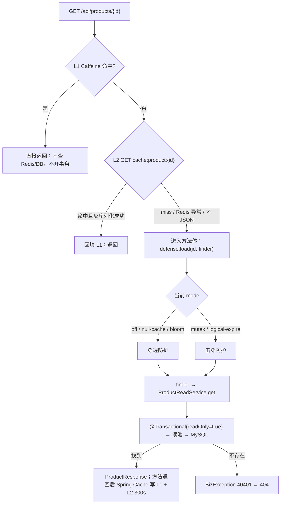
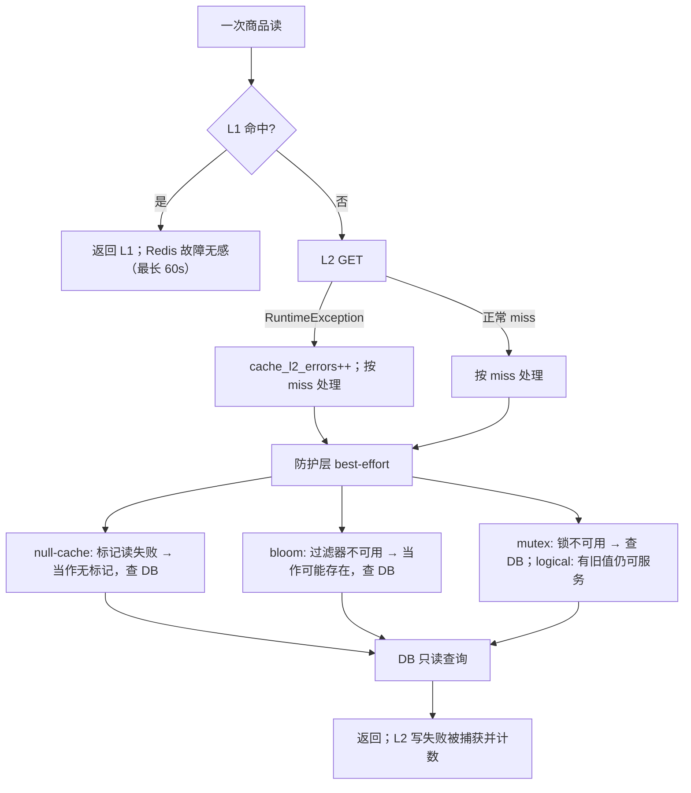
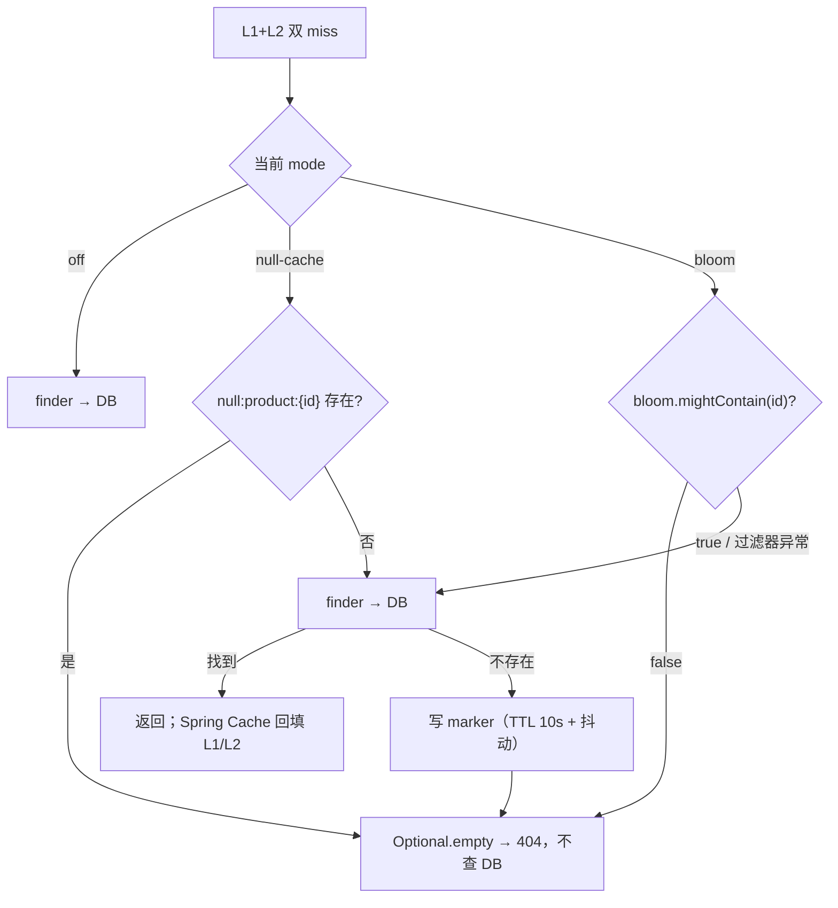
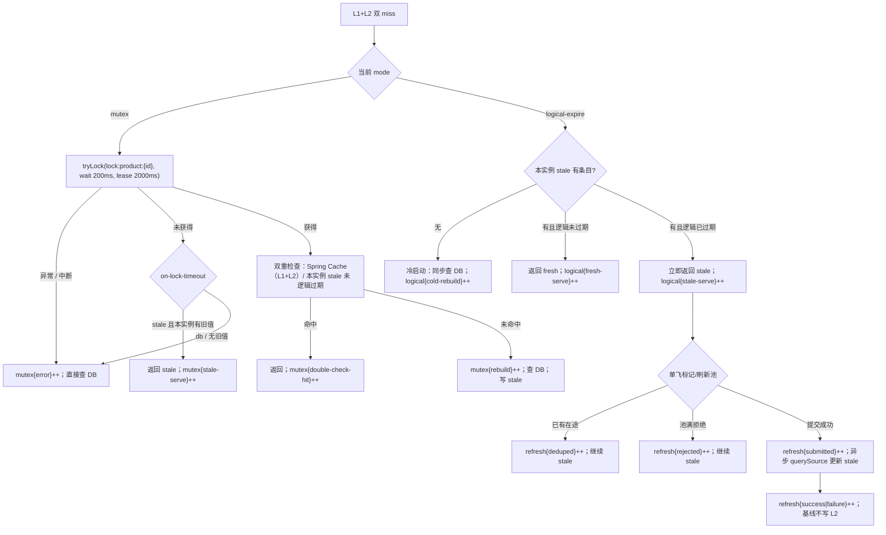

# 03 缓存体系

> 一句话职责：讲清商品读路径的 L1 Caffeine → L2 Redis → DB、Redis 故障时的降级，以及 M4-1 穿透 / M4-2 击穿两组可运行时切换的防护策略。
> 代码基线：`294798a`（本工作树 `git rev-parse --short HEAD`，2026-10-27）。
> 重要边界：M4-2 的两个评审修复（logical-expire 刷新结果 publish-through、`retention > hot-key-ttl` 校验）**不在本基线**；本文在 §6.4 按「未合并」标注，不把它们写成已存在。

## 1. 角色与组件

| 角色 | 组件 | 职责 |
|---|---|---|
| 读入口 | `ProductController` → `CachedProductViewService` | `GET /api/products/{id}`；`@Cacheable("product", key="#id")` |
| L1 | Caffeine（进程内） | 10,000 条上限、写入后 60s 过期；命中不查 Redis/DB |
| L2 | Redis + `StringRedisTemplate` | JSON 值、键 `cache:product:<id>`、TTL 5 分钟 |
| 防护分发 | `ProductBreakdownDefense` | L1+L2 双 miss 时按当前 mode 分派：`mutex`/`logical-expire` 自处理，其余委托穿透防护 |
| 穿透防护 | `ProductPenetrationDefense` | `off` / `null-cache` / `bloom` |
| 空值标记 | `NullValueMarkerStore` | Redis `null:product:<id>` = `"NULL"`，10s + [0,5]s 抖动 |
| 布隆过滤器 | `ProductBloomFilterService` | Redisson `RBloomFilter`，键 `bloom:product-ids` |
| 击穿防护 | `ProductBreakdownDefense` | Redisson 互斥锁、逻辑过期 + 有界异步刷新 |
| 实验数据 | `CacheExperimentDataService` | `/lab/cache/seed`、`/lab/cache/state` |
| 模式开关 | `CacheDefenseModeService` | 进程内 `AtomicReference`，启动种子 + 运行时 POST |

## 2. L1/L2 的构造、键与 TTL

### 2.1 两层缓存的构造

- `TwoLevelCache` 是 `org.springframework.cache.Cache` 的实现；`TwoLevelCacheManager` 把它注册成唯一的 `CacheManager`，因此 `@Cacheable` 仍然生效。
- L1 是 Caffeine：`maximumSize(10_000)`、`expireAfterWrite(60s)`、`recordStats()`；没有 `refreshAfterWrite`。
- L2 是 Redis：值用 Jackson 序列化成 JSON；键 = `"cache:" + cacheName + ":" + key`，所以 product 缓存是 `cache:product:<id>`；写 L2 用 `SET` 带 300s TTL。
- `TwoLevelCacheManager.getCache(name)` 每次调用都检查 `cache` toggle：关闭时返回 `NoOpCache`，既不读也不写 L1/L2；重新打开返回原 `TwoLevelCache`，旧条目仍有效。

### 2.2 键 / TTL 一览

| 用途 | 键 | TTL / 上限 | 来源 |
|---|---|---|---|
| L1 商品缓存 | 进程内 `Long id`（不是 Redis 键） | 10,000 条；写入后 60s | `code/services/seckill-app-jdk21/src/main/java/com/javalearn/lab/seckill/catalog/cache/TwoLevelCache.java:39-40` |
| L2 商品缓存 | `cache:product:<id>` | 300s（5 分钟） | `code/services/seckill-app-jdk21/src/main/java/com/javalearn/lab/seckill/catalog/cache/TwoLevelCache.java:41-42` / `:238` |
| 空值标记 | `null:product:<id>`，值 `"NULL"` | 10s + 随机 [0,5]s | `application.yml:142` / `:145` / `:146` |
| 布隆过滤器 | `bloom:product-ids` | Redisson 位图，无 TTL | `application.yml:148` |
| 互斥锁 | `lock:product:<id>` | 租约 2000ms；等待 200ms | `application.yml:161-163` |
| 逻辑过期旧值 | 进程内 `Long id`（Caffeine） | 逻辑 30s；物理保留 120s；最多 10,000 条 | `application.yml:172-175` |
| 实验雪崩组 | `cache:product:90000..90199` | 同一 60s TTL | `application.yml:120-121` |
| 实验热点键 | `cache:product:90999` | 300s TTL | `application.yml:126-127` |

> 容易混淆但不是缓存的键：`seckill:stock:<productId>`（无 TTL，启动 `SET NX` 播种）、`seckill:idem:<key>`（1800s）、`seckill:request:<requestId>`（1800s）、`login:token:<token>`（1800s）。它们不参与两级缓存，Redis 故障时也不走缓存降级。

### 2.3 多实例的 L1 一致性窗口

- L1 是**每实例**的 Caffeine，没有失效广播、没有 Redis pub/sub、没有 `refreshAfterWrite`。
- `evict(key)` 只清本实例 L1 并删 L2 键；`clear()` 只清本实例 L1，再按前缀 SCAN + 删除 L2 键，**不会清其他实例的 L1**。
- 因此一个实例写入/删除后，另一个实例的 L1 仍可能在最长 **60s** 内返回旧值；设计稿 §8.4 提到的「刷新间隔 10s、最长不超过 L1 TTL 60s」中的 10s 刷新在合并代码里**不存在**，实际窗口就是 L1 的 60s。
- 对商品这种只读数据，演示时可接受；不要把它讲成「多实例强一致」。

## 3. 读路径



要点：

- L1/L2 命中时 `@Cacheable` 直接返回，方法体不执行；因此事务、防护、指标都不会发生。
- L2 的异常被 `readL2` 吃掉并计 `cache_l2_errors`，按 miss 处理，继续走 DB；不会把 200/404 变成 500。
- 缓存写回发生在**方法返回之后**：如果方法体返回的是击穿策略的旧值，Spring Cache 也会把旧值写回 L1/L2；这是 §6.4 评审缺陷的根源。
- 404 由 `CachedProductViewService` 在 `Optional.empty()` 之后抛 `BizException(40401)`；防护组件不拥有 HTTP 契约。

## 4. Redis 故障时的降级



要点：

- **应用容器保持健康**：`management.endpoint.health.group.app.exclude=redis`，Docker healthcheck 打 `/actuator/health/app`；根 `/actuator/health` 仍诚实报 Redis DOWN（503）。这样 Redis 演练不会让 Docker/Nginx 把实例摘掉。
- L1 里的条目在 60s 内继续服务；之后每次读都走 DB。L2 写失败只记 `cache_l2_errors`，不影响响应。
- `null-cache` 的读/写失败都返回「无标记」并继续查 DB；`bloom` 的失败按「可能存在」处理；`mutex` 的 Redisson 异常按「跳过锁」处理；`logical-expire` 的 stale 存储是本地 Caffeine，不依赖 Redis，仍可服务旧值。
- **不是所有 Redis 用途都降级**：登录（`LoginService` 直接写 Redis）会 500；秒杀准入的锁/幂等/Lua 库存失败会 503；`seckill:request` 状态读失败也会 503。缓存降级只覆盖商品读路径。
- `GET /lab/cache/state` 在 Redis 不可达时返回 `redisReachable=false` 且 Redis 相关计数归零，不报错；L1/DB 相关计数仍可见。

## 5. M4-1 穿透防护决策树



- `off`：症状态，任何 miss 都到 DB。
- `null-cache`：只缓存「不存在」这一事实，短 TTL + 抖动，避免同一批 miss 与雪崩键同秒过期；已有商品绝不会被写 marker。
- `bloom`：只对「证明不存在」短路；假阳性会回落 DB 并保持普通 404 契约；过滤器不可用/未初始化按「可能存在」处理。
- 三个穿透模式由 `ProductPenetrationDefense` 处理；但读路径的入口是 `ProductBreakdownDefense`，后者对 `off`/`null-cache`/`bloom` 原样委托，不改变行为。

## 6. M4-2 击穿防护决策树

### 6.1 总决策树



### 6.2 mutex：持锁者 / 等待者 / 超时

- **持锁者**：`tryLock(wait=200ms, lease=2000ms)` 成功后先双重检查——先查 Spring 两级缓存（`springCacheProbe`），再查本实例 stale 存储中「逻辑未过期」的值；两者都没有才查 DB，并把结果写入 stale 存储。锁在 `finally` 里按 `isHeldByCurrentThread()` 释放，租约过期不会误解锁。
- **等待者**：最多等 200ms；拿到锁后同样双重检查，所以大部分等待者不会重复查 DB。`lease-ms >= wait-ms` 在启动时强制，避免等到的锁其实已被持有者释放/过期。
- **超时**：`on-lock-timeout=db`（默认）直接查 DB；`stale` 时若本实例有旧值则返回旧值，没有仍查 DB。超时计 `cache_breakdown_mutex{result="timeout"}`；`stale-serve` 单独计。
- **Redis 异常**：计 `error`，跳过锁直接查 DB；读请求不会失败。
- **代价**：等待者抬高 P99，这是演示要看到的 trade-off；`mutex` 不是「没有代价的缓存」。
- **不是数学上的 1 次重建**：持锁者方法返回与 `@Cacheable` 写入 L2 之间有窗口，等待者可能双检扑空再查一次 DB；预期是 `rebuild≈1`、`double-check-hit` 高、少量额外 fallback。

### 6.3 logical-expire：旧值兜底 + 有界异步刷新

- `LogicalStaleStore` 是每实例 Caffeine，键为 product id；每条 `StaleValue` 带 `logicalExpireAtMillis`。Caffeine 的 `expireAfterWrite(retention=120s)` 是物理窗口，逻辑 TTL 是 30s；启动校验 `retention > logical-ttl`。
- 没有条目（冷启动或超过保留期）：同步查 DB，计 `cold-rebuild`；不防并发，这是策略代价。
- 条目仍新鲜：直接返回，计 `fresh-serve`。
- 条目逻辑过期但物理还在：立即返回旧值，计 `stale-serve`，同时触发一次异步刷新。
- 异步刷新：`refreshing` 用 `putIfAbsent` 做每 key 单飞；执行器固定 2 线程、队列 100、daemon、AbortPolicy；池满被拒计 `rejected`，旧值继续服务，请求线程绝不代跑查询；刷新失败/商品消失计 `failure`，保留旧值到 retention 结束，不把演示中途变成 404。
- 刷新结果只更新 `LogicalStaleStore`（基线行为）；**没有**写回 Spring Cache/L2。因此 refreshed 值在 L1/L2 旧条目过期前不可见——见 §6.4。
- `staleEntriesCached` / `refreshInFlight` 是瞬时值，抓取时可能为 0，只用于 state 展示。

### 6.4 两个评审修复：基线未合并

| 评审发现 | 基线 `294798a` 的真实行为 | 分支修复（`feature/ha-lab` 更晚提交） | 对本演示的影响 |
|---|---|---|---|
| logical-expire 刷新结果没有 publish-through | `refreshOne` 只调用 `querySource` 更新 `LogicalStaleStore`；`@Cacheable` 在 stale-serve 返回后把**旧值**写回 L1/L2，L2 旧值可持续 300s | `34c0dfc` 增加 wired `CacheWriter`，异步刷新结果通过同一 Spring Cache 写回 L2 | 当前基线里「短暂陈旧」会变成「旧值在 L2 再活一个 TTL」；不能按设计稿宣称刷新后立刻可见 |
| `retention-seconds` 未与热点键 TTL 对齐 | 默认 `logical=30s`、`retention=120s`；热点键 TTL 是 300s；`LabCacheProperties.validate()` 只校验 `retention > logical-ttl` | `34c0dfc` 把默认 retention 改为 600s，并新增 `retention > seed.hot-key-ttl-seconds` 启动校验 | 当前基线中 stale 条目会在热点键 L2 过期前（120s < 300s）被物理淘汰；热点键真正过期时 stale store 常为空，logical-expire 退化为冷重建，看起来像 `off`/无异步兜底 |

> 结论：本文按基线把 logical-expire 的「旧值兜底 + 异步刷新」讲成**已存在的代码路径**，但必须同时说明上述两个缺陷；不要把设计稿的最终效果当成当前实测效果。修复提交不在 `294798a` 的祖先链上，合并后再更新本节。

## 7. 实验数据播种

### 7.1 数据集

- `POST /lab/cache/seed` 在保留 id 段生成 **1000** 个商品：`90000..90999`；`protected-max-id=1000`，所以 Flyway 演示商品 1/20 及 `id <= 1000` 的行永远不会被写。
- 前 **200** 个（`90000..90199`）以**同一个 60s TTL** 预热 L2，制造雪崩组；热点键是偏移 999，即 **90999**，用 300s TTL 单独预热。
- DB 写入只插入区间内缺失的 id，二次调用 `inserted=0`；不覆盖已存在行。L2 预热和 Bloom 重建不是 DB 幂等的一部分：重复 seed 会把雪崩键 TTL 重置、Bloom 重建。
- Bloom 重建覆盖**全部**现存 id（不只实验区间），避免真实商品被「证明不存在」而错答 404；重建是 `delete → tryInit → add`，窗口内未初始化会回落 DB。
- Redis/Redisson 失败不会让 seed 失败：返回 `avalancheKeysWritten=0`、`bloomInitialised=false` 等真实计数，便于诊断「实验没架好」。
- seed 的 DB 写走 `JdbcTemplate` 无事务 → 写池，和 `SeckillStockSeeder` 一样避免启动/实验时初始化读池。

### 7.2 状态读取

`GET /lab/cache/state` 返回：

- `defense{mode, cacheToggleEnabled}`；
- `breakdown{strategy, mutexActive, logicalExpireActive, mutexWaitMs, mutexLeaseMs, mutexOnLockTimeout, logicalTtlSeconds, retentionSeconds, refreshPoolSize, refreshQueueCapacity, staleEntriesCached, refreshInFlight}`；
- `dataset{startId,endId,productCount,rowsInRange,missingRows,avalancheKeyCount,avalancheTtlSeconds,hotKeyProductId}`；
- `keys{redisReachable,l1ExperimentKeys,l2ExperimentKeys,l2AvalancheKeysAlive,hotKeyCached}`；
- `bloom{key,initialised,size,capacity,falseProbability}`；
- `nullCache{keyPrefix,ttlSeconds,jitterSeconds,liveMarkerKeys}`。

`keys` 的 L2 计数用 `SCAN cache:product:*`；L1 计数读 Caffeine 的 key 集合；Redis 不可达时 `redisReachable=false`、Redis 计数为 0，不抛错。

## 8. `/lab/cache/*` 端点

| 方法 | 路径 | 作用 | 备注 |
|---|---|---|---|
| GET | `/lab/cache/mode` | 读当前模式 | 返回 `{"mode":"off"}` |
| POST | `/lab/cache/mode` | 切模式 | body `{"mode":"off\|null-cache\|bloom\|mutex\|logical-expire"}`；未知/缺失 400；精确匹配，不 trim 不换大小写 |
| POST | `/lab/cache/seed` | 生成/补齐实验数据 | 只写保留区间；Redis/Bloom 失败降级为计数 |
| GET | `/lab/cache/state` | 读实验状态 | Redis 不可达时降级为 DB+L1 口径 |

- 所有 `/lab/**` 由 `LabTokenFilter` 用 `X-Lab-Token` 常量时间校验；Nginx **不代理**应用 `/lab/**`，应用也没有宿主端口，所以宿主机不能直接 `curl 127.0.0.1:8080/lab/cache/...`。演示要在容器网络内调用（见 §10）。
- `/lab/cache/reset` **未实现**（设计附录 A 有，代码没有）；清理实验商品只能 SQL DELETE / 手动删 Redis 键。
- 模式是**每实例**内存态：`POST` 到 app-1 只改 app-1；三实例要分别切。chaos-controller 广播尚未实现。

## 9. 5 分钟演示步骤

> 前提：`bash code/lab/scripts/up.sh --profile dev` 已把栈拉起；`LAB_TOKEN` 从本地 `code/lab/docker/.env` 读取，**不要把值打印到屏幕或提交**。以下命令都打到 `app-1`，避免 Nginx 轮询到其他实例导致模式不一致。

```bash
# 0) 只在当前 shell 设置 token；值来自你本地的 .env，不在这里回显
export LAB_TOKEN="${LAB_TOKEN:?set LAB_TOKEN from your local .env}"

# 1) 看初始状态；mode 默认 off
docker exec jl-nginx wget -qO- --header="X-Lab-Token: $LAB_TOKEN" \
  http://app-1:8080/lab/cache/state

# 2) 播种 1000 个实验商品（二次调用 inserted=0；会重置雪崩键 TTL）
docker exec jl-nginx wget -qO- --header="X-Lab-Token: $LAB_TOKEN" \
  --post-data='' http://app-1:8080/lab/cache/seed

# 3) 穿透：切 null-cache，连续请求不存在的 99999；第二次应不再查 DB
docker exec jl-nginx wget -qO- --header="X-Lab-Token: $LAB_TOKEN" \
  --header="Content-Type: application/json" \
  --post-data='{"mode":"null-cache"}' http://app-1:8080/lab/cache/mode
curl -s -o /dev/null -w '%{http_code}\n' http://127.0.0.1:8080/api/products/99999
curl -s -o /dev/null -w '%{http_code}\n' http://127.0.0.1:8080/api/products/99999
docker exec jl-nginx wget -qO- --header="X-Lab-Token: $LAB_TOKEN" \
  http://app-1:8080/lab/cache/state

# 4) 击穿 mutex：删掉热点键的 L2，再对 app-1 并发 20 次；看 rebuild/double-check
docker exec jl-redis redis-cli DEL cache:product:90999
docker exec jl-nginx wget -qO- --header="X-Lab-Token: $LAB_TOKEN" \
  --header="Content-Type: application/json" \
  --post-data='{"mode":"mutex"}' http://app-1:8080/lab/cache/mode
docker exec jl-app-1 sh -c 'i=0; while [ $i -lt 20 ]; do \
  wget -qO- http://127.0.0.1:8080/api/products/90999 >/dev/null & \
  i=$((i+1)); done; wait'
docker exec jl-nginx wget -qO- http://app-1:8080/actuator/prometheus \
  | grep -E 'cache_breakdown|cache_db_fallbacks'

# 5) 击穿 logical-expire：先读一次写 stale，等 L1 60s 过期，再删 L2，读一次看 stale-serve
docker exec jl-nginx wget -qO- --header="X-Lab-Token: $LAB_TOKEN" \
  --header="Content-Type: application/json" \
  --post-data='{"mode":"logical-expire"}' http://app-1:8080/lab/cache/mode
docker exec jl-nginx wget -qO- http://app-1:8080/api/products/90999
sleep 61
docker exec jl-redis redis-cli DEL cache:product:90999
docker exec jl-nginx wget -qO- http://app-1:8080/api/products/90999
docker exec jl-nginx wget -qO- http://app-1:8080/actuator/prometheus \
  | grep -E 'cache_breakdown_logical|cache_breakdown_refresh'
```

5 分钟内的取舍：seed + 穿透 + mutex 约 30–60s；logical-expire 需要 `sleep 61` 等 L1 过期（L1 TTL 是硬编码 60s，不能通过环境变量调小），总计仍在 2 分钟内。若要更快，可在启动前把 `LAB_CACHE_LOGICAL_TTL_SECONDS` 调小并接受 L1 仍是 60s。

收尾（可选）：`bash code/lab/scripts/reset-lab.sh --yes` 会 FLUSHDB（清掉 L1/L2 与实验标记）并恢复订单/库存/队列；它**不会**删除 `catalog_product` 里的 1000 行实验商品，清理这些行需要手工 SQL DELETE。

## 10. 代码对照表

| 概念/行为 | 类或方法 | 路径:行 | 说明 |
|---|---|---|---|
| L1 构造 | `Caffeine.newBuilder()` | `code/services/seckill-app-jdk21/src/main/java/com/javalearn/lab/seckill/catalog/cache/TwoLevelCache.java:68` | 进程内缓存 |
| L1 容量 | `L1_MAXIMUM_SIZE` | `code/services/seckill-app-jdk21/src/main/java/com/javalearn/lab/seckill/catalog/cache/TwoLevelCache.java:39` | 10,000 |
| L1 TTL | `L1_EXPIRE_AFTER_WRITE` | `code/services/seckill-app-jdk21/src/main/java/com/javalearn/lab/seckill/catalog/cache/TwoLevelCache.java:40` | 60s，硬编码 |
| L2 TTL | `L2_TTL` | `code/services/seckill-app-jdk21/src/main/java/com/javalearn/lab/seckill/catalog/cache/TwoLevelCache.java:41` | 5 分钟，硬编码 |
| L2 键前缀 | `KEY_PREFIX` | `code/services/seckill-app-jdk21/src/main/java/com/javalearn/lab/seckill/catalog/cache/TwoLevelCache.java:42` | `cache:` |
| L1 读 | `public ValueWrapper get(Object key)` | `code/services/seckill-app-jdk21/src/main/java/com/javalearn/lab/seckill/catalog/cache/TwoLevelCache.java:104` | 命中计 `l1 hit` |
| L2 读 | `private Object readL2` | `code/services/seckill-app-jdk21/src/main/java/com/javalearn/lab/seckill/catalog/cache/TwoLevelCache.java:200` | JSON 反序列化 |
| Redis 读异常 | `countL2Error` | `code/services/seckill-app-jdk21/src/main/java/com/javalearn/lab/seckill/catalog/cache/TwoLevelCache.java:242` | 计 `cache_l2_errors` |
| 双 miss 计数 | `cache_db_fallbacks` | `code/services/seckill-app-jdk21/src/main/java/com/javalearn/lab/seckill/catalog/cache/TwoLevelCache.java:85` | reason=miss |
| L2 写 | `public void put` | `code/services/seckill-app-jdk21/src/main/java/com/javalearn/lab/seckill/catalog/cache/TwoLevelCache.java:154` | 先 L1 再 L2 |
| L2 删除 | `public void evict` | `code/services/seckill-app-jdk21/src/main/java/com/javalearn/lab/seckill/catalog/cache/TwoLevelCache.java:168` | 只清本实例 L1 + L2 |
| 清空 | `public void clear()` | `code/services/seckill-app-jdk21/src/main/java/com/javalearn/lab/seckill/catalog/cache/TwoLevelCache.java:178` | L1 全清，L2 按前缀删 |
| L2 键布局 | `static String l2KeyPrefix` | `code/services/seckill-app-jdk21/src/main/java/com/javalearn/lab/seckill/catalog/cache/TwoLevelCache.java:238` | `cache:<name>:` |
| CacheManager | `public Cache getCache` | `code/services/seckill-app-jdk21/src/main/java/com/javalearn/lab/seckill/catalog/cache/TwoLevelCacheManager.java:49` | 每次查 toggle |
| 关闭缓存 | `NoOpCache` | `code/services/seckill-app-jdk21/src/main/java/com/javalearn/lab/seckill/catalog/cache/TwoLevelCacheManager.java:51` | 两级都不读写 |
| 商品缓存名 | `PRODUCT_CACHE` | `code/services/seckill-app-jdk21/src/main/java/com/javalearn/lab/seckill/catalog/cache/TwoLevelCacheManager.java:30` | `product` |
| L2 前缀单一来源 | `productL2KeyPrefix` | `code/services/seckill-app-jdk21/src/main/java/com/javalearn/lab/seckill/catalog/cache/TwoLevelCacheManager.java:67` | seeder/state 复用 |
| 启动建缓存 | `manager.getCache` | `code/services/seckill-app-jdk21/src/main/java/com/javalearn/lab/seckill/catalog/cache/TwoLevelCacheConfig.java:34` | 指标先注册 |
| 商品缓存注解 | `@Cacheable` | `code/services/seckill-app-jdk21/src/main/java/com/javalearn/lab/seckill/catalog/app/CachedProductViewService.java:47` | 方法体只在 miss 时执行 |
| 只读事务 | `@Transactional(readOnly = true)` | `code/services/seckill-app-jdk21/src/main/java/com/javalearn/lab/seckill/catalog/app/ProductReadService.java:32` | 读池 |
| 穿透分发 | `public Optional<ProductResponse> load` | `code/services/seckill-app-jdk21/src/main/java/com/javalearn/lab/seckill/catalog/cache/ProductPenetrationDefense.java:49` | switch 模式 |
| off | `case OFF` | `code/services/seckill-app-jdk21/src/main/java/com/javalearn/lab/seckill/catalog/cache/ProductPenetrationDefense.java:52` | 直查 DB |
| null-cache 分支 | `case NULL_CACHE` | `code/services/seckill-app-jdk21/src/main/java/com/javalearn/lab/seckill/catalog/cache/ProductPenetrationDefense.java:53` | 标记 + DB |
| bloom 分支 | `case BLOOM` | `code/services/seckill-app-jdk21/src/main/java/com/javalearn/lab/seckill/catalog/cache/ProductPenetrationDefense.java:54` | 过滤器 + DB |
| 标记判断 | `markerStore.isMarkedAbsent` | `code/services/seckill-app-jdk21/src/main/java/com/javalearn/lab/seckill/catalog/cache/ProductPenetrationDefense.java:67` | 命中直接 404 |
| 标记写入 | `markerStore.markAbsent` | `code/services/seckill-app-jdk21/src/main/java/com/javalearn/lab/seckill/catalog/cache/ProductPenetrationDefense.java:73` | 只对不存在 |
| 标记 TTL | `entryTtl` | `code/services/seckill-app-jdk21/src/main/java/com/javalearn/lab/seckill/catalog/cache/NullValueMarkerStore.java:117` | base + jitter |
| 随机抖动 | `randomJitterSeconds` | `code/services/seckill-app-jdk21/src/main/java/com/javalearn/lab/seckill/catalog/cache/NullValueMarkerStore.java:75` | [0,jitter] |
| Bloom 判断 | `mightContain` | `code/services/seckill-app-jdk21/src/main/java/com/javalearn/lab/seckill/catalog/cache/ProductBloomFilterService.java:72` | false 才短路 |
| Bloom 重建 | `public long rebuild` | `code/services/seckill-app-jdk21/src/main/java/com/javalearn/lab/seckill/catalog/cache/ProductBloomFilterService.java:102` | delete + tryInit + add |
| Bloom 初始化 | `tryInit` | `code/services/seckill-app-jdk21/src/main/java/com/javalearn/lab/seckill/catalog/cache/ProductBloomFilterService.java:105` | 失败抛异常 |
| 击穿入口 | `public Optional<ProductResponse> load` | `code/services/seckill-app-jdk21/src/main/java/com/javalearn/lab/seckill/catalog/cache/ProductBreakdownDefense.java:128` | 先分派 |
| mutex 分支 | `case MUTEX` | `code/services/seckill-app-jdk21/src/main/java/com/javalearn/lab/seckill/catalog/cache/ProductBreakdownDefense.java:131` | 互斥重建 |
| logical 分支 | `case LOGICAL_EXPIRE` | `code/services/seckill-app-jdk21/src/main/java/com/javalearn/lab/seckill/catalog/cache/ProductBreakdownDefense.java:132` | 旧值兜底 |
| mutex 加锁 | `lock.tryLock` | `code/services/seckill-app-jdk21/src/main/java/com/javalearn/lab/seckill/catalog/cache/ProductBreakdownDefense.java:158` | wait/lease |
| mutex 超时 | `mutexTimeouts` | `code/services/seckill-app-jdk21/src/main/java/com/javalearn/lab/seckill/catalog/cache/ProductBreakdownDefense.java:173` | 计 timeout |
| mutex 双检 | `private Optional<ProductResponse> doubleCheck` | `code/services/seckill-app-jdk21/src/main/java/com/javalearn/lab/seckill/catalog/cache/ProductBreakdownDefense.java:198` | 缓存 + stale |
| logical 入口 | `withLogicalExpire` | `code/services/seckill-app-jdk21/src/main/java/com/javalearn/lab/seckill/catalog/cache/ProductBreakdownDefense.java:218` | fresh/stale/cold |
| 单飞刷新 | `triggerRefresh` | `code/services/seckill-app-jdk21/src/main/java/com/javalearn/lab/seckill/catalog/cache/ProductBreakdownDefense.java:240` | putIfAbsent |
| 刷新实现 | `refreshOne` | `code/services/seckill-app-jdk21/src/main/java/com/javalearn/lab/seckill/catalog/cache/ProductBreakdownDefense.java:261` | 基线只更新 stale |
| 查源 | `querySource` | `code/services/seckill-app-jdk21/src/main/java/com/javalearn/lab/seckill/catalog/cache/ProductBreakdownDefense.java:282` | 计 breakdown fallback |
| stale 存储 | `public LogicalStaleStore` | `code/services/seckill-app-jdk21/src/main/java/com/javalearn/lab/seckill/catalog/cache/LogicalStaleStore.java:39` | 有界 Caffeine |
| retention 校验 | `retention.compareTo` | `code/services/seckill-app-jdk21/src/main/java/com/javalearn/lab/seckill/catalog/cache/LogicalStaleStore.java:45` | retention > logical |
| 物理 TTL | `expireAfterWrite(retention)` | `code/services/seckill-app-jdk21/src/main/java/com/javalearn/lab/seckill/catalog/cache/LogicalStaleStore.java:53` | retention 到期清除 |
| 写 stale | `public void put` | `code/services/seckill-app-jdk21/src/main/java/com/javalearn/lab/seckill/catalog/cache/LogicalStaleStore.java:59` | 记录逻辑过期 |
| mutex 配置 bean | `new ProductBreakdownDefense` | `code/services/seckill-app-jdk21/src/main/java/com/javalearn/lab/seckill/catalog/cache/BreakdownProtectionConfig.java:88` | 注入 CacheProbe |
| 刷新池 | `newRefreshExecutor` | `code/services/seckill-app-jdk21/src/main/java/com/javalearn/lab/seckill/catalog/cache/BreakdownProtectionConfig.java:55` | 有界、daemon、AbortPolicy |
| 缓存探测 | `springCacheProbe` | `code/services/seckill-app-jdk21/src/main/java/com/javalearn/lab/seckill/catalog/cache/BreakdownProtectionConfig.java:98` | L1/L2 |
| 标记 bean | `new NullValueMarkerStore` | `code/services/seckill-app-jdk21/src/main/java/com/javalearn/lab/seckill/catalog/cache/PenetrationProtectionConfig.java:31` | TTL + jitter |
| Bloom bean | `new ProductBloomFilterService` | `code/services/seckill-app-jdk21/src/main/java/com/javalearn/lab/seckill/catalog/cache/PenetrationProtectionConfig.java:46` | Redisson |
| 穿透 bean | `new ProductPenetrationDefense` | `code/services/seckill-app-jdk21/src/main/java/com/javalearn/lab/seckill/catalog/cache/PenetrationProtectionConfig.java:60` | 三模式 |
| 保护区校验 | `start-id must be greater` | `code/services/seckill-app-jdk21/src/main/java/com/javalearn/lab/seckill/lab/config/LabCacheProperties.java:32` | start > protected |
| 热点区间校验 | `hot-key-index must not` | `code/services/seckill-app-jdk21/src/main/java/com/javalearn/lab/seckill/lab/config/LabCacheProperties.java:54` | 热点不在雪崩组 |
| mutex 租约校验 | `lease-ms must be` | `code/services/seckill-app-jdk21/src/main/java/com/javalearn/lab/seckill/lab/config/LabCacheProperties.java:90` | lease >= wait |
| 超时策略校验 | `on-lock-timeout` | `code/services/seckill-app-jdk21/src/main/java/com/javalearn/lab/seckill/lab/config/LabCacheProperties.java:94` | db/stale |
| retention vs logical | `getRetentionSeconds() <= logical.getLogicalTtlSeconds()` | `code/services/seckill-app-jdk21/src/main/java/com/javalearn/lab/seckill/lab/config/LabCacheProperties.java:102` | 只校验这一对 |
| 热点 TTL 正数校验 | `hot-key-ttl-seconds` | `code/services/seckill-app-jdk21/src/main/java/com/javalearn/lab/seckill/lab/config/LabCacheProperties.java:45` | 没有与 retention 交叉校验 |
| seed 入口 | `public CacheSeedResponse seed` | `code/services/seckill-app-jdk21/src/main/java/com/javalearn/lab/seckill/lab/cache/CacheExperimentDataService.java:108` | 幂等补齐 |
| 缺失 id 查询 | `SELECT_IDS_IN_RANGE` | `code/services/seckill-app-jdk21/src/main/java/com/javalearn/lab/seckill/lab/cache/CacheExperimentDataService.java:64` | 只查区间 |
| 批量插入 | `batchUpdate(INSERT_PRODUCT` | `code/services/seckill-app-jdk21/src/main/java/com/javalearn/lab/seckill/lab/cache/CacheExperimentDataService.java:256` | 分批 200 |
| 雪崩预热 | `warmAvalancheKeys` | `code/services/seckill-app-jdk21/src/main/java/com/javalearn/lab/seckill/lab/cache/CacheExperimentDataService.java:229` | 同一 TTL |
| 热点预热 | `warmHotKey` | `code/services/seckill-app-jdk21/src/main/java/com/javalearn/lab/seckill/lab/cache/CacheExperimentDataService.java:242` | 独立 TTL |
| Bloom 重建 | `bloomFilter.rebuild` | `code/services/seckill-app-jdk21/src/main/java/com/javalearn/lab/seckill/lab/cache/CacheExperimentDataService.java:143` | 全部 id |
| state 入口 | `public CacheStateResponse state` | `code/services/seckill-app-jdk21/src/main/java/com/javalearn/lab/seckill/lab/cache/CacheExperimentDataService.java:158` | 只读 |
| state L2 前缀 | `productL2KeyPrefix` | `code/services/seckill-app-jdk21/src/main/java/com/javalearn/lab/seckill/lab/cache/CacheExperimentDataService.java:165` | 单一来源 |
| L1 计数 | `countL1ExperimentKeys` | `code/services/seckill-app-jdk21/src/main/java/com/javalearn/lab/seckill/lab/cache/CacheExperimentDataService.java:299` | toggle 关时为 0 |
| 实验端点 | `@RequestMapping("/lab/cache")` | `code/services/seckill-app-jdk21/src/main/java/com/javalearn/lab/seckill/lab/api/LabCacheController.java:22` | 四个端点 |
| mode GET | `@GetMapping("/mode")` | `code/services/seckill-app-jdk21/src/main/java/com/javalearn/lab/seckill/lab/api/LabCacheController.java:34` | 读模式 |
| mode POST | `@PostMapping("/mode")` | `code/services/seckill-app-jdk21/src/main/java/com/javalearn/lab/seckill/lab/api/LabCacheController.java:39` | 切模式 |
| seed POST | `@PostMapping("/seed")` | `code/services/seckill-app-jdk21/src/main/java/com/javalearn/lab/seckill/lab/api/LabCacheController.java:49` | 播种 |
| state GET | `@GetMapping("/state")` | `code/services/seckill-app-jdk21/src/main/java/com/javalearn/lab/seckill/lab/api/LabCacheController.java:54` | 状态 |
| 模式枚举 | `OFF("off")` | `code/services/seckill-app-jdk21/src/main/java/com/javalearn/lab/seckill/lab/toggle/CacheDefenseMode.java:34` | 五值之一 |
| 模式服务 | `public CacheDefenseModeService` | `code/services/seckill-app-jdk21/src/main/java/com/javalearn/lab/seckill/lab/toggle/CacheDefenseModeService.java:22` | 每实例 |
| 运行时切换 | `modeService.update` | `code/services/seckill-app-jdk21/src/main/java/com/javalearn/lab/seckill/lab/api/LabCacheController.java:45` | 不重启 |
| 应用健康组排除 Redis | `redis` | `code/services/seckill-app-jdk21/src/main/resources/application.yml:389` | 容器门不误杀 |
| L1 指标 | `cache_l1_requests` | `code/services/seckill-app-jdk21/src/main/java/com/javalearn/lab/seckill/catalog/cache/TwoLevelCache.java:73` | hit/miss |
| L2 指标 | `cache_l2_requests` | `code/services/seckill-app-jdk21/src/main/java/com/javalearn/lab/seckill/catalog/cache/TwoLevelCache.java:79` | hit/miss |
| L2 错误指标 | `cache_l2_errors` | `code/services/seckill-app-jdk21/src/main/java/com/javalearn/lab/seckill/catalog/cache/TwoLevelCache.java:88` | 计数 |
| 击穿 fallback | `reason", "breakdown"` | `code/services/seckill-app-jdk21/src/main/java/com/javalearn/lab/seckill/catalog/cache/ProductBreakdownDefense.java:110` | 独立 reason |
| state breakdown 段 | `record Breakdown` | `code/services/seckill-app-jdk21/src/main/java/com/javalearn/lab/seckill/lab/api/CacheStateResponse.java:29` | 12 个字段 |
| 种子配置 | `LAB_CACHE_SEED_PRODUCT_COUNT` | `code/services/seckill-app-jdk21/src/main/resources/application.yml:114` | 1000 |
| 起始 id | `LAB_CACHE_SEED_START_ID` | `code/services/seckill-app-jdk21/src/main/resources/application.yml:115` | 90000 |
| 保护区 | `LAB_CACHE_SEED_PROTECTED_MAX_ID` | `code/services/seckill-app-jdk21/src/main/resources/application.yml:117` | 1000 |
| 雪崩数量 | `LAB_CACHE_SEED_AVALANCHE_KEY_COUNT` | `code/services/seckill-app-jdk21/src/main/resources/application.yml:120` | 200 |
| 雪崩 TTL | `LAB_CACHE_SEED_AVALANCHE_TTL_SECONDS` | `code/services/seckill-app-jdk21/src/main/resources/application.yml:121` | 60 |
| 热点偏移 | `LAB_CACHE_SEED_HOT_KEY_INDEX` | `code/services/seckill-app-jdk21/src/main/resources/application.yml:126` | 999 |
| 热点 TTL | `LAB_CACHE_SEED_HOT_KEY_TTL_SECONDS` | `code/services/seckill-app-jdk21/src/main/resources/application.yml:127` | 300 |
| 状态 SCAN | `LAB_CACHE_STATE_SCAN_COUNT` | `code/services/seckill-app-jdk21/src/main/resources/application.yml:134` | 500 |
| 启动模式 | `LAB_CACHE_DEFENSE_MODE` | `code/services/seckill-app-jdk21/src/main/resources/application.yml:140` | off |
| 空值前缀 | `LAB_CACHE_NULL_KEY_PREFIX` | `code/services/seckill-app-jdk21/src/main/resources/application.yml:142` | `null:product:` |
| 空值 TTL | `LAB_CACHE_NULL_TTL_SECONDS` | `code/services/seckill-app-jdk21/src/main/resources/application.yml:145` | 10 |
| 空值抖动 | `LAB_CACHE_NULL_JITTER_SECONDS` | `code/services/seckill-app-jdk21/src/main/resources/application.yml:146` | 5 |
| Bloom 键 | `LAB_CACHE_BLOOM_KEY` | `code/services/seckill-app-jdk21/src/main/resources/application.yml:148` | `bloom:product-ids` |
| Bloom 容量 | `LAB_CACHE_BLOOM_EXPECTED_INSERTIONS` | `code/services/seckill-app-jdk21/src/main/resources/application.yml:151` | 10000 |
| Bloom fpp | `LAB_CACHE_BLOOM_FALSE_PROBABILITY` | `code/services/seckill-app-jdk21/src/main/resources/application.yml:152` | 0.01 |
| mutex 前缀 | `LAB_CACHE_MUTEX_KEY_PREFIX` | `code/services/seckill-app-jdk21/src/main/resources/application.yml:161` | `lock:product:` |
| mutex 等待 | `LAB_CACHE_MUTEX_WAIT_MS` | `code/services/seckill-app-jdk21/src/main/resources/application.yml:162` | 200 |
| mutex 租约 | `LAB_CACHE_MUTEX_LEASE_MS` | `code/services/seckill-app-jdk21/src/main/resources/application.yml:163` | 2000 |
| mutex 超时策略 | `LAB_CACHE_MUTEX_ON_LOCK_TIMEOUT` | `code/services/seckill-app-jdk21/src/main/resources/application.yml:167` | db |
| 逻辑 TTL | `LAB_CACHE_LOGICAL_TTL_SECONDS` | `code/services/seckill-app-jdk21/src/main/resources/application.yml:172` | 30 |
| 物理保留 | `LAB_CACHE_LOGICAL_RETENTION_SECONDS` | `code/services/seckill-app-jdk21/src/main/resources/application.yml:173` | 120 |
| stale 上限 | `LAB_CACHE_LOGICAL_MAX_ENTRIES` | `code/services/seckill-app-jdk21/src/main/resources/application.yml:175` | 10000 |
| 刷新池 | `LAB_CACHE_LOGICAL_REFRESH_POOL_SIZE` | `code/services/seckill-app-jdk21/src/main/resources/application.yml:178` | 2 |
| 刷新队列 | `LAB_CACHE_LOGICAL_REFRESH_QUEUE_CAPACITY` | `code/services/seckill-app-jdk21/src/main/resources/application.yml:179` | 100 |
| 刷新线程名前缀 | `LAB_CACHE_LOGICAL_REFRESH_THREAD_PREFIX` | `code/services/seckill-app-jdk21/src/main/resources/application.yml:181` | `breakdown-refresh` |

## 11. 配置项表

> 下表 `application.yml` 均指 `code/services/seckill-app-jdk21/src/main/resources/application.yml`；行号以基线 `294798a` 为准。

| 配置键 | 环境变量 | 默认值 | 在哪里读 |
|---|---|---|---|
| `app.lab.cache.seed.product-count` | `LAB_CACHE_SEED_PRODUCT_COUNT` | `1000` | `application.yml:114` |
| `app.lab.cache.seed.start-id` | `LAB_CACHE_SEED_START_ID` | `90000` | `application.yml:115` |
| `app.lab.cache.seed.protected-max-id` | `LAB_CACHE_SEED_PROTECTED_MAX_ID` | `1000` | `application.yml:117` |
| `app.lab.cache.seed.avalanche-key-count` | `LAB_CACHE_SEED_AVALANCHE_KEY_COUNT` | `200` | `application.yml:120` |
| `app.lab.cache.seed.avalanche-ttl-seconds` | `LAB_CACHE_SEED_AVALANCHE_TTL_SECONDS` | `60` | `application.yml:121` |
| `app.lab.cache.seed.hot-key-index` | `LAB_CACHE_SEED_HOT_KEY_INDEX` | `999` | `application.yml:126` |
| `app.lab.cache.seed.hot-key-ttl-seconds` | `LAB_CACHE_SEED_HOT_KEY_TTL_SECONDS` | `300` | `application.yml:127` |
| `app.lab.cache.seed.write-batch-size` | `LAB_CACHE_SEED_WRITE_BATCH_SIZE` | `200` | `application.yml:128` |
| `app.lab.cache.seed.name-prefix` | `LAB_CACHE_SEED_NAME_PREFIX` | `实验商品` | `application.yml:129` |
| `app.lab.cache.seed.status` | `LAB_CACHE_SEED_STATUS` | `ON_SALE` | `application.yml:130` |
| `app.lab.cache.seed.price` | `LAB_CACHE_SEED_PRICE` | `99.00` | `application.yml:131` |
| `app.lab.cache.state.scan-count` | `LAB_CACHE_STATE_SCAN_COUNT` | `500` | `application.yml:134` |
| `app.lab.cache.penetration.mode` | `LAB_CACHE_DEFENSE_MODE` | `off` | `application.yml:140` |
| `app.lab.cache.penetration.null-cache.key-prefix` | `LAB_CACHE_NULL_KEY_PREFIX` | `null:product:` | `application.yml:142` |
| `app.lab.cache.penetration.null-cache.ttl-seconds` | `LAB_CACHE_NULL_TTL_SECONDS` | `10` | `application.yml:145` |
| `app.lab.cache.penetration.null-cache.jitter-seconds` | `LAB_CACHE_NULL_JITTER_SECONDS` | `5` | `application.yml:146` |
| `app.lab.cache.penetration.bloom.key` | `LAB_CACHE_BLOOM_KEY` | `bloom:product-ids` | `application.yml:148` |
| `app.lab.cache.penetration.bloom.expected-insertions` | `LAB_CACHE_BLOOM_EXPECTED_INSERTIONS` | `10000` | `application.yml:151` |
| `app.lab.cache.penetration.bloom.false-probability` | `LAB_CACHE_BLOOM_FALSE_PROBABILITY` | `0.01` | `application.yml:152` |
| `app.lab.cache.breakdown.mutex.key-prefix` | `LAB_CACHE_MUTEX_KEY_PREFIX` | `lock:product:` | `application.yml:161` |
| `app.lab.cache.breakdown.mutex.wait-ms` | `LAB_CACHE_MUTEX_WAIT_MS` | `200` | `application.yml:162` |
| `app.lab.cache.breakdown.mutex.lease-ms` | `LAB_CACHE_MUTEX_LEASE_MS` | `2000` | `application.yml:163` |
| `app.lab.cache.breakdown.mutex.on-lock-timeout` | `LAB_CACHE_MUTEX_ON_LOCK_TIMEOUT` | `db` | `application.yml:167` |
| `app.lab.cache.breakdown.logical-expire.logical-ttl-seconds` | `LAB_CACHE_LOGICAL_TTL_SECONDS` | `30` | `application.yml:172` |
| `app.lab.cache.breakdown.logical-expire.retention-seconds` | `LAB_CACHE_LOGICAL_RETENTION_SECONDS` | `120` | `application.yml:173` |
| `app.lab.cache.breakdown.logical-expire.max-entries` | `LAB_CACHE_LOGICAL_MAX_ENTRIES` | `10000` | `application.yml:175` |
| `app.lab.cache.breakdown.logical-expire.refresh-pool-size` | `LAB_CACHE_LOGICAL_REFRESH_POOL_SIZE` | `2` | `application.yml:178` |
| `app.lab.cache.breakdown.logical-expire.refresh-queue-capacity` | `LAB_CACHE_LOGICAL_REFRESH_QUEUE_CAPACITY` | `100` | `application.yml:179` |
| `app.lab.cache.breakdown.logical-expire.keep-alive-seconds` | `LAB_CACHE_LOGICAL_REFRESH_KEEP_ALIVE_SECONDS` | `60` | `application.yml:180` |
| `app.lab.cache.breakdown.logical-expire.thread-name-prefix` | `LAB_CACHE_LOGICAL_REFRESH_THREAD_PREFIX` | `breakdown-refresh` | `application.yml:181` |
| `app.toggles.cache` | `LAB_TOGGLE_CACHE` | `true` | `application.yml:258` |
| `management.endpoint.health.group.app.exclude` | —（固定） | `redis` | `application.yml:388-389` |

> **非外置常量（已知缺陷）**：L1 `10_000`/`60s`、L2 `300s`、L2 前缀 `cache:` 都是 Java 常量；`CacheExperimentDataService` 的 SCAN count 已外置，但 `TwoLevelCache.clear()` 的 SCAN count 500 也是常量。

## 12. 已知缺陷 / 边界

- **M4-2 评审修复未合并**：见 §6.4。基线中 logical-expire 的刷新不写回 L2，且 `retention=120s < hot-key-ttl=300s`；这两点是演示前必须知道的真实缺陷，不能按设计稿的最终效果讲。
- **没有 `/lab/cache/reset`**：seed 写入的 1000 行实验商品不会被 `reset-lab.sh` 清掉（它只清订单/库存/Redis/队列，不动 catalog）；清理需 SQL DELETE 或手工删 Redis 键。设计附录 A 的 reset 端点未实现。
- **seed 对 Redis 非幂等**：重复调用会把雪崩键 TTL 重置、Bloom 重建；演示中不要在观察雪崩窗口时重复 seed。
- **Bloom 重建非原子**：`delete → tryInit → add` 之间过滤器未初始化，窗口内 bloom 退化为「全部查 DB」；安全但数字上会短暂变差。
- **空值标记过宽**：`isMarkedAbsent` 把前缀下任意非空值都当缺席标记；人工写入脏值会被误判为 404。
- **并发 seed 可能 500**：两个并发 `POST /lab/cache/seed` 可能 PK 相撞；教学工具可接受，演示避免并发点。
- **Bloom capacity 上报的是配置值**：`stats().capacity()` 是 `expectedInsertions`，不是位数组真实容量。
- **hot-key-index 约束**：默认 200/1000/999 安全；`avalanche-key-count == product-count` 时热点 key 放不进去（启动校验会拒绝）。
- **mutex 双检窗口**：持锁者方法返回与 `@Cacheable` 写 L2 之间，等待者可能多查一次 DB；`rebuild≈1` 不是严格 1。
- **stale 存储每实例**：多实例各自兜底、互不可见，重启即失；跨实例旧值兜底未实现。
- **logical-expire 冷启动不防并发**：没有任何旧值时，并发首个请求各自同步重建。
- **L1 多实例窗口 60s**：没有失效广播/`refreshAfterWrite`；设计里的 10s 刷新未实现。`clear()` 只清本实例 L1。
- **L1/L2 常量硬编码**：`TwoLevelCache` 的 10k/60s/300s 未外置，已在阶段交接的配置清理项中登记。
- **state 的 SCAN 是 O(L2 全量 product key)**：键多时变慢；演示规模可接受。
- **状态/模式不广播**：三实例需分别 POST；chaos-controller 广播未实现。
- **D10 面板未实现**：Grafana 当前只有 D1–D4、D9；缓存指标可用 `/actuator/prometheus` 或 `/prom/` 查询，但没有 `ha-d10.json`。
- **Caffeine 预热未实现**：没有 `hot:products` ZSet、启动预热、周期再预热；`refreshAfterWrite(10s)` 也不存在。
- **雪崩策略未实现**：没有 `ttl-jitter` / `l1-cache` / 熔断降级到 DB + 限流；seed 只准备了 200 个同 TTL 键，供后续实验使用。
- **Redis 故障降级只覆盖缓存读**：登录/秒杀库存/幂等/请求状态不走缓存降级，分别 500/503。
- **`cache` toggle 关闭不清理旧条目**：重新打开后旧 L1/L2 仍有效；演示「绕过缓存」应先删 `cache:product:*` 或等 TTL。
- **跨专题未合并能力以 README §3.1 / 01 §10 为准**：线程快照、应用 Router 双数据源、Toxiproxy、D6/D7/D10/D11 面板都不在本文按已实现描述。

## 13. 关联文档

- [README（索引与代码对照约定）](README.md)
- [01-总体架构与运行拓扑](01-总体架构与运行拓扑.md) — 容器/端口/网络
- [02-业务主链路](02-业务主链路.md) — 商品读在完整业务链路中的位置、读写路由
- 过程：`doc/process/step-25-cache-seed-penetration.md`（M4-1）、`step-26-breakdown-defense.md`（M4-2）、`step-24b-sentinel-client.md`（L1 掩盖 failover）、`阶段交接-2026-10-26.md`
- 设计：[总体设计](../2026-10-26-ha-concurrency-lab-design.md) §8.4（缓存防护与预热）、附录 A（实验接口）
