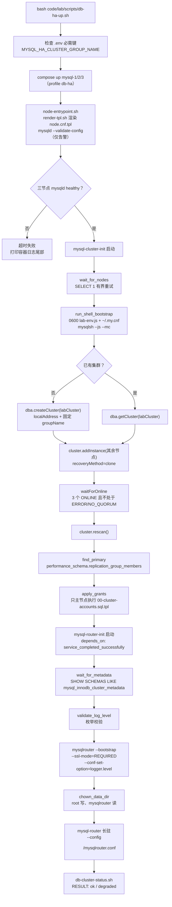
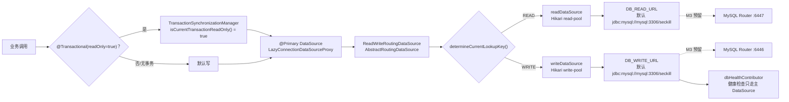
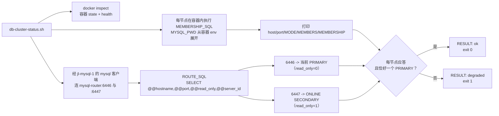

# 05 · MySQL 高可用与读写路由

> 一句话职责：把 3 节点 InnoDB Cluster（单主）+ MySQL Router（6446 读写 / 6447 只读）跑起来，并说明应用侧“按只读事务选池”的读写路由现状与尚未接线的部分。
>
> 代码基线：`294798a`

本文严格区分三件事：**集群本身已在线服务**（step-25b 实测）、**应用仍连 dev 单机 MySQL**（当前 `DB_WRITE_URL` / `DB_READ_URL` 只是钩子）、**应用侧 Router 模式与集群指标尚未实现**。不要把第三件写成已有能力。

---

## 1. 角色与组件

| 角色 | 实例/文件 | 职责 | 关键事实 |
|---|---|---|---|
| Group Replication 节点 | `jl-mysql-1/2/3` | 单主组复制（`multiPrimary=false`） | 各自独立卷；`server_id` 1/2/3；`report_host` 是 compose 服务名 |
| 集群引导 job | `jl-mysql-cluster-init` | 等三节点可用 → MySQL Shell AdminAPI 建组/加成员 → 在**主节点**建账号 | 一次性容器，退出码 0 才放行 Router 引导 |
| Router 引导 job | `jl-mysql-router-init` | 校验日志级别 → 等元数据 schema → `mysqlrouter --bootstrap` → `chown` 数据目录 | 以 root 跑（`user: 0`），写配置后把卷交给 uid 999 |
| Router | `jl-mysql-router` | 6446 跟随主、6447 在 ONLINE 从节点间轮询 | 只读配置；日志在卷内 `log/mysqlrouter.log`；宿主仅 127.0.0.1 发布 |
| Exporter | `jl-mysql-N-exporter` | 每节点一个 `mysqld-exporter` | 只 `expose`，抓取配置尚未接进 Prometheus |
| 应用侧路由 | `DataSourceConfig` / `ReadWriteRoutingDataSource` | `@Transactional(readOnly=true)` → 读池，其余 → 写池 | `LazyConnectionDataSourceProxy` 是关键，否则连接先于只读标记被取走 |
| 只读验收脚本 | `code/lab/scripts/db-cluster-status.sh` | 容器状态 + 成员视图 + 6446/6447 落地节点 | 退出码 0 当且仅当每节点应答且恰好一个 PRIMARY |
| 编排入口 | `db-ha-up.sh` / `db-ha-down.sh` | 分层启停，保留卷 | `--profile db-ha` 只起本层；`--purge` 才删卷 |

### 1.1 为什么是“3 节点 + Router”而不是主从 + ProxySQL

总设计把方案 A（InnoDB Cluster）作为采纳方案，理由是组复制自带选主与元数据，Router 直接读元数据缓存即可跟随；代价是初始化复杂、内存高、Router 自身是单点。这些代价在“失败域”一节如实列出。

---

## 2. 引导链路



引导顺序里有三个不能交换的点：

1. **先成组，再建账号**：账号 SQL 若走 `docker-entrypoint-initdb.d`，会在每个节点自己的 initdb 里执行，产生不同 `server_uuid` 的 errant transaction，组复制会拒绝后加入者，只能整机 clone。现在账号只在选举出的 PRIMARY 上执行一次，DDL 随组复制传播。
2. **先有元数据，再引导 Router**：集群还没形成时 bootstrap 会得到一个“没有路由目的地的健康 Router”，容器 healthy 但 6446/6447 什么都不转发。
3. **Router 配置只生成一次**：卷里已有 `mysqlrouter.conf` 时默认跳过 bootstrap，只校正日志级别并打印路由摘要；要重做必须显式 `MYSQL_HA_ROUTER_FORCE_BOOTSTRAP=true`。

---

## 3. 应用侧读写路由



要点：

- `LazyConnectionDataSourceProxy` 不是装饰。Spring 在事务开始时就要绑定只读标记，而路由键是在**取物理连接**时解析的；没有 Lazy 代理，连接会在事务 begin 阶段被取走，此时只读标记还不可见，所有只读事务都会悄悄走写池。
- 非事务调用（Flyway、健康检查、普通 JdbcTemplate）默认走写池；只读事务才走读池。这是有意的保守策略：读池绝不能执行可能写入的语句，读连接也不能看到当前写事务未提交的数据。
- `dbHealthContributor` 显式声明，是为了让 Boot 的多 DataSource 健康组合不再逐个直连读池；否则 Docker 健康检查会在启动几秒后拉起读池，破坏“`hikaricp_connections_max{pool="read-pool"}` 出现 = 有只读事务跑过”的验收含义。

### 3.1 当前接线状态（重要）

- `application.yml` 中写池与读池都默认指向 `${MYSQL_HOST:mysql}:3306`，即 dev 单机库；两个 URL 只是 M3 的钩子。
- `compose.base.yml` 的应用环境里只有 `MYSQL_HOST: mysql`，**没有**注入 `DB_WRITE_URL` / `DB_READ_URL`。因此当前所有 app 实例仍连单机 MySQL，Router 6446/6447 只有手工 `mysql` 客户端验证过。
- 应用侧没有 `MYSQL_MODE` 开关，也没有 `mysql_cluster_*` 指标；`db-cluster-status.sh` 里的两条 SQL 只是未来指标的“契约草案”。这些属于**未实现/待补**。

---

## 4. 活体验收路径（已记录）



输出契约（step-25b 实测原文）：

```text
read/write :6446   -> mysql-1        (server_id=1, READ_WRITE)
read-only  :6447   -> mysql-3        (server_id=3, READ_ONLY)

RESULT: ok - 3/3 node(s) answering, exactly one PRIMARY.
```

- 成功行是 `RESULT: ok - …`（早期文档写 `healthy`，已由脚本统一为 `ok`；`db-ha-up.sh` 只判退出码，不受措辞影响）。
- 6447 只探一轮，因此“RO 没有回落到主库”靠 `read_only=1` + 轮询到不同 `server_id` 判断；若要多轮证据，需重复执行或手工多查几次。
- 脚本纯只读：只 `docker inspect` 与 `SELECT`，演练中可安全运行；密码只在容器内由 `MYSQL_PWD` 展开，不进入宿主 argv。

---

## 5. 代码对照表

| 概念/行为 | 类/方法（或脚本函数、配置键） | 位置 | 说明 |
|---|---|---|---|
| 节点公共定义 | `x-mysql-ha-node` | `code/lab/docker/compose.mysql.yml:42` | 镜像/内存/entrypoint/健康检查锚点 |
| 节点配置渲染 | `render_template` | `code/lab/docker/mysql-cluster/node-entrypoint.sh:53` | 渲染 `node.cnf`，随后 `mysqld --validate-config` 仅告警 |
| 模板渲染器 | `render_template` | `code/lab/docker/mysql-cluster/lib/render-tpl.sh:18` | 缺变量即失败，注释里的占位符也会被扫描 |
| 集群引导 job | `mysql-cluster-init:` | `code/lab/docker/compose.mysql.yml:191` | 一次性容器，gate 住 Router |
| 节点就绪等待 | `wait_for_nodes` | `code/lab/docker/mysql-cluster/cluster-init-entrypoint.sh:84` | 有界重试，失败时打印三类常见原因 |
| 凭据文件 | `write_lab_env` | `code/lab/docker/mysql-cluster/cluster-init-entrypoint.sh:117` | mysqlsh 无 `process`，用 0600 `lab-env.js` 传配置 |
| 启动连接认证 | `setup_launch_auth` | `code/lab/docker/mysql-cluster/cluster-init-entrypoint.sh:137` | 写 0600 `~/.my.cnf`，口令不上 argv |
| 调用 AdminAPI | `run_shell_bootstrap` | `code/lab/docker/mysql-cluster/cluster-init-entrypoint.sh:148` | `mysqlsh --js --mc --log-file=/dev/null` |
| 建组 | `dba.createCluster` | `code/lab/docker/mysql-cluster/create-cluster.js:323` | 只对 seed 执行一次，单主 |
| 复用已有组 | `getCluster(CLUSTER_NAME)` | `code/lab/docker/mysql-cluster/create-cluster.js:301` | 幂等重跑只补成员 |
| 加成员 | `cluster.addInstance` | `code/lab/docker/mysql-cluster/create-cluster.js:243` | 字典失败后回退 URI |
| 等 ONLINE | `waitForOnline` | `code/lab/docker/mysql-cluster/create-cluster.js:260` | ERROR / ON_NO_QUORUM 立即失败 |
| 元数据重扫 | `rescan` | `code/lab/docker/mysql-cluster/create-cluster.js:336` | 让 Router 元数据看到最新成员 |
| 找主 | `find_primary` | `code/lab/docker/mysql-cluster/cluster-init-entrypoint.sh:173` | 与未来指标复用同一查询 |
| 账号下发 | `apply_grants` | `code/lab/docker/mysql-cluster/cluster-init-entrypoint.sh:188` | 只在 PRIMARY 执行 |
| 监控账号 | `MYSQL_HA_MONITOR_USER` | `code/lab/docker/mysql-cluster/init/00-cluster-accounts.sql.tpl:33` | 只读：PROCESS/REPLICATION CLIENT/SELECT |
| 应用账号 | `MYSQL_USER` | `code/lab/docker/mysql-cluster/init/00-cluster-accounts.sql.tpl:51` | `IF NOT EXISTS`，不覆盖已有密码 |
| Router 引导 job | `mysql-router-init:` | `code/lab/docker/compose.mysql.yml:242` | gated behind cluster-init |
| Router 镜像 | `MYSQL_HA_ROUTER_IMAGE` | `code/lab/docker/compose.mysql.yml:244` | 必须是 8.4；8.0 会把 8.4 成员判成 RO |
| Router 提权 | `MYSQL_HA_ROUTER_INIT_USER` | `code/lab/docker/compose.mysql.yml:253` | 默认 0：root 写配置后 chown 给 Router |
| Router 日志级别 | `MYSQL_HA_ROUTER_LOG_LEVEL` | `code/lab/docker/compose.mysql.yml:271` | 配置项而非命令行项 |
| Router SSL | `MYSQL_HA_ROUTER_SSL_MODE` | `code/lab/docker/compose.mysql.yml:272` | 默认 REQUIRED，规避 2061 |
| Router 数据卷 | `jl-mysql-router-data` | `code/lab/docker/compose.mysql.yml:286` | 配置/keyring/日志共用 |
| 长驻 Router | `mysql-router:` | `code/lab/docker/compose.mysql.yml:295` | 只读配置启动 |
| 元数据等待 | `wait_for_metadata` | `code/lab/docker/mysql-cluster/router-bootstrap-entrypoint.sh:56` | 查 `mysql_innodb_cluster_metadata` |
| 日志级别校验 | `validate_log_level` | `code/lab/docker/mysql-cluster/router-bootstrap-entrypoint.sh:111` | 非法值在写文件前失败 |
| 就地面向旧卷修复 | `apply_log_level` | `code/lab/docker/mysql-cluster/router-bootstrap-entrypoint.sh:127` | 跳过 bootstrap 时也校正 |
| bootstrap 参数 | `--conf-set-option` | `code/lab/docker/mysql-cluster/router-bootstrap-entrypoint.sh:148` | 写入 `logger.level` |
| SSL 参数 | `--ssl-mode` | `code/lab/docker/mysql-cluster/router-bootstrap-entrypoint.sh:147` | 与 2061 直接相关 |
| 不存在的开关 | `--conf-scope` | `code/lab/docker/mysql-cluster/router-bootstrap-entrypoint.sh:140` | 注释说明 8.0/8.4 都拒绝 |
| 卷属主 | `chown_data_dir` | `code/lab/docker/mysql-cluster/router-bootstrap-entrypoint.sh:211` | root 写完交给 mysqlrouter |
| 写池 | `writeDataSource` | `code/services/seckill-app-jdk21/src/main/java/com/javalearn/lab/seckill/datasource/DataSourceConfig.java:47` | `app.datasource.write` |
| 读池 | `readDataSource` | `code/services/seckill-app-jdk21/src/main/java/com/javalearn/lab/seckill/datasource/DataSourceConfig.java:57` | `app.datasource.read` |
| 路由数据源 | `routingDataSource` | `code/services/seckill-app-jdk21/src/main/java/com/javalearn/lab/seckill/datasource/DataSourceConfig.java:62` | 默认目标 = 写池 |
| 主 DataSource | `LazyConnectionDataSourceProxy` | `code/services/seckill-app-jdk21/src/main/java/com/javalearn/lab/seckill/datasource/DataSourceConfig.java:84` | 延迟到物理连接才解析路由键 |
| 路由判定 | `determineCurrentLookupKey` | `code/services/seckill-app-jdk21/src/main/java/com/javalearn/lab/seckill/datasource/ReadWriteRoutingDataSource.java:26` | 只读事务 → READ |
| 只读标记 | `isCurrentTransactionReadOnly` | `code/services/seckill-app-jdk21/src/main/java/com/javalearn/lab/seckill/datasource/ReadWriteRoutingDataSource.java:27` | Spring 事务同步器 |
| 健康检查 | `dbHealthContributor` | `code/services/seckill-app-jdk21/src/main/java/com/javalearn/lab/seckill/datasource/DataSourceConfig.java:108` | 避免健康检查拉起读池 |
| 写 URL | `DB_WRITE_URL` | `code/services/seckill-app-jdk21/src/main/resources/application.yml:79` | 默认 dev 单机 MySQL |
| 读 URL | `DB_READ_URL` | `code/services/seckill-app-jdk21/src/main/resources/application.yml:86` | 默认 dev 单机 MySQL |
| 应用容器未注入 DB_* | `x-app-env` | `code/lab/docker/compose.base.yml:42` | 只有 `MYSQL_HOST: mysql` |
| 成员查询契约 | `MEMBERSHIP_SQL` | `code/lab/scripts/db-cluster-status.sh:127` | 未来 `mysql_cluster_member_state` 的来源 |
| 路由查询 | `ROUTE_SQL` | `code/lab/scripts/db-cluster-status.sh:134` | `@@read_only` 判 RW/RO |
| 路由探测 | `mysql_query` | `code/lab/scripts/db-cluster-status.sh:153` | 容器内展开 `MYSQL_PWD` |
| 路由段 | `read/write:${ROUTER_RW_PORT}` | `code/lab/scripts/db-cluster-status.sh:240` | 6446/6447 两行结果 |
| 成功门禁 | `RESULT: ok` | `code/lab/scripts/db-cluster-status.sh:272` | 退出码 0 |
| 降级行 | `RESULT: degraded` | `code/lab/scripts/db-cluster-status.sh:275` | 退出码 1 |
| 分层启动 | `STATUS_SCRIPT` | `code/lab/scripts/db-ha-up.sh:33` | 启动末尾调用状态脚本 |

---

## 6. 配置项表

| 键 | 环境变量 | 默认值 | 读取位置 |
|---|---|---|---|
| 组 UUID（必需） | `MYSQL_HA_CLUSTER_GROUP_NAME` | 空（必须由 `.env` 提供，无默认） | compose 节点 env + `node.cnf.tpl` + `create-cluster.js` |
| 集群名 | `MYSQL_HA_CLUSTER_NAME` | `labCluster` | `create-cluster.js` / init job |
| 期望成员数 | `MYSQL_HA_EXPECTED_MEMBERS` | `3` | `create-cluster.js` / init job |
| 节点镜像 | `MYSQL_IMAGE` / `MYSQL_HA_INIT_IMAGE` | `mysql:8.4.4` | compose 节点 / init job |
| Router 镜像 | `MYSQL_HA_ROUTER_IMAGE` | `container-registry.oracle.com/mysql/community-router:8.4` | 两个 Router 服务 |
| 节点内存 | `MYSQL_HA_NODE_MEM_LIMIT` | `640m` | compose `mem_limit` |
| Buffer Pool | `MYSQL_HA_INNODB_BUFFER_POOL_SIZE` | `128M` | `node.cnf.tpl` |
| 节点端口 | `MYSQL_HA_NODE_PORT` | `3306` | 节点 / 引导 / 状态脚本 |
| GR 端口 | `MYSQL_HA_GR_LOCAL_PORT` | `33061` | 节点 / 引导 |
| 恢复方式 | `MYSQL_HA_RECOVERY_METHOD` | `clone` | `create-cluster.js` |
| 成员权重 | `MYSQL_HA_MYSQL_N_MEMBER_WEIGHT` | `100` | `node.cnf.tpl` |
| 自动重加入 | `MYSQL_HA_AUTO_REJOIN_TRIES` | `3` | `node.cnf.tpl` |
| 节点退出动作 | `MYSQL_HA_EXIT_STATE_ACTION` | `READ_ONLY` | `node.cnf.tpl` |
| Router 端口 | `MYSQL_HA_ROUTER_RW_PORT` / `_RO_PORT` | `6446` / `6447` | Router / 状态脚本 |
| Router 宿主发布 | `MYSQL_HA_ROUTER_RW_HOST_PORT` / `_RO_HOST_PORT` | `6446` / `6447` | compose `ports`（仅 127.0.0.1） |
| Router 数据目录 | `MYSQL_HA_ROUTER_DATA_DIR` | `/var/lib/mysqlrouter` | 两个 Router 服务 |
| Router 配置名 | `MYSQL_HA_ROUTER_CONF_NAME` | `mysqlrouter.conf` | 引导 job / 长驻命令 |
| Router 日志级别 | `MYSQL_HA_ROUTER_LOG_LEVEL` | `info` | 引导 job / `[logger]` |
| Router SSL | `MYSQL_HA_ROUTER_SSL_MODE` | `REQUIRED` | 引导 `--ssl-mode` |
| 口令传递方式 | `MYSQL_HA_ROUTER_PASSWORD_MODE` | `stdin` | 引导 job |
| 强制重引导 | `MYSQL_HA_ROUTER_FORCE_BOOTSTRAP` | `false` | 引导 job |
| 引导重试 | `MYSQL_HA_INIT_RETRY_COUNT` / `_INTERVAL_SECONDS` | `12` / `10` | 两个 init job |
| 集群就绪超时 | `MYSQL_HA_CLUSTER_READY_TIMEOUT_SECONDS` | `180` | `create-cluster.js` |
| 探测超时 | `MYSQL_HA_PROBE_TIMEOUT_SECONDS` | `5` | init / status |
| 状态脚本节点列表 | `DB_CLUSTER_STATUS_NODES` | `mysql-1 mysql-2 mysql-3` | `db-cluster-status.sh` |
| 状态脚本重试 | `DB_CLUSTER_STATUS_RETRIES` / `_INTERVAL_SECONDS` | `3` / `2` | `db-cluster-status.sh` |
| 状态脚本探测容器 | `DB_CLUSTER_STATUS_PROBE_CONTAINER` | `jl-mysql-1` | Router 路由段 |
| 写库 URL | `DB_WRITE_URL` | `jdbc:mysql://mysql:3306/seckill…` | `application.yml` |
| 读库 URL | `DB_READ_URL` | 同上 | `application.yml` |

---

## 7. 5 分钟演示步骤

### 7.1 起层并验收

```bash
bash code/lab/scripts/db-ha-up.sh
bash code/lab/scripts/db-cluster-status.sh
```

期望最后一行 `RESULT: ok - 3/3 node(s) answering, exactly one PRIMARY.`，且路由段两行都有后端。

### 7.2 真读写探针（只读版）

```bash
# 6446：应落在 PRIMARY
docker exec jl-mysql-1 bash -c \
  'MYSQL_PWD="$MYSQL_ROOT_PASSWORD" mysql -h mysql-router -P 6446 -uroot -N -B \
   -e "SELECT @@hostname, @@port, @@read_only, @@server_id"'
# 6447：连续三次，应落在不同 SECONDARY
for i in 1 2 3; do
  docker exec jl-mysql-1 bash -c \
    'MYSQL_PWD="$MYSQL_ROOT_PASSWORD" mysql -h mysql-router -P 6447 -uroot -N -B \
     -e "SELECT @@hostname, @@port, @@read_only, @@server_id"'
done
```

期望：6446 的 `read_only=0`；6447 的 `read_only=1`，`server_id` 在 2/3 之间轮换。

### 7.3 看 Router 日志

```bash
docker exec jl-mysql-router tail -n 20 /var/lib/mysqlrouter/log/mysqlrouter.log
```

Router 没有 `--log-to-console`；日志只在卷内。

### 7.4 拆除

```bash
bash code/lab/scripts/db-ha-down.sh          # 先 stop 再 rm，保留卷
bash code/lab/scripts/db-ha-down.sh --dry-run
```

不要用 `docker compose down` 直接拆；脚本的先 stop 后 rm 是为了让 InnoDB 干净关闭。

### 7.5 应用侧（当前不可直接演示）

应用容器没有注入 `DB_WRITE_URL` / `DB_READ_URL`，也没有 Router 模式开关。若要验证应用经 Router，需要先在代码侧把两个 URL 接到 6446/6447 并完成 `MYSQL_MODE` 与集群指标（见缺陷项）。本仓库的文档任务不改代码/Compose。

---

## 8. 活体引导教训（step-25b 实测）

| 现象 | 根因 | 现在的处理 |
|---|---|---|
| Router 容器 healthy，但 6446 拒连、6447 回落到主库 | **8.0 Router 配 8.4 服务器**：8.0 通过 `group_replication_primary_member` 判角色，该变量在 8.4 返回 0 行，于是三人全判 `RO`，Router 主动关闭读写监听；健康检查只是 TCP 探测 | 镜像改成 Oracle `community-router:8.4`（8.4.10）；引导后 6446 跟随主、6447 轮询从 |
| 日志只有一行错误、端口一个都不听 | 手工把卷内 `[logger] level` 改成 `debug_3`；Router 对未知级别**硬失败**，错误随卷持久化 | 级别外置为 `MYSQL_HA_ROUTER_LOG_LEVEL`，启动前枚举校验；`apply_log_level` 在“跳过引导”路径上就地修复旧卷 |
| `--log-to-console` / `--config-name` / `--conf-scope` 报 unknown option | 8.0 与 8.4.10 都不支持；bootstrap 默认就写 6446/6447（以及未用的 6448/6449） | 参数已删除，长驻命令只留 `--config`；日志位置写进注释 |
| bootstrap 连元数据时报 2061 | 8.4 节点用 `caching_sha2_password`，明文连接触发 “Authentication requires secure connection (2061)” | `--ssl-mode=REQUIRED`；docker-library 8.4 自带 auto-TLS，无需额外证书 |
| Router 引导 job 无法写新卷 | 镜像以 uid 999 运行且镜像内没有 `/var/lib/mysqlrouter`，新卷由 root 创建 | 引导 job `user: 0`，写完后 `chown -R mysqlrouter`；长驻进程以 999 只读 |
| mysqlsh 脚本读不到环境变量 | MySQL Shell 8.4.4 不向 JS 暴露 Node 的 `process` | 启动器生成 0600 `lab-env.js` 全局 `LAB_ENV`，脚本只从它读；退出时清理 |

### 8.1 内存口径

- 声明稳态：3×640m + 64m + 3×48m = **2128MiB ≈ 2.1GB**（128m 引导 job 是一次性，不计入）。
- 实测（`docker stats --no-stream`）：三节点 630.8 / 631.5 / 626.8 MiB，Router 14.86 MiB，三 exporter 2.31 / 2.43 / 2.31 MiB，合计 **1911.0MiB ≈ 1.87GB**。
- 结论：真实占用落在 1.8GB 附近，但声明上限 2.1GB 比原设计高 0.3GB；节点 cgroup 已到 limit 的 97–99%，其中含可回收页缓存。若后续出现节点 OOM 或 Buffer Pool 命中率异常，再走“512m + 96M”的成对下调路线（需重建并重新引导，当前未验证）。

---

## 9. 已知缺陷/边界

1. **应用未接 Router**：`DB_WRITE_URL` / `DB_READ_URL` 只是钩子，compose 未注入，应用仍连 dev 单机 MySQL；`MYSQL_MODE`、`mysql_cluster_member_state` / `mysql_cluster_primary_info` 均**未实现/待补**。
2. **故障转移与重加入未演练**：`db-failover` 动作、被踢节点 `clone` 重加入、Router 切主都没有实测；step-25b 明确列为未验证。不要把它写成已支持。
3. **Router 是单点**：设计 §8.6 接受；生产需多实例 + 前置负载均衡。
4. **Router 路由健康检查只探 TCP**：容器 healthy 不代表 6446 真的接了可写成员（8.0/8.4 混搭事故就是这样发生的）。真正的门禁是 `db-cluster-status.sh` 的 6447/6446 后端探测。
5. **6447 只探一轮**：轮询证据弱；要更醒目需要多轮或输出路由名（当前脚本未做）。
6. **Prometheus 未抓取**：`prometheus/mysql-ha-scrape.yml` 未接进 `prometheus.yml`；`mysql_cluster_*` 指标只存在于脚本注释与总设计，不在运行代码里。
7. **Cluster init 依赖镜像自带 MySQL Shell**：`mysql:8.4.4` 有；换 slim 镜像必须同时改 `MYSQL_HA_INIT_IMAGE`。Router 8.0 与 8.4 服务器混搭会静默失败，镜像必须同代。
8. **账号密码策略是实验级**：`root@'%'`、应用账号、exporter/monitor 账号共用同一批 `.env` 口令；节点不发布宿主端口，但仍只适合本地实验。
9. **声明内存高于设计**：2.1GB 是接受值，不是压到 1.8GB 的证明；节点已接近 cgroup 上限。

---

## 10. 关联文档

- 总设计：`doc/design/2026-10-26-ha-concurrency-lab-design.md` §3.1 / §8.3 / §8.6
- 方案对比：`doc/design/数据库高可用方案对比.md` §2（方案 A）
- 步骤交接：`doc/process/step-25a-mysql-cluster-compose.md`（compose 与渲染设计）、`doc/process/step-25b-mysql-live-bootstrap.md`（首次实机引导、8.4 Router 修复、内存实测）
- 同目录：`04-Redis高可用.md`、`06-故障注入与实验向导.md`、`11-配置与安全边界.md`
- 汇总交接：`doc/process/阶段交接-2026-10-26.md`（缺陷/TODO 总表与历史硬编码清单）
