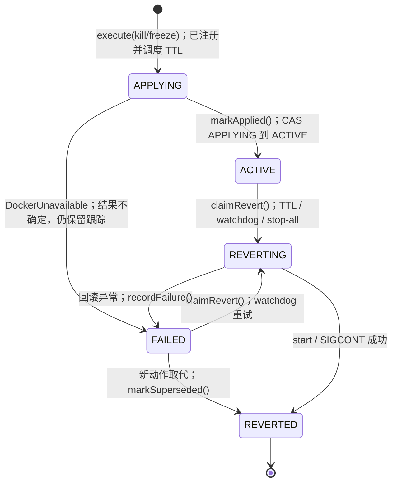
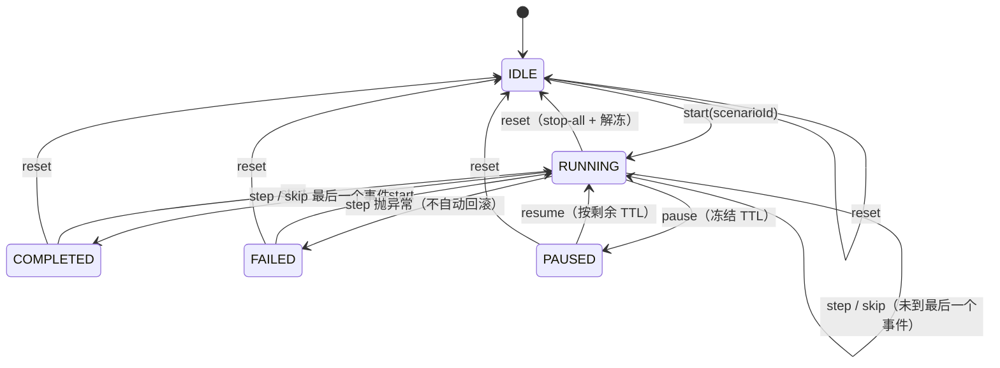
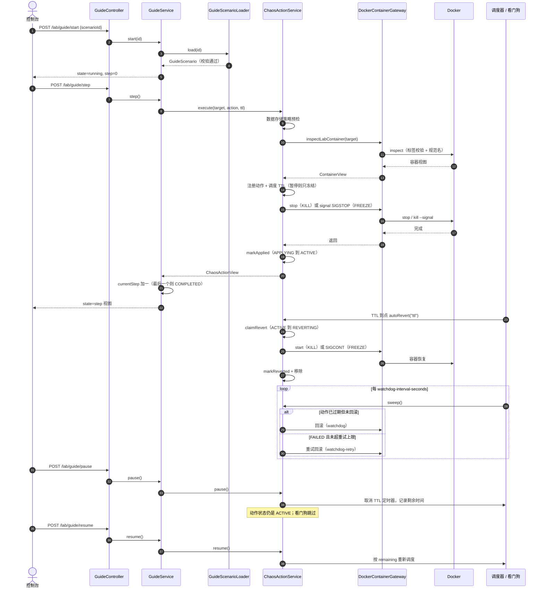
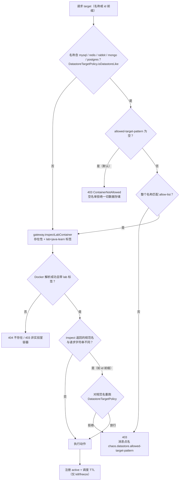

# 06 · 故障注入与实验向导

> 一句话职责：用受白名单约束的容器动作（停/启/重启/冻结/恢复）和有 TTL 保证的自动回滚，把“制造故障 → 观察 → 恢复”做成可暂停、可复位、可脚本化的 5 分钟实验。
>
> 代码基线：`294798a`

本文按**实际实现**描述状态机。特别注意：控制器**没有**每个动作独立的 `PAUSED` 状态；“暂停”是服务级开关，冻结的是 TTL 与看门狗，不改变动作状态。

---

## 1. 角色与组件

| 角色 | 位置 | 职责 | 关键约束 |
|---|---|---|---|
| `ChaosActionService` | `code/services/chaos-controller/.../action/` | 应用动作、调度 TTL 回滚、看门狗、暂停/恢复、stop-all | 每个目标只允许一个待回滚动作；同目标再次下发默认 409 |
| `ChaosAction` | 同上 | 单动作的 CAS 状态与剩余 TTL | 状态只前进，回滚只能从 ACTIVE/FAILED 认领 |
| `ContainerGateway` / `DockerContainerGateway` | `.../gateway/` | 唯一 Docker 调用出口 | 目标必须带 `lab=java-learn`；信号只允许 `SIGSTOP` / `SIGCONT` |
| `DatastoreTargetPolicy` | `.../config/` | 数据存储目标允许名单 | 空 = 全拒；按**整个容器名**匹配 |
| `GuideScenarioLoader` | `.../guide/` | 场景 JSON 校验与加载 | schema v1；与 k6 的 JS 校验互为镜像 |
| `GuideService` / `GuideController` | `.../guide/` | 单实例实验向导状态机 | 内存态；`step` 每次只执行一个事件 |
| 场景目录 | `code/lab/scenarios/` | 共享场景 JSON | 只读挂载进控制器与 k6 |
| k6 时间线驱动 | `code/lab/k6/lib/chaos.js` | 校验同一份 JSON 并调用控制器 | `X-Lab-Token`；只接受 200/202 |
| Token 过滤器 | `.../auth/TokenFilter` | 所有 `/lab/**`、`/chaos/**` 的入口门禁 | 观测端点豁免；token 不落日志 |
| 背景流量 | `jl-traffic` + `TrafficService` | 按需起停的固定 k6 容器 | 它不是 chaos action，没有 TTL |

---

## 2. 动作状态机（实际实现）

### 2.1 单动作状态



读法与边界：

- **APPLYING 是回滚门闩**：故障 Docker 调用还没返回时，TTL 任务即使到点也不能认领回滚，否则 `start` 可能和仍在进行的 `stop` 赛跑，把容器留在永久停止状态。`markApplied` 用 CAS 把 APPLYING 推到 ACTIVE 后，才允许回滚。
- **FAILED 不是终点**：应用阶段出现“传输结果不确定”（`DockerUnavailableException`）时动作保留为 FAILED，由看门狗重试回滚；回滚次数上限是 `chaos.max-revert-attempts`，超过后保持 FAILED 直到 stop-all。
- **REVERTED 立即从 active map 移除**，所以 `GET /chaos/actions` 只显示仍带待回滚/失败的动作。
- **COMPLETED 不是被跟踪的状态**：`start` / `restart` / `resume` 这类一次性动作在 `execute` 里直接执行并返回一个 `status=completed` 的视图，不进入 active map，也永远不会被 TTL 回滚。
- **没有 PAUSED 动作状态**：`pause()` 只设置服务级 `paused` 标志，取消每个 ACTIVE/APPLYING 动作的定时器并记录 `remainingMillis`；动作状态仍是 ACTIVE（或 APPLYING）。`resume()` 按**剩余** TTL 重新调度，不会重置为完整 TTL。这是与“每个动作一个 PAUSED 状态”的常见设计差异，必须按实现理解。

### 2.2 暂停/恢复与 stop-all 的交互

- `pause()` 只允许向导处于 RUNNING 时调用；它冻结**所有**被跟踪动作，包括不是向导创建的。
- `resume()` 先把每个冻结的到期时间平移到 `now + remaining`，再清掉暂停标志，避免看门狗在两步之间看到“已过期”的旧时间而提前回滚。
- `stopAll()` 无视暂停，立即回滚可认领的动作；但 APPLYING 的动作不能回滚，只能记一个 `stopRequested` 标志，等 apply 完成检查点立刻回滚，并计入 `pending`（不是 `reverted`）。
- 暂停期间执行 stop-all 不会自动解除暂停（文档明确：用 `/lab/guide/reset` 或 resume 解冻）。

---

## 3. 向导状态机



规则：

- `start` 只允许从 IDLE / COMPLETED / FAILED 进入；RUNNING 或 PAUSED 时再 start 是 409。
- `step` 与 `skip` 都只前进一个事件；`skip` 不执行动作，供控制台“只走时间线不触发”演示。
- 单个事件失败：向导置 FAILED，记录 `lastError`，**不自动 rollback**；`reset` 才是显式 stop-all。
- `chaos.reset-mode=manual`（默认）在完成/失败后保留故障，便于读日志与面板；`auto` 才在终态调用 stop-all。
- 向导状态是**单实例内存态**；控制器重启会回到 IDLE，而已注入的 TTL 动作同样只存在于内存，重启即失去自动回滚路径。这是实验室可接受的边界，但演示时不要重启控制器。

---

## 4. 一次向导步骤（含 TTL 回滚与看门狗）



两条安全网同时存在：定时器负责准点回滚，看门狗负责“定时器丢了/回滚失败了”。暂停会同时冻结两者；stop-all 是人工的第三条路径。

---

## 5. 数据存储允许名单



为什么要二次检查：Docker 会把**容器名和 id 前缀**都解析到同一个容器。如果只检查请求字符串，攻击者/误操作可以用 `3f2a1b` 这样的 id 前缀绕过 `jl-redis` 这类关键词。实现先按请求串拒绝，再在 inspect 得到规范名后重跑同一策略；只有规范名与请求串不同才需要第二次。

同一策略还被 `GuideScenarioLoader` 用作**场景预检**（HTTP 400），所以坏场景在第一步执行前就会被拒。两处调用同一个 `DatastoreTargetPolicy` 实例逻辑，判定不会漂移；JS 侧 `chaos-schema.js` 是镜像实现。

---

## 6. 场景 schema v1 与共享矩阵

| 文件 | id | 事件 | 用途 |
|---|---|---|---|
| `quick-failover.json` | `quick-failover` | 5s: kill `jl-app-3`，TTL 15s | 最小验收集；只碰沙箱实例 |
| `ha-app-failover.json` | `ha-app-failover` | 60s: kill `jl-app-1` TTL 60；120s: freeze `jl-app-2` TTL 30；150s: resume `jl-app-2` | 负载均衡 + 假死；`resume` 幂等 |
| `redis-sentinel-failover.json` | `redis-sentinel-failover` | 10s: kill `jl-redis-1` TTL 45；25s: resume `jl-redis-2`；60s: start `jl-redis-1` | 需要 allow-list；初始主写死为 redis-1 |

schema v1 的共同规则（Java 与 JS 必须一致）：

- `schemaVersion` 必须为 1；`id` 匹配 `[a-z0-9-]+` 且在目录内唯一（文件名不决定查找）。
- `events` 非空；`atSeconds` 为正数且**非降序**；同一 `(atSeconds,target)` 不允许重复。
- `action` ∈ `kill|start|restart|freeze|resume`；`ttlSeconds` 只允许出现在 kill/freeze，范围 `1..chaos.max-ttl-seconds`。
- 目标默认必须匹配 `chaos.guide.target-pattern`（默认 `^jl-app-[0-9]+$`），并且通过数据存储允许名单。
- 可选的 `explain`（现象/根因/处方/预期）只用于控制台展示，不参与执行。

k6 的 `lib/chaos-schema.js` 不做任何 k6 导入，因此同一套校验能在 k6 和纯 Node 下跑；`chaos.js` 只是把它再导出并加上控制器调用。

---

## 7. 错误码契约

| 码 | 含义 | 典型触发 | HTTP | 实现 |
|---|---|---|---|---|
| `40101` | Unauthorized | 缺/错 `X-Lab-Token` | 401 | `TokenFilter` 写 `Result.failure(UNAUTHORIZED)` |
| `40001` | Invalid argument | 未知 action、TTL 越界、tail 越界、非法场景、body 不可解析、参数类型错 | 400 | `LabExceptionHandler` 多个分支 |
| `40401` | Resource not found | 容器不存在、场景不存在 | 404 | `LabExceptionHandler` |
| `40901` | Conflict | 同目标已有待回滚动作；向导状态不允许该操作（start/pause/resume/step） | 409 | `ChaosConflictException` / `GuideConflictException` |
| `50301` | Service unavailable | Docker 守护进程不可达/调用失败 | 503 | `DockerUnavailableException` |
| `40301` | Forbidden | 非 `lab=java-learn` 容器；数据存储目标被允许名单拒绝 | 403 | `LabErrorCode.FORBIDDEN` |
| `42901` | Too many requests | 秒杀限流（不属于 chaos 契约） | 429 | 应用侧，供对照 |

`Result` 统一包络：成功 `code="0"`，失败带 `code` 与 `message`。

---

## 8. 代码对照表

| 概念/行为 | 类/方法（或脚本函数、配置键） | 位置 | 说明 |
|---|---|---|---|
| 动作状态枚举 | `APPLYING` | `code/services/chaos-controller/src/main/java/com/javalearn/lab/chaos/action/ChaosActionStatus.java:9` | 故障调用进行中，禁止回滚 |
| 已应用 | `ACTIVE` | `code/services/chaos-controller/src/main/java/com/javalearn/lab/chaos/action/ChaosActionStatus.java:11` | TTL 生效，可被认领 |
| 回滚中 | `REVERTING` | `code/services/chaos-controller/src/main/java/com/javalearn/lab/chaos/action/ChaosActionStatus.java:13` | CAS 认领后的独占态 |
| 回滚成功 | `REVERTED` | `code/services/chaos-controller/src/main/java/com/javalearn/lab/chaos/action/ChaosActionStatus.java:15` | 随后从 active 移除 |
| 失败 | `FAILED` | `code/services/chaos-controller/src/main/java/com/javalearn/lab/chaos/action/ChaosActionStatus.java:17` | 看门狗可重试 |
| 一次性完成 | `COMPLETED` | `code/services/chaos-controller/src/main/java/com/javalearn/lab/chaos/action/ChaosActionStatus.java:19` | 仅视图，不跟踪 |
| 需要回滚的动作 | `reverting` | `code/services/chaos-controller/src/main/java/com/javalearn/lab/chaos/action/ChaosActionType.java:30` | 只有 KILL/FREEZE |
| 反向动作 | `revertAction` | `code/services/chaos-controller/src/main/java/com/javalearn/lab/chaos/action/ChaosActionType.java:35` | KILL→START，FREEZE→RESUME |
| 初始状态 | `AtomicReference` | `code/services/chaos-controller/src/main/java/com/javalearn/lab/chaos/action/ChaosAction.java:26` | 构造即 APPLYING |
| APPLYING 门闩 | `markApplied` | `code/services/chaos-controller/src/main/java/com/javalearn/lab/chaos/action/ChaosAction.java:97` | CAS APPLYING→ACTIVE |
| stop-all 延迟意图 | `requestStopWhileApplying` | `code/services/chaos-controller/src/main/java/com/javalearn/lab/chaos/action/ChaosAction.java:108` | 只在 APPLYING 时置位 |
| 认领回滚 | `claimRevert` | `code/services/chaos-controller/src/main/java/com/javalearn/lab/chaos/action/ChaosAction.java:126` | 仅 ACTIVE/FAILED |
| 标记回滚 | `markReverted` | `code/services/chaos-controller/src/main/java/com/javalearn/lab/chaos/action/ChaosAction.java:144` | 成功后置 REVERTED |
| 冻结剩余 TTL | `freeze` | `code/services/chaos-controller/src/main/java/com/javalearn/lab/chaos/action/ChaosAction.java:165` | 取消定时器并记剩余 |
| 恢复剩余 TTL | `resumeAt` | `code/services/chaos-controller/src/main/java/com/javalearn/lab/chaos/action/ChaosAction.java:180` | 到期时间前移 |
| 过期判定 | `expiredAt` | `code/services/chaos-controller/src/main/java/com/javalearn/lab/chaos/action/ChaosAction.java:187` | 仅 ACTIVE 且到期 |
| 动作入口 | `execute` | `code/services/chaos-controller/src/main/java/com/javalearn/lab/chaos/action/ChaosActionService.java:130` | 白名单先于 409 |
| 数据存储预检 | `rejectionReason` | `code/services/chaos-controller/src/main/java/com/javalearn/lab/chaos/action/ChaosActionService.java:142` | 拒绝时不碰 Docker |
| 规范名二次检查 | `canonical` | `code/services/chaos-controller/src/main/java/com/javalearn/lab/chaos/action/ChaosActionService.java:153` | id 前缀不能绕过 |
| 一次性动作 | `applyOneShot` | `code/services/chaos-controller/src/main/java/com/javalearn/lab/chaos/action/ChaosActionService.java:164` | start/restart/resume |
| 注册冲突 | `register(action)` | `code/services/chaos-controller/src/main/java/com/javalearn/lab/chaos/action/ChaosActionService.java:180` | 同目标唯一 |
| TTL 调度 | `scheduler.schedule` | `code/services/chaos-controller/src/main/java/com/javalearn/lab/chaos/action/ChaosActionService.java:193` | 先调度再碰 Docker |
| 应用完成 | `action.markApplied` | `code/services/chaos-controller/src/main/java/com/javalearn/lab/chaos/action/ChaosActionService.java:228` | 之后才允许回滚 |
| 完成检查点 | `autoRevert` | `code/services/chaos-controller/src/main/java/com/javalearn/lab/chaos/action/ChaosActionService.java:234` | apply 超过 TTL / stop-all |
| 暂停 | `pause` | `code/services/chaos-controller/src/main/java/com/javalearn/lab/chaos/action/ChaosActionService.java:268` | 服务级冻结 |
| 恢复 | `resume` | `code/services/chaos-controller/src/main/java/com/javalearn/lab/chaos/action/ChaosActionService.java:294` | 按剩余 TTL |
| 全部回滚 | `stopAll` | `code/services/chaos-controller/src/main/java/com/javalearn/lab/chaos/action/ChaosActionService.java:351` | 返回 reverted/failed/pending |
| 看门狗 | `sweep` | `code/services/chaos-controller/src/main/java/com/javalearn/lab/chaos/action/ChaosActionService.java:389` | 过期回滚 + FAILED 重试 |
| 重试上限 | `getMaxRevertAttempts` | `code/services/chaos-controller/src/main/java/com/javalearn/lab/chaos/action/ChaosActionService.java:402` | `chaos.max-revert-attempts` |
| 停/冻结 | `applyReverting` | `code/services/chaos-controller/src/main/java/com/javalearn/lab/chaos/action/ChaosActionService.java:458` | stop 或 SIGSTOP |
| 回滚执行 | `performRevert` | `code/services/chaos-controller/src/main/java/com/javalearn/lab/chaos/action/ChaosActionService.java:467` | start 或 SIGCONT |
| 活跃数指标 | `chaos.active.actions` | `code/services/chaos-controller/src/main/java/com/javalearn/lab/chaos/action/ChaosActionService.java:116` | Gauge |
| 标签白名单常量 | `LAB_VALUE` | `code/services/chaos-controller/src/main/java/com/javalearn/lab/chaos/gateway/DockerContainerGateway.java:41` | `java-learn` |
| 标签校验 | `requireLabContainer` | `code/services/chaos-controller/src/main/java/com/javalearn/lab/chaos/gateway/DockerContainerGateway.java:221` | 每个变更调用前执行 |
| 标签判定 | `labels.get(LAB_LABEL)` | `code/services/chaos-controller/src/main/java/com/javalearn/lab/chaos/gateway/DockerContainerGateway.java:233` | 缺失/不等即 403 |
| 信号白名单 | `ALLOWED_SIGNALS` | `code/services/chaos-controller/src/main/java/com/javalearn/lab/chaos/gateway/DockerContainerGateway.java:47` | 只 SIGSTOP/SIGCONT |
| 发信号 | `signal` | `code/services/chaos-controller/src/main/java/com/javalearn/lab/chaos/gateway/DockerContainerGateway.java:199` | 非白名单信号直接 400 |
| 规范名 | `canonicalName` | `code/services/chaos-controller/src/main/java/com/javalearn/lab/chaos/gateway/DockerContainerGateway.java:282` | 去掉 inspect 名称前导 `/` |
| 关键词集 | `DATASTORE_KEYWORD` | `code/services/chaos-controller/src/main/java/com/javalearn/lab/chaos/config/DatastoreTargetPolicy.java:42` | 大小写不敏感 |
| 规则键 | `RULE_KEY` | `code/services/chaos-controller/src/main/java/com/javalearn/lab/chaos/config/DatastoreTargetPolicy.java:46` | `chaos.datastore.allowed-target-pattern` |
| 空名单 | `configured.isEmpty` | `code/services/chaos-controller/src/main/java/com/javalearn/lab/chaos/config/DatastoreTargetPolicy.java:53` | 置 `allowed=null` |
| 放行判定 | `permits` | `code/services/chaos-controller/src/main/java/com/javalearn/lab/chaos/config/DatastoreTargetPolicy.java:76` | 非数据存储直接放行 |
| 拒绝理由 | `rejectionReason` | `code/services/chaos-controller/src/main/java/com/javalearn/lab/chaos/config/DatastoreTargetPolicy.java:89` | 消息点名规则 |
| 向导状态 | `IDLE` | `code/services/chaos-controller/src/main/java/com/javalearn/lab/chaos/guide/GuideStatus.java:8` | 初始/复位 |
| 向导运行 | `RUNNING` | `code/services/chaos-controller/src/main/java/com/javalearn/lab/chaos/guide/GuideStatus.java:9` | 可 step/skip/pause |
| 向导暂停 | `PAUSED` | `code/services/chaos-controller/src/main/java/com/javalearn/lab/chaos/guide/GuideStatus.java:10` | 仅可 resume/reset |
| 向导完成 | `COMPLETED` | `code/services/chaos-controller/src/main/java/com/javalearn/lab/chaos/guide/GuideStatus.java:11` | 可重新 start |
| 向导失败 | `FAILED` | `code/services/chaos-controller/src/main/java/com/javalearn/lab/chaos/guide/GuideStatus.java:12` | 保留 lastError |
| 启动向导 | `start` | `code/services/chaos-controller/src/main/java/com/javalearn/lab/chaos/guide/GuideService.java:70` | 仅 IDLE/COMPLETED/FAILED |
| 执行一步 | `step` | `code/services/chaos-controller/src/main/java/com/javalearn/lab/chaos/guide/GuideService.java:87` | 一次一个事件 |
| 跳过一步 | `skip` | `code/services/chaos-controller/src/main/java/com/javalearn/lab/chaos/guide/GuideService.java:114` | 只前进游标 |
| 暂停向导 | `pause` | `code/services/chaos-controller/src/main/java/com/javalearn/lab/chaos/guide/GuideService.java:165` | 仅 RUNNING |
| 恢复向导 | `resume` | `code/services/chaos-controller/src/main/java/com/javalearn/lab/chaos/guide/GuideService.java:178` | 仅 PAUSED |
| 复位 | `reset` | `code/services/chaos-controller/src/main/java/com/javalearn/lab/chaos/guide/GuideService.java:191` | stop-all + 解冻 + IDLE |
| 终态清理策略 | `applyResetMode` | `code/services/chaos-controller/src/main/java/com/javalearn/lab/chaos/guide/GuideService.java:147` | manual/auto |
| schema 版本 | `SCHEMA_VERSION` | `code/services/chaos-controller/src/main/java/com/javalearn/lab/chaos/guide/GuideScenarioLoader.java:48` | 固定 1 |
| 允许动作 | `ALLOWED_ACTIONS` | `code/services/chaos-controller/src/main/java/com/javalearn/lab/chaos/guide/GuideScenarioLoader.java:50` | 五种子集 |
| 加载场景 | `load` | `code/services/chaos-controller/src/main/java/com/javalearn/lab/chaos/guide/GuideScenarioLoader.java:110` | 按嵌入 id 查找 |
| 乱序检查 | `atSeconds < previousOffset` | `code/services/chaos-controller/src/main/java/com/javalearn/lab/chaos/guide/GuideScenarioLoader.java:234` | 非降序 |
| 目标模式 | `targetPattern.matcher` | `code/services/chaos-controller/src/main/java/com/javalearn/lab/chaos/guide/GuideScenarioLoader.java:247` | 默认只允许 app 实例 |
| 场景预检 | `datastorePolicy.rejectionReason` | `code/services/chaos-controller/src/main/java/com/javalearn/lab/chaos/guide/GuideScenarioLoader.java:253` | 400 先于执行 |
| 重复事件 | `duplicates atSeconds` | `code/services/chaos-controller/src/main/java/com/javalearn/lab/chaos/guide/GuideScenarioLoader.java:262` | `(at,target)` 唯一 |
| JS schema 版本 | `SCHEMA_VERSION` | `code/lab/k6/lib/chaos-schema.js:9` | 与 Java 对齐 |
| JS 允许动作 | `ALLOWED_ACTIONS` | `code/lab/k6/lib/chaos-schema.js:10` | 镜像 |
| JS 默认目标 | `DEFAULT_TARGET_PATTERN` | `code/lab/k6/lib/chaos-schema.js:12` | `^jl-app-[0-9]+$` |
| JS 空名单 | `DEFAULT_ALLOWED_DATASTORE_PATTERN` | `code/lab/k6/lib/chaos-schema.js:19` | 空字符串 |
| k6 控制器地址 | `CHAOS_CONTROLLER_URL` | `code/lab/k6/lib/chaos.js:109` | 默认容器内地址 |
| k6 token 必填 | `LAB_TOKEN` | `code/lab/k6/lib/chaos.js:110` | 缺失即初始化失败 |
| k6 场景加载 | `loadScenario` | `code/lab/k6/lib/chaos.js:165` | 同一 schema 校验 |
| k6 下发动作 | `action` | `code/lab/k6/lib/chaos.js:222` | 200/202 之外直接失败 |
| k6 兜底回滚 | `stopAll` | `code/lab/k6/lib/chaos.js:249` | 只接受 200 |
| 场景：快速验收 | `quick-failover` | `code/lab/scenarios/quick-failover.json:3` | 停 app-3 15s |
| 场景：应用故障 | `ha-app-failover` | `code/lab/scenarios/ha-app-failover.json:3` | kill/freeze/resume 三步 |
| 场景：Redis 切换 | `redis-sentinel-failover` | `code/lab/scenarios/redis-sentinel-failover.json:3` | 需 allow-list |
| 错误码基表 | `UNAUTHORIZED` | `code/platform/platform-common/src/main/java/com/javalearn/lab/common/CommonErrorCode.java:7` | 40101 |
| 参数错误 | `INVALID_ARGUMENT` | `code/platform/platform-common/src/main/java/com/javalearn/lab/common/CommonErrorCode.java:6` | 40001 |
| 未找到 | `NOT_FOUND` | `code/platform/platform-common/src/main/java/com/javalearn/lab/common/CommonErrorCode.java:8` | 40401 |
| 冲突 | `CONFLICT` | `code/platform/platform-common/src/main/java/com/javalearn/lab/common/CommonErrorCode.java:9` | 40901 |
| 不可用 | `SERVICE_UNAVAILABLE` | `code/platform/platform-common/src/main/java/com/javalearn/lab/common/CommonErrorCode.java:12` | 50301 |
| 禁止 | `FORBIDDEN` | `code/services/chaos-controller/src/main/java/com/javalearn/lab/chaos/error/LabErrorCode.java:7` | 40301 |
| token 头 | `TOKEN_HEADER` | `code/services/chaos-controller/src/main/java/com/javalearn/lab/chaos/auth/TokenFilter.java:36` | `X-Lab-Token` |
| 未授权响应 | `SC_UNAUTHORIZED` | `code/services/chaos-controller/src/main/java/com/javalearn/lab/chaos/auth/TokenFilter.java:70` | 401 |
| 404 映射 | `handleNotFound` | `code/services/chaos-controller/src/main/java/com/javalearn/lab/chaos/web/LabExceptionHandler.java:29` | 容器不存在 |
| 403 映射 | `handleNotAllowed` | `code/services/chaos-controller/src/main/java/com/javalearn/lab/chaos/web/LabExceptionHandler.java:35` | 标签/名单拒绝 |
| 400 动作映射 | `handleInvalidAction` | `code/services/chaos-controller/src/main/java/com/javalearn/lab/chaos/web/LabExceptionHandler.java:47` | 非法动作 |
| 409 映射 | `handleChaosConflict` | `code/services/chaos-controller/src/main/java/com/javalearn/lab/chaos/web/LabExceptionHandler.java:65` | 同目标冲突 |
| 503 映射 | `handleDockerUnavailable` | `code/services/chaos-controller/src/main/java/com/javalearn/lab/chaos/web/LabExceptionHandler.java:84` | Docker 不可达 |
| 动作 API | `@PostMapping("/instances/{name}/actions")` | `code/services/chaos-controller/src/main/java/com/javalearn/lab/chaos/web/ChaosController.java:33` | 返回 202 |
| 动作列表 | `@GetMapping("/actions")` | `code/services/chaos-controller/src/main/java/com/javalearn/lab/chaos/web/ChaosController.java:40` | 仅未回滚动作 |
| 全部回滚 API | `@PostMapping("/stop-all")` | `code/services/chaos-controller/src/main/java/com/javalearn/lab/chaos/web/ChaosController.java:45` | 200 |
| 向导 API 前缀 | `@RequestMapping("/lab/guide")` | `code/services/chaos-controller/src/main/java/com/javalearn/lab/chaos/guide/GuideController.java:18` | token 保护 |
| 向导弹步端点 | `@PostMapping("/step")` | `code/services/chaos-controller/src/main/java/com/javalearn/lab/chaos/guide/GuideController.java:42` | 一次一个事件 |

---

## 9. 配置项表

| 键 | 环境变量 | 默认值 | 读取位置 |
|---|---|---|---|
| Lab token | `lab.token` / `LAB_TOKEN` | `lab-token` | `chaos-controller application.yml` / `TokenFilter` |
| 默认 TTL | `CHAOS_DEFAULT_TTL_SECONDS` | `120` | `chaos.default-ttl-seconds` |
| 最大 TTL | `CHAOS_MAX_TTL_SECONDS` | `600` | `chaos.max-ttl-seconds` |
| 就绪探测预算 | `CHAOS_ACTION_TIMEOUT_SECONDS` | `30` | `chaos.action-timeout-seconds` |
| 看门狗间隔 | `CHAOS_WATCHDOG_INTERVAL_SECONDS` | `5` | `chaos.watchdog-interval-seconds` |
| stop 宽限 | `CHAOS_STOP_GRACE_SECONDS` | `10` | `chaos.stop-grace-seconds` |
| 回滚重试上限 | `CHAOS_MAX_REVERT_ATTEMPTS` | `3` | `chaos.max-revert-attempts` |
| 调度线程数 | `CHAOS_SCHEDULER_THREADS` | `4` | `chaos.scheduler-threads` |
| 终态清理 | `LAB_RESET_MODE` | `manual` | `chaos.reset-mode` |
| 场景目录 | `CHAOS_GUIDE_SCENARIO_DIR` | `/app/scenarios` | `chaos.guide.scenario-dir` |
| 向导目标模式 | `CHAOS_GUIDE_TARGET_PATTERN` | `^jl-app-[0-9]+$` | `chaos.guide.target-pattern` |
| 数据存储名单 | `CHAOS_DATASTORE_ALLOWED_TARGET_PATTERN` | 空（全拒） | `chaos.datastore.allowed-target-pattern` |
| 流量容器 | `CHAOS_TRAFFIC_CONTAINER` | `jl-traffic` | `chaos.traffic.container-name` |
| 流量 stop 宽限 | `CHAOS_TRAFFIC_STOP_GRACE_SECONDS` | `5` | `chaos.traffic.stop-grace-seconds` |
| Grafana 注解开关 | `CHAOS_ANNOTATION_ENABLED` | `true` | `chaos.annotation.enabled` |
| Grafana URL | `CHAOS_ANNOTATION_GRAFANA_URL` | `http://grafana:3000` | `chaos.annotation.grafana-url` |
| 注解额外标签 | `CHAOS_ANNOTATION_TAGS` | 空 | `chaos.annotation.tags` |
| Docker 连接数 | `LAB_DOCKER_MAX_CONNECTIONS` | `16` | `lab.docker.max-connections` |
| Docker 连接超时 | `LAB_DOCKER_CONNECTION_TIMEOUT_SECONDS` | `5` | `lab.docker.connection-timeout-seconds` |
| Docker 响应超时 | `LAB_DOCKER_RESPONSE_TIMEOUT_SECONDS` | `30` | `lab.docker.response-timeout-seconds` |
| k6 场景文件 | `CHAOS_SCENARIO_FILE` | `ha-app-failover.json` | `lib/chaos.js` |
| k6 负载时长 | `CHAOS_DURATION` / `DURATION` | `4m` | `lib/chaos.js` |
| k6 起始偏移 | `CHAOS_START_OFFSET` | `0s` | `lib/chaos.js` |
| k6 VU | `CHAOS_VUS` | `20` | `lib/chaos.js` |
| k6 TTL 上限 | `CHAOS_MAX_TTL` | `600` | `lib/chaos.js` |

---

## 10. 5 分钟演示步骤

### 10.1 向导最小闭环

```bash
TOKEN=${LAB_TOKEN:-lab-token}          # 本地实验默认值，切勿在真实环境照抄
BASE=http://127.0.0.1:8080/lab-api
curl -sS "$BASE/lab/guide/scenarios" -H "X-Lab-Token: $TOKEN"
curl -sS -X POST "$BASE/lab/guide/start" -H "X-Lab-Token: $TOKEN" \
  -H 'Content-Type: application/json' -d '{"scenarioId":"quick-failover"}'
curl -sS -X POST "$BASE/lab/guide/step"  -H "X-Lab-Token: $TOKEN"
curl -sS "$BASE/chaos/actions"           -H "X-Lab-Token: $TOKEN"
# 观察 15s TTL 到点后动作自动消失：
curl -sS "$BASE/chaos/actions"           -H "X-Lab-Token: $TOKEN"
docker ps --filter name=jl-app-3 --format '{{.Names}} {{.Status}}'
```

预期：step 返回 `status=active`，`revert=start`，`expiresAt` 约 15s 后；TTL 到点后 `chaos/actions` 为空，`jl-app-3` 恢复 Up。

### 10.2 暂停/恢复（剩余 TTL，不重置）

```bash
curl -sS -X POST "$BASE/lab/guide/start" -H "X-Lab-Token: $TOKEN" \
  -H 'Content-Type: application/json' -d '{"scenarioId":"ha-app-failover"}'
curl -sS -X POST "$BASE/lab/guide/step"  -H "X-Lab-Token: $TOKEN"   # kill app-1, TTL 60
curl -sS -X POST "$BASE/lab/guide/pause" -H "X-Lab-Token: $TOKEN"
sleep 30
curl -sS -X POST "$BASE/lab/guide/resume" -H "X-Lab-Token: $TOKEN"
```

预期：暂停期间 app-1 保持停止、动作仍在列表；resume 后按剩余 TTL 到期，而不是重新计 60s。暂停中 `POST /chaos/stop-all` 会立即回滚可认领动作，但不会解除暂停；彻底复位用 `POST /lab/guide/reset`。

### 10.3 用 k6 驱动同一份场景

```bash
LAB_TOKEN="$LAB_TOKEN" CHAOS_SCENARIO_FILE=quick-failover.json \
  CHAOS_DURATION=30s CHAOS_VUS=6 \
  bash code/lab/k6/run.sh ha-failover
```

k6 会先按 schema v1 校验场景，再在时间线里调用控制器；teardown 调 `/chaos/stop-all` 兜底。

### 10.4 错误契约演示

```bash
# 40101
curl -i -sS -X POST "$BASE/chaos/stop-all"
# 40401
curl -i -sS -X POST "$BASE/chaos/instances/no-such/actions" -H "X-Lab-Token: $TOKEN" \
  -H 'Content-Type: application/json' -d '{"action":"kill"}'
# 40001
curl -i -sS -X POST "$BASE/chaos/instances/jl-app-1/actions" -H "X-Lab-Token: $TOKEN" \
  -H 'Content-Type: application/json' -d '{"action":"kill","ttlSeconds":0}'
# 403：数据存储目标默认全拒（用允许名单外的名字）
curl -i -sS -X POST "$BASE/chaos/instances/jl-mysql/actions" -H "X-Lab-Token: $TOKEN" \
  -H 'Content-Type: application/json' -d '{"action":"kill"}'
```

`403` 的响应消息会点名 `chaos.datastore.allowed-target-pattern`。`409` 可用“同一目标在 TTL 内再次 kill”复现。

---

## 11. 已知缺陷/边界

1. **数据存储允许名单已接进 Compose**：`compose.base.yml` 的 chaos-controller 环境默认注入 `CHAOS_DATASTORE_ALLOWED_TARGET_PATTERN=^jl-(redis|mysql)-[1-3]$`（`58b1e75`），因此 HA 栈上的 `redis-sentinel-failover` 可在向导列表中出现；代码默认仍是空名单（全拒），`jl-redis`/`jl-mysql` 单机名与 exporter 仍被拒。
2. **没有单动作 PAUSED 状态**：任务描述里的 `APPLYING → ACTIVE → PAUSED → …` 中的 PAUSED 在本实现里是**服务级冻结**，动作状态仍是 ACTIVE/APPLYING。对外展示时不要把它画成 `ChaosActionStatus.PAUSED`。此外，已认领的回滚可能在 `pause()` 返回后短暂完成；FAILED 重试会冻结到 resume。
3. **stop-all 暂停语义**：暂停期间 stop-all 不会清掉 `paused`；若只 stop-all 不 reset，服务仍是冻结状态。文档给出的解冻方式是 reset 或 resume。
4. **状态只在内存**：向导与动作跟踪都是单实例内存态，控制器重启后向导回 IDLE，且已注入的 TTL 自动回滚丢失（容器可能停在停止/冻结态）。演示期间不要重启控制器。
5. **看门狗只能救“已跟踪”的动作**：进程崩溃/重启后没有任何持久化补偿；这是与“生产级故障注入平台”的明确边界。
6. **场景里的 Redis 主是写死的**：`redis-sentinel-failover.json` 第一步固定 `jl-redis-1`，真实主会漂移；必须先跑 `sentinel-status.sh` 核对（场景描述已提示）。
7. **仍未实现：`SIGSTOP` 主库切换演练**：仓库没有对应的 db 故障场景；应用 Router 双数据源 `MYSQL_MODE`（step-29）、Toxiproxy 延迟/断网（step-39/40）、`mysql_cluster_*` 集群指标（step-30）均已落地，不要与这一项混写。
8. **Traffic 不是 chaos action**：`jl-traffic` 由 `TrafficService` 单独起停，没有 TTL；暂停向导不会停止它，这是有意设计（避免暂停时把负载也回滚）。
9. **注解是 best-effort**：Grafana 不可达只记日志，不影响动作与回滚。

---

## 12. 关联文档

- 总设计：`doc/design/2026-10-26-ha-concurrency-lab-design.md` §8.1 / §11.3 / §12
- 步骤交接：`doc/process/step-21-chaos-actions.md`、`doc/process/step-22a-scenario-timeline.md`、`doc/process/step-22b-guide-state.md`、`doc/process/step-23-console-mvp.md`、`doc/process/step-24c-sentinel-targets.md`
- 场景规范：`code/lab/scenarios/README.md`；k6 手册：`code/lab/k6/README.md`
- 同目录：`04-Redis高可用.md`、`05-MySQL高可用与读写路由.md`、`11-配置与安全边界.md`
- 汇总交接：`doc/process/阶段交接-2026-10-26.md`（缺陷/TODO 总表与历史硬编码清单）
