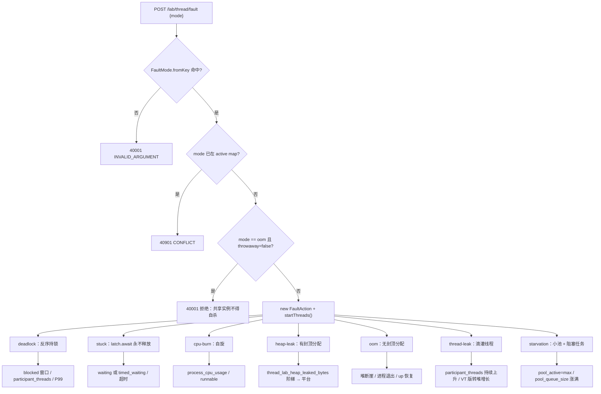
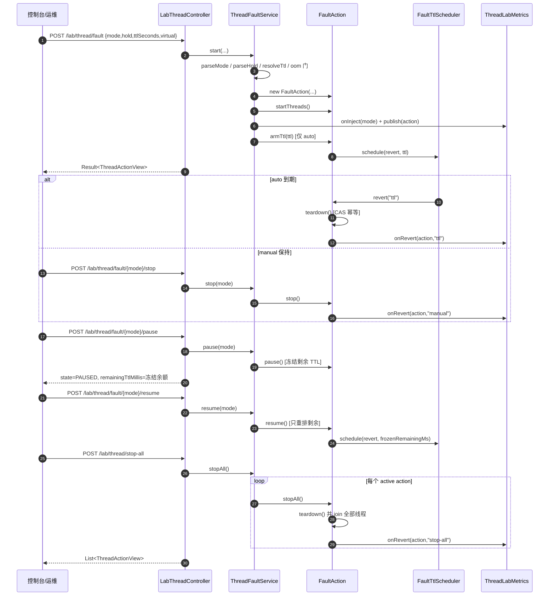
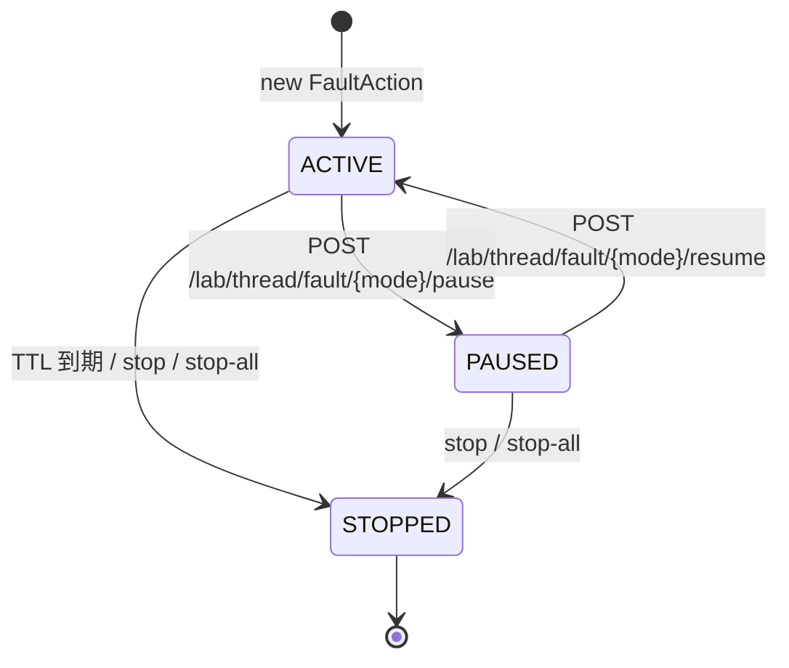
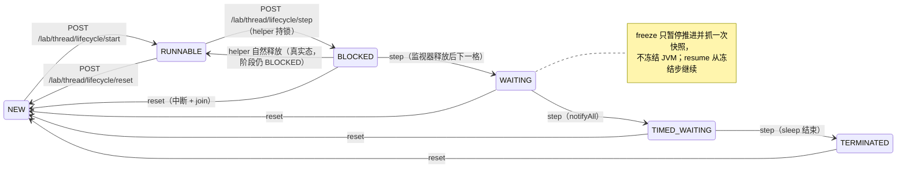
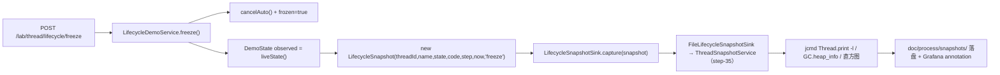

# 07 · 线程实验室（故障线程 + 单线程生命周期）

> 一句话职责：在**单个应用实例内**可注入、可冻结、可完全回收地演示七种故障线程，并用一条真实 JVM 线程走完 `NEW → RUNNABLE → BLOCKED → WAITING → TIMED_WAITING → TERMINATED` 六态。
> 代码基线：`294798a`

本文只描述**已合并进基线**的实现。凡交接文档中登记、但仓库里没有对应代码/面板/脚本的内容，一律标注 **未实现** 或 **待补**，不按设计原文冒充现状。

---

## 1. 角色与组件

| 角色 | 代码位置 | 职责 |
|---|---|---|
| 实验端点 | `lab/api/LabThreadController` | `/lab/thread/**`，`GET state`、`POST fault`、`stop/pause/resume`、`stop-all`；以及 `/lab/thread/lifecycle/**` 六态演示 |
| 故障仓库/生命周期控制 | `lab/thread/ThreadFaultService` | 每个 mode 至多一个 `FaultAction`；拒绝重复注入（40901）；TTL / manual / pause / resume / stop-all |
| 单个故障动作 | `lab/thread/FaultAction` | 参与线程的创建、TTL 计时、冻结余额、幂等 teardown（CAS `tornDown`） |
| 模式枚举 | `lab/thread/FaultMode`、`HoldMode` | 七个模式键（对外契约）与 `auto/manual` 两种保持方式 |
| TTL 调度 | `lab/thread/FaultTtlScheduler` + `ExecutorFaultTtlScheduler` | 单 daemon 线程调度 auto 回退；测试注入手工触发实现 |
| 故障指标 | `lab/thread/ThreadLabMetrics` | `thread_lab_*` 指标族，按 mode 预注册零值序列 |
| 堆分配器 | `lab/thread/HeapLeakAllocator` | 受控/无封顶两种分配语义；`drain()` 清空强引用 |
| 六态演示 | `lab/thread/LifecycleDemoService` + `DemoState` | 真实 `Thread.getState()` 驱动；`start/step/freeze/resume/reset` |
| 六态指标 | `lab/thread/LifecycleDemoMetrics` | `thread_lab_demo_*`，与故障生命周期**分开命名** |
| 快照接缝 | `LifecycleSnapshotSink` / `LifecycleSnapshot` / `FileLifecycleSnapshotSink` | `freeze` 时同步回调一次；生产实现委托 `ThreadSnapshotService`，落盘 jcmd bundle（step-35） |
| 装配 | `lab/config/ThreadLabConfig` | 独立 `@Configuration`，注册 scheduler/metrics/service/sink 五个 bean |
| 鉴权 | `lab/auth/LabTokenFilter` | 只拦 `/lab` 与 `/lab/**`，请求头 `X-Lab-Token`，常量时间比较 |

关键边界：线程实验室是**单实例、进程内**能力，没有跨实例注册表；chaos-controller 通过 `AppProxyService` 提供 `/chaos/app/{instance}/lab/thread/**` 窄代理（step-44），控制台线程页经它访问；k6 仍需 `BASE_URL` 直连应用（或自行走该代理）。

---

## 2. 七种故障模式与指标指纹

| 模式键 | 机制（真实实现） | 预期指纹 | 实现位置 |
|---|---|---|---|
| `deadlock` | 两线程以相反顺序各持一把监视器、**取第二把前先释放**，制造可中断的真实 `BLOCKED` 竞争 | `blocked` 窗口；`thread_lab_participant_threads{mode="deadlock"}`；P99 上升 | `FaultAction#startDeadlock` |
| `deadlock` + `true-deadlock` | 操作员门控的永久 hold-and-wait 环，JVM 死锁检测器可见 | `Found one Java-level deadlock`；线程只能随 JVM 重启回收 | `FaultAction#startTrueDeadlock` |
| `stuck` | N 个线程在永不 countDown 的 latch 上 `await(poll, ms)` | `WAITING` / `TIMED_WAITING`；请求超时 | `FaultAction#startStuck` |
| `cpu-burn` | M 个线程自旋，每 `yield-every-loops` 让出一次 | `process_cpu_usage` 拉满；`RUNNABLE` 增加 | `FaultAction#startCpuBurn` |
| `heap-leak` | 按 chunk/interval 分配，分配前判 `used + chunk <= cap% * max`，到顶即停 | 堆阶梯上升后平台；GC 次数/暂停上涨 | `FaultAction#startHeapLeak` |
| `oom` | 无封顶分配器；仅 `throwaway-instance=true` 的实例可执行 | 堆断崖 → 进程退出 → 容器重启/流量转移 | `HeapLeakAllocator#unbounded` |
| `thread-leak` | 控制器线程滴灌 daemon 线程，封顶 `max-live-threads`；可切虚拟线程 | 平台线程数上升；VT 版转为堆增长 | `FaultAction#startThreadLeak` |
| `starvation` | 小池 + 有界队列 + 足量阻塞任务，队列满即停止提交 | `pool_active == max`、队列涨满、接口超时 | `FaultAction#startStarvation` |

### 2.1 故障模式决策流（模式 → 机制 → 指标指纹）



`true-deadlock` 是 `deadlock` 的变体而不是第八个模式：它由配置门 `app.lab.thread.deadlock.true-deadlock`（默认 false）选择，见配置表。

---

## 3. 注入 → TTL/手动保持 → 暂停/继续 → 全量清理

### 3.1 生命周期语义

- **auto**：构造时 `deadline = now + ttl`；`armTtl()` 把回退任务交给 `FaultTtlScheduler`。到期回调 `revert("ttl")`。
- **manual**：`deadline = Long.MAX_VALUE`，不注册任何计时器；只能 `stop` / `stop-all`。
- **pause**：仅 ACTIVE 可暂停；auto 会取消已 arm 的计时器，并把 `deadline - now` 存为冻结余额（冻结期间时间流逝不吃预算）；manual 只改状态。
- **resume**：仅 PAUSED 可继续；auto 以冻结余额重新 arm，余额 ≤ 0 时以 0 重排（下一 tick 即回退）。
- **stop / stop-all**：`revert` 的两种 reason；`teardown()` 用 `tornDown` CAS 保证只执行一次：取消计时器 → `stopped=true` → `drain` 堆 → `shutdownNow` 饥饿池 → 中断所有参与线程 → 按 `shutdown-join-timeout-ms` 逐个 join → 再 `drain` 一次并把泄漏计数清零。
- **重复注入同一 mode**：拒绝（`40901`），不是幂等。不同 mode 可共存。
- **同 mode 重启与旧动作回退的竞态**：指标层按**身份** `active.remove(mode, action)` 去发布，旧动作回退不会把新故障的 gauge 抹零。



### 3.2 故障动作状态机（`LifecycleState`）



注意：`LifecycleState` 只是**故障动作**的 0/1/2 状态码，不是 §9.2 的单线程六态；两者指标名不同，见第 5 节。

---

## 4. 单线程六态演示（`DemoState`，与故障生命周期分离）

### 4.1 真实状态，不是记账

- `LifecycleDemoService` 创建一条 daemon 演示线程（名字来自 `app.lab.thread.lifecycle.thread-name`），一条 helper 线程（`monitor-thread-name`）只负责制造 BLOCKED 窗口。
- 对外 `view()` 的 `state/stateCode` 来自 `DemoState.from(thread.getState())`，即**真实 JVM 线程态**；`machineStage` 只是推进阶段，允许在 helper 释放后短暂落后于真实态（真实 RUNNABLE / 阶段仍 BLOCKED），页面应以 `state` 动画。
- 阶段推进靠许可（`permits/consumed` 原子量）：`step` 发一个许可，`start` 与 `resume` 重新 arm 自动推进（`auto-advance-interval-ms`）。
- 各阶段的真实构造：
  - RUNNABLE：自旋 gate（故意不用 park/sleep，否则会报 WAITING/TIMED_WAITING）。
  - BLOCKED：helper 先持有私有监视器 `monitor-hold-ms`，演示线程随后进入同一监视器的 `synchronized`。
  - WAITING：`Object.wait()` 无超时；推进时用同一 `waitMonitor` 置许可并 `notifyAll`，且 WAITING 阶段在持锁时发布，避免丢通知。
  - TIMED_WAITING：`Thread.sleep(timed-wait-ms)`。
  - TERMINATED：`run()` 返回；线程对象保留到 reset，因此 `GET` 仍能看到 5 且 `alive=false`。
- `freeze`：取消自动推进、置 frozen、以**当前真实状态**构造 `LifecycleSnapshot` 并同步调用 sink 一次；sink 抛异常只记 WARN，不会留下半冻结状态。它**不冻结 JVM**。
- `reset`：中断并 join 演示线程与 helper（预算 `shutdown-join-timeout-ms`，启动校验要求它大于 `monitor-hold-ms`），回到 NEW。`enabled=false` 时 reset 仍可用（拆除不受开关限制）。
- `stop-all` **不覆盖** lifecycle 演示线程：它只清七种故障。



### 4.2 快照接缝



`sink` 的契约是：每次成功的 `freeze` 恰好同步调用一次；实现必须可从 HTTP 线程调用且不应抛异常（服务已隔离异常）。当前实现 `FileLifecycleSnapshotSink` 委托 `ThreadSnapshotService`，把 `jcmd Thread.print -l` / `GC.heap_info` / `GC.class_histogram` 与 metadata 落盘（step-35）。

---

## 5. 指标

### 5.1 故障线程指标（`ThreadLabMetrics`）

| 指标 | 类型 | 标签 | 语义 |
|---|---|---|---|
| `thread_lab_injected_total` | counter | `mode` | 注入次数 |
| `thread_lab_reverted_total` | counter | `mode`,`reason=ttl\|manual\|stop-all` | 回退/停止次数 |
| `thread_lab_fault_active` | gauge | `mode` | 1 表示该 mode 有非 STOPPED 动作 |
| `thread_lab_lifecycle_state_code` | gauge | `mode` | 0 STOPPED / 1 ACTIVE / 2 PAUSED |
| `thread_lab_participant_threads` | gauge | `mode` | 当前存活参与线程数 |
| `thread_lab_heap_leaked_bytes` | gauge | `mode` | 尚未 drain 的保留字节 |
| `thread_lab_pool_active` | gauge | `mode` | 饥饿池活跃线程 |
| `thread_lab_pool_queue_size` | gauge | `mode` | 饥饿池队列长度 |

所有 `mode` 序列在启动时**零值预注册**，面板可以绑定标签集而不是等流量。

### 5.2 六态演示指标（`LifecycleDemoMetrics`）

| 指标 | 类型 | 标签 | 语义 |
|---|---|---|---|
| `thread_lab_demo_state_code` | gauge | 无 | 真实线程态：0 NEW / 1 RUNNABLE / 2 BLOCKED / 3 WAITING / 4 TIMED_WAITING / 5 TERMINATED |
| `thread_lab_demo_frozen` | gauge | 无 | 1 表示推进已冻结 |
| `thread_lab_demo_step` | gauge | 无 | 已完成推进数 |
| `thread_lab_demo_transitions_total` | counter | `to` | 六个目标态分别预注册 |
| `thread_lab_demo_steps_total` | counter | `source=manual\|auto` | 成功推进次数 |
| `thread_lab_demo_starts_total` | counter | 无 | start 次数 |
| `thread_lab_demo_freezes_total` | counter | 无 | freeze 次数 |
| `thread_lab_demo_resumes_total` | counter | 无 | resume 次数 |
| `thread_lab_demo_resets_total` | counter | 无 | reset 次数 |
| `thread_lab_demo_snapshot_requests_total` | counter | 无 | 交给 sink 的快照请求数 |

### 5.3 指标指纹对照

| 现象 | 观察点 | 期望 |
|---|---|---|
| deadlock（默认竞争版） | `thread_lab_participant_threads{mode="deadlock"}` + JVM 线程态 `blocked` | 真实 BLOCKED 窗口存在，stop 后线程归零 |
| deadlock（true 变体） | `ThreadMXBean.findDeadlockedThreads()` / jstack | 环成立；stop 只注销，线程等 JVM 重启 |
| stuck | JVM 线程态 `waiting`/`timed_waiting` | 非 BLOCKED；中断可回收 |
| cpu-burn | `process_cpu_usage`、`runnable` | CPU 拉满；stop 后回落 |
| heap-leak | `thread_lab_heap_leaked_bytes{mode="heap-leak"}` | 阶梯上升、封顶后平台、stop 归零 |
| oom | 堆断崖 + 进程退出 + `up` 恢复 | 仅 throwaway 实例 |
| thread-leak | `thread_lab_participant_threads{mode="thread-leak"}` | 持续上升；VT 版平台线程数不明显上升 |
| starvation | `thread_lab_pool_active`、`thread_lab_pool_queue_size` | active=max、队列涨满 |

---

## 6. 代码对照表

> 每一行的 `path:line` 均在写作时用 `grep -n`/逐行阅读取得，并由机械校验脚本复核（见文末验证）。路径相对仓库根。

| 概念/行为 | 类/方法（或脚本函数、配置键） | path:line | 说明 |
|---|---|---|---|
| 七模式对外键 | `FaultMode` | `code/services/seckill-app-jdk21/src/main/java/com/javalearn/lab/seckill/lab/thread/FaultMode.java:33` | 枚举起点；`deadlock/stuck/cpu-burn/heap-leak/oom/thread-leak/starvation` |
| 模式解析严格匹配 | `fromKey` | `code/services/seckill-app-jdk21/src/main/java/com/javalearn/lab/seckill/lab/thread/FaultMode.java:56` | 未知键返回 null → 服务层 40001 |
| 保持方式 | `AUTO` / `MANUAL` | `code/services/seckill-app-jdk21/src/main/java/com/javalearn/lab/seckill/lab/thread/HoldMode.java:14` | 默认 AUTO（服务层 holdKey 为空时） |
| 注入总入口 | `start` | `code/services/seckill-app-jdk21/src/main/java/com/javalearn/lab/seckill/lab/thread/ThreadFaultService.java:58` | 解析 + oom 门 + 冲突检查 + 发布 |
| oom 安全门 | `isThrowawayInstance` | `code/services/seckill-app-jdk21/src/main/java/com/javalearn/lab/seckill/lab/thread/ThreadFaultService.java:62` | false 时在任何 Docker/线程动作之前拒绝 |
| 同 mode 冲突 | `containsKey` | `code/services/seckill-app-jdk21/src/main/java/com/javalearn/lab/seckill/lab/thread/ThreadFaultService.java:68` | 抛出 `40901 CONFLICT` |
| 停止单故障 | `stop` | `code/services/seckill-app-jdk21/src/main/java/com/javalearn/lab/seckill/lab/thread/ThreadFaultService.java:83` | reason=manual |
| 暂停 | `pause` | `code/services/seckill-app-jdk21/src/main/java/com/javalearn/lab/seckill/lab/thread/ThreadFaultService.java:94` | 无活动故障 → 40401 |
| 继续 | `resume` | `code/services/seckill-app-jdk21/src/main/java/com/javalearn/lab/seckill/lab/thread/ThreadFaultService.java:102` | 只补剩余 TTL |
| 全量停止 | `stopAll` | `code/services/seckill-app-jdk21/src/main/java/com/javalearn/lab/seckill/lab/thread/ThreadFaultService.java:116` | 先清注册表再逐个 teardown |
| 列表 | `list` | `code/services/seckill-app-jdk21/src/main/java/com/javalearn/lab/seckill/lab/thread/ThreadFaultService.java:131` | 按 mode 排序，供 `GET state` |
| TTL 解析 | `resolveTtl` | `code/services/seckill-app-jdk21/src/main/java/com/javalearn/lab/seckill/lab/thread/ThreadFaultService.java:162` | manual 恒 0；auto 必须 >0 |
| 模式校验 | `parseMode` | `code/services/seckill-app-jdk21/src/main/java/com/javalearn/lab/seckill/lab/thread/ThreadFaultService.java:174` | 空/未知 → 40001 |
| 故障状态 | `LifecycleState` | `code/services/seckill-app-jdk21/src/main/java/com/javalearn/lab/seckill/lab/thread/LifecycleState.java:18` | ACTIVE=1, PAUSED=2, STOPPED=0 |
| 动作初始状态 | `state` | `code/services/seckill-app-jdk21/src/main/java/com/javalearn/lab/seckill/lab/thread/FaultAction.java:71` | volatile，初始 ACTIVE |
| 装 TTL | `armTtl` | `code/services/seckill-app-jdk21/src/main/java/com/javalearn/lab/seckill/lab/thread/FaultAction.java:106` | 仅 AUTO 且未拆除 |
| 暂停冻结余额 | `pause` | `code/services/seckill-app-jdk21/src/main/java/com/javalearn/lab/seckill/lab/thread/FaultAction.java:117` | 取消 handle，保存 `deadline-now` |
| 继续只补剩余 | `resume` | `code/services/seckill-app-jdk21/src/main/java/com/javalearn/lab/seckill/lab/thread/FaultAction.java:130` | `scheduleRevert(frozenRemainingMs)` |
| 回退入口 | `revert` | `code/services/seckill-app-jdk21/src/main/java/com/javalearn/lab/seckill/lab/thread/FaultAction.java:144` | `teardown()` 成功后去发布并计数 |
| 手动停止 | `stop` | `code/services/seckill-app-jdk21/src/main/java/com/javalearn/lab/seckill/lab/thread/FaultAction.java:156` | reason=manual |
| 全量停止 | `stopAll` | `code/services/seckill-app-jdk21/src/main/java/com/javalearn/lab/seckill/lab/thread/FaultAction.java:161` | reason=stop-all |
| 幂等拆除 | `teardown` | `code/services/seckill-app-jdk21/src/main/java/com/javalearn/lab/seckill/lab/thread/FaultAction.java:165` | CAS `tornDown`，join + 二次 drain |
| 模式分发 | `startThreads` | `code/services/seckill-app-jdk21/src/main/java/com/javalearn/lab/seckill/lab/thread/FaultAction.java:283` | 七分支 switch |
| 可耗尽死锁 | `startDeadlock` | `code/services/seckill-app-jdk21/src/main/java/com/javalearn/lab/seckill/lab/thread/FaultAction.java:295` | 持一把、释放、再取另一把 |
| 真死锁变体 | `startTrueDeadlock` | `code/services/seckill-app-jdk21/src/main/java/com/javalearn/lab/seckill/lab/thread/FaultAction.java:345` | 永久 hold-and-wait，仅重启回收 |
| stuck | `startStuck` | `code/services/seckill-app-jdk21/src/main/java/com/javalearn/lab/seckill/lab/thread/FaultAction.java:361` | `await(poll)`，尊重中断 |
| cpu-burn | `startCpuBurn` | `code/services/seckill-app-jdk21/src/main/java/com/javalearn/lab/seckill/lab/thread/FaultAction.java:382` | 自旋 + 周期性 yield |
| 堆泄漏/oom | `startHeapLeak` | `code/services/seckill-app-jdk21/src/main/java/com/javalearn/lab/seckill/lab/thread/FaultAction.java:403` | `unbounded` 决定封顶与否 |
| 线程泄漏 | `startThreadLeak` | `code/services/seckill-app-jdk21/src/main/java/com/javalearn/lab/seckill/lab/thread/FaultAction.java:434` | 控制器线程 + 有界 live 数 |
| 平台/VT 选择 | `ofVirtual` | `code/services/seckill-app-jdk21/src/main/java/com/javalearn/lab/seckill/lab/thread/FaultAction.java:460` | 请求 `virtual` 覆盖配置 |
| 饥饿 | `startStarvation` | `code/services/seckill-app-jdk21/src/main/java/com/javalearn/lab/seckill/lab/thread/FaultAction.java:465` | 小池 + 有界队列 + 阻塞任务 |
| 有封顶分配 | `HeapLeakAllocator` | `code/services/seckill-app-jdk21/src/main/java/com/javalearn/lab/seckill/lab/thread/HeapLeakAllocator.java:60` | 分配前判 cap |
| 无封顶分配 | `unbounded` | `code/services/seckill-app-jdk21/src/main/java/com/javalearn/lab/seckill/lab/thread/HeapLeakAllocator.java:67` | oom 专用，永不进 capped 判定 |
| 分配一次 | `allocateOnce` | `code/services/seckill-app-jdk21/src/main/java/com/javalearn/lab/seckill/lab/thread/HeapLeakAllocator.java:78` | 到顶置 capped 并拒绝增长 |
| 释放 | `drain` | `code/services/seckill-app-jdk21/src/main/java/com/javalearn/lab/seckill/lab/thread/HeapLeakAllocator.java:102` | 清空强引用、计数归零 |
| 指标原因常量 | `REASON_TTL` / `REASON_MANUAL` / `REASON_STOP_ALL` | `code/services/seckill-app-jdk21/src/main/java/com/javalearn/lab/seckill/lab/thread/ThreadLabMetrics.java:25` | 依次为 ttl/manual/stop-all |
| 注入计数 | `thread_lab_injected_total` | `code/services/seckill-app-jdk21/src/main/java/com/javalearn/lab/seckill/lab/thread/ThreadLabMetrics.java:37` | 按 mode 预注册 |
| 活跃 gauge | `thread_lab_fault_active` | `code/services/seckill-app-jdk21/src/main/java/com/javalearn/lab/seckill/lab/thread/ThreadLabMetrics.java:41` | 非 STOPPED 即 1 |
| 故障生命周期码 | `thread_lab_lifecycle_state_code` | `code/services/seckill-app-jdk21/src/main/java/com/javalearn/lab/seckill/lab/thread/ThreadLabMetrics.java:45` | 与六态 demo **不同**指标 |
| 参与线程数 | `thread_lab_participant_threads` | `code/services/seckill-app-jdk21/src/main/java/com/javalearn/lab/seckill/lab/thread/ThreadLabMetrics.java:49` | 读活 action |
| 堆泄漏字节 | `thread_lab_heap_leaked_bytes` | `code/services/seckill-app-jdk21/src/main/java/com/javalearn/lab/seckill/lab/thread/ThreadLabMetrics.java:53` | drain 后 0 |
| 池活跃 | `thread_lab_pool_active` | `code/services/seckill-app-jdk21/src/main/java/com/javalearn/lab/seckill/lab/thread/ThreadLabMetrics.java:57` | 非 starvation 为 0 |
| 队列长度 | `thread_lab_pool_queue_size` | `code/services/seckill-app-jdk21/src/main/java/com/javalearn/lab/seckill/lab/thread/ThreadLabMetrics.java:61` | 非 starvation 为 0 |
| 身份去发布 | `onRevert` | `code/services/seckill-app-jdk21/src/main/java/com/javalearn/lab/seckill/lab/thread/ThreadLabMetrics.java:84` | `remove(mode, action)`，避免抹掉新故障 |
| 六态枚举 | `DemoState` | `code/services/seckill-app-jdk21/src/main/java/com/javalearn/lab/seckill/lab/thread/DemoState.java:18` | 0..5，与 `LifecycleState` 分离 |
| 真实态映射 | `from` | `code/services/seckill-app-jdk21/src/main/java/com/javalearn/lab/seckill/lab/thread/DemoState.java:38` | `Thread.State` → 导出码 |
| 演示 start | `start` | `code/services/seckill-app-jdk21/src/main/java/com/javalearn/lab/seckill/lab/thread/LifecycleDemoService.java:117` | NEW→RUNNABLE，arm 自动推进 |
| 演示 step | `step` | `code/services/seckill-app-jdk21/src/main/java/com/javalearn/lab/seckill/lab/thread/LifecycleDemoService.java:155` | 上一格未消费 → 40901 |
| 演示 freeze | `freeze` | `code/services/seckill-app-jdk21/src/main/java/com/javalearn/lab/seckill/lab/thread/LifecycleDemoService.java:186` | 取消计时 + 抓一次快照 |
| 演示 resume | `resume` | `code/services/seckill-app-jdk21/src/main/java/com/javalearn/lab/seckill/lab/thread/LifecycleDemoService.java:226` | 从冻结步重新 arm |
| 演示 reset | `reset` | `code/services/seckill-app-jdk21/src/main/java/com/javalearn/lab/seckill/lab/thread/LifecycleDemoService.java:248` | 中断 + join + 回 NEW |
| 真实状态读取 | `liveState` | `code/services/seckill-app-jdk21/src/main/java/com/javalearn/lab/seckill/lab/thread/LifecycleDemoService.java:288` | 无线程即 NEW |
| RUNNABLE 自旋 gate | `awaitGate` | `code/services/seckill-app-jdk21/src/main/java/com/javalearn/lab/seckill/lab/thread/LifecycleDemoService.java:343` | 不用 park/sleep |
| 真实 BLOCKED | `runBlockedStage` | `code/services/seckill-app-jdk21/src/main/java/com/javalearn/lab/seckill/lab/thread/LifecycleDemoService.java:363` | helper 持锁 `monitor-hold-ms` |
| 真实 WAITING | `runWaitingStage` | `code/services/seckill-app-jdk21/src/main/java/com/javalearn/lab/seckill/lab/thread/LifecycleDemoService.java:413` | `wait()` + `notifyAll`，无丢通知 |
| 推进许可 | `tryAdvance` | `code/services/seckill-app-jdk21/src/main/java/com/javalearn/lab/seckill/lab/thread/LifecycleDemoService.java:428` | 按 stage 发 permit / waitingPermit |
| 快照接缝 | `LifecycleSnapshotSink#capture` | `code/services/seckill-app-jdk21/src/main/java/com/javalearn/lab/seckill/lab/thread/LifecycleSnapshotSink.java:21` | 每次 freeze 恰好一次，可插拔 |
| 快照载荷 | `LifecycleSnapshot` | `code/services/seckill-app-jdk21/src/main/java/com/javalearn/lab/seckill/lab/thread/LifecycleSnapshot.java:21` | 展示安全，无栈内容 |
| 占位 sink | `LoggingLifecycleSnapshotSink` | `code/services/seckill-app-jdk21/src/main/java/com/javalearn/lab/seckill/lab/thread/LoggingLifecycleSnapshotSink.java:15` | 只打 INFO，**不含 jcmd** |
| 六态状态码 | `thread_lab_demo_state_code` | `code/services/seckill-app-jdk21/src/main/java/com/javalearn/lab/seckill/lab/thread/LifecycleDemoMetrics.java:71` | Grafana state timeline 用 |
| 冻结 gauge | `thread_lab_demo_frozen` | `code/services/seckill-app-jdk21/src/main/java/com/javalearn/lab/seckill/lab/thread/LifecycleDemoMetrics.java:75` | 0/1 |
| 步数 gauge | `thread_lab_demo_step` | `code/services/seckill-app-jdk21/src/main/java/com/javalearn/lab/seckill/lab/thread/LifecycleDemoMetrics.java:78` | 已完成推进 |
| 六态 service 绑定 | `bind` | `code/services/seckill-app-jdk21/src/main/java/com/javalearn/lab/seckill/lab/thread/LifecycleDemoMetrics.java:88` | 构造后绑定，gauge 读活线程 |
| 端点总路由 | `@RequestMapping` | `code/services/seckill-app-jdk21/src/main/java/com/javalearn/lab/seckill/lab/api/LabThreadController.java:29` | `/lab/thread` |
| 故障状态 | `state` | `code/services/seckill-app-jdk21/src/main/java/com/javalearn/lab/seckill/lab/api/LabThreadController.java:41` | `GET /state` |
| 注入 | `fault` | `code/services/seckill-app-jdk21/src/main/java/com/javalearn/lab/seckill/lab/api/LabThreadController.java:46` | `POST /fault` |
| 单停 | `stop` | `code/services/seckill-app-jdk21/src/main/java/com/javalearn/lab/seckill/lab/api/LabThreadController.java:55` | `POST /fault/{mode}/stop` |
| 暂停端点 | `pause` | `code/services/seckill-app-jdk21/src/main/java/com/javalearn/lab/seckill/lab/api/LabThreadController.java:60` | `POST .../pause` |
| 继续端点 | `resume` | `code/services/seckill-app-jdk21/src/main/java/com/javalearn/lab/seckill/lab/api/LabThreadController.java:65` | `POST .../resume` |
| 全停端点 | `stopAll` | `code/services/seckill-app-jdk21/src/main/java/com/javalearn/lab/seckill/lab/api/LabThreadController.java:70` | `POST /stop-all` |
| 六态查询 | `lifecycleState` | `code/services/seckill-app-jdk21/src/main/java/com/javalearn/lab/seckill/lab/api/LabThreadController.java:78` | `GET /lifecycle` |
| 六态 start | `lifecycleStart` | `code/services/seckill-app-jdk21/src/main/java/com/javalearn/lab/seckill/lab/api/LabThreadController.java:83` | `POST /lifecycle/start` |
| 六态 step | `lifecycleStep` | `code/services/seckill-app-jdk21/src/main/java/com/javalearn/lab/seckill/lab/api/LabThreadController.java:88` | `POST /lifecycle/step` |
| 六态 freeze | `lifecycleFreeze` | `code/services/seckill-app-jdk21/src/main/java/com/javalearn/lab/seckill/lab/api/LabThreadController.java:94` | `POST /lifecycle/freeze` |
| 六态 resume | `lifecycleResume` | `code/services/seckill-app-jdk21/src/main/java/com/javalearn/lab/seckill/lab/api/LabThreadController.java:99` | `POST /lifecycle/resume` |
| 六态 reset | `lifecycleReset` | `code/services/seckill-app-jdk21/src/main/java/com/javalearn/lab/seckill/lab/api/LabThreadController.java:105` | `POST /lifecycle/reset` |
| 装配 scheduler | `faultTtlScheduler` | `code/services/seckill-app-jdk21/src/main/java/com/javalearn/lab/seckill/lab/config/ThreadLabConfig.java:33` | daemon executor，随上下文关闭 |
| 装配故障指标 | `threadLabMetrics` | `code/services/seckill-app-jdk21/src/main/java/com/javalearn/lab/seckill/lab/config/ThreadLabConfig.java:38` | 使用自动配置的 `MeterRegistry` |
| 装配故障服务 | `threadFaultService` | `code/services/seckill-app-jdk21/src/main/java/com/javalearn/lab/seckill/lab/config/ThreadLabConfig.java:43` | 注入 `Clock.systemUTC()` |
| 装配 sink | `lifecycleSnapshotSink` | `code/services/seckill-app-jdk21/src/main/java/com/javalearn/lab/seckill/lab/config/ThreadLabConfig.java:51` | 当前为 Logging 占位 |
| 装配六态指标 | `lifecycleDemoMetrics` | `code/services/seckill-app-jdk21/src/main/java/com/javalearn/lab/seckill/lab/config/ThreadLabConfig.java:56` | 独立指标族 |
| 装配六态服务 | `lifecycleDemoService` | `code/services/seckill-app-jdk21/src/main/java/com/javalearn/lab/seckill/lab/config/ThreadLabConfig.java:66` | 复用故障 lab 的 scheduler |
| 应用内 token 过滤 | `TOKEN_HEADER` | `code/services/seckill-app-jdk21/src/main/java/com/javalearn/lab/seckill/lab/auth/LabTokenFilter.java:37` | `X-Lab-Token`；只拦 `/lab/**` |
| 路径判定 | `isLabPath` | `code/services/seckill-app-jdk21/src/main/java/com/javalearn/lab/seckill/lab/auth/LabTokenFilter.java:74` | `/lab` 或 `/lab/` 前缀 |
| true-deadlock 门 | `true-deadlock` | `code/services/seckill-app-jdk21/src/main/resources/application.yml:203` | `LAB_THREAD_DEADLOCK_TRUE:false` |
| oom 门 | `throwaway-instance` | `code/services/seckill-app-jdk21/src/main/resources/application.yml:193` | `LAB_THREAD_OOM_THROWAWAY:false` |
| 六态开关 | `enabled` | `code/services/seckill-app-jdk21/src/main/resources/application.yml:236` | `LAB_THREAD_LIFECYCLE_ENABLED:true` |
| 真死锁检测证据 | `findDeadlockedThreads` | `code/services/seckill-app-jdk21/src/test/java/com/javalearn/lab/seckill/lab/thread/FaultActionTest.java:102` | 与 jstack 同源检测器证明环成立 |
| 默认死锁指纹证据 | `defaultDeadlockContentionReallyBlocksParticipants` | `code/services/seckill-app-jdk21/src/test/java/com/javalearn/lab/seckill/lab/thread/ThreadStateFingerprintTest.java:29` | 活 JVM 采样真实 BLOCKED |
| stuck 指纹证据 | `stuckParticipantsParkInWaitingStates` | `code/services/seckill-app-jdk21/src/test/java/com/javalearn/lab/seckill/lab/thread/ThreadStateFingerprintTest.java:45` | 接受 WAITING 或 TIMED_WAITING |
| cpu-burn 指纹证据 | `cpuBurnParticipantsSpinAsRunnable` | `code/services/seckill-app-jdk21/src/test/java/com/javalearn/lab/seckill/lab/thread/ThreadStateFingerprintTest.java:63` | 活 JVM 采样 RUNNABLE |
| oom 拒绝路径证据 | `oomIsRefusedUnlessInstanceIsMarkedThrowaway` | `code/services/seckill-app-jdk21/src/test/java/com/javalearn/lab/seckill/lab/thread/ThreadFaultServiceTest.java:167` | 共享实例默认拒绝 |
| TTL/pause/resume 证据 | `pauseFreezesRemainingTtlAndResumeSchedulesOnlyTheRemainder` | `code/services/seckill-app-jdk21/src/test/java/com/javalearn/lab/seckill/lab/thread/ThreadFaultServiceTest.java:72` | 手工 scheduler 瞬时断言 |
| 六态全走通证据 | `stepWalksTheSixRealJvmStatesAndTerminates` | `code/services/seckill-app-jdk21/src/test/java/com/javalearn/lab/seckill/lab/thread/LifecycleDemoServiceTest.java:87` | 真实 `Thread.getState()` |

---

## 7. 配置项表

全部位于 `app.lab.thread.*`，由 `LabThreadProperties` 绑定；Java 类没有默认值，`application.yml` 是唯一默认源，`@PostConstruct validate()` 在启动时拒绝非法值。

| 配置键 | 环境变量 | 默认 | 读取位置 |
|---|---|---|---|
| `app.lab.thread.default-ttl-seconds` | `LAB_THREAD_DEFAULT_TTL_SECONDS` | `120` | `code/services/seckill-app-jdk21/src/main/resources/application.yml:190`；`LabThreadProperties#getDefaultTtlSeconds` |
| `app.lab.thread.shutdown-join-timeout-ms` | `LAB_THREAD_SHUTDOWN_JOIN_TIMEOUT_MS` | `2000` | `code/services/seckill-app-jdk21/src/main/resources/application.yml:191`；`FaultAction#teardown` |
| `app.lab.thread.oom.throwaway-instance` | `LAB_THREAD_OOM_THROWAWAY` | `false` | `code/services/seckill-app-jdk21/src/main/resources/application.yml:193`；`ThreadFaultService#start` |
| `app.lab.thread.oom.chunk-bytes` | `LAB_THREAD_OOM_CHUNK_BYTES` | `8388608` | `code/services/seckill-app-jdk21/src/main/resources/application.yml:194` |
| `app.lab.thread.oom.interval-ms` | `LAB_THREAD_OOM_INTERVAL_MS` | `50` | `code/services/seckill-app-jdk21/src/main/resources/application.yml:195` |
| `app.lab.thread.deadlock.thread-count` | `LAB_THREAD_DEADLOCK_THREADS` | `2` | `code/services/seckill-app-jdk21/src/main/resources/application.yml:197`；校验 ≥2 |
| `app.lab.thread.deadlock.hold-ms` | `LAB_THREAD_DEADLOCK_HOLD_MS` | `50` | `code/services/seckill-app-jdk21/src/main/resources/application.yml:198` |
| `app.lab.thread.deadlock.true-deadlock` | `LAB_THREAD_DEADLOCK_TRUE` | `false` | `code/services/seckill-app-jdk21/src/main/resources/application.yml:203` |
| `app.lab.thread.stuck.thread-count` | `LAB_THREAD_STUCK_THREADS` | `4` | `code/services/seckill-app-jdk21/src/main/resources/application.yml:205` |
| `app.lab.thread.stuck.poll-ms` | `LAB_THREAD_STUCK_POLL_MS` | `200` | `code/services/seckill-app-jdk21/src/main/resources/application.yml:206` |
| `app.lab.thread.cpu-burn.thread-count` | `LAB_THREAD_CPU_BURN_THREADS` | `2` | `code/services/seckill-app-jdk21/src/main/resources/application.yml:208` |
| `app.lab.thread.cpu-burn.yield-every-loops` | `LAB_THREAD_CPU_BURN_YIELD_EVERY_LOOPS` | `100000` | `code/services/seckill-app-jdk21/src/main/resources/application.yml:209` |
| `app.lab.thread.heap-leak.chunk-bytes` | `LAB_THREAD_HEAP_LEAK_CHUNK_BYTES` | `1048576` | `code/services/seckill-app-jdk21/src/main/resources/application.yml:211` |
| `app.lab.thread.heap-leak.interval-ms` | `LAB_THREAD_HEAP_LEAK_INTERVAL_MS` | `200` | `code/services/seckill-app-jdk21/src/main/resources/application.yml:212` |
| `app.lab.thread.heap-leak.cap-percent` | `LAB_THREAD_HEAP_LEAK_CAP_PERCENT` | `80` | `code/services/seckill-app-jdk21/src/main/resources/application.yml:213`；校验 (0,100] |
| `app.lab.thread.thread-leak.max-live-threads` | `LAB_THREAD_THREAD_LEAK_MAX_LIVE` | `200` | `code/services/seckill-app-jdk21/src/main/resources/application.yml:215` |
| `app.lab.thread.thread-leak.spawn-count` | `LAB_THREAD_THREAD_LEAK_SPAWN_COUNT` | `5` | `code/services/seckill-app-jdk21/src/main/resources/application.yml:216` |
| `app.lab.thread.thread-leak.spawn-interval-ms` | `LAB_THREAD_THREAD_LEAK_SPAWN_INTERVAL_MS` | `50` | `code/services/seckill-app-jdk21/src/main/resources/application.yml:217` |
| `app.lab.thread.thread-leak.hold-ms` | `LAB_THREAD_THREAD_LEAK_HOLD_MS` | `60000` | `code/services/seckill-app-jdk21/src/main/resources/application.yml:218` |
| `app.lab.thread.thread-leak.virtual` | `LAB_THREAD_THREAD_LEAK_VIRTUAL` | `false` | `code/services/seckill-app-jdk21/src/main/resources/application.yml:221`；请求体 `virtual` 可覆盖 |
| `app.lab.thread.starvation.pool-size` | `LAB_THREAD_STARVATION_POOL_SIZE` | `2` | `code/services/seckill-app-jdk21/src/main/resources/application.yml:223` |
| `app.lab.thread.starvation.queue-capacity` | `LAB_THREAD_STARVATION_QUEUE_CAPACITY` | `50` | `code/services/seckill-app-jdk21/src/main/resources/application.yml:224` |
| `app.lab.thread.starvation.submit-count` | `LAB_THREAD_STARVATION_SUBMIT_COUNT` | `100` | `code/services/seckill-app-jdk21/src/main/resources/application.yml:225` |
| `app.lab.thread.starvation.task-block-ms` | `LAB_THREAD_STARVATION_TASK_BLOCK_MS` | `30000` | `code/services/seckill-app-jdk21/src/main/resources/application.yml:226` |
| `app.lab.thread.lifecycle.enabled` | `LAB_THREAD_LIFECYCLE_ENABLED` | `true` | `code/services/seckill-app-jdk21/src/main/resources/application.yml:236` |
| `app.lab.thread.lifecycle.thread-name` | `LAB_THREAD_LIFECYCLE_THREAD_NAME` | `thread-lab-demo` | `code/services/seckill-app-jdk21/src/main/resources/application.yml:237` |
| `app.lab.thread.lifecycle.monitor-thread-name` | `LAB_THREAD_LIFECYCLE_MONITOR_THREAD_NAME` | `thread-lab-demo-monitor` | `code/services/seckill-app-jdk21/src/main/resources/application.yml:238` |
| `app.lab.thread.lifecycle.auto-advance-interval-ms` | `LAB_THREAD_LIFECYCLE_AUTO_ADVANCE_INTERVAL_MS` | `2000` | `code/services/seckill-app-jdk21/src/main/resources/application.yml:239` |
| `app.lab.thread.lifecycle.monitor-hold-ms` | `LAB_THREAD_LIFECYCLE_MONITOR_HOLD_MS` | `1200` | `code/services/seckill-app-jdk21/src/main/resources/application.yml:240` |
| `app.lab.thread.lifecycle.monitor-acquire-timeout-ms` | `LAB_THREAD_LIFECYCLE_MONITOR_ACQUIRE_TIMEOUT_MS` | `5000` | `code/services/seckill-app-jdk21/src/main/resources/application.yml:241` |
| `app.lab.thread.lifecycle.timed-wait-ms` | `LAB_THREAD_LIFECYCLE_TIMED_WAIT_MS` | `1500` | `code/services/seckill-app-jdk21/src/main/resources/application.yml:242` |
| `app.lab.thread.lifecycle.max-steps` | `LAB_THREAD_LIFECYCLE_MAX_STEPS` | `6` | `code/services/seckill-app-jdk21/src/main/resources/application.yml:244`；校验 ≥4 |
| `app.lab.thread.lifecycle.shutdown-join-timeout-ms` | `LAB_THREAD_LIFECYCLE_SHUTDOWN_JOIN_TIMEOUT_MS` | `3000` | `code/services/seckill-app-jdk21/src/main/resources/application.yml:246`；校验 > monitor-hold-ms |
| `app.lab.token` | `LAB_TOKEN` | `lab-token` | `code/services/seckill-app-jdk21/src/main/resources/application.yml:103`；`LabProperties#getToken` |

---

## 8. 5 分钟演示步骤

前提：compose 栈已由 `up.sh` 启动；`LAB_TOKEN` 从 `code/lab/docker/.env` 读取（**不要把 token 打到屏幕/日志**）。app 实例没有宿主端口，下面的命令通过 `docker exec` 在容器内访问 `127.0.0.1:8080`；镜像基于 Alpine，只有 busybox `wget`。

```bash
# 0. 读取令牌（不打印）
LAB_TOKEN="$(sed -n 's/^LAB_TOKEN=//p' code/lab/docker/.env | head -n1)"
[ -n "$LAB_TOKEN" ] || LAB_TOKEN=lab-token

# 1. 看当前故障（应为空数组）
docker exec jl-app-1 wget -qO- --header="X-Lab-Token: $LAB_TOKEN" \
  http://127.0.0.1:8080/lab/thread/state

# 2. 注入 stuck，auto 30s（到期自动回退）
docker exec jl-app-1 wget -qO- --header="X-Lab-Token: $LAB_TOKEN" \
  --header="Content-Type: application/json" \
  --post-data='{"mode":"stuck","hold":"auto","ttlSeconds":30}' \
  http://127.0.0.1:8080/lab/thread/fault

# 3. 再查一次：fault_active 应为 1，remainingTtlMillis 递减
docker exec jl-app-1 wget -qO- --header="X-Lab-Token: $LAB_TOKEN" \
  http://127.0.0.1:8080/lab/thread/state

# 4. Prometheus 侧指纹（经 Nginx 的 /prom/ 代理，无需 token）
curl -sG http://127.0.0.1:8080/prom/api/v1/query \
  --data-urlencode 'query=thread_lab_fault_active{app="seckill-app"}'

# 5. 暂停 / 继续（观察 remainingTtlMillis 冻结后只补剩余）
docker exec jl-app-1 wget -qO- --header="X-Lab-Token: $LAB_TOKEN" --post-data='' \
  http://127.0.0.1:8080/lab/thread/fault/stuck/pause
docker exec jl-app-1 wget -qO- --header="X-Lab-Token: $LAB_TOKEN" --post-data='' \
  http://127.0.0.1:8080/lab/thread/fault/stuck/resume

# 6. 全量清理
docker exec jl-app-1 wget -qO- --header="X-Lab-Token: $LAB_TOKEN" --post-data='' \
  http://127.0.0.1:8080/lab/thread/stop-all

# 7. 六态演示：start → step ×4 → freeze → resume → reset
for p in start step step step step freeze resume reset; do
  docker exec jl-app-1 wget -qO- --header="X-Lab-Token: $LAB_TOKEN" --post-data='' \
    "http://127.0.0.1:8080/lab/thread/lifecycle/$p" >/dev/null
done
docker exec jl-app-1 wget -qO- --header="X-Lab-Token: $LAB_TOKEN" \
  http://127.0.0.1:8080/lab/thread/lifecycle
```

演示时同时打开 Grafana `D2 JVM 与线程`（`http://127.0.0.1:3000/d/ha-d2`）：`线程实验室生命周期状态码` 面板画的是故障动作的 0/1/2；六态 demo 的 `thread_lab_demo_state_code` 在 D6 有独立面板（step-36）。

---

## 9. 已知缺陷 / 边界

1. **线程快照已实现（step-35）**：freeze 与 `POST /lab/thread/snapshot` 会写 `jcmd Thread.print -l`、`GC.heap_info`、`GC.class_histogram`、`metadata.json` 与分析模板到 `doc/process/snapshots/`，带保留策略与 Grafana annotation；抓取失败只 WARN/计数，不影响 freeze。
2. **D6 面板已实现（step-36）**：`ha-d6.json` 提供七模式指纹与六态时间轴；D2 的 `thread_lab_lifecycle_state_code` 面板仍在。
3. **thread-leak / starvation 只有单元测试级证据**：交接文档明确“未在运行栈上真注入、未在 Grafana 看过 `thread_lab_*`、未核对真实指纹”。同理 deadlock 的 `jstack` 目视输出、true-deadlock 实例、oom 真进程退出/容器重启都未做实栈验收。
4. **默认 deadlock 不是“dump 可见死锁”**：它只保证真实 BLOCKED 竞争且可清理；要 `Found one Java-level deadlock` 必须开 `LAB_THREAD_DEADLOCK_TRUE=true`，并且接受“线程只能由 JVM 重启回收”。这是“可清理”与“dump 保真”在同一 JVM 内互斥的取舍。
5. **oom 仅验证了拒绝路径**：允许分支会真的打挂进程（`ExitOnOutOfMemoryError`），故意不进 `mvn test`；只在显式 throwaway 小堆实例上演示。
6. **清理是 best-effort**：join 受 `shutdown-join-timeout-ms` 约束；如果参与者卡在不可中断调用，join 会放弃。当前七种模式的线程都可中断，但这是共享 JVM 的固有权衡。
7. **六态演示的 RUNNABLE 自旋占一个核**：为了诚实展示 RUNNABLE 故意不用 park/sleep；长期 freeze 在 RUNNABLE 会持续占 CPU，演示后应 reset。
8. **`step` 不排队**：上一格尚未被线程消费时返回 40901；页面应按 `state` 变化再发下一步。
9. **`stop-all` 不覆盖六态演示线程**：急停只清七种故障，demo 线程需显式 reset 或自然 TERMINATED。
10. **chaos-controller 广播/全局急停未接**：控制器没有 `/lab/thread/**` 代理，也没有把“全局急停”广播到各实例的 `stop-all`；线程实验室目前只能单实例直连。
11. **控制器层无独立 HTTP 测试**：错误码契约由 service 测试覆盖，`LabThreadController` 没有 MockMvc 测试；JSON 信封/鉴权沿用既有 `/lab/**` 路径。

---

## 10. 关联文档

- `doc/design/details/08-双JDK与JVM调优.md`：JDK 8 外壳与 D7（线程实验室只在 JDK 21 侧）。
- `doc/design/details/09-压测与观测.md`：`thread_lab_*` 在 Prometheus/Grafana 的落点与 D2 面板。
- `doc/design/details/10-操作台与API.md`：`/lab/thread/**` 与 `/lab-api/**` 的边界（控制台当前打不到线程端点）。
- `doc/process/step-32-thread-lab.md`：七模式与 TTL 生命周期交接、独立评审修复记录。
- `doc/process/step-34-thread-lifecycle.md`：六态状态机与快照接缝交接。
- `doc/design/2026-10-26-ha-concurrency-lab-design.md` §9.1–§9.3：原始设计。
- `doc/process/阶段交接-2026-10-26.md`：阶段汇总与未实现清单。

---

### 验证说明

- 代码对照表与配置表的 `path:line` 由脚本机械校验：文件存在、行号在范围内、该行包含表中符号（大小写敏感子串）。检查结果见提交报告。
- Mermaid 代码块成对闭合、图类型仅使用 `flowchart` / `stateDiagram-v2` / `sequenceDiagram`；**未做可视化渲染验证**（本环境不启动 Mermaid 渲染器）。
