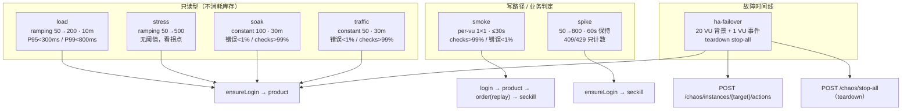
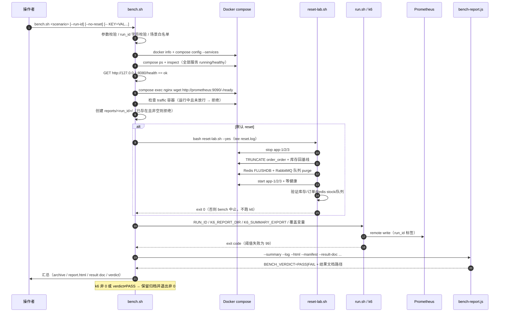
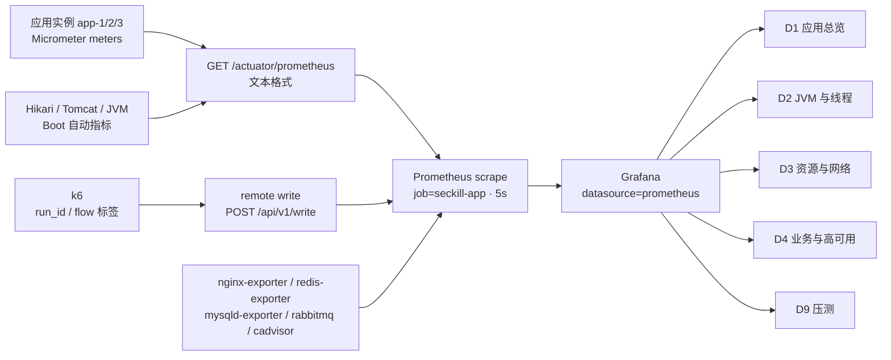
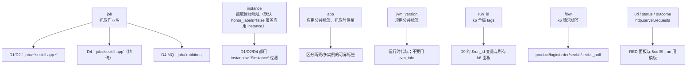

# 09 · 压测与观测（k6 / bench / Prometheus / Grafana）

> 一句话职责：用一套可复现的 k6 场景 + `bench.sh` 归档流水线产生带 `run_id` 的压测数据，经 Prometheus remote write 与 5s 抓取汇入 Grafana D1–D9，形成“压测 → 判定 → 归档 → 对比”的闭环。
> 代码基线：`294798a`

现状要点：k6 场景只有 `smoke/load/stress/spike/soak/traffic/ha-failover` 七个；Grafana 只有 D1/D2/D3/D4/D9 五块面板。设计里列的 `cache-penetration`、`cache-breakdown`、`cache-avalanche`、`redis-failover`、`db-failover`、`caffeine-warmup`、D5–D8、D10/D11 都不在基线内（见 §14）。

---

## 1. 角色与组件

| 角色 | 位置 | 职责 |
|---|---|---|
| 共享配置 | `code/lab/k6/lib/config.js` | 所有 URL/路径/id/时长/VU/阈值/超时/轮询/摘要统计的集中默认值与 fail-fast 校验；`run_id` 与全局 `tags` |
| HTTP 包装 | `code/lab/k6/lib/http.js` | 统一 `http.request`、`flow`/`run_id` 标签、`expectedStatuses`、`flow_errors`/`server_errors` 与秒杀计数 |
| 业务流 | `code/lab/k6/lib/flow.js` | `login/ensureLogin/product/order/seckill`；smoke/load/spike 的差别都收敛在这里 |
| 场景 schema | `code/lab/k6/lib/chaos-schema.js` | schema v1 的纯 JS 校验（与 Java 侧镜像实现） |
| 编排客户端 | `code/lab/k6/lib/chaos.js` | 读场景 JSON、调 chaos-controller、`chaos_events` 计数、teardown `stop-all` |
| 场景 | `code/lab/k6/scenarios/*.js` | 七个 `options` 定义 |
| 单次运行 | `code/lab/k6/run.sh` | 固定 k6 镜像、生成 `RUN_ID`、挂载、转发环境、`-o experimental-prometheus-rw` |
| 压测编排 | `code/lab/scripts/bench.sh` | preflight → reset → k6 → verdict → archive → report |
| 报告 | `code/lab/scripts/bench-report.js` | `manifest.json` + `report.html` + 结果 Markdown + `BENCH_VERDICT` |
| 对比 | `code/lab/scripts/bench-compare.js`（`compare.sh` 包装） | 两次 run 的 k6 指标 + Prometheus 峰值对比 |
| 复位 | `code/lab/scripts/reset-lab.sh` | 停 app → 清订单/库存 → FLUSHDB → 清队列 → 起 app → 验证基线 |
| 抓取 | `code/lab/docker/prometheus/prometheus.yml` | 8 个 job（含 `seckill-app`、`rabbitmq-queue`、cAdvisor、controller） |
| 面板 | `code/lab/docker/grafana/dashboards/ha-d*.json` | D1/D2/D3/D4/D9 |

---

## 2. k6 场景分类与形状

| 场景 | executor / 规模 | 业务流 | 阈值 |
|---|---|---|---|
| `smoke` | `per-vu-iterations`，1 VU × 1 iter，`maxDuration=30s` | login → product → order（replay）→ seckill → poll | `flow_errors<1%`、`server_errors<1%`、`checks>99%` |
| `load` | `ramping-vus`，50 → 200，时长由 `LOAD_DURATION`（默认 10m）派生 20%/20%/60% | product 只读 | `flow/server<1%`，product P95<300ms、P99<800ms |
| `stress` | `ramping-vus`，默认 50→100→200→300→400→500→0 | product 只读 | **无阈值**（观察拐点） |
| `spike` | `ramping-vus`，baseline 50/30s → 800/10s → 保持 60s → 10s 回落 | seckill | `flow/server<1%`；409/429 只计数 |
| `soak` | `constant-vus`，100 VU × 30m | product 只读 | `flow/server<1%`、`checks>99%` |
| `traffic` | `constant-vus`，50 VU × 30m（compose `traffic` profile，`jl-traffic`） | product 只读 | `flow/server<1%`、`checks>99%` |
| `ha-failover` | 两条 scenario：`constant-vus` 20 VU × `CHAOS_DURATION`(4m) + `per-vu-iterations` 1 VU 时间线 | product 只读 + 调控制器 | `flow/server<1%`，product P95/P99 |



### 2.1 场景选择建议

- 要判定：`smoke`（功能/幂等/秒杀全链）或 `load`（只读性能）。
- 要看容量拐点：`stress`，**不产生 PASS/FAIL**（`bench.sh` 把 `--thresholds-expected false`）。
- 要看拒绝语义：`spike`，409/429 计入 `seckill_expected_409/429`，不污染错误率。
- 要长时间稳定性：`soak`；堆/线程趋势由压测后 Prometheus 查询判定，不由 k6 判定。
- 交互演示背景流量：`traffic`，只由 compose profile 启动，`run.sh` **不接受** `traffic`。

---

## 3. `run.sh` 的环境契约

- 固定镜像：`K6_IMAGE=grafana/k6:1.3.0`（默认，可覆盖）；网络默认 `jl-net`；`BASE_URL` 默认 `http://nginx`（`K6_NETWORK=host` 时默认 `http://127.0.0.1:8080`）。
- `RUN_ID` 由 `run.sh` 生成一次并注入所有 VU；`lib/config.js` 直接 `k6 run` 时也会生成，但每个 VU 会不同，故正式运行必须走 `run.sh`/`bench.sh`。
- 只接受 `smoke|load|stress|spike|soak|ha-failover`；`traffic` 由 compose 直接跑。
- 远程写：`K6_PROMETHEUS_RW_SERVER_URL` 默认 `http://prometheus:9090/api/v1/write`；趋势统计默认 `p(95),p(99),max`；推送间隔 `5s`；启动命令带 `-o experimental-prometheus-rw`。
- 环境转发是**白名单**：`CONFIG_VARS` 列出的名字才进容器；chaos 变量（含 `LAB_TOKEN`）只在 `ha-failover` 时转发；`K6_FORWARD_ENV` 允许 `bench.sh` 追加任意合法变量名（仍校验标识符）。
- Windows：`host_mount_path` 用 `cygpath -m`；`MSYS_NO_PATHCONV=1` 防止 Git Bash 改写容器内路径。
- 报告挂载：`K6_REPORT_DIR` + `K6_SUMMARY_EXPORT`（容器内路径，默认 `/reports/summary.json`）；二者必须成对出现。

---

## 4. `bench.sh` 流水线



关键语义：

- **stack 必须已运行**，`bench.sh` 从不启动栈；health/Prometheus/traffic 三道预检任一失败即退出。
- **归档先建后跑**：`summary.json`、`k6.log`、`manifest.json`、`report.html`、`reset.log`（若 reset）；同名非空目录拒绝覆盖。
- **verdict 以 k6 退出码为锚**，报告再从 `k6.log` 解析每条阈值的中文/符号结果；`stress` 明确“无阈值预期”。
- **背景流量护栏**：`jl-traffic` 在跑时归档失真，除非 `BENCH_ALLOW_TRAFFIC=1`。
- **失败也归档**：PASS/FAIL 都写 `report.html` 与 `doc/process/benchmark/<date>-<scenario>-<run_id>.md`。

---

## 5. 报告、归档与对比

| 产物 | 内容 |
|---|---|
| `code/lab/k6/reports/<run_id>/summary.json` | k6 `--summary-export` |
| `.../k6.log` | 完整 stdout/stderr（阈值逐条结果） |
| `.../manifest.json` | 场景、run_id、起止时间、git、k6 镜像/退出码、remote write、env 覆盖、reset 基线、阈值、verdict、keyMetrics、artifacts |
| `.../report.html` | 自包含 HTML（无外部依赖） |
| `.../reset.log` | `reset-lab.sh` 输出（若执行） |
| `doc/process/benchmark/<date>-<scenario>-<run_id>.md` | 结果页（key metrics、verdict、时间范围深链） |

`bench-report.js` 的关键指标：iterations/rate、http_reqs/rate、duration avg/P95/P99/max、product P95/P99、failed/flow/server error rate、checks rate、409/429、terminal failed、poll timeouts、VUs max。`manifest.json` 的 `keyMetrics` 是 `bench-compare.js` 的唯一 k6 数据源。

`compare.sh A B` → `bench-compare.js`：

- A/B 可以是 run id（在 `BENCH_REPORTS_DIR` 下解析）或含 `manifest.json` 的目录；
- 对比 RPS、请求/迭代、P95/P99/max、错误率、checks、409/429、VUs、**Prometheus 峰值**（堆、线程、GC 次数、Hikari pending）；
- Prometheus 查询失败只标 `n/a`，不让对比失败；
- 场景不同会打印“不等价于同场景回归”的警告。

---

## 6. `reset-lab.sh` 的复位语义

1. 预检：compose 项目标签、容器状态、RabbitMQ 管理 API/队列、MySQL/Redis 可达；`--yes` 才真正执行，`--dry-run` 只打印计划与当前值。
2. 停 app 层（默认 `app-1 app-2 app-3`），避免 reset 期间消费者继续写。
3. MySQL：`TRUNCATE order_order`；`inventory_stock` 全量置 `RESET_BASELINE_STOCK`（默认 100）、`reserved=0`；缺失行补齐。Flyway 历史与商品种子不动。
4. Redis：对 lab 专用实例 `FLUSHDB`（缓存 L2、登录 token、幂等 claim、`seckill:stock:*`）。
5. RabbitMQ：删除队列中的 ready 消息（保留 durable 队列与绑定）。
6. 启动 app 层并等待健康；启动 seeder 从 MySQL 回填 Redis 库存，toggles/熔断/Caffeine L1 回到种子。
7. 验证：库存 min/max=基线、reserved=0、订单 0、每个商品都有 `seckill:stock:<id>`、队列 0/0、容器 healthy。

不执行 `docker compose down`、不删卷、不碰 `java-learn-lab` 之外的容器；凭据从 `.env` 读，经 0600 临时 env-file/stdin 传给 MySQL/RabbitMQ，不出现在 argv/日志/归档。

---

## 7. 指标数据链路



- Prometheus：`scrape_interval=5s`、`scrape_timeout=5s`、`evaluation_interval=5s`；保留 7 天；`--web.enable-remote-write-receiver` 已开；`--web.external-url=http://127.0.0.1:8080/prom/` 供 Nginx `/prom/` 访问。
- 抓取 job：`prometheus`、`seckill-app`（app-1/2/3）、`nginx-exporter`、`redis-exporter`、`mysqld-exporter`、`rabbitmq`、`rabbitmq-queue`（`/metrics/detailed` + relabel）、`cadvisor`、`tempo`、`chaos-controller`（`/metrics`）。
- `rabbitmq-queue` 把 `rabbitmq_detailed_queue_*` 改名为 `rabbitmq_queue_*`，让 D4 的 backlog 面板有 `queue` 标签；`seckill-app` 把 `orders_total` 改回 `orders_created_total`。
- db-ha exporter job 已内联进 `prometheus.yml`（`mysqld-exporter-ha`）；D11 已存在（`ha-d11.json`）。

### 7.1 PromQL / 标签约定（实际使用）



实际查询示例（与 dashboard JSON 一致）：

- `up{job=~"seckill-app.*", instance=~"$instance"}`
- `sum by (instance) (rate(http_server_requests_seconds_count{job=~"seckill-app.*", uri!~"/actuator.*", instance=~"$instance"}[1m]))`
- `histogram_quantile(0.99, sum by (le, instance) (rate(http_server_requests_seconds_bucket{job=~"seckill-app.*", instance=~"$instance"}[1m])))`
- `sum(rate(orders_created_total{job="seckill-app",instance=~"$instance"}[1m]))`
- `rabbitmq_queue_messages_ready{queue="seckill.order.queue"}`
- `max by (run_id, flow) (k6_http_req_duration_p99{run_id=~"$run_id"}) * 1000`

标签纪律：`uri` 必须是 URI 模板（`/api/products/{id}`），禁止原始路径/userId/订单号进标签；k6 自定义指标都带 `run_id`（`baseOptions.tags`），HTTP 请求额外带 `flow`。

---

## 8. Grafana 面板清单（实际只有 D1–D4、D9）

| 面板 | UID | 实际内容 |
|---|---|---|
| D1 应用总览 | `ha-d1` | 三实例 `up`、请求速率、5xx 错误率、P95、P99（全部按 `instance` 过滤） |
| D2 JVM 与线程 | `ha-d2` | 活跃线程、线程状态分布、堆、GC 暂停速率、Tomcat busy、Hikari 活跃、`thread_lab_lifecycle_state_code` |
| D3 资源与网络 | `ha-d3` | cAdvisor CPU/内存/网络、抓取状态、Nginx 连接、Redis 连接/内存、MySQL 线程 |
| D4 业务与高可用 | `ha-d4` | 订单速率、秒杀结果、幂等拒绝、超卖（必须 0）、下单受理 P95/P99、消费者结果、MQ backlog/消费、熔断/限流、L1/L2 命中率、Hikari 压力 |
| D9 压测 | `ha-d9` | k6 VUs、RPS、P95/P99、错误率（409/429 不计失败）、业务拒绝计数、应用入口 RPS/P95 对照、运行信息 |

**当前**：D6 `ha-d6.json`、D7 `ha-d7.json`、D10 `ha-d10.json`、D11 `ha-d11.json` 均已落地；D5 由 Tempo UI 承担；**D8 调优实验仍未实现**。

---

## 9. 指标目录（按域）

| 域 | 指标 | 来源/备注 |
|---|---|---|
| HTTP | `http_server_requests_seconds_{count,sum,bucket}`（`uri/status/outcome`） | Boot/Micrometer 自动；直方图与 SLO 桶在 JDK 21 由 `platform-observability` 注入，JDK 8 由 yml 声明 |
| JVM | `jvm_threads_live_threads`、`jvm_threads_states_threads`、`jvm_memory_used_bytes{area}`、`jvm_gc_pause_seconds_{count,sum}`、`jvm_classes_loaded_classes`、`jvm_buffer_memory_used_bytes` | Boot 自动；**无 `jvm_info`** |
| Tomcat | `tomcat_threads_busy_threads`、`tomcat_threads_current_threads`、`tomcat_connections_current` | Boot 自动（`server.tomcat.mbeanregistry.enabled=true`） |
| Hikari | `hikaricp_connections_{active,idle,pending,max}`、`hikaricp_connections_acquire_seconds_*` | Boot 自动，按 `pool` 标签区分 write/read |
| 缓存通用 | `cache_l1_requests_total{result}`、`cache_l2_requests_total{result}`、`cache_l2_errors_total`、`cache_db_fallbacks_total{reason}`、`cache_bloom_requests_total{result}` | `TwoLevelCache`、`ProductPenetrationDefense`、`ProductBreakdownDefense`、`ProductBloomFilterService` |
| 缓存实验 | `cache_null_cache_requests_total`、`cache_null_cache_writes_total`、`cache_null_cache_errors_total`、`cache_breakdown_mutex_total`、`cache_breakdown_logical_total`、`cache_breakdown_refresh_total` | 缓存实验室端点 `/lab/cache/**` 的策略运行结果 |
| 订单 | `orders_created_total`（抓取时由 `orders_total` 改名）、`idempotent_reject_total`、`order_accept_seconds_bucket`、`stock_oversold_total` | `OrderMetrics`、`OrderTransactionService` |
| 秒杀 | `seckill_attempts_total{result}`、`order_consumer_processed_total{result}` | `SeckillMetrics`，每个 result 预注册 |
| 限流/熔断 | `resilience4j_circuitbreaker_state`、`resilience4j_ratelimiter_available_permissions` | Resilience4j 注册表启动时预注册 |
| MQ | `rabbitmq_queue_messages_ready`、`rabbitmq_queue_messages_unacked`、`rabbitmq_queue_messages_delivered_total` | `rabbitmq-queue` 详细端点 + relabel |
| Redis | `redis_connected_clients`、`redis_memory_used_bytes`、`redis_up`、主从角色 | `redis-exporter`；Sentinel 角色探针由脚本/手册使用 |
| MySQL | `mysql_up`、客户端线程数、QPS | `mysqld-exporter`（dev）+ `mysqld-exporter-ha`（三节点）；集群成员指标来自 chaos-controller 探针 |
| 容器 | `container_cpu_usage_seconds_total`、`container_memory_working_set_bytes`、网络收发 | cAdvisor（`container_label_lab="java-learn"`） |
| k6 | `k6_http_reqs_total`、`k6_http_req_duration_{p95,p99}`、`k6_vus`、`k6_http_req_failed_rate`、`k6_flow_errors_rate`、`k6_server_errors_rate`、`k6_checks_rate`、`k6_seckill_expected_409_total`、`k6_seckill_expected_429_total`、`k6_chaos_events_total` | remote write；全部带 `run_id` |
| 混沌 | `chaos_active_actions`、`chaos_actions_total`、`chaos_reverts_total`（后者懒注册） | chaos-controller `/metrics` |
| 线程 | `thread_lab_*`、`thread_lab_demo_*` | 见 07 文档；故障动作与六态 demo 两套命名 |
| 缓存实验室状态 | `/lab/cache/state` 的 `CacheStateResponse`（非指标） | 运行策略/种子/布隆几何的只读视图 |

---

## 10. 代码对照表

| 概念/行为 | 类/方法（或脚本函数、配置键） | path:line | 说明 |
|---|---|---|---|
| k6 集中配置 | `export const config` | `code/lab/k6/lib/config.js:226` | 所有默认值的唯一出口 |
| 默认 BASE_URL | `baseUrl` | `code/lab/k6/lib/config.js:192` | `http://nginx`，去尾斜杠并校验 |
| 默认 run_id | `runId` | `code/lab/k6/lib/config.js:191` | 直接 k6 run 时生成，正式运行由 run.sh 注入 |
| 全局 run_id 标签 | `baseOptions` | `code/lab/k6/lib/config.js:303` | `tags.run_id` 覆盖所有 k6 指标 |
| 登录路径默认 | `login` | `code/lab/k6/lib/config.js:236` | `/api/login` |
| 秒杀预期状态 | `expectedStatuses` | `code/lab/k6/lib/config.js:251` | `200,202,409,429` |
| 场景形状 | `smoke` / `load` / `stress` / `spike` / `soak` / `traffic` | `code/lab/k6/lib/config.js:257` | 六段配置起点 |
| 阈值默认 | `thresholds` | `code/lab/k6/lib/config.js:290` | P95 300ms / P99 800ms / 错误 1% / checks 99% |
| 统一请求 | `call` | `code/lab/k6/lib/http.js:41` | 标签、超时、expectedStatuses、check |
| 业务错误率 | `flowErrors` | `code/lab/k6/lib/http.js:17` | 每个请求一次 add |
| 服务端错误率 | `serverErrors` | `code/lab/k6/lib/http.js:18` | 5xx 或 0 |
| 秒杀 409/429 计数 | `seckillExpected409` / `seckillExpected429` | `code/lab/k6/lib/http.js:19` | 预期业务拒绝 |
| 登录 | `login` | `code/lab/k6/lib/flow.js:31` | POST `/api/login`，token 存 VU 内存 |
| 确保登录 | `ensureLogin` | `code/lab/k6/lib/flow.js:51` | token 为空即登录（JDK 8 缺口） |
| 商品读 | `product` | `code/lab/k6/lib/flow.js:59` | 只校验 `data.id` |
| 幂等下单 | `order` | `code/lab/k6/lib/flow.js:74` | 同 `Idempotency-Key` 可 replay |
| 秒杀 | `seckill` | `code/lab/k6/lib/flow.js:179` | 202 轮询 / 200 终态 / 409/429 计数 |
| 场景 schema 版本 | `SCHEMA_VERSION` | `code/lab/k6/lib/chaos-schema.js:9` | v1 |
| 动作白名单 | `ALLOWED_ACTIONS` | `code/lab/k6/lib/chaos-schema.js:10` | kill/start/restart/freeze/resume |
| TTL 动作 | `TTL_ACTIONS` | `code/lab/k6/lib/chaos-schema.js:11` | kill/freeze |
| 目标正则 | `DEFAULT_TARGET_PATTERN` | `code/lab/k6/lib/chaos-schema.js:12` | `^jl-app-[0-9]+$` |
| 数据存储目标默认拒绝 | `DEFAULT_ALLOWED_DATASTORE_PATTERN` | `code/lab/k6/lib/chaos-schema.js:19` | 空 = 全拒 |
| 教学 explain 字段 | `EXPLAIN_FIELDS` | `code/lab/k6/lib/chaos-schema.js:22` | 现象/根因/处方/预期 |
| 场景校验 | `validateScenario` | `code/lab/k6/lib/chaos-schema.js:88` | 排序/TTL/重复偏移/目标 |
| 事件排序 | `sortEvents` | `code/lab/k6/lib/chaos-schema.js:229` | 稳定升序 |
| 混沌事件计数 | `chaosEvents` | `code/lab/k6/lib/chaos.js:35` | `chaos_events{action,target,result}` |
| 控制器地址 | `CHAOS_CONTROLLER_URL` | `code/lab/k6/lib/chaos.js:109` | 默认 `http://chaos-controller:8081` |
| 混沌配置 | `chaosConfig` | `code/lab/k6/lib/chaos.js:131` | 超时/偏移/TTL 上限/VU |
| 场景路径解析 | `resolveScenarioPath` | `code/lab/k6/lib/chaos.js:149` | 绝对路径优先，否则拼目录 |
| 场景加载 | `loadScenario` | `code/lab/k6/lib/chaos.js:165` | init 期 `open()` + 校验 |
| 单动作 | `action` | `code/lab/k6/lib/chaos.js:222` | 202/200 之外即失败 |
| 全局回滚 | `stopAll` | `code/lab/k6/lib/chaos.js:249` | teardown 兜底 |
| smoke 选项 | `options` | `code/lab/k6/scenarios/smoke.js:11` | per-vu-iterations |
| load 选项 | `options` | `code/lab/k6/scenarios/load.js:10` | ramping-vus |
| stress 选项 | `options` | `code/lab/k6/scenarios/stress.js:12` | 无 thresholds |
| spike 选项 | `options` | `code/lab/k6/scenarios/spike.js:14` | ramping-vus |
| soak 选项 | `options` | `code/lab/k6/scenarios/soak.js:10` | constant-vus |
| traffic 选项 | `options` | `code/lab/k6/scenarios/traffic.js:13` | constant-vus |
| ha-failover 选项 | `options` | `code/lab/k6/scenarios/ha-failover.js:36` | 双 scenario |
| 时间线 | `chaosTimeline` | `code/lab/k6/scenarios/ha-failover.js:77` | 相对 VU 起点重放 |
| teardown | `teardown` | `code/lab/k6/scenarios/ha-failover.js:133` | 总是 stop-all |
| run.sh 场景白名单 | `case` | `code/lab/k6/run.sh:40` | 六个场景 |
| RUN_ID 生成 | `RUN_ID` | `code/lab/k6/run.sh:72` | 单次运行共享 |
| remote write 默认 | `K6_PROMETHEUS_RW_SERVER_URL` | `code/lab/k6/run.sh:74` | `http://prometheus:9090/api/v1/write` |
| 转发白名单 | `CONFIG_VARS` | `code/lab/k6/run.sh:124` | 只转发列出的变量 |
| 混沌变量 | `CONFIG_VARS+=` | `code/lab/k6/run.sh:146` | 仅 ha-failover 带 token |
| 实际运行 | `docker` | `code/lab/k6/run.sh:228` | `-o experimental-prometheus-rw` |
| bench 预检 | `# --- Preflight` | `code/lab/scripts/bench.sh:214` | Docker/compose/health/Prometheus |
| 服务健康判定 | `service_ready` | `code/lab/scripts/bench.sh:234` | running + healthy/none |
| 背景流量护栏 | `traffic_id` | `code/lab/scripts/bench.sh:291` | 运行中则拒绝归档 |
| 归档目录 | `RUN_DIR` | `code/lab/scripts/bench.sh:305` | 非空即拒绝 |
| 复位步骤 | `if $DO_RESET` | `code/lab/scripts/bench.sh:325` | `reset-lab.sh --yes` |
| k6 调用 | `bash "$K6_RUNNER"` | `code/lab/scripts/bench.sh:357` | 汇总导出到归档 |
| 报告参数 | `report_args` | `code/lab/scripts/bench.sh:372` | manifest/html/result doc |
| verdict 提取 | `BENCH_VERDICT` | `code/lab/scripts/bench.sh:410` | 报告 stdout 协议 |
| bench key metrics | `keyMetrics` | `code/lab/scripts/bench-report.js:133` | compare 的唯一 k6 来源 |
| manifest 结构 | `manifest` | `code/lab/scripts/bench-report.js:265` | git/k6/reset/thresholds/artifacts |
| verdict 生成 | `verdictReason` | `code/lab/scripts/bench-report.js:230` | k6 退出码 + 阈值 |
| Prometheus 峰值 | `peaks` | `code/lab/scripts/bench-compare.js:146` | 堆/线程/GC/Hikari |
| 对比主流程 | `main` | `code/lab/scripts/bench-compare.js:203` | 表格 + 差异/百分比 |
| compare 包装 | `exec node` | `code/lab/scripts/compare.sh:24` | 透传参数 |
| reset 停 app | `step "stopping app tier` | `code/lab/scripts/reset-lab.sh:440` | 先停消费者 |
| reset MySQL | `mysql_reset_sql` | `code/lab/scripts/reset-lab.sh:446` | truncate + 库存基线 |
| reset Redis | `flushing Redis DB` | `code/lab/scripts/reset-lab.sh:458` | FLUSHDB |
| reset 队列 | `purging RabbitMQ queue` | `code/lab/scripts/reset-lab.sh:466` | 保留队列/绑定 |
| reset 起 app | `starting app tier` | `code/lab/scripts/reset-lab.sh:482` | seeder 回填 Redis |
| reset 验证 | `verifying baseline` | `code/lab/scripts/reset-lab.sh:529` | 库存/订单/Redis/队列/健康 |
| Prometheus 全局 | `scrape_interval` | `code/lab/docker/prometheus/prometheus.yml:5` | 5s |
| app 抓取 job | `seckill-app` | `code/lab/docker/prometheus/prometheus.yml:15` | app-1/2/3 |
| 订单指标改名 | `orders_total` | `code/lab/docker/prometheus/prometheus.yml:26` | → `orders_created_total` |
| Redis exporter | `redis-exporter` | `code/lab/docker/prometheus/prometheus.yml:34` | 9121 |
| RabbitMQ 详细队列 | `rabbitmq-queue` | `code/lab/docker/prometheus/prometheus.yml:51` | `/metrics/detailed` |
| 队列指标改名 | `rabbitmq_detailed_(queue_.*)` | `code/lab/docker/prometheus/prometheus.yml:60` | → `rabbitmq_queue_*` |
| cAdvisor | `cadvisor` | `code/lab/docker/prometheus/prometheus.yml:66` | 10s，慢首抓 |
| controller 抓取 | `chaos-controller` | `code/lab/docker/prometheus/prometheus.yml:77` | `/metrics` |
| remote write 接收 | `--web.enable-remote-write-receiver` | `code/lab/docker/compose.base.yml:385` | Prometheus 启动参数 |
| /prom 外部 URL | `--web.external-url` | `code/lab/docker/compose.base.yml:389` | Nginx `/prom/` |
| db-ha 抓取 | 已内联 | `code/lab/docker/prometheus/prometheus.yml`（`mysqld-exporter-ha`） | `mysql_up` 三节点；D11 已存在 |
| D1 标题 | `D1 应用总览` | `code/lab/docker/grafana/dashboards/ha-d1.json:305` | uid `ha-d1` |
| D2 标题 | `D2 JVM 与线程` | `code/lab/docker/grafana/dashboards/ha-d2.json:434` | uid `ha-d2` |
| D3 标题 | `D3 资源与网络` | `code/lab/docker/grafana/dashboards/ha-d3.json:448` | uid `ha-d3` |
| D4 标题 | `D4 业务与高可用` | `code/lab/docker/grafana/dashboards/ha-d4.json:641` | uid `ha-d4` |
| D9 标题 | `D9 压测` | `code/lab/docker/grafana/dashboards/ha-d9.json:131` | uid `ha-d9` |
| D9 run_id 变量 | `label_values` | `code/lab/docker/grafana/dashboards/ha-d9.json:120` | 从 `k6_http_reqs_total` 取 |
| 秒杀指标 | `seckill_attempts` | `code/services/seckill-app-jdk21/src/main/java/com/javalearn/lab/seckill/admission/app/SeckillMetrics.java:46` | 按 result 预注册 |
| 消费者指标 | `order_consumer_processed` | `code/services/seckill-app-jdk21/src/main/java/com/javalearn/lab/seckill/admission/app/SeckillMetrics.java:51` | 按 result 预注册 |
| 超卖指标 | `stock_oversold` | `code/services/seckill-app-jdk21/src/main/java/com/javalearn/lab/seckill/admission/app/SeckillMetrics.java:54` | 必须为 0 |
| 订单指标 | `orders_created_total` | `code/services/seckill-app-jdk21/src/main/java/com/javalearn/lab/seckill/order/app/OrderMetrics.java:36` | 幂等重放不计 |
| 幂等拒绝 | `idempotent_reject` | `code/services/seckill-app-jdk21/src/main/java/com/javalearn/lab/seckill/order/app/OrderMetrics.java:39` | 渲染 `_total` |
| L1 指标 | `cache_l1_requests` | `code/services/seckill-app-jdk21/src/main/java/com/javalearn/lab/seckill/catalog/cache/TwoLevelCache.java:73` | 按 result |
| L2 指标 | `cache_l2_requests` | `code/services/seckill-app-jdk21/src/main/java/com/javalearn/lab/seckill/catalog/cache/TwoLevelCache.java:79` | 按 result |
| L2 错误 | `cache_l2_errors` | `code/services/seckill-app-jdk21/src/main/java/com/javalearn/lab/seckill/catalog/cache/TwoLevelCache.java:88` | Redis 故障 |
| DB 回落 | `cache_db_fallbacks` | `code/services/seckill-app-jdk21/src/main/java/com/javalearn/lab/seckill/catalog/cache/ProductPenetrationDefense.java:43` | reason=miss |
| 击穿回落 | `cache_db_fallbacks` | `code/services/seckill-app-jdk21/src/main/java/com/javalearn/lab/seckill/catalog/cache/ProductBreakdownDefense.java:108` | reason=breakdown |
| 布隆指标 | `cache_bloom_requests` | `code/services/seckill-app-jdk21/src/main/java/com/javalearn/lab/seckill/catalog/cache/ProductBloomFilterService.java:57` | hit/absent/error |
| 混沌 gauge | `chaos.active.actions` | `code/services/chaos-controller/src/main/java/com/javalearn/lab/chaos/action/ChaosActionService.java:116` | 渲染 `chaos_active_actions` |

`code/services/seckill-app-jdk21/src/main/java/com/javalearn/lab/seckill/admission/...`、`code/services/seckill-app-jdk21/src/main/java/com/javalearn/lab/seckill/order/...`、`code/services/seckill-app-jdk21/src/main/java/com/javalearn/lab/seckill/catalog/...` 的完整前缀为 `code/services/seckill-app-jdk21/src/main/java/com/javalearn/lab/seckill/`。

---

## 11. 配置项表（压测与观测）

| 配置键 / 变量 | 默认 | 读取位置 |
|---|---|---|
| `BASE_URL` | `http://nginx` | `code/lab/k6/lib/config.js:192` |
| `RUN_ID` | 运行期生成 | `code/lab/k6/lib/config.js:191`；`code/lab/k6/run.sh:72` |
| `P95_MS` / `P99_MS` | `300` / `800` | `code/lab/k6/lib/config.js:197` |
| `ERROR_RATE` / `CHECKS_RATE` | `0.01` / `0.99` | `code/lab/k6/lib/config.js:199` |
| `LOAD_DURATION` | `10m` | `code/lab/k6/lib/config.js:202` |
| `LOAD_START_VUS` / `LOAD_VUS` | `50` / `200` | `code/lab/k6/lib/config.js:203` |
| `STRESS_STAGES` | 50→500 七段 | `code/lab/k6/lib/config.js:153` |
| `SPIKE_VUS` / `SPIKE_DURATION` | `800` / `60s` | `code/lab/k6/lib/config.js:215` |
| `SOAK_VUS` / `SOAK_DURATION` | `100` / `30m` | `code/lab/k6/lib/config.js:281` |
| `TRAFFIC_VUS` / `TRAFFIC_DURATION` | `50` / `30m` | `code/lab/k6/lib/config.js:287` |
| `SECKILL_EXPECTED_STATUSES` | `200,202,409,429` | `code/lab/k6/lib/config.js:251` |
| `SECKILL_POLL_ATTEMPTS` / `SECKILL_POLL_INTERVAL` | `30` / `1s` | `code/lab/k6/lib/config.js:254` |
| `HTTP_TIMEOUT` | `10s` | `code/lab/k6/lib/config.js:229` |
| `K6_IMAGE` | `grafana/k6:1.3.0` | `code/lab/k6/run.sh:18` |
| `K6_NETWORK` | `jl-net` | `code/lab/k6/run.sh:19` |
| `K6_PROMETHEUS_RW_SERVER_URL` | `http://prometheus:9090/api/v1/write` | `code/lab/k6/run.sh:74` |
| `K6_PROMETHEUS_RW_TREND_STATS` | `p(95),p(99),max` | `code/lab/k6/run.sh:75` |
| `K6_PROMETHEUS_RW_PUSH_INTERVAL` | `5s` | `code/lab/k6/run.sh:76` |
| `CHAOS_CONTROLLER_URL` | `http://chaos-controller:8081` | `code/lab/k6/lib/chaos.js:109` |
| `CHAOS_MAX_TTL` | `600` | `code/lab/k6/lib/chaos.js:142` |
| `CHAOS_DURATION` / `CHAOS_VUS` | `4m` / `20` | `code/lab/k6/lib/chaos.js:128` |
| `LAB_TOKEN`（k6 chaos） | 必填，无默认 | `code/lab/k6/lib/chaos.js:110` |
| `BENCH_REPORTS_DIR` | `code/lab/k6/reports` | `code/lab/scripts/bench.sh:29` |
| `BENCH_DOC_DIR` | `doc/process/benchmark` | `code/lab/scripts/bench.sh:30` |
| `BENCH_GRAFANA_DASHBOARD_UID` | `ha-d4` | `code/lab/scripts/bench.sh:40` |
| `PROM_URL` | `http://127.0.0.1:8080/prom` | `code/lab/scripts/bench.sh:38` |
| `BENCH_ALLOW_TRAFFIC` | `0` | `code/lab/scripts/bench.sh:296` |
| `RESET_BASELINE_STOCK` | `100` | `code/lab/scripts/reset-lab.sh:49` |
| `RESET_APP_SERVICES` | `app-1 app-2 app-3` | `code/lab/scripts/reset-lab.sh:40` |
| `RABBITMQ_QUEUE` | `seckill.order.queue` | `code/lab/scripts/reset-lab.sh:50` |
| `RESET_APP_HEALTH_TIMEOUT_SECONDS` | `180` | `code/lab/scripts/reset-lab.sh:55` |
| Prometheus `scrape_interval` | `5s` | `code/lab/docker/prometheus/prometheus.yml:5` |
| Prometheus remote write receiver | 开启 | `code/lab/docker/compose.base.yml:385` |
| `BENCH_COMPARE_TIMEOUT_MS` | `5000` | `code/lab/scripts/bench-compare.js:38` |
| `BENCH_COMPARE_WINDOW_GRACE_SECONDS` | `15` | `code/lab/scripts/bench-compare.js:41` |

---

## 12. 5 分钟演示步骤

```bash
# 0. 前提：栈已启动（up.sh），且控制台背景流量未开启
curl -s http://127.0.0.1:8080/health

# 1. 正式冒烟：preflight → reset → k6 → verdict → 归档
bash code/lab/scripts/bench.sh smoke

# 2. 2 分钟只读负载（覆盖默认 10m，避免占用整场演示）
bash code/lab/scripts/bench.sh load -- LOAD_DURATION=2m

# 3. 查看归档
ls code/lab/k6/reports/
# 打开最新 run 的 report.html（浏览器）或：
sed -n '1,40p' code/lab/k6/reports/<run_id>/manifest.json

# 4. 对比两次运行（RPS/P95/P99/错误率/堆/线程）
bash code/lab/scripts/compare.sh <runA> <runB>

# 5. 复位（只读计划；真正复位要 --yes）
bash code/lab/scripts/reset-lab.sh --dry-run

# 6. 观测：Prometheus 直查 + Grafana D9
curl -sG http://127.0.0.1:8080/prom/api/v1/query \
  --data-urlencode 'query=sum by (run_id) (rate(k6_http_reqs_total[1m]))'
# 浏览器：http://127.0.0.1:3000/d/ha-d9（选择 run_id）
```

演示讲解顺序：D9 看 k6 侧 VUs/RPS/P95/P99，再切 D1/D2 看应用侧同时间窗的 RED/JVM 曲线，最后用 D4 解释 409/429 是业务拒绝而不是故障。

---

## 13. 已知缺陷 / 边界

1. **场景不全**：设计 §11.1 的 `cache-penetration`、`cache-breakdown`、`cache-avalanche`、`redis-failover`、`db-failover`、`caffeine-warmup` 在 `scenarios/` 中**不存在**；缓存/HA 故障目前靠 `ha-failover` + 向导/手动端点演示。
2. **面板不全**：D5/D6/D7/D8/D10/D11 都未实现；`mysql-ha-scrape.yml` 惰性未接线，D11 没有数据面。
3. **`run.sh` 不接受 `traffic`**：背景流量只能由 compose `traffic` profile 启停；`bench.sh` 也会在 `jl-traffic` 运行时拒绝归档（除非 `BENCH_ALLOW_TRAFFIC=1`）。
4. **`ensureLogin()` 与 JDK 8 不兼容**：所有带登录的 k6 场景打 JDK 8 会把 `flow_errors` 打爆（详见 08 文档 §6.1）。
5. **remote write 是硬依赖**：`run.sh` 固定 `-o experimental-prometheus-rw`，Prometheus 必须开接收器且网络可达；否则 k6 输出会失败或指标缺失。
6. **k6 阈值判定依赖日志解析**：k6 1.3 的 summary-export 不提供稳定的 ok/crossed 语义，`bench-report.js` 从 `k6.log` 的 ✓/✗ 行解析每条规则；日志格式变化会影响归档可读性（退出码仍是权威）。
7. **`stress` 没有 PASS/FAIL**：这是有意的“看拐点”场景，`bench.sh` 标记 `thresholds-expected=false`；不要把它当回归门禁。
8. **`reset-lab.sh` 会停/起 app 层**：演示中执行 reset 会造成一次真实重启与短暂不可用；共享栈上要先确认没有其他实验。
9. **chaos 指标不完整**：设计里的 `chaos_actions_total`、`chaos_reverts_total` 未实现，只有 `chaos_active_actions` gauge；D9 的故障 annotation 与动态 manifest 面板也未做。
10. **k6 场景的 `atSeconds` 只用于展示/时间线**：交互向导不按墙钟自动触发；自动播放未实现。
11. **cAdvisor 在 WSL2 下网络指标可能不完整**：D3 的网络面板作为可降级项，不作为验收硬指标。
12. **归档目录被 gitignore**：`code/lab/k6/reports/` 不入库；可复现性依赖 `manifest.json` + 结果文档，而不是提交原始 summary。

---

## 14. 关联文档

- `doc/design/details/07-线程实验室.md`：`thread_lab_*` 指标与 D2 的唯一线程面板。
- `doc/design/details/08-双JDK与JVM调优.md`：JDK 8 数据源、`jvm_version` 契约与 D7 约束。
- `doc/design/details/10-操作台与API.md`：`/lab-api/lab/traffic/*`、`/lab/guide/*` 与 `/prom/` 代理。
- `doc/process/step-19-k6-base.md`、`step-20a-bench-reset.md`、`step-20b-compare-d9.md`、`step-21-chaos-actions.md`、`step-22a-scenario-timeline.md`：k6/bench/compare/chaos 原始交接。
- `doc/design/2026-10-26-ha-concurrency-lab-design.md` §7、§11：观测与压测原始设计。
- `doc/process/benchmark/`：已归档的 smoke/load/负向阈值/compare 样例。

---

### 验证说明

- 代码对照表与配置表的 `path:line` 由脚本机械校验；结果见提交报告。
- Mermaid 代码块成对闭合且图类型在标准集合内；**未做可视化渲染验证**。
