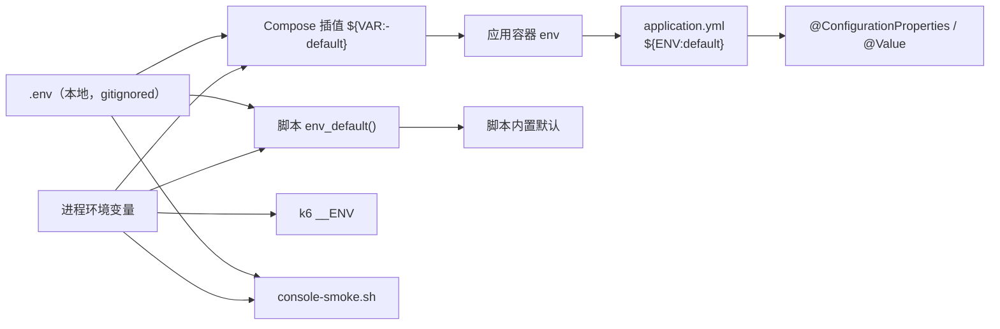
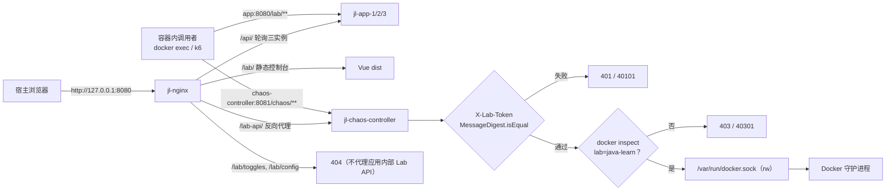

# 11 · 配置与安全边界

> 一句话职责：把“哪些参数必须外置、它们各自的默认值与读取点、以及实验室的安全边界在哪里”讲清楚，避免演示环境被误当成生产，也避免硬编码回潮。
>
> 代码基线：`294798a`

本文只列 `.env.example` / `.env.mysql.example` 中的**键名与公开默认值**，不记录任何真实 `.env` 内容；`.env` 本身被 gitignore，是本地实验凭据。

---

## 1. 角色与组件（配置消费者）

| 消费者 | 配置来源 | 读取方式 |
|---|---|---|
| `seckill-app` × 3 | `application.yml` + 环境变量 | Spring `@ConfigurationProperties` / `${ENV:default}` |
| `chaos-controller` | `chaos-controller/src/main/resources/application.yml` + 环境变量 | 同上；`ChaosProperties` |
| Compose 渲染 | `code/lab/docker/.env` | `${VAR:-default}` 插值 |
| 运维脚本 | 进程环境 > `.env` > 内置默认 | `env_default()` / 只按行读取键，不 `source` |
| k6 | k6 进程环境 | `__ENV` + `lib/config.js` / `lib/chaos.js` |
| 控制台冒烟 | 环境 > `.env` > 默认 | `console-smoke.sh` 的 `dotenv_value` |

### 1.1 读取链与优先级



优先级统一为：**进程环境 > `.env` > 代码/脚本默认**。脚本刻意不 `source .env`：那会把所有实验口令导出到当前 shell 及子进程，并可能出现在 `docker inspect`/`ps` 的输出里；`db-cluster-status.sh`、`db-ha-up.sh`、`sentinel-status.sh` 都只按行读取需要的键。

---

## 2. 配置外置规约

`doc/design/工程规约.md` §1 要求：路径（文件/目录/URL/挂载点/日志/数据目录）、时间与数量参数（超时/重试/退避/TTL/缓存容量/池大小/端口/并发/批量/保留期）、敏感值，全部可配置，禁止在 Java、模板、脚本里写死；评审发现硬编码必须在同一任务内修复并补测试。

落地方式：

- Spring：`application.yml` + `@ConfigurationProperties`，给安全默认值但允许环境覆盖。
- Compose：`${VAR:-default}`；服务数由 profile 控制，`ha` / `db-ha` 服务不进入默认渲染。
- 脚本：可调参数集中在变量或 `.env.example`，使用 `env_default` 一类函数，只读键名。
- 场景：参数放 JSON（schema v1），由 Java 与 k6 双重校验。
- 敏感值：只放环境变量或 `.env`，不提交。

### 2.1 仍然存在的例外（如实登记）

| 例外 | 位置 | 影响 |
|---|---|---|
| L1 Caffeine TTL / L2 TTL 是 Java 常量 | `TwoLevelCache.java`（`L1_EXPIRE_AFTER_WRITE=60s`、`L2_TTL=5min`） | 改缓存时长必须改代码；演练里 L1 会掩盖 Redis 切换 |
| Hikari 池大小写在 yaml 字面量 | `application.yml` 的 `app.datasource.write/read.maximum-pool-size: 10`、`minimum-idle: 2` | 属于配置文件而非代码，但不能用环境变量覆盖 |
| `ChaosProperties` 的字段默认值在 Java 里 | `chaos-controller/.../config/ChaosProperties.java` | 可由 yaml/env 覆盖，只是默认值写在代码中 |
| 部分脚本自带兜底默认 | `DEFAULT_TAIL=200`、状态脚本默认值 | 可被参数/环境覆盖，默认值在脚本中 |

这些不影响“运行值可改”，但违反“默认值不散落在代码里”的严格口径，属于后续清理项；本文不把它们写成已达标。

---

## 3. 配置清单（按域）

### 3.1 应用实验键（`application.yml`）

| 键 | 环境变量 | 默认 | 读取位置 |
|---|---|---|---|
| Redis 模式 | `REDIS_MODE` | `standalone` | `code/services/seckill-app-jdk21/src/main/resources/application.yml:77` |
| 发现探测次数 | `REDIS_DISCOVERY_REPORT_ATTEMPTS` | `12` | `code/services/seckill-app-jdk21/src/main/resources/application.yml:84` |
| 发现探测间隔 | `REDIS_DISCOVERY_REPORT_INTERVAL_MS` | `5000` | `code/services/seckill-app-jdk21/src/main/resources/application.yml:85` |
| 写库 URL | `DB_WRITE_URL` | `jdbc:mysql://${MYSQL_HOST:mysql}:3306/${MYSQL_DATABASE:seckill}…` | `code/services/seckill-app-jdk21/src/main/resources/application.yml:95` |
| 读库 URL | `DB_READ_URL` | 同上 | `code/services/seckill-app-jdk21/src/main/resources/application.yml:96` |
| 登录令牌前缀 | `LOGIN_TOKEN_KEY_PREFIX` | `login:token:` | `code/services/seckill-app-jdk21/src/main/resources/application.yml:116` |
| 登录令牌 TTL | `LOGIN_TOKEN_TTL_SECONDS` | `1800` | `code/services/seckill-app-jdk21/src/main/resources/application.yml:117` |
| Lab token | `LAB_TOKEN` | `lab-token` | `code/services/seckill-app-jdk21/src/main/resources/application.yml:123` |
| 缓存实验条数 | `LAB_CACHE_SEED_PRODUCT_COUNT` | `1000` | `code/services/seckill-app-jdk21/src/main/resources/application.yml:134` |
| 缓存实验起始 id | `LAB_CACHE_SEED_START_ID` | `90000` | `code/services/seckill-app-jdk21/src/main/resources/application.yml:135` |
| 保护 id 上限 | `LAB_CACHE_SEED_PROTECTED_MAX_ID` | `1000` | `code/services/seckill-app-jdk21/src/main/resources/application.yml:137` |
| 雪崩键数量/TTL | `LAB_CACHE_SEED_AVALANCHE_KEY_COUNT` / `_TTL_SECONDS` | `200` / `60` | `code/services/seckill-app-jdk21/src/main/resources/application.yml:140` |
| 热键 TTL | `LAB_CACHE_SEED_HOT_KEY_TTL_SECONDS` | `300` | `code/services/seckill-app-jdk21/src/main/resources/application.yml:147` |
| 缓存状态 SCAN | `LAB_CACHE_STATE_SCAN_COUNT` | `500` | `code/services/seckill-app-jdk21/src/main/resources/application.yml:154` |
| 防护模式 | `LAB_CACHE_DEFENSE_MODE` | `off` | `code/services/seckill-app-jdk21/src/main/resources/application.yml:160` |
| 空值标记 TTL | `LAB_CACHE_NULL_TTL_SECONDS` | `10` | `code/services/seckill-app-jdk21/src/main/resources/application.yml:165` |
| 布隆容量/误判率 | `LAB_CACHE_BLOOM_EXPECTED_INSERTIONS` / `_FALSE_PROBABILITY` | `10000` / `0.01` | `code/services/seckill-app-jdk21/src/main/resources/application.yml:171` |
| 互斥锁等待/租约 | `LAB_CACHE_MUTEX_WAIT_MS` / `_LEASE_MS` | `200` / `2000` | `code/services/seckill-app-jdk21/src/main/resources/application.yml:182` |
| 逻辑过期 TTL | `LAB_CACHE_LOGICAL_TTL_SECONDS` | `30` | `code/services/seckill-app-jdk21/src/main/resources/application.yml:197` |
| 线程故障默认 TTL | `LAB_THREAD_DEFAULT_TTL_SECONDS` | `120` | `code/services/seckill-app-jdk21/src/main/resources/application.yml:285` |
| OOM 一次性开关 | `LAB_THREAD_OOM_THROWAWAY` | `false` | `code/services/seckill-app-jdk21/src/main/resources/application.yml:288` |
| 运行时开关 | `LAB_TOGGLE_LOCK` … `LAB_TOGGLE_CACHE` | 全 `true` | `code/services/seckill-app-jdk21/src/main/resources/application.yml:374` |
| 异步秒杀总开关 | `SECKILL_ASYNC_ENABLED` | `true` | `code/services/seckill-app-jdk21/src/main/resources/application.yml:385` |
| 锁等待/租约 | `SECKILL_LOCK_WAIT_MS` / `_LEASE_MS` | `500` / `3000` | `code/services/seckill-app-jdk21/src/main/resources/application.yml:388` |
| 库存键前缀 | `SECKILL_STOCK_KEY_PREFIX` | `seckill:stock:` | `code/services/seckill-app-jdk21/src/main/resources/application.yml:391` |
| 请求 TTL | `SECKILL_REQUEST_TTL_SECONDS` | `1800` | `code/services/seckill-app-jdk21/src/main/resources/application.yml:396` |
| 幂等 TTL | `SECKILL_IDEMPOTENCY_TTL_SECONDS` | `1800` | `code/services/seckill-app-jdk21/src/main/resources/application.yml:399` |
| Redisson 读模式 | `SECKILL_REDISSON_READ_MODE` | `MASTER` | `code/services/seckill-app-jdk21/src/main/resources/application.yml:425` |
| 实例标识 | `INSTANCE_ID` | `app-local` | `code/services/seckill-app-jdk21/src/main/resources/application.yml:472` |
| 健康门禁排除 Redis | `management.endpoint.health.group.app.exclude` | `redis` | `code/services/seckill-app-jdk21/src/main/resources/application.yml:509` |

### 3.1.1 秒杀准入与弹性键（`application.yml`，Task 16/17）

这批键原先只在 `doc/process/阶段交接-2026-10-26.md` 的「配置外置审计清单」里逐任务登记，
2026-10-27 文档整理时上收到设计；审计清单本体已改为指向本节。

| 键 | 环境变量 | 默认 | 读取位置 |
|---|---|---|---|
| 准入锁键前缀 | `SECKILL_LOCK_KEY_PREFIX` | `lock:seckill:` | `code/services/seckill-app-jdk21/src/main/resources/application.yml:387` |
| 库存 Lua 路径 | `SECKILL_STOCK_LUA_PATH` | `lua/seckill_stock.lua` | `code/services/seckill-app-jdk21/src/main/resources/application.yml:393` |
| 库存启动播种 | `SECKILL_STOCK_SEED_ON_STARTUP` | `true` | `code/services/seckill-app-jdk21/src/main/resources/application.yml:392` |
| 请求状态键前缀 | `SECKILL_REQUEST_KEY_PREFIX` | `seckill:request:` | `code/services/seckill-app-jdk21/src/main/resources/application.yml:395` |
| 幂等键前缀 | `SECKILL_IDEMPOTENCY_KEY_PREFIX` | `seckill:idem:` | `code/services/seckill-app-jdk21/src/main/resources/application.yml:398` |
| MQ 交换机 / 队列 / 路由键 | `SECKILL_MQ_EXCHANGE` / `_QUEUE` / `_ROUTING_KEY` | `seckill.order.exchange` / `.queue` / `.requested` | `code/services/seckill-app-jdk21/src/main/resources/application.yml:401` |
| 消费前限速延迟 | `SECKILL_CONSUMER_DELAY_MS` | `20` | `code/services/seckill-app-jdk21/src/main/resources/application.yml:405` |
| Redisson 连接/命令超时 | `SECKILL_REDISSON_CONNECT_TIMEOUT_MS` / `SECKILL_REDISSON_TIMEOUT_MS` | `3000` / `3000` | `code/services/seckill-app-jdk21/src/main/resources/application.yml:407` |
| Redisson 重试次数/间隔 | `SECKILL_REDISSON_RETRY_ATTEMPTS` / `_RETRY_INTERVAL_MS` | `3` / `1000` | `code/services/seckill-app-jdk21/src/main/resources/application.yml:409` |
| Redisson 池大小 | `SECKILL_REDISSON_MIN_IDLE` / `SECKILL_REDISSON_POOL_SIZE` | `2` / `8` | `code/services/seckill-app-jdk21/src/main/resources/application.yml:411` |
| Redisson 懒初始化 | `SECKILL_REDISSON_LAZY_INIT` | `true`（Redis 故障不阻塞启动） | `code/services/seckill-app-jdk21/src/main/resources/application.yml:415` |
| Sentinel 模式池旋钮 | `SECKILL_REDISSON_MASTER_*` / `SLAVE_*` / `SUBSCRIPTION_POOL_SIZE` | 回落通用键 | `code/services/seckill-app-jdk21/src/main/resources/application.yml:420` |
| 限流：每周期许可数 | `SECKILL_RATE_LIMIT_PER_PERIOD` | `50` | `code/services/seckill-app-jdk21/src/main/resources/application.yml:445` |
| 限流：刷新周期 | `SECKILL_RATE_LIMIT_REFRESH` | `1s` | `code/services/seckill-app-jdk21/src/main/resources/application.yml:446` |
| 限流：获取等待 | `SECKILL_RATE_LIMIT_TIMEOUT` | `0`（不排队，立即 429） | `code/services/seckill-app-jdk21/src/main/resources/application.yml:447` |
| 熔断：滑动窗口 | `SECKILL_CB_WINDOW` | `10` | `code/services/seckill-app-jdk21/src/main/resources/application.yml:451` |
| 熔断：失败率阈值 | `SECKILL_CB_FAILURE_RATE` | `50` | `code/services/seckill-app-jdk21/src/main/resources/application.yml:452` |
| 熔断：OPEN 等待 | `SECKILL_CB_WAIT` | `10s` | `code/services/seckill-app-jdk21/src/main/resources/application.yml:453` |
| 熔断：半开许可数 | `SECKILL_CB_HALF_OPEN` | `3` | `code/services/seckill-app-jdk21/src/main/resources/application.yml:454` |
| 熔断：最小调用数 | `SECKILL_CB_MIN_CALLS` | `5`（Resilience4j 默认 100 在 10 窗口内永远到不了） | `code/services/seckill-app-jdk21/src/main/resources/application.yml:458` |
| 熔断：忽略异常 | — | `com.javalearn.lab.common.BusinessException`（售罄/锁超时不计失败；`BizException` 50301 **计入**） | `code/services/seckill-app-jdk21/src/main/resources/application.yml:459` |
| RabbitMQ 连接 | `RABBITMQ_HOST` / `_PORT` / `RABBITMQ_USER` / `RABBITMQ_PASSWORD` | `rabbitmq` / `5672` / 回落 `RABBITMQ_DEFAULT_*`（口令只写在 `.env`） | `code/services/seckill-app-jdk21/src/main/resources/application.yml:42` |
| 监听并发 / 最大并发 / 预取 | `RABBITMQ_CONSUMER_CONCURRENCY` / `_MAX_CONCURRENCY` / `_PREFETCH` | `2` / `4` / `20` | `code/services/seckill-app-jdk21/src/main/resources/application.yml:48` |
| 失败不重入队 | —（写死 `false`） | `false`，**没有 DLQ**，失败消息被丢弃、只留请求状态 FAILED（见 §9） | `code/services/seckill-app-jdk21/src/main/resources/application.yml:53` |

### 3.2 chaos-controller 键（`chaos-controller/application.yml`）

| 键 | 环境变量 | 默认 | 读取位置 |
|---|---|---|---|
| Lab token | `LAB_TOKEN` | `lab-token` | `code/services/chaos-controller/src/main/resources/application.yml:23` |
| Docker 最大连接 | `LAB_DOCKER_MAX_CONNECTIONS` | `16` | `code/services/chaos-controller/src/main/resources/application.yml:28` |
| Docker 连接/响应超时 | `LAB_DOCKER_CONNECTION_TIMEOUT_SECONDS` / `_RESPONSE_TIMEOUT_SECONDS` | `5` / `30` | `code/services/chaos-controller/src/main/resources/application.yml:29` |
| 默认/最大 TTL | `CHAOS_DEFAULT_TTL_SECONDS` / `CHAOS_MAX_TTL_SECONDS` | `120` / `600` | `code/services/chaos-controller/src/main/resources/application.yml:36` |
| 就绪探测 | `CHAOS_ACTION_TIMEOUT_SECONDS` | `30` | `code/services/chaos-controller/src/main/resources/application.yml:40` |
| 看门狗间隔 | `CHAOS_WATCHDOG_INTERVAL_SECONDS` | `5` | `code/services/chaos-controller/src/main/resources/application.yml:42` |
| stop 宽限 | `CHAOS_STOP_GRACE_SECONDS` | `10` | `code/services/chaos-controller/src/main/resources/application.yml:44` |
| 回滚重试 | `CHAOS_MAX_REVERT_ATTEMPTS` | `3` | `code/services/chaos-controller/src/main/resources/application.yml:46` |
| 调度线程 | `CHAOS_SCHEDULER_THREADS` | `4` | `code/services/chaos-controller/src/main/resources/application.yml:49` |
| 终态清理 | `LAB_RESET_MODE` | `manual` | `code/services/chaos-controller/src/main/resources/application.yml:52` |
| 场景目录 | `CHAOS_GUIDE_SCENARIO_DIR` | `/app/scenarios` | `code/services/chaos-controller/src/main/resources/application.yml:56` |
| 向导目标模式 | `CHAOS_GUIDE_TARGET_PATTERN` | `^jl-app-[0-9]+$` | `code/services/chaos-controller/src/main/resources/application.yml:59` |
| 数据存储名单 | `CHAOS_DATASTORE_ALLOWED_TARGET_PATTERN` | 空（全拒） | `code/services/chaos-controller/src/main/resources/application.yml:69` |
| 流量容器 | `CHAOS_TRAFFIC_CONTAINER` | `jl-traffic` | `code/services/chaos-controller/src/main/resources/application.yml:72` |
| 注解开关/URL 超时 | `CHAOS_ANNOTATION_ENABLED` / `_GRAFANA_URL` / `_TIMEOUT_SECONDS` | `true` / `http://grafana:3000` / `3` | `code/services/chaos-controller/src/main/resources/application.yml:76` |
| 注解额外标签 | `CHAOS_ANNOTATION_TAGS` | 空 | `code/services/chaos-controller/src/main/resources/application.yml:82` |

### 3.3 Redis HA 键（`.env.example`）

| 键 | 默认 | 读取位置 |
|---|---|---|
| `REDIS_HA_IMAGE` | `redis:7.4.2-alpine` | `code/lab/docker/.env.example:79` |
| `REDIS_HA_MASTER_NAME` | `mymaster` | `code/lab/docker/.env.example:82` |
| `REDIS_HA_NODE_PORT` / `REDIS_HA_SENTINEL_PORT` | `6379` / `26379` | `code/lab/docker/.env.example:88` |
| `REDIS_HA_PASSWORD` | `labredis` | `code/lab/docker/.env.example:95` |
| `REDIS_HA_QUORUM` | `2` | `code/lab/docker/.env.example:99` |
| `REDIS_HA_DOWN_AFTER_MS` | `5000` | `code/lab/docker/.env.example:100` |
| `REDIS_HA_FAILOVER_TIMEOUT_MS` | `15000` | `code/lab/docker/.env.example:102` |
| `REDIS_HA_SUBNET` | `172.28.190.0/24` | `code/lab/docker/.env.example:112` |
| `REDIS_HA_REDIS_1_IP` … `_3_IP` | `.11/.12/.13` | `code/lab/docker/.env.example:113` |
| `REDIS_HA_NODE_MEM_LIMIT` / `SENTINEL` / `EXPORTER` | `128m` / `64m` / `48m` | `code/lab/docker/.env.example:155` |
| `SENTINEL_STATUS_*` | 容器名 / `5s` / `2s` | `code/lab/docker/.env.example:163` |
| `REDIS_SENTINEL_NODES` | `sentinel-1:26379,…` | `code/lab/docker/.env.example:203` |

读取点：`compose.ha.yml` 插值 + `redis-node-entrypoint.sh` / `sentinel.conf.tpl` 渲染 + `sentinel-status.sh`。

### 3.4 MySQL HA 键（`.env.mysql.example`）

| 键 | 默认 | 读取位置 |
|---|---|---|
| `MYSQL_HA_CLUSTER_GROUP_NAME` | 空（必需，无默认） | `code/lab/docker/.env.mysql.example:18` |
| `MYSQL_HA_ROUTER_IMAGE` | `container-registry.oracle.com/mysql/community-router:8.4` | `code/lab/docker/.env.mysql.example:30` |
| `MYSQL_HA_NODE_MEM_LIMIT` | `640m` | `code/lab/docker/.env.mysql.example:73` |
| `MYSQL_HA_INNODB_BUFFER_POOL_SIZE` | `128M` | `code/lab/docker/.env.mysql.example:103` |
| `MYSQL_HA_EXPECTED_MEMBERS` | `3` | `code/lab/docker/.env.mysql.example:136` |
| `MYSQL_HA_ROOT_HOST` | `%` | `code/lab/docker/.env.mysql.example:118` |
| `MYSQL_HA_EXPORTER_PASSWORD` | `exporter` | `code/lab/docker/.env.mysql.example:126` |
| `MYSQL_HA_MONITOR_PASSWORD` | `labmonitor` | `code/lab/docker/.env.mysql.example:132` |
| `MYSQL_HA_ROUTER_LOG_LEVEL` | `info` | `code/lab/docker/.env.mysql.example:177` |
| `MYSQL_HA_ROUTER_SSL_MODE` | `REQUIRED` | `code/lab/docker/.env.mysql.example:184` |
| `MYSQL_HA_ROUTER_RW_HOST_PORT` / `_RO_HOST_PORT` | `6446` / `6447` | `code/lab/docker/.env.mysql.example:165` |

读取点：`compose.mysql.yml` 插值 + `node-entrypoint.sh` / `cluster-init-entrypoint.sh` / `router-bootstrap-entrypoint.sh` / `db-cluster-status.sh`。

### 3.5 k6 键

| 键 | 默认 | 读取位置 |
|---|---|---|
| `K6_IMAGE` | `grafana/k6:1.3.0` | `code/lab/k6/run.sh:18` |
| `K6_NETWORK` | `jl-net` | `code/lab/k6/run.sh:19` |
| `BASE_URL` | 容器内 `http://nginx`，host 模式 `http://127.0.0.1:8080` | `code/lab/k6/run.sh:62` |
| `CHAOS_CONTROLLER_URL` | `http://chaos-controller:8081` | `code/lab/k6/lib/chaos.js:109` |
| `LAB_TOKEN` | 无默认，必填 | `code/lab/k6/lib/chaos.js:110` |
| `CHAOS_SCENARIO_FILE` | `ha-app-failover.json` | `code/lab/k6/lib/chaos.js:116` |
| `CHAOS_DURATION` / `DURATION` | `4m` | `code/lab/k6/lib/chaos.js:128` |
| `CHAOS_VUS` | `20` | `code/lab/k6/lib/chaos.js:145` |

### 3.6 控制台冒烟键（`console-smoke.sh`）

| 键 | 默认 | 读取位置 |
|---|---|---|
| `CONSOLE_URL` | `http://127.0.0.1:8080/lab/` | `code/lab/scripts/console-smoke.sh:70` |
| `LAB_API_BASE` | `http://127.0.0.1:8080/lab-api` | `code/lab/scripts/console-smoke.sh:73` |
| `LAB_TOKEN` | `lab-token` | `code/lab/scripts/console-smoke.sh:77` |
| `SMOKE_SCENARIO_ID` | `quick-failover` | `code/lab/scripts/console-smoke.sh:49` |
| `SMOKE_LOG_CONTAINER` | `jl-app-1` | `code/lab/scripts/console-smoke.sh:50` |
| `SMOKE_ACTION_TIMEOUT_MS` | `20000` | `code/lab/scripts/console-smoke.sh:51` |

---

## 4. 安全边界



### 4.1 Lab token

- 所有 `/lab/**` 与 `/chaos/**` 都过 `TokenFilter`；`X-Lab-Token` 用常量时间比较，失败返回 401 + `40101`，且**从不记录**请求头值。
- 豁免路径只有 `/health`、`/metrics`、`/info`、`/actuator`（含 `/actuator/` 前缀），便于探针与抓取。
- Nginx 的 `/lab-api/` 会代理到控制器，但 token 仍由控制器校验；静态 `/lab/` 页面本身不含 token，浏览器端需要用户输入/本地保存。
- 默认 token 是 `lab-token`，只适合本地实验；换值需要同时重启控制器并更新控制台/脚本。

### 4.2 `label=lab=java-learn` 白名单

- 列表接口只返回带该标签的容器；每个变更调用（stop/start/restart/signal/inspect/tail）在真正调 Docker 前都会 `inspect` 并校验标签，缺失/不等直接 403。
- 这是 Docker socket 之外的**第二道闸**：即使 token 泄露，也只能操作实验室容器（且数据存储目标还要过 allow-list）。
- 非实验室容器（包括其他项目的容器）永远不出现在控制台，也不能被动作命中。

### 4.3 Docker socket 读写挂载

`compose.base.yml` 把 `/var/run/docker.sock` 以**读写**方式挂进 chaos-controller。这是“停/启/冻结容器”能力的必要条件，也是本实验室最大的权限面：能访问该 socket 的进程等价于宿主机 root 级 Docker 权限。边界依赖 token + 标签白名单 + 数据存储名单三层，而不是容器隔离。仅限本地实验，不要暴露到不可信网络。

### 4.4 默认口令

`.env.example` / `.env.mysql.example` 中的默认值全部是公开的实验口令（如 MySQL root `labroot`、应用账号 `seckill`、RabbitMQ `lab/lab`、Grafana `admin/labadmin`、Redis HA `labredis`、MySQL monitor `labmonitor`）。它们只用于本地演示：

- 不提交真实 `.env`；`.env` 在 `.gitignore` 中。
- 脚本只读键名/在容器内展开，不把口令放上宿主 argv。
- 任何对外网暴露都必须先换掉全部默认口令并加传输层保护；本实验室不做这件事。

### 4.5 宿主端口暴露

| 端口 | 绑定 | 用途 | 依据 |
|---|---|---|---|
| `8080` | `127.0.0.1` | Nginx：业务 API + 控制台 + `/lab-api` | `code/lab/docker/compose.base.yml:91` |
| `3306` | `127.0.0.1` | dev 单机 MySQL（仅 dev overlay） | `code/lab/docker/compose.dev.yml:7` |
| `6379` | `127.0.0.1` | dev 单机 Redis（仅 dev overlay） | `code/lab/docker/compose.dev.yml:11` |
| `15672` | `127.0.0.1` | RabbitMQ 管理台 | `code/lab/docker/compose.base.yml:182` |
| `3000` | `127.0.0.1` | Grafana | `code/lab/docker/compose.base.yml:423` |
| `6446/6447` | `127.0.0.1` | MySQL Router RW/RO | `code/lab/docker/compose.mysql.yml:319` |

其余：应用容器不发布宿主端口；Redis Sentinel 全组与 MySQL 节点只在 Docker 网络内；Prometheus 默认不发布；`cadvisor` 只读挂载 `/var/run`。所有宿主绑定都是 loopback，设计上不允许非 localhost 接口。

### 4.6 其它边界

- 应用内部 Lab API（`/lab/toggles`、`/lab/config` 等）不被 Nginx 代理，只有容器内调用者能到；控制台走 `/lab-api` 到 chaos-controller。
- Redis 哨兵端口本身不鉴权，只有哨兵到数据节点方向带 `auth-pass`；数据节点有 `requirepass`。
- Router 用 `--ssl-mode=REQUIRED` 解决 8.4 `caching_sha2_password` 的 2061，不是完整 TLS 加固；Router 元数据口令在 keyring。
- MySQL 集群节点由 `MYSQL_ROOT_HOST=%` 创建 `root@'%'`，仅因节点不发布宿主端口而可接受。

---

## 5. 失败域（有意为之的单点）

| 组件 | 单点？ | 说明 | 依据 |
|---|---|---|---|
| Nginx | 是 | 本地实验接受；生产需 Keepalived/VIP 或云 LB | 总设计 §8.6 |
| MySQL Router | 是 | 生产可多实例 + 前置 LB；本层只有一个 Router | 总设计 §8.6 |
| RabbitMQ | 是 | 单节点 + 管理/ Prometheus 插件；生产需 3 节点 + quorum queue | 总设计 §8.6 |
| Grafana / Prometheus | 是 | 观测栈不参与业务链路 | 总设计 §8.6 |
| dev MySQL / Redis | 是 | 默认 dev profile 就是单机；HA 需要显式叠加 profile | `compose.base.yml` / `compose.dev.yml` |
| chaos-controller | 是 | 单实例内存态；重启丢失向导与 TTL 回滚 | `GuideService`/`ChaosActionService` javadoc |
| 宿主机 Docker | 是 | 所有容器与 socket 能力都依赖它 | 实验室前提 |

这些单点不是遗漏，而是“演示优先”的取舍：把有限的复杂度预算花在 Redis Sentinel、InnoDB Cluster 与故障注入上，而不是在本地复刻生产全冗余。

---

## 6. “演示优先”的范围规则

`doc/design/工程规约.md` §3 的口径：项目目标是“制造缺陷/故障 → 观察症状 → 执行处理 → 对比效果”，**任何不能在 5 分钟内演示、或不服务于演示链路的功能都应砍掉**；不添加录屏、旁白、回放。

据此形成的范围规则：

- 不实现 CI、集群自身的 HA（Nginx/RabbitMQ/Router 均为单点）、生产级鉴权/审计/TLS 全链路。
- 新能力先问：能否在 5 分钟窗口里制造、观察、处理、对比？不能则不做或降级为文档。
- 故障必须可暂停/可还原：TTL + stop-all + reset 是硬要求，宁可少做一种故障，也不引入无法回收的注入。
- 观测只保留服务演示的指标/面板；不为“完整可观测性”堆组件。
- 仍未实现的能力（`SIGSTOP` 主库切换演练）不写进运行说明，只在缺陷/待补里登记；`MYSQL_MODE`、Toxiproxy、集群状态指标已合并，按现状描述。

---

## 7. 代码对照表（边界与读取链）

| 概念/行为 | 类/方法（或脚本函数、配置键） | 位置 | 说明 |
|---|---|---|---|
| 应用 lab token | `LAB_TOKEN` | `code/services/seckill-app-jdk21/src/main/resources/application.yml:123` | 应用内部 Lab API |
| 控制器 token | `LAB_TOKEN` | `code/services/chaos-controller/src/main/resources/application.yml:23` | 与 compose 注入同源 |
| token 头 | `TOKEN_HEADER` | `code/services/chaos-controller/src/main/java/com/javalearn/lab/chaos/auth/TokenFilter.java:36` | `X-Lab-Token` |
| 常量时间比较 | `MessageDigest.isEqual` | `code/services/chaos-controller/src/main/java/com/javalearn/lab/chaos/auth/TokenFilter.java:63` | 避免时序侧信道 |
| 豁免路径 | `PUBLIC_PATHS` | `code/services/chaos-controller/src/main/java/com/javalearn/lab/chaos/auth/TokenFilter.java:39` | 仅健康/指标/信息 |
| 401 响应 | `SC_UNAUTHORIZED` | `code/services/chaos-controller/src/main/java/com/javalearn/lab/chaos/auth/TokenFilter.java:70` | `40101` |
| 标签名 | `LAB_LABEL` | `code/services/chaos-controller/src/main/java/com/javalearn/lab/chaos/gateway/DockerContainerGateway.java:40` | `lab` |
| 标签值 | `LAB_VALUE` | `code/services/chaos-controller/src/main/java/com/javalearn/lab/chaos/gateway/DockerContainerGateway.java:41` | `java-learn` |
| 变更前校验 | `requireLabContainer` | `code/services/chaos-controller/src/main/java/com/javalearn/lab/chaos/gateway/DockerContainerGateway.java:221` | 每个 Docker 变更调用 |
| 列表过滤 | `isLabContainer` | `code/services/chaos-controller/src/main/java/com/javalearn/lab/chaos/gateway/DockerContainerGateway.java:238` | 只列实验室容器 |
| socket 挂载 | `/var/run/docker.sock` | `code/lab/docker/compose.base.yml:262` | 读写，最大权限面 |
| 控制器 token env | `LAB_TOKEN` | `code/lab/docker/compose.base.yml:233` | compose 注入控制器 |
| 应用 token env | `LAB_TOKEN` | `code/lab/docker/compose.base.yml:61` | compose 注入应用 |
| Nginx 入口 | `127.0.0.1:8080` | `code/lab/docker/compose.base.yml:91` | 唯一业务入口 |
| 屏蔽应用 Lab API | `toggles` | `code/lab/docker/nginx/conf.d/default.conf:44` | 返回 404 |
| 控制台 API 代理 | `/lab-api/` | `code/lab/docker/nginx/conf.d/default.conf:55` | 转到 chaos-controller |
| 静态控制台 | `/lab/` | `code/lab/docker/nginx/conf.d/default.conf:49` | Vue dist |
| dev MySQL 端口 | `127.0.0.1:3306` | `code/lab/docker/compose.dev.yml:7` | 仅 loopback |
| dev Redis 端口 | `127.0.0.1:6379` | `code/lab/docker/compose.dev.yml:11` | 仅 loopback |
| RabbitMQ 管理台 | `127.0.0.1:15672` | `code/lab/docker/compose.base.yml:182` | 仅 loopback |
| Grafana 端口 | `127.0.0.1:3000` | `code/lab/docker/compose.base.yml:423` | 仅 loopback |
| Router 端口 | `MYSQL_HA_ROUTER_RW_HOST_PORT` | `code/lab/docker/compose.mysql.yml:319` | RW/RO 仅 loopback |
| 默认 root 口令 | `MYSQL_ROOT_PASSWORD` | `code/lab/docker/.env.example:25` | 实验默认值 |
| 默认应用口令 | `MYSQL_PASSWORD` | `code/lab/docker/.env.example:28` | 实验默认值 |
| 默认 RabbitMQ | `RABBITMQ_DEFAULT_PASS` | `code/lab/docker/.env.example:35` | 实验默认值 |
| 默认 Grafana | `GRAFANA_ADMIN_PASSWORD` | `code/lab/docker/.env.example:39` | 实验默认值 |
| 默认 lab token | `LAB_TOKEN` | `code/lab/docker/.env.example:43` | 实验默认值 |
| 默认 Redis HA 口令 | `REDIS_HA_PASSWORD` | `code/lab/docker/.env.example:95` | 实验默认值 |
| 默认集群 monitor | `MYSQL_HA_MONITOR_PASSWORD` | `code/lab/docker/.env.mysql.example:132` | 实验默认值 |
| 脚本只读键值 | `env_default` | `code/lab/scripts/db-cluster-status.sh:34` | 不 source .env |
| 脚本只读键值（启动） | `env_default` | `code/lab/scripts/db-ha-up.sh:39` | 不 source .env |
| compose profile 隔离 | `profiles: ["ha"]` | `code/lab/docker/compose.ha.yml:30` | 默认渲染 16 服务 |
| MySQL HA profile | `profiles: ["db-ha", "ha"]` | `code/lab/docker/compose.mysql.yml:45` | 双 profile |
| 健康门禁排除 Redis | `exclude` | `code/services/seckill-app-jdk21/src/main/resources/application.yml:388` | 容器健康不等于 Redis 健康 |
| 演示优先规约 | `## 3. 演示优先` | `doc/design/工程规约.md:42` | 5 分钟窗口取舍 |
| 失败域表 | `Nginx` | `doc/design/2026-10-26-ha-concurrency-lab-design.md:365` | 有意单点清单 |

---

## 8. 5 分钟演示步骤

### 8.1 配置一致性审计（不打印口令）

```bash
# 1) 默认渲染仍是 16 个服务；叠加 ha / db-ha 后增加
docker compose --project-name java-learn-lab --project-directory code/lab/docker \
  --env-file code/lab/docker/.env \
  -f code/lab/docker/compose.base.yml -f code/lab/docker/compose.dev.yml \
  config --services | wc -l

# 2) 只列出键名，确认必填键存在（不显示值）
grep -oE '^[A-Z_]+=' code/lab/docker/.env | tr -d '=' | sort
grep -oE '^[A-Z_]+=' code/lab/docker/.env.mysql.example | tr -d '=' | sort

# 3) dev 渲染不应出现 Sentinel 客户端键；ha 渲染应出现（计数为键名匹配数）
docker compose --project-name java-learn-lab --project-directory code/lab/docker \
  --env-file code/lab/docker/.env \
  -f code/lab/docker/compose.base.yml -f code/lab/docker/compose.dev.yml \
  config | grep -c SPRING_DATA_REDIS_SENTINEL
```

### 8.2 安全边界验证

```bash
BASE=http://127.0.0.1:8080/lab-api
# 401：无 token
curl -i -sS -X POST "$BASE/chaos/stop-all" | head -5
# 403：非实验室容器（不存在/不在白名单）
curl -i -sS -X POST "$BASE/chaos/instances/jl-mysql/actions" \
  -H "X-Lab-Token: ${LAB_TOKEN:-lab-token}" -H 'Content-Type: application/json' \
  -d '{"action":"kill"}' | head -8
# 应用内部 Lab API 不被 Nginx 代理
curl -i -sS http://127.0.0.1:8080/lab/toggles | head -3
# 宿主端口只绑 loopback
docker ps --format '{{.Names}} {{.Ports}}' | grep -E '8080|3306|6379|15672|3000|6446|6447'
```

预期：401/403 为统一 `Result` 包络；`/lab/toggles` 由 Nginx 直接 404；端口字符串都以 `127.0.0.1:` 开头。

### 8.3 静态安全自检

```bash
bash code/lab/scripts/test-lab-safety.sh
```

该脚本零依赖、不碰 Docker，断言凭据不上 argv、空项目标签被拒、队列预检先于破坏性步骤、失败中途能自动恢复应用层、bench 覆盖变量被拒等不变量。

---

## 9. 已知缺陷/边界

1. **chaos 数据存储名单已接进 compose**：`compose.base.yml` 默认注入 `CHAOS_DATASTORE_ALLOWED_TARGET_PATTERN=^jl-(redis|mysql)-[1-3]$`（`58b1e75`）；代码默认空名单仍是全拒，`jl-redis`/`jl-mysql` 单机名与 exporter 仍被拒。
2. **应用 Router 默认关闭**：`MYSQL_MODE=standalone|router` 已实现（step-29），但 compose 渲染默认 `standalone`，`DB_WRITE_URL`/`DB_READ_URL` 未注入；真机切换未验收。
3. **Toxiproxy 已实现**：`compose.toxiproxy.yml` + `chaos-proxy` profile 与 `ToxiproxyController`（step-39/40）；`up.sh --profile chaos-proxy`。
4. **集群状态指标已实现**：`MysqlClusterMonitor` 导出 `mysql_cluster_*`（step-30），`mysqld-exporter-ha` job 已内联 `prometheus.yml`（step-38）。
5. **`SIGSTOP` 主库切换演练未实现**：没有对应的 db 故障场景；现有 chaos 只在 app 与（允许名单打开后的）Redis 上演示。
6. **默认口令与明文传输**：所有默认口令公开，Redis 哨兵端口无鉴权，MySQL Router 只做 REQUIRED TLS（解决 2061），不是完整链路加密；只在本地 loopback 场景可接受。
7. **Docker socket rw 是最高权限面**：token/标签/名单是应用层约束，无法抵御能直接读 socket 的进程；实验室边界不等于安全沙箱。
8. **配置外置仍有例外**：L1/L2 TTL 为 Java 常量，Hikari 池大小是 yaml 字面量；参见 §2.1，不要声称“全部参数可环境覆盖”。
9. **单点未消除**：Nginx、Router、RabbitMQ、Prometheus/Grafana 都是单点；设计 §8.6 明确接受，演示时不要暗示高可用全覆盖。
10. **控制台 token 处理**：静态页不含 token，浏览器端需人工提供；`console-smoke.sh` 默认回退到 `lab-token`，只适合本地。

---

## 10. 关联文档

- 工程规约：`doc/design/工程规约.md` §1（配置外置）、§3（演示优先）
- 总设计：`doc/design/2026-10-26-ha-concurrency-lab-design.md` §3.1 / §3.2 / §3.3 / §8.6
- 同目录：`04-Redis高可用.md`、`05-MySQL高可用与读写路由.md`、`06-故障注入与实验向导.md`
- 步骤交接：`doc/process/step-24c-sentinel-targets.md`（名单接线阻塞）、`doc/process/step-25b-mysql-live-bootstrap.md`（Router 镜像/日志/SSL 边界）
- 汇总交接：`doc/process/阶段交接-2026-10-26.md`（缺陷/TODO 总表与历史硬编码清单）
