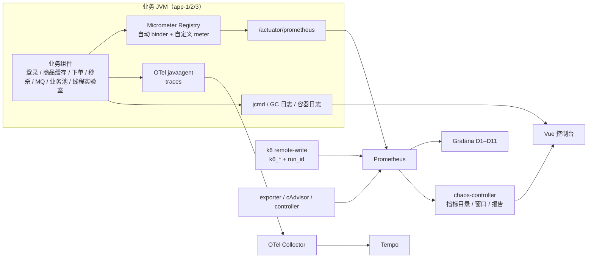

# 监测与可观测设计（JVM 业务 · 插装 · 采集 · 判定）

> 适用版本：2026-10-30，app-1/app-2 = JDK 21，app-3 = JDK 8。
> 本文回答三件事：**JVM 里跑了什么业务逻辑、JVM 如何被插装、每个部件为什么这样监测**。
> 指标口径以 [`process/Stage2/指标字典.md`](process/Stage2/指标字典.md) 为准，抓取裁剪见
> [`process/Stage2/step-S2-B5-06-metric-budget.md`](process/Stage2/step-S2-B5-06-metric-budget.md)。

## 1. 一张图看完整链路



## 2. JVM 里的业务组件（监测对象）

| 组件 | JVM 内职责 | 关键入口 | 主要监测 |
|---|---|---|---|
| HTTP 入口 | Spring MVC + Tomcat 接收 `/api/**` | `http_server_requests_*`、Tomcat binder | RPS、P95/P99、5xx、Tomcat 线程 |
| 登录 | 任意非空 userId 换 UUID token，写共享 Redis（TTL 1800） | `POST /api/login` | HTTP 指标 + Redis `login:token:*` |
| 商品读 | `CachedProductViewService` → L1 Caffeine → L2 Redis → DB | `GET /api/products/{id}` | `cache_l1_*` / `cache_l2_*` / `cache_db_fallbacks_*` |
| 缓存防御 | 穿透（null-cache/bloom）、击穿（mutex/logical-expire）、雪崩（ttl-jitter/l1-cache/db-fallback） | `/lab/cache/mode` | `cache_penetration_*` / `cache_breakdown_*` / `cache_avalanche_*` |
| 下单 | 幂等键 + 库存预占 + 订单插入（同一事务） | `POST /api/orders` | `orders_created_total`、`idempotent_reject_total`、`stock_oversold_total` |
| 秒杀准入 | 校验 → Redisson 锁 → Redis 幂等 → Lua 扣库存 → Rabbit 发布 → 202 | `POST /api/seckill/orders` | `seckill_attempts_total`、`order_accept_seconds_*` |
| MQ 消费 | 竞争消费秒杀消息，落订单并回写请求状态 | `seckill.order.queue` | `order_consumer_processed_total` |
| 库存 | 条件扣减，拒绝超卖 | `JpaInventoryRepositoryAdapter` | `stock_oversold_total` |
| 业务池 | 有界线程池 + 队列连接 MQ 消费与准入 | `businessExecutor` | `executor_*`、`executor_rejected_total` |
| 限流/熔断 | Resilience4j 程序化保护异步秒杀 | `SeckillResilienceGuard` | `resilience4j_*` |
| 线程实验室 | 7 种演示线程 + 生命周期 + 快照 | `/lab/thread/**` | `thread_lab_*` |
| 实验开关 | 每实例内存态 toggle（lock/idempotency/mq/ratelimit/circuitbreaker/cache） | `/lab/toggles` | 回读 `GET /lab/config` + 业务指标变化 |

## 3. JVM 插装（怎么做到）

### 3.1 Micrometer + Actuator

- 公共标签由 `platform-observability` 注入：`app`、`env`、`instance`、`jvm.version`
  （[ObservabilityAutoConfiguration.java:17-25](../code/platform/platform-observability/src/main/java/com/javalearn/lab/observability/ObservabilityAutoConfiguration.java#L17)）。
- 自动 binder 覆盖：JVM 内存/GC/线程/类加载/buffer、进程 CPU、Tomcat、HikariCP、Executor、HTTP。
- HTTP 直方图默认开启，并给 `http.server.requests` 配 50ms–2s 的 SLO 桶与 50ms–2s 的 expected-value
  （[ObservabilityEnvironmentPostProcessor.java:22-28](../code/platform/platform-observability/src/main/java/com/javalearn/lab/observability/ObservabilityEnvironmentPostProcessor.java#L22)）。
- 自定义业务 meter 与代码位置：

| 指标族 | 代码 |
|---|---|
| `cache_l1_requests` / `cache_l2_requests` / `cache_l1_hit_ratio` / `cache_l2_errors` | [`TwoLevelCache.java:146-236`](../code/services/seckill-app-jdk21/src/main/java/com/javalearn/lab/seckill/catalog/cache/TwoLevelCache.java#L146) |
| `cache_null_cache_*` / `cache_bloom_*` | [`NullValueMarkerStore.java:57-66`](../code/services/seckill-app-jdk21/src/main/java/com/javalearn/lab/seckill/catalog/cache/NullValueMarkerStore.java#L57)、[`ProductBloomFilterService.java:57-63`](../code/services/seckill-app-jdk21/src/main/java/com/javalearn/lab/seckill/catalog/cache/ProductBloomFilterService.java#L57) |
| `cache_breakdown_*` / `cache_avalanche_*` | [`ProductBreakdownDefense.java:325-335`](../code/services/seckill-app-jdk21/src/main/java/com/javalearn/lab/seckill/catalog/cache/ProductBreakdownDefense.java#L325)、[`ProductAvalancheDefense.java:101,254-264`](../code/services/seckill-app-jdk21/src/main/java/com/javalearn/lab/seckill/catalog/cache/ProductAvalancheDefense.java#L101) |
| `orders_created_total` / `idempotent_reject` | [`OrderMetrics.java:36-39`](../code/services/seckill-app-jdk21/src/main/java/com/javalearn/lab/seckill/order/app/OrderMetrics.java#L36) |
| `seckill_attempts_total` / `order_consumer_processed_total` / `stock_oversold_total` / `order_accept_seconds` | [`SeckillMetrics.java:51-92`](../code/services/seckill-app-jdk21/src/main/java/com/javalearn/lab/seckill/admission/app/SeckillMetrics.java#L51) |
| `executor_*` + `executor_rejected_total` | [`BusinessPoolConfig.java:41-56`](../code/services/seckill-app-jdk21/src/main/java/com/javalearn/lab/seckill/admission/config/BusinessPoolConfig.java#L41) |
| `thread_lab_injected_total` / `thread_lab_fault_active` / `thread_lab_participant_threads` | [`ThreadLabMetrics.java:37-61`](../code/services/seckill-app-jdk21/src/main/java/com/javalearn/lab/seckill/lab/thread/ThreadLabMetrics.java#L37) |
| `thread_lab_demo_transitions_total` / `thread_lab_demo_*` | [`LifecycleDemoMetrics.java:42-78`](../code/services/seckill-app-jdk21/src/main/java/com/javalearn/lab/seckill/lab/thread/LifecycleDemoMetrics.java#L42) |
| `thread_lab_snapshot_*` | [`ThreadSnapshotMetrics.java:51-78`](../code/services/seckill-app-jdk21/src/main/java/com/javalearn/lab/seckill/lab/thread/ThreadSnapshotMetrics.java#L51) |

### 3.2 健康门与实验开关

- 容器健康门 `/actuator/health/app`：**排除 Redis**（缓存 L2 是 best-effort，Redis 故障时读降级到 MySQL，
  实例必须保持 healthy），root health 仍如实报告 Redis
  （[application.yml:538-575](../code/services/seckill-app-jdk21/src/main/resources/application.yml#L538)）。
- 熔断/限流器不参与 health：故意 OPEN/无配额是实验结果，不是应用故障。
- toggle 是**每实例内存态**，读路径每请求检查（[LabToggleService.java:24-43](../code/services/seckill-app-jdk21/src/main/java/com/javalearn/lab/seckill/lab/toggle/LabToggleService.java#L24)），
  因此可以只降级一台做 A/B。

### 3.3 追踪（OTel）

- 应用镜像内含 OTel javaagent，入口参数 `-javaagent:/app/otel/opentelemetry-javaagent.jar`
  （[Dockerfile:35-43](../code/services/seckill-app-jdk21/Dockerfile#L35)）。
- 环境变量统一：`OTEL_SERVICE_NAME=seckill-app`、OTLP gRPC 到 `otel-collector:4317`、10% 比例采样
  （[compose.base.yml:205-217](../code/lab/docker/compose.base.yml#L205)）。
- Collector 只做 traces：OTLP → batch → Tempo（[otel-collector.yaml:1-36](../code/lab/docker/otel-collector/otel-collector.yaml#L1)）；
  metrics 仍走 Actuator，不双写。

### 3.4 JVM 诊断（GC 日志 / 线程快照）

- GC 日志由控制面下发 `-Xloggc` / `-Xlog:gc*`（JDK 21）或 `-Xloggc`（JDK 8），路径限制在快照目录
  （[InstanceConfigValidator.java:301-323](../code/services/chaos-controller/src/main/java/com/javalearn/lab/chaos/instance/InstanceConfigValidator.java#L301)）。
- 线程快照：
  - JDK 21：`jcmd Thread.print -l`、`jcmd GC.heap_info`、`jcmd GC.class_histogram`
    （[ThreadSnapshotService.java:77-79](../code/services/seckill-app-jdk21/src/main/java/com/javalearn/lab/seckill/lab/thread/ThreadSnapshotService.java#L77)）；
  - JDK 8：`jstack -l`、`jcmd GC.heap_info`、`jmap -histo[:live]`
    （[SnapshotCommands.java:18-27](../code/services/seckill-app-jdk8/src/main/java/com/javalearn/lab/seckill/jdk8/lab/snapshot/SnapshotCommands.java#L18)）。
- 控制台“容器日志/诊断事件”走控制器 Docker 日志扫描，识别 OOM、堆转储路径等。

## 4. 部件监测矩阵（组件 + 怎么做 + 为什么）

| 部件 | 监测方式 | 指标/数据 | 为什么需要 |
|---|---|---|---|
| 应用 HTTP | Micrometer HTTP binder + 直方图 | `http_server_requests_seconds_{count,bucket}`、状态码 | 判定 RPS、P95/P99、5xx；k6 阈值与分流口径 |
| JVM 内存/GC | Micrometer JVM binder | `jvm_memory_*`、`jvm_gc_pause_*`、`jvm_gc_memory_*` | 堆曲线、GC 次数/停顿；JDK/参数对比 |
| JVM 线程 | Micrometer + Tomcat | `jvm_threads_*`、`tomcat_threads_busy_threads` | 线程池/线程故障观测 |
| 商品缓存 | 自定义 counters + Caffeine binder | `cache_l1_*`、`cache_l2_*`、`cache_db_fallbacks_*` | 穿透/击穿/雪崩实验的判定依据 |
| 缓存防御 | 各防御类 counters | `cache_bloom_*`、`cache_null_cache_*`、`cache_breakdown_*`、`cache_avalanche_*` | 证明“模式切换后拦截发生在哪一层” |
| 预热 | 自定义 counters/timer | `cache_preheat_runs_total`、`_loaded_total`、`_duration_seconds_*` | 证明热点榜回填是否生效 |
| 订单 | 自定义 counters | `orders_created_total`、`idempotent_reject_total` | 幂等重放/真实下单区分 |
| 秒杀准入 | 自定义 counters + Timer | `seckill_attempts_total{result}`、`order_accept_seconds_*` | 准入结果分布、受理延迟 |
| MQ 消费 | 自定义 counters | `order_consumer_processed_total{result}` | 消费成功/重复/失败，验证异步闭环 |
| 库存 | 库存适配器 counter | `stock_oversold_total` | 业务正确性：超卖必须为 0 |
| 业务池 | Executor binder + 自定义拒绝计数 | `executor_pool_*`、`executor_active_threads`、`executor_queued_tasks`、`executor_rejected_total` | 池饱和/拒绝实验，配置重启后验证 |
| 限流/熔断 | Resilience4j micrometer | `resilience4j_circuitbreaker_state`、`resilience4j_ratelimiter_available_permissions` | 保护是否生效、是否 OPEN |
| 线程实验室 | 自定义 gauges/counters | `thread_lab_injected_total`、`thread_lab_fault_active`、`thread_lab_participant_threads`、`thread_lab_heap_leaked_bytes` | 故障注入后线程/堆/池的变化 |
| 登录 | HTTP + Redis | `login:token:*`（TTL）、HTTP 200 | 三实例共享 token store 的一致性 |
| Hikari | Hikari binder | `hikaricp_connections_{active,idle,pending,max}` | 连接池压力、Router 模式读写池 |
| Redis L2 | Redis exporter + 自定义 errors | `redis_up`、`redis_db_keys`、`redis_memory_used_bytes`、`cache_l2_errors_total` | Redis 故障降级、L2 键/TTL |
| MySQL | mysqld exporter | `mysql_up`、`mysql_global_status_questions/queries/threads_*` | QPS/连接数/可用性 |
| MySQL InnoDB Cluster | controller 只读探测 | `mysql_cluster_member_state`、`mysql_cluster_primary`、`mysql_cluster_probe_up` | 3 节点 ONLINE/PRIMARY、探针健康 |
| Redis Sentinel | data-node exporter + 脚本 | `redis_instance_info{role}`、`redis_connected_slaves`、`redis_master_link_up`、`sentinel-status.sh` | 主从角色与切换证据 |
| RabbitMQ | prometheus plugin + 队列 detailed | `rabbitmq_queue_messages_ready/unacked/delivered_total` | MQ 堆积与消费速率 |
| Nginx | nginx exporter | `nginx_connections_active`、`nginx_http_requests_total` | 入口流量与连接 |
| 容器 | cAdvisor | `container_cpu_usage_seconds_total`、`container_memory_working_set_bytes`、网络 | 资源口径；WSL2 下仅 root 序列 |
| 混沌动作 | controller 自定义 | `chaos_active_actions`、`chaos_actions_total`、`chaos_reverts_total` | 故障是否注入/回滚 |
| 压测 | k6 remote-write | `k6_http_reqs_total`、`k6_*_rate`、`k6_vus`、`k6_cache_lab_*` | 流量、错误率、阈值与归因 |
| 台账/报告 | controller 指标窗口 | `GET /lab/runs/{id}/metrics`、`/report`、`/export` | 单次实验复盘与对比 |

## 5. 业务监测逻辑（看什么 → 判断什么）

1. **缓存穿透**：`off` 下每个不存在 id 都会触发 `cache_db_fallbacks{reason="miss"}` 与一次 DB 查询；
   切 `null-cache` 后看 `cache_null_cache_requests{result="hit"}`，切 `bloom` 后看
   `cache_bloom_requests{result="absent"}`。拦截发生在哪层，由对应 counter 增量证明。
2. **缓存击穿**：`mutex` 下看 `cache_breakdown_mutex{result}` 与回源次数；`logical-expire` 下看
   `cache_breakdown_logical`、后台刷新数与 P95（回源被异步化）。
3. **缓存雪崩**：`ttl-jitter` 看 `cache_avalanche_ttl_jitter`；`l1-cache` 看 L1 命中与
   `cache_avalanche_l1*`；`db-fallback` 看 `cache_avalanche_limiter{result}` 与
   `cache_db_fallbacks` 是否被限流。D10 按时间窗对齐 k6 的 `k6_cache_lab_mode_switches_total`。
4. **缓存 A/B**：L1 开关关闭时 `cache_l1_enabled=0`、L1 请求直达 L2；比较 P95、L2 请求速率与 DB 回源，
   差值只在 L1 这一个变量上。
5. **下单/幂等/超卖**：真实插入看 `orders_created_total`，重放看 `idempotent_reject_total`；
   超卖必须 `stock_oversold_total=0`，业务对账器再核对库存扣减与订单增量。
6. **异步秒杀**：`seckill_attempts_total{result=accepted|sold_out|rate_limited|error}` 看准入分布；
   `order_accept_seconds` 看受理耗时；`order_consumer_processed_total` 看消费闭环。
7. **业务池**：`executor_active_threads`/`executor_queued_tasks` 接近上限、`executor_rejected_total` 增长，
   说明池或队列不够；改配置后重启，再从 `/lab/pool` 回读验证。
8. **限流/熔断**：`resilience4j_ratelimiter_available_permissions` 归零 → 429；
   `resilience4j_circuitbreaker_state` 从 CLOSED→OPEN → 503/降级，均为预期实验结果。
9. **JVM/GC**：`jvm_memory_used_bytes`、`jvm_gc_pause_seconds_*`、分配/晋升速率看堆行为；
   JDK 21/app-3 的分代差异用 D7 面板 `jvm_version` 标签区分，不比较不可得指标。
10. **实例分流/故障**：`up{job="seckill-app"}`、`http_server_requests_seconds_count` 按 instance 增量、
    Nginx exporter、`GET /lab/runs/{id}/instance-stats` 三路对齐；kill/freeze 由 `chaos_*` 与 up 变化确认。
11. **MySQL/Redis HA**：`mysql_cluster_*` 看 3/3 ONLINE 与 PRIMARY；`redis_instance_info{role}`、
    `redis_master_link_up` 看主从；Router 无原生指标，用 6446/6447 探针与 Hikari 读写池间接判断。
12. **业务正确性**：`POST /lab/runs/{id}/reconcile` 七项检查（订单增量/库存扣减/非负/重复订单/重复幂等键/
    超卖计数/MQ 排空），不只看性能阈值。

## 6. 采集与可视化链路

### 6.1 Prometheus 抓取

| job | 目标 | 用途 |
|---|---|---|
| `seckill-app` | app-1/2/3 `/actuator/prometheus` | 业务/JVM/缓存/HTTP |
| `seckill-app-jdk8` | D7 壳 | 双 JDK 对比 |
| `nginx-exporter` / `redis-exporter` / `mysqld-exporter` / `rabbitmq` / `rabbitmq-queue` | dev 单机与 broker | 入口/缓存/DB/MQ |
| `mysqld-exporter-ha` / `redis-exporter-ha` | 3 MySQL / 2 Redis 节点（`member`/`node` 标签） | HA 面板 |
| `cadvisor` | 容器 | 资源 |
| `chaos-controller` | 控制器 `/metrics` | 混沌动作/集群探针 |

配置与裁剪见 [prometheus.yml](../code/lab/docker/prometheus/prometheus.yml)：
- `orders_total` → `orders_created_total`（Micrometer/OpenMetrics 命名差异）；
- `rabbitmq_detailed_queue_*` → `rabbitmq_queue_*`（D4 队列面板）；
- 只保留有消费者的指标（exporter keep-list、app/controller drop），抓取面约 6k series。

### 6.2 k6 → Prometheus

`run.sh` 固定 `-o experimental-prometheus-rw`（[run.sh:320](../code/lab/k6/run.sh#L320)），
`systemTags` 只保留 `status/method/expected_response/error/error_code`（[config.js:343-353](../code/lab/k6/lib/config.js#L343)），
`run_id` 打在全部 k6 序列上；趋势统计为 `p(95),p(99),max`。这是“流量层”的独立证据，不依赖应用自报。

### 6.3 控制台/报告的聚合

- 控制器只执行**版本化目录**里的 PromQL（[catalog.yml](../code/services/chaos-controller/src/main/resources/metrics/catalog.yml)），
  禁止任意查询；窗口查询见 [MetricsService.java:88](../code/services/chaos-controller/src/main/java/com/javalearn/lab/chaos/metrics/MetricsService.java#L88)。
- 空结果不补 0：`OK / NO_DATA / COLLECTING / DEGRADED` 分级；抓取间隔内没有样本会明确返回
  “no samples yet”而不是 0。
- run 报告/导出/克隆使用同一窗口与目录 key；业务对账单独判定。

### 6.4 Grafana

10 个 JSON 文件、10 张面板（`ha-d1..d11` 去掉 D5，D5 由 Tempo UI 承担）：D1 应用总览、D2 JVM 与线程、D3 资源与网络、
D4 业务与高可用、D6 线程实验室、D7 JDK 对比、D8 JVM 调优、D9 压测、D10 缓存实验室、D11 数据库高可用。
面板通过 `grafana/provisioning/dashboards` 声明式加载，不依赖手工导入。

## 7. 口径与已知边界

- `_info` 会被 Micrometer 剥掉（如 `mysql_cluster_primary_info` → `mysql_cluster_primary`）；`_created` 也一样，
  所以 `orders_created_total` 在 JDK21 原始抓取里叫 `orders_total`，由 Prometheus relabel 统一。
- JDK8 与 JDK21 的指标名/集合不完全相同：JDK8 无 `jvm_info`、`jvm_gc_overhead`、
  `http_server_requests_active_seconds_*`，`jvm_memory_usage_after_gc` 为 `_percent` 命名；
  D7 只使用两边共有的家族，不用 0 伪造缺失。
- `cache_db_fallbacks` 在 `miss` 与 `penetration` 下可能对同一次查库双计；D10 的“占比”讲解时要说明。
- 全新安装没有实验数据集时，`cache:product:90000..90999` 不存在，需要先 seed；商品缓存键由预热产生。
- 缓存键抽屉默认前缀 `cache:product:`，默认 limit 100；稀疏前缀下前几页可能为空，按游标继续翻。
- cAdvisor 在 Docker Desktop/WSL2 只能看到 root cgroup，per-container 序列缺失；这是环境限制，不是采集坏了。
- 受控重建必须保留 app 的全部网络（`jl-net + jl-sentinel-net`）。只保留主网络会让 Sentinel 模式实例
  不可达 Redis，进而让 Prometheus 抓取超时、KPI 全空；重建网关见
  [`DockerInstanceRebuildGateway.java`](../code/services/chaos-controller/src/main/java/com/javalearn/lab/chaos/instance/DockerInstanceRebuildGateway.java)。
- app-3 没有线程实验室端点（UI 已标 N/A），D6 只对 app-1/2 有数据；
- HA 模式的 app 写 `jl-redis-1`，dev 单机 `jl-redis` 只给 D7 壳/工具用；排查 Redis 键不要看错实例。

## 8. 快速排查

```bash
# 目标是否在抓
curl -s 'http://127.0.0.1:8080/prom/api/v1/targets?state=active' | jq '.data.activeTargets[]|{job:.labels.job,instance:.labels.instance,health}'

# 单个 app 的原始指标（容器内没有 curl，用 wget）
docker exec jl-app-1 sh -c 'wget -qO- http://127.0.0.1:8080/actuator/prometheus' | head

# KPI 窗口（控制台同一接口）
curl -H 'X-Lab-Token: lab-token' \
  'http://127.0.0.1:8080/lab-api/lab/metrics/window?from=...&to=...&keys=http.rps,jvm.heap.used&phase=adhoc'

# 缓存键与 TTL
docker exec jl-app-1 sh -c 'wget -qO- --header="X-Lab-Token: $LAB_TOKEN" \
  "http://localhost:8080/lab/cache/keys?limit=100"'

# 线程快照
ls doc/process/Stage1/snapshots/
# GC 日志（配置下发时启用）
docker exec jl-app-1 sh -c 'ls -l /app/lab-snapshots/gc-*.log'
```

常见症状 → 检查顺序：

1. **KPI/面板全空**：先看 `up{job="seckill-app"}`；target down 时再检查 app 网络（`jl-net` + `jl-sentinel-net`）、
   Redis 可达性、`/actuator/prometheus` 响应时间。
2. **只有 app-3 空**：它是 JDK8，先看 D7 是否只查共有指标；线程实验室 N/A 是预期。
3. **Redis 键/指标看不到**：确认看的是 `jl-redis-1`（HA 主）还是 `jl-redis`（dev 单机）；实验数据集是否已 seed。
4. **分流比例不对**：看 `instance-stats` 的窗口是否覆盖 k6 起止；排除 `/actuator/**`；确认没有背景流量。
