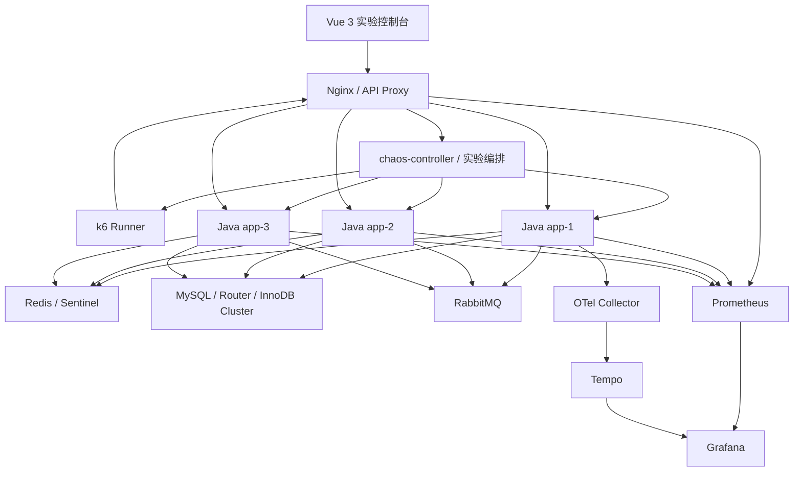

# Stage2 改造方案：Java 并发与高可用演练工作台

- 文档版本：v1.0
- 日期：2026-10-27
- 基线：Stage1 当前实现与设计文档
- 状态：方案评审稿
- 范围：在 Stage1 基础上进行增量改造；本文件不代表代码已经实现

---

## 1. 方案摘要

Stage2 将现有 Java 高并发与高可用教学实验室，改造成一套可从 UI 完成配置、启动、观测、故障注入、压测、对比和复盘的实验工作台。

改造原则：

1. **保留 Stage1 已有架构与实验能力**，优先复用 Docker Compose、Nginx、Java 应用、chaos-controller、k6、Prometheus、Grafana、Tempo、OTel Collector、Redis、MySQL、RabbitMQ 及现有实验脚本。
2. **控制台成为统一入口**：常用控制和关键指标直接呈现在 UI；Grafana 继续承担深度监控与探索，不用自研图表替代全部 Grafana 能力。
3. **相同业务代码，不同运行配置**：多个负载均衡 Java 实例可以配置不同 JDK、JVM 参数、线程池参数及缓存策略，以观察不同配置在相同流量下的差异。
4. **每次实验可复现**：保存配置快照、数据规模、压测参数、故障时间线、监控窗口、阈值结果和业务对账。
5. **区分“目标配置”和“实际状态”**：UI 中的目标 key 数、JVM 参数或故障状态，只有经过后端确认后才能显示为实际生效。
6. **本项目是本地演示实验室**，不是生产级秒杀平台；不引入复杂多租户、生产级权限体系或集群自身 HA。

## 2. Stage1 基线与改造边界

### 2.1 已有基础（按当前文档记录）

- Nginx 作为统一入口，负载均衡到 `jl-app-1/2/3`。
- Java 应用基于相同业务主链路；设计包含 JDK 21 与可选 JDK 8 外壳。
- `chaos-controller` 管理容器故障动作、实验向导、日志与状态探针。
- 有线程实验室、缓存实验、Redis Sentinel、MySQL InnoDB Cluster + Router、RabbitMQ 异步链路等实验基础。
- Prometheus + Grafana 采集和展示应用、JVM、容器、Redis、MySQL、Nginx、RabbitMQ 等指标；Tempo/OTel 提供链路追踪。
- k6 已有 smoke/load/stress/spike/soak 等场景及 cache/HA/DB 故障相关场景；已有 `bench.sh`、`compare.sh`、报告归档与部分 `run_id` 关联能力。
- UI 已有拓扑、场景向导、线程、缓存、JVM 调优、JDK 对比和 benchmark 等页面基础。

### 2.2 已知缺口与限制

- 部分正式压测仍需在终端执行，尚未完全纳入 UI 的完整执行闭环。
- `bench.sh` 当前支持的场景白名单少于 k6 Runner 本身支持的场景；需统一可执行场景目录。
- 现有 compare 以两次 run 为主；业务对账、N 次实验查询和历史检索需要完善。
- k6 指标带 `run_id`，但应用侧常规 Micrometer 指标没有相同的 run 标签；首期应用指标应按实验时间窗口聚合，并明确显示关联口径。
- `TwoLevelCache` 有 Caffeine L1 + Redis L2，但 L2 TTL 当前为硬编码；有整体缓存开关，缺少独立的 Caffeine-only 开关。
- Caffeine 已启用 `recordStats()`，但统计尚未完整绑定到 Micrometer；L1 条目数、命中率和驱逐指标需要补齐。
- 缓存状态接口以计数为主，没有完整的键分页、单键值/TTL 查询接口。
- Redis 没有“最大 key 数”原生配置；应通过实验数据播种控制目标规模，以业务前缀统计实际数量，不能把 Redis 内存限制当作 key 数限制。
- 应用代理存在路径白名单和 query string 转发限制；新增缓存查询 API 时需要同步修复代理路径、请求体和响应大小限制。
- 某些业务指标当前只注册未在真实业务路径递增，例如 `stock_oversold_total`；必须修复或由真实库存/订单对账补足，不能把恒为 0 当成通过。
- 故障动作 TTL、手动保持、单项撤销、超时反馈、恢复后健康确认及状态呈现需要统一。
- Redis Sentinel / MySQL HA 等部分 exporter 或指标接线需要按当前环境复核，不能只依据仪表盘存在就判定采集正常。

### 2.3 Stage2 非目标

- 不重写业务领域和现有故障实验。
- 不把所有 Grafana 仪表盘迁移到 Vue。
- 不开放任意 Docker 命令、任意 shell 或无限制 JVM 参数输入。
- 不把关闭 Redis 与模拟 Redis 故障混为一谈。
- 不在 Prometheus 中给所有应用指标随意增加高基数 `run_id` 标签。
- 不承诺在同一运行进程内热修改所有 JVM 启动参数。

## 3. 目标架构



### 3.1 新增/强化的逻辑模块

1. **实验配置与台账**：创建 run、保存参数快照、状态转换、历史查询。
2. **实例配置管理**：管理每个 Java 实例的 JDK 镜像、JVM 启动参数和运行时应用配置。
3. **Benchmark 执行器**：通过白名单启动 k6 容器，管理日志、停止、超时和报告生成。
4. **指标查询聚合**：通过 Prometheus HTTP API 获取核心指标，按实例和实验时间窗口归集。
5. **缓存实验服务**：数据播种、预热、实际键数量核验、L1/L2 开关与键查询。
6. **故障剧本**：统一故障启动、暂停、恢复、TTL、单项撤销和全局急停。
7. **业务对账器**：检查库存、订单、幂等和消息队列最终状态。

以上模块优先作为现有 chaos-controller、应用 `/lab/**`、脚本和 Vue 页面上的增量改造，不为每项能力新增独立微服务。

## 4. 多 Java 实例的 JVM 与应用配置

### 4.1 目标

`jl-app-1/2/3` 使用相同源码版本与业务代码，通过每个实例独立的运行配置，支持比较不同 JVM、GC、堆参数和缓存策略。

示例：

| 配置 | app-1（基线） | app-2（实验组 A） | app-3（实验组 B） |
|---|---|---|---|
| 应用源码版本 | 相同 | 相同 | 相同 |
| JDK | 21 | 21 或已验证的 8 外壳 | 21 |
| `-Xms/-Xmx` | 256m/512m | 128m/256m | 512m/512m |
| GC | 默认/已验证配置 | Parallel 或适用配置 | G1 或适用配置 |
| Caffeine L1 | 开 | 关 | 开 |
| L1 最大条目数 | 10,000 | 不适用 | 20,000 |
| L2 TTL | 300s | 300s | 600s |
| 线程池参数 | 基线 | 实验参数 A | 实验参数 B |

以上数值仅为示例，实际可选项必须受当前镜像、JDK 版本和资源预算约束。

### 4.2 配置类型与生效方式

| 配置类别 | 示例 | 生效方式 |
|---|---|---|
| 镜像/运行时 | JDK 8、JDK 21、已验证镜像 tag | 重建或替换容器 |
| JVM 启动参数 | `-Xms`、`-Xmx`、GC 选择、GC 日志 | 重启 JVM |
| 容器资源 | CPU quota、memory limit | 容器重建或受控更新 |
| 运行时应用参数 | Caffeine 开关、缓存 TTL、熔断/限流 | 通过受控应用配置 API 动态生效，或按实现要求重启 |
| 实验参数 | VU、持续时间、阈值、故障时间 | 仅作用于本次 run |

UI 应明确显示配置状态：`草稿`、`校验失败`、`待重启`、`应用中`、`已生效`、`应用失败`。启动参数不能伪装成热更新。

### 4.3 JDK 8 / 21 约束

- 只允许选择已构建、已测试的应用镜像。
- JDK 8 与 JDK 21 应通过对应的应用外壳/构建目标提供；不能仅把容器内 `JAVA_HOME` 指向另一个路径就认为完成切换。
- 公共业务代码应保持兼容的编译目标；依赖、Spring Boot 版本与 Java 版本必须匹配。
- 每个实例暴露 `app`、`instance`、`jvm.version`、`app.version` 等低基数标签。
- 报告记录源码 commit、镜像 tag/digest、Java 版本和有效启动参数。

### 4.4 安全和资源限制

- JVM 参数由后端白名单和类型规则校验，禁止任意 shell 参数或挂载路径。
- 校验 `-Xmx` 与容器内存限制的关系，预留 Metaspace、线程栈、直接内存和 native 开销。
- OOM 故障仅能作用于专用小堆实验实例，且必须有恢复路径。
- 重启前检查是否存在正在执行的 benchmark；默认要求先结束当前 run。
- 每次配置应用保留前后快照、实例名、时间、结果和失败原因。

## 5. 缓存实验改造

### 5.1 必须新增的能力

- 独立控制每个 Java 实例的 Caffeine L1 开关。
- 保留 Redis L2 开关/故障模式，但区分“正常关闭 L2”和“Redis 不可用”。
- 配置 L1 最大容量、刷新/过期参数和 L2 TTL。
- UI 设置目标 Redis 业务缓存键数，执行 seed 后核验实际数量。
- 展示每个 Java 实例 Caffeine 的实际条目数、命中/未命中、命中率和驱逐数。
- 展示 Redis 业务缓存键数、内存、命中/未命中、错误、TTL 与驱逐信息。
- 提供分页键列表；值仅在查询单个键时按需读取，并限制返回字节数。
- 支持预热、清理/重置、实际数量复核和缓存实验报告。

### 5.2 计数口径

- Redis 业务缓存键只按已定义的商品缓存前缀统计，例如 `cache:product:*`；不把锁、Bloom、空值标记、热点 ZSet 等其他命名空间计入商品缓存键数量。
- Redis 使用 `SCAN` 分页，禁止在在线实验接口使用 `KEYS`。
- Caffeine 是每个 JVM 的本地缓存，分别显示 app-1/app-2/app-3 的数据。
- `maximumSize` 是容量上限，不是当前条目数；当前数量应使用实际缓存状态/估算条目数。
- UI 必须分开显示目标数、实际数、差值、播种状态和核验时间。
- Caffeine 关闭时显示“不适用/已关闭”，不能显示为采集失败。

### 5.3 缓存对照实验矩阵

| 实验组 | Caffeine L1 | Redis L2 | 目的 |
|---|---|---|---|
| A：两级缓存 | 开 | 开 | 基准 |
| B：仅 Redis | 关 | 开 | 测量 L1 对延迟、吞吐与回源的影响 |
| C：Redis 故障 | 开 | 故障 | 观察本地缓存兜底和降级行为 |
| D：两级均不可用 | 关 | 故障 | 观察回源、限流、降级与错误 |

A/B 是第一优先级。对照实验需使用相同数据集、请求比例、VU、持续时间、实例数、JVM 参数及预热流程。若测试写业务数据，必须执行可验证的数据复位。

### 5.4 建议新增接口（示例契约，需与现有 API 风格统一）

| 方法 | 路径 | 用途 |
|---|---|---|
| `GET` | `/lab/cache/l1/state` | 查询指定实例或当前实例 L1 开关和统计 |
| `POST` | `/lab/cache/l1/config` | 修改 L1 开关/容量等白名单参数 |
| `POST` | `/lab/cache/seed` | 扩展为可设置目标数据规模并返回播种结果 |
| `GET` | `/lab/cache/keys` | 分页列出指定业务前缀的键（cursor/limit） |
| `POST` | `/lab/cache/key` | 查询单个键的 L1/L2 状态、值预览和 TTL |
| `GET` | `/lab/cache/state` | 保留汇总状态并补充目标/实际数量与采集时间 |

如果现有接口命名或 DTO 更合适，可在实现时调整，但需保留上述语义。当前代理会丢弃 query string 的问题要先修复，或对查询参数采用 POST body，并将新路径加入严格白名单。

## 6. 指标与观测

### 6.1 监控原则

- Prometheus 继续作为指标存储和查询入口。
- Grafana 保留完整仪表盘、Explore 和历史查询能力。
- Vue 控制台展示实验最常用的 KPI、按实例指标、状态和对比表，并可嵌入 Grafana 面板或跳转到带时间范围的 Grafana/Tempo 页面。
- 所有面板显示数据时间、实例维度和缺失数据状态；没有序列时显示“无数据”，不显示虚构的 0。
- 应用指标优先用低基数标签；禁止将 userId、订单号、traceId、原始 URL 等作为指标标签。

### 6.2 必须覆盖的指标目录

#### HTTP / k6
- RPS、请求总量、成功率、失败率、状态码分布。
- P50/P90/P95/P99、最大延迟；只有采集端提供真实分位数时才展示。
- k6 VU、迭代数、检查失败、超时、连接错误。
- 阈值 PASS/FAIL 与阈值详情。

#### JVM
- 堆 used/committed/max、非堆/Metaspace、BufferPool/直接内存（采集可用时）。
- Live/Peak/Daemon 线程数与线程状态分布。
- GC 次数、耗时、暂停时间与长暂停；GC 类型。
- 进程/容器 CPU、容器 RSS、重启次数、OOM/堆转储事件。
- Java 版本、JVM 参数、镜像版本和配置变更时间。

#### Web、业务线程池、数据库连接池
- Tomcat 当前/忙碌/最大线程数及连接数（按实际采集能力）。
- 业务线程池 Active、Pool size、Core/Max、Queue、Remaining capacity、Completed、Rejected。
- Hikari active/idle/pending/max/total、连接获取耗时、超时/失败。
- 线程故障注入数、活动故障数、恢复数、快照和故障模式。

#### Caffeine / Redis
- L1 开关、每实例条目数、命中/未命中、命中率、驱逐数、预热加载数/耗时/失败数。
- L2 命中/未命中/错误、业务键数量、内存、驱逐、连接数、命令速率。
- DB fallback 次数和原因；穿透、击穿、雪崩、互斥锁、逻辑过期、TTL 抖动等防护计数。
- 单键 TTL 和缓存状态（通过按需查询接口展示，不将键名/值放入 Prometheus 标签）。

#### MySQL / HA
- QPS/TPS、查询与事务耗时、连接数、慢查询、锁等待、死锁（以可采集指标为准）。
- Hikari 读写池状态、Router 读写路径。
- InnoDB Cluster 成员状态、PRIMARY、ONLINE 状态与故障转移事件。
- 库存基线、剩余库存、扣减量、订单新增量和对账结果。

#### Redis / RabbitMQ / Nginx / 容器
- Redis 角色、复制状态、Sentinel 主节点切换、内存和驱逐。
- RabbitMQ Ready/Unacked、发布/消费速率、失败、积压和排空时间。
- Nginx 请求速率、上游响应时间、状态码和失败数。
- 容器 CPU、内存、重启、健康检查；网络指标在当前 WSL2/cAdvisor 环境实际可用时展示，否则标记为降级项。
- Toxiproxy 的延迟、带宽、断网状态和生效时间。

#### 熔断、限流、业务正确性
- 熔断状态及切换次数、慢调用/失败率、限流通过/拒绝、降级次数。
- `seckill_attempts_total{result}`、`order_consumer_processed_total{result}`、`orders_created_total`、`idempotent_reject_total`、`order_accept_seconds`。
- 修复 `stock_oversold_total` 的真实递增路径，或将其标记为未接线；最终判定以真实业务对账为准。
- 订单新增量、订单数量合计、库存变化、重复订单/幂等键、消息队列排空状态。

### 6.3 UI 指标布局

- 顶部 KPI：RPS、P95/P99、失败率、VU、运行时长、实验状态。
- JVM 行：每个实例一列，堆、GC、CPU、线程数。
- 线程池/连接池：Active、Queue、Rejected、Pending。
- 缓存行：L1/L2 开关、条目数、命中率、DB fallback。
- 业务正确性：订单、库存、超卖、幂等、队列排空。
- 时间线：k6 开始/结束、配置应用、故障注入/恢复、异常事件。
- 深度分析：Grafana 面板、Tempo trace 链接。

## 7. k6 执行、归档与比较

### 7.1 UI 可配置参数

- 场景：`smoke`、`load`、`stress`、`spike`、`soak`、缓存对比、DB/Redis HA 故障等经验证的白名单场景。
- VU/阶段曲线、持续时间、预热时间、请求比例、数据规模。
- 目标配置组/实例配置、缓存策略、阈值。
- 故障剧本、故障目标、开始时间、持续时间、自动 TTL 或手动保持。
- 数据复位策略、结束后业务对账选项。

UI 只提供后端已实现且通过验收的场景，不直接拼接任意 shell 命令。

### 7.2 执行器设计

- 由 chaos-controller 或现有脚本执行层启动固定版本的 k6 Runner 容器。
- 镜像、命令、参数、挂载路径、运行时长、并发 run 数量均受白名单限制。
- 返回唯一 `run_id`、状态、日志、开始/结束时间和退出结果。
- 支持停止、超时清理、失败恢复与报告归档。
- 执行期间禁止重复启动同一资源冲突场景；对于数据会互相污染的场景，默认只允许一个活动 run。

### 7.3 实验台账

每次 run 至少记录：

- `run_id`、场景、状态、创建/开始/结束时间、退出码。
- 源码 commit、应用镜像、JDK/JVM 参数和每个实例的有效配置快照。
- k6 场景参数、阈值、请求比例、数据集/库存基线。
- L1/L2 开关、目标/实际键数、TTL、预热结果。
- 故障动作、目标、开始/结束时间、恢复状态。
- k6 汇总、Prometheus 时间窗口、业务对账结果、最终判定。
- 报告文件位置和 Grafana/Tempo 深链。

第一期应用指标按 `[run_start, run_end]` 时间窗口查询，并在报告里标注窗口口径；k6 自身指标按 `run_id` 过滤。不要为了 UI 方便就给所有应用指标添加高基数 run 标签。

### 7.4 比较报告

至少支持两次 run 横向对比；建议台账接口设计支持后续 N 次比较。指标包括：

- RPS、总请求数、成功/失败率、P95/P99。
- JVM 堆峰值、GC 暂停、线程峰值、CPU。
- 线程池队列与拒绝数、Hikari pending。
- L1/L2 命中率、DB fallback、键数量。
- MySQL/Redis/MQ 状态、故障恢复时间。
- 订单、库存、幂等和队列排空对账。
- 每项指标差值、百分比变化和实验阈值结果。

### 7.5 公平性规则

比较两组配置时，除要比较的变量外，其余变量尽量一致：源码版本、数据集、VU、持续时间、请求比例、实例数、依赖拓扑、JVM 其他参数、缓存预热策略和资源预算。若实验专门比较不同 JVM/GC，则要把 JVM/GC 作为显式变量，并保存完整配置快照。

## 8. 故障注入闭环

统一现有故障动作与向导能力，支持：

- 选择目标容器/实例及故障类型。
- 自动 TTL 或手动保持（manual hold）。
- 暂停/继续实验时冻结/恢复 TTL 计时。
- 查看实际动作状态、剩余时间、最后错误和容器健康状态。
- 单项撤销、目标恢复、全局“全部停止”与全量重置。
- 将故障事件记录到 run 时间线。
- 对 start/restart/resume 类动作，在 UI 中区分“请求已接受”和“容器健康已恢复”。

首批场景优先覆盖：
1. Java 实例 kill/restart/freeze/resume。
2. 七种线程实验和线程快照。
3. Caffeine 开/关、缓存穿透/击穿/雪崩。
4. Redis 故障和 Sentinel 切换。
5. MySQL 主节点故障与 Router 路由。
6. Toxiproxy 延迟、带宽限制、断网。
7. 熔断、限流和降级。
8. RabbitMQ 消费积压与恢复。

所有动作限定在 `lab=java-learn` 的实验容器，并继续使用现有 token/白名单机制。

## 9. 简单 UI 设计（Markdown 线框图）

以下线框图是页面布局建议，不是实际运行截图。

### 9.1 总览 `/`

```text
┌──────────────────────────────────────────────────────────────────────┐
│ Java 并发与高可用演练台   环境：DEV/HA   状态：干净   [全部停止] [重置] │
├────────────┬─────────────────────────────────────────────────────────┤
│ 总览       │ 当前实验：cache-lab             Run ID：run-20261027-001 │
│ 场景向导   │ 状态：运行中  运行时长：02:31    [暂停] [停止] [查看报告] │
│ 实例/JVM   ├──────────────┬──────────────┬──────────────┬─────────────┤
│ Benchmark  │ RPS          │ P95          │ 错误率       │ VU          │
│ 缓存实验   │ 1,240        │ 86 ms        │ 0.2%         │ 100         │
│ 线程实验   ├──────────────┴──────────────┴──────────────┴─────────────┤
│ 故障时间线 │ 实时曲线：RPS / P95 / P99 / 错误率 / CPU / GC             │
│ 监控面板   ├─────────────────────────────────────────────────────────┤
│ 实验记录   │ app-1 健康 | app-2 健康 | app-3 故障中 | Redis 正常       │
│            │ 最近事件：10:02:01 app-3 freeze；10:02:20 请求失败上升    │
└────────────┴─────────────────────────────────────────────────────────┘
```

### 9.2 实例/JVM `/instances`

```text
┌──────────────────────────────────────────────────────────────────────┐
│ 实例与 JVM 配置                                      [校验全部] [应用] │
├──────────┬───────────────┬──────────────┬──────────────┬──────────────┤
│ 实例     │ app-1         │ app-2        │ app-3        │              │
│ 源码版本 │ 同一 commit   │ 同一 commit  │ 同一 commit  │              │
│ JDK      │ [21 ▼]        │ [21 ▼]       │ [8 ▼]        │              │
│ 镜像     │ [jdk21 ▼]     │ [jdk21 ▼]    │ [jdk8 ▼]     │              │
│ Xms/Xmx  │ [256/512 MB]  │ [128/256 MB] │ [256/512 MB] │              │
│ GC       │ [G1 ▼]        │ [Parallel ▼] │ [适用选项 ▼] │              │
│ Caffeine │ [开 ▼]        │ [关 ▼]       │ [开 ▼]       │              │
│ L1 上限  │ [10000]       │ [—]          │ [10000]      │              │
│ 状态     │ 已生效        │ 待重启       │ 已生效       │              │
├──────────┴───────────────┴──────────────┴──────────────┴──────────────┤
│ 提示：JDK/GC/堆参数需要重启；应用前显示变更差异、内存校验和影响范围。   │
└──────────────────────────────────────────────────────────────────────┘
```

### 9.3 缓存实验 `/cache`

```text
┌──────────────────────────────────────────────────────────────────────┐
│ 缓存实验：L1/L2 对照                         [生成数据] [预热] [核验] │
├──────────────────────────────┬───────────────────────────────────────┤
│ 配置                         │ 实际状态                              │
│ app-1 Caffeine：[开 ▼]       │ app-1 L1：4,820 / 上限 10,000         │
│ app-2 Caffeine：[关 ▼]       │ app-2 L1：已关闭                      │
│ app-3 Caffeine：[开 ▼]       │ app-3 L1：4,790 / 上限 10,000         │
│ Redis L2：[开 ▼]             │ Redis 业务键：目标 10,000 / 实际 9,980│
│ 目标 Redis 键数：[10000]     │ L1 命中率：app-1 82% / app-3 80%      │
│ L1 最大容量：[10000]         │ L2 命中率：91%   DB fallback：2.1%    │
│ L2 TTL：[300 秒]             │ 最近核验：10:03:15                    │
├──────────────────────────────┴───────────────────────────────────────┤
│ [运行 A：L1 开 + L2 开] [运行 B：L1 关 + L2 开] [比较 A/B]            │
├──────────────────────────────────────────────────────────────────────┤
│ 键查询：前缀 [cache:product:*] [查询]                                 │
│ Key                         L1 状态    Redis 状态   TTL    [查看单键] │
│ cache:product:1001          命中       存在         242s   [查看]     │
│ cache:product:1002          未命中     存在         180s   [查看]     │
└──────────────────────────────────────────────────────────────────────┘
```

### 9.4 Benchmark `/bench`

```text
┌──────────────────────────────────────────────────────────────────────┐
│ Benchmark                                      [新建实验] [停止活动] │
├──────────────────────────────────────────────────────────────────────┤
│ 场景：[load ▼]  VU：[100]  时长：[5m]  预热：[30s]  阈值：[默认 ▼]    │
│ 配置组：[cache-A ▼] 数据规模：[10000] 故障剧本：[无 ▼]                │
│ 数据复位：[压测前复位 ☑]  结束后对账：[☑]          [预检查] [启动]    │
├──────────────────────────────────────────────────────────────────────┤
│ 最近运行                                                               │
│ Run ID           场景       状态      RPS    P95    错误率  业务对账   │
│ run-001          load       PASS      1240   86ms   0.2%   PASS      │
│ run-002          cache-B    FAIL      980    130ms  1.8%   PASS      │
├──────────────────────────────────────────────────────────────────────┤
│ 选择 run-001 与 run-002：[比较]                                        │
│ RPS +26.5% | P95 -33.8% | 错误率 -1.6pp | L1 命中率差值 | 报告/面板   │
└──────────────────────────────────────────────────────────────────────┘
```

### 9.5 监控与故障时间线 `/observe`

```text
┌──────────────────────────────────────────────────────────────────────┐
│ 实时观测      实例：[全部 ▼] 指标组：[线程池 ▼] 时间：[当前 Run ▼]     │
├──────────────────────────────────────────────────────────────────────┤
│ [RPS/P95/P99 曲线]                    [JVM 堆/GC/CPU 曲线]             │
├──────────────────────────────────────────────────────────────────────┤
│ 实例     Busy Threads   Pool Active   Queue   Hikari Pending  状态     │
│ app-1    42             18            0       0               正常     │
│ app-2    80             32            120     6               警告     │
│ app-3    0              0             0       0               已冻结   │
├──────────────────────────────────────────────────────────────────────┤
│ 事件时间线：10:02 开始压测 → 10:03 app-3 freeze → 10:03 延迟上升       │
│              → 10:04 恢复 app-3 → 10:05 错误率回落                   │
│ [打开 Grafana 当前时间范围] [打开 Tempo trace] [下载快照]             │
└──────────────────────────────────────────────────────────────────────┘
```

### 9.6 页面交互规则

- 所有会影响运行环境的按钮显示目标实例、当前值、预期影响和是否需要重启。
- 执行中的操作有超时、进度、结果和失败原因，不让 UI 无限等待。
- “已请求”与“已生效/已恢复”是不同状态。
- 全局“全部停止”始终可用；全量重置前显示将被清理的故障与数据范围。
- 指标无数据时显示“无数据/采集异常”，不显示伪造的 0。
- Grafana iframe 若因登录、Cookie 或代理配置不可用，提供带时间范围的跳转链接作为降级方案。

## 10. 后端 API 与数据模型建议

### 10.1 实验接口（建议）

| 方法 | 路径 | 说明 |
|---|---|---|
| `POST` | `/lab/runs` | 创建实验并保存配置快照 |
| `GET` | `/lab/runs` | 查询历史 run，支持场景/状态筛选 |
| `GET` | `/lab/runs/{runId}` | 运行详情与当前状态 |
| `POST` | `/lab/runs/{runId}/start` | 执行预检查并启动 |
| `POST` | `/lab/runs/{runId}/stop` | 停止压测与相关剧本 |
| `GET` | `/lab/runs/{runId}/report` | 报告与结果摘要 |
| `POST` | `/lab/runs/compare` | 比较两个或多个 run |

### 10.2 实例配置接口（建议）

| 方法 | 路径 | 说明 |
|---|---|---|
| `GET` | `/lab/instances` | 实例状态、版本、健康度和有效配置 |
| `GET` | `/lab/instances/{id}/config` | 获取配置快照 |
| `PUT` | `/lab/instances/{id}/config` | 校验并保存目标配置 |
| `POST` | `/lab/instances/{id}/apply` | 重启/重建并等待健康确认 |
| `GET` | `/lab/instances/{id}/metrics` | 返回 UI 核心指标（或统一查询 Prometheus） |

这些是语义建议，不要求机械照搬路径。实现时应优先扩展现有 API、复用 token、路径白名单、容器白名单和 DTO 约定。

### 10.3 实验台账字段

```json
{
  "runId": "run-20261027-001",
  "scenario": "cache-lab",
  "status": "COMPLETED",
  "sourceCommit": "git-sha",
  "startedAt": "ISO-8601",
  "endedAt": "ISO-8601",
  "instances": {
    "app-1": {
      "javaVersion": "21",
      "jvmArgs": ["-Xms256m", "-Xmx512m"],
      "caffeineEnabled": true
    }
  },
  "load": {
    "vus": 100,
    "duration": "5m",
    "thresholds": {}
  },
  "cache": {
    "redisTargetKeys": 10000,
    "redisActualKeys": 9980,
    "l1TargetKeys": 5000,
    "l1ActualKeysByInstance": {}
  },
  "faultEvents": [],
  "businessVerification": {
    "status": "PASS",
    "details": {}
  },
  "verdict": "PASS"
}
```

以上为字段示例。正式模型应校验数据类型、状态转换和配置版本；不要把敏感数据、缓存完整值或用户标识存进指标标签。

## 11. 实施批次

### B1：观测底座与实验台账（最高优先级）

- 统一 run 元数据与历史索引。
- 扩展报告字段和多次 run 对比能力。
- 从 Prometheus 查询并展示核心指标；按实例、时间窗口归集。
- 加入业务对账结果与 Grafana/Tempo 深链。
- 修复或明确标记未接线指标，尤其库存超卖检测。
- 为浏览器 API 增加超时、加载/错误反馈和统一错误结构。

**验收：**一次实验结束后，可以从 UI 打开配置、k6 报告、Java 指标窗口、故障事件和业务对账。

### B2：统一实验执行与故障剧本

- UI 启动/停止白名单 k6 场景。
- 统一场景列表，明确哪些场景可通过正式 benchmark 执行。
- 故障动作支持 TTL/manual hold、单项撤销、剩余时间和健康确认。
- 场景向导、故障事件和 run 台账共用一个时间线。
- 修复浏览器请求超时与操作中状态反馈。

**验收：**无需手动进入终端即可启动正式 benchmark；可在压测中注入故障并确认恢复。

### B3：缓存与业务可见性

- 独立 Caffeine L1 开关。
- 外部化 L2 TTL，补齐 L1 stats 的 Micrometer 导出。
- Redis 目标规模播种、实际业务键数量核验。
- Redis/Caffeine 键分页和单键查询，限制返回值大小。
- 修复应用代理 query string / body 路由和白名单。
- Redis maxmemory 作为内存压力演示项，而不是 key 数限制。

**验收：**能完成 L1 开/关对照，显示各实例 L1 实际数量、Redis 业务键数量、命中率、回源和性能差异。

### B4：实例 JVM 配置管理

- 为每个实例维护 JDK 镜像、JVM 参数和应用配置模板。
- UI 配置校验、差异展示、应用/重启、健康检查。
- 支持相同源码版本下不同 JDK/GC/堆配置。
- 保存配置快照并纳入 run 报告。
- 校验 Docker 内存预算、运行中实验冲突和回滚路径。

**验收：**三个实例可分别配置并实际生效；报告能证明源码版本一致、JDK/JVM 配置不同，并展示性能差异。

### B5：指标补齐与场景验收

- 补齐线程池、GC、缓存、HA exporter 采集缺口。
- 按场景建立验收矩阵。
- 验证故障期间指标变化、恢复时间、业务正确性。
- 对每个面板验证真实数据、空数据和故障状态。

**验收：**关键指标在控制台或 Grafana 中有真实序列，故障演示可重复。

## 12. 核心验收用例

| ID | 场景 | 操作 | 通过标准 |
|---|---|---|---|
| A01 | k6 UI 执行 | 选 load 场景、VU、时长并启动 | UI 返回 run ID、状态、日志与报告；无需终端启动 |
| A02 | run 对比 | 选择两次完成的 run | 显示 RPS、P95/P99、错误率、JVM/缓存/业务对账差异 |
| A03 | 监控联动 | 运行中打开实时指标和 Grafana | 指标按实例显示；时间范围与 run 匹配 |
| A04 | Caffeine 对照 | L1 开启与关闭分别压测 | 变量可追踪；显示每实例 L1 数量/命中率与性能差异 |
| A05 | Redis 目标键数 | 设置目标 10,000 并播种 | 展示目标、实际、差值、扫描口径和核验时间 |
| A06 | 单键检查 | 查一个业务缓存键 | 显示 L1/L2 状态、TTL、截断值预览；列表不批量读值 |
| A07 | JVM 配置 | app-1 与 app-2 使用不同堆/GC | UI 显示待重启、应用结果和健康状态；配置写入报告 |
| A08 | JDK 对照 | 使用已验证 JDK 8/21 镜像 | 同一源码版本、兼容性通过，版本和参数可审计 |
| A09 | 线程故障 | 注入线程池相关故障 | 指标、故障事件、日志/快照与恢复状态可关联 |
| A10 | HA 故障 | Redis 或 MySQL 切换 | 状态变化、错误窗口、恢复时间和请求表现可观察 |
| A11 | 业务对账 | 压测后检查库存、订单、幂等、MQ | 给出明确 PASS/FAIL 和证据；不能只依赖单个计数器 |
| A12 | 清理恢复 | stop-all / reset | 故障清理结果明确，实例恢复健康，数据复位范围可见 |

## 13. 风险与处理

| 风险 | 处理方式 |
|---|---|
| 多实例使用不同 JDK 后行为差异不全来自 JVM | 报告记录应用外壳、Spring Boot/依赖版本；JDK 对比时固定业务源码和尽量一致的依赖语义 |
| 负载均衡导致请求在不同配置实例间混流 | 增加按实例指标；对比时可用实例隔离/定向流量能力，或用 Nginx upstream 权重进行受控实验并记录权重 |
| 运行时配置并未真正生效 | 每次配置写入后读取有效状态；配置状态与目标状态分离 |
| 缓存实际条目数低于目标数 | 分别记录目标/实际；检查 TTL、预热、淘汰和 L1 容量 |
| Prometheus run 窗口包含其他背景流量 | benchmark 前检查并停止背景 traffic；标记时间窗口口径和环境状态 |
| 高基数标签导致 Prometheus 压力 | 不把 runId/traceId/订单号等无界标签加到所有应用指标 |
| UI 调用故障动作超时但故障已发生 | 返回动作 ID；状态轮询；显示“结果待确认”，支持状态核查和撤销 |
| 16GB 环境同时运行全量 HA、k6 与多 JVM | 根据资源预算设置预检查和并发限制；推荐按 dev/HA 分阶段运行 |
| 缓存浏览接口拖慢 Redis/应用 | SCAN 分页、limit 上限、值按需查询、字节截断、请求速率限制 |
| 故障或实验未清理 | 常驻状态栏、stop-all、reset、启动前检查残留故障 |

## 14. 方案结论

Stage2 应沿着“观测与台账 → UI 压测与故障闭环 → 缓存对照 → 多 JVM 配置 → 全量验收”的顺序增量改造。

首期重点不是增加更多实验种类，而是确保现有实验可以从 UI 运行、指标能解释现象、对比实验公平、业务结果可核验，并且实验后能够安全恢复。Prometheus + Grafana 继续保留为监控底座；控制台提供统一操作和最常用的可视化。多 Java 实例的不同 JDK/JVM/缓存配置作为正式功能纳入 Stage2，前提是镜像已验证、配置有白名单、重启状态可见且每次实验保存有效配置快照。
